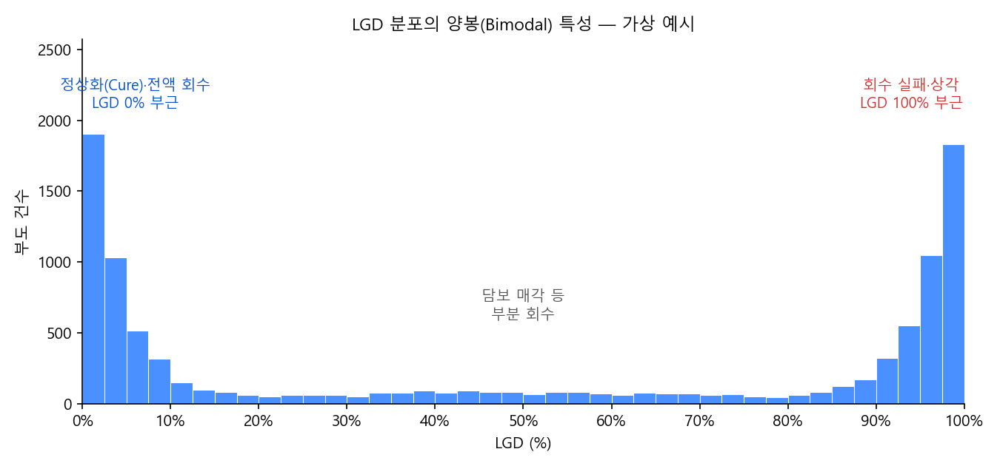

# LGD — Loss Given Default

PD가 "이 사람이 부도날 확률"이라면,
LGD는 **"부도가 났을 때 얼마를 못 받는가"** — 부도 시 손실률이다.

$$
\text{LGD} = 1 - \text{회수율(Recovery Rate)}
$$

---

## PD와 LGD의 근본적 차이

PD와 LGD는 같은 EL 산식의 구성 요소이지만, **만들어지는 방식과 쓰이는 방식이 크게 다르다.**

| | PD | LGD |
|---|---|---|
| **질문** | 부도가 날까? | 부도 나면 얼마나 잃을까? |
| **대상** | 모든 차주 (부도 전) | **부도가 난 건만** (부도 후) |
| **결정 요인** | 차주의 신용도 | **담보, 채권 순위, 회수 프로세스** |
| **산출** | 모형 개발 (로지스틱, GBM 등) | 과거 부도 건 회수 실적 집계 → 필요 시 모형화 |
| **적용** | 차주별 모형 스코어링 | **상품·담보 유형별 세그먼트 값**이 출발점 |
| **개별화** | 차주마다 다른 값 | 같은 세그먼트면 같은 값 (모형화하면 거래별로 달라짐) |

핵심은 이것이다.

- PD는 **예측 모형** — 신규 차주가 오면 모형을 돌려서 개별 값을 산출
- LGD는 **세그먼트 값에서 출발** — 상품·담보 유형별로 과거 회수 실적을 집계한 값을 쓰고, 데이터가 충분하면 거래별 모형으로 세분화

같은 사람이라도 주택담보대출과 신용대출의 LGD는 완전히 다르다.
차주(사람)보다 **거래(deal)**의 특성이 LGD를 지배하기 때문이다.

---

## 1. 관측 LGD (Workout LGD) — 회수 실적에서 산출

### 회수율과 LGD

10만 명의 차주에게 대출이 나갔고, 이 중 10%(1만 명)가 부도를 냈다고 하자.
이 1만 건 각각에 대해, 부도 이후 실제로 얼마를 회수했는지를 추적한다.

$$
\text{회수율} = \frac{\text{순회수액(총회수 − 비용)}}{\text{부도 시점 대출 잔액(EAD)}}
$$

$$
\text{LGD} = 1 - \text{회수율}
$$

분모는 부도 시점에 빌려준 잔액(EAD), 분자는 회수 비용을 제외하고 순수하게 들어온 금액이다.
이 비율이 **회수율**이고, 그 반대편이 **LGD**이다.

### 한 건의 예시

| 항목 (차주 A — 주택담보대출, 가상 예시) | 금액 |
|---|---:|
| 부도 시점 잔액(EAD) | 5,000만 원 |
| 담보 매각 | 3,000만 원 |
| 추심 회수 | 500만 원 |
| 회수 비용(법률, 경매) | −300만 원 |
| **순회수액** | **3,200만 원** |
| 회수율 | 3,200 ÷ 5,000 = 64% |
| **LGD** | **36%** |

### 회수는 한 번에 끝나지 않는다

부도가 발생하면 회수가 수개월~수년에 걸쳐 진행된다.

| 시점 (부도 후) | 사건 | 회수액 |
|---|---|---:|
| 0개월 | 부도, EAD = 5,000만 원 | — |
| 3개월 | 담보 매각 착수 | — |
| 6개월 | 담보 매각 완료 | 3,000만 원 |
| 12개월 | 추심 회수 | 300만 원 |
| 18개월 | 추심 회수 | 200만 원 |
| 24개월 | 회수 종결 (잔여 상각) | — |

시간이 지나서 받은 돈은 현재 가치가 떨어지므로,
실무에서는 회수 현금흐름을 **부도 시점 기준으로 할인**한다. Basel도 LGD 산정 시 손실을 회계상 손실이 아닌
**경제적 손실**로 보고, 할인 효과와 직간접 회수 비용을 반영하도록 요구한다(CRE36.77).

$$
\text{Workout LGD} = 1 - \frac{\displaystyle\sum_{k} \frac{R_k}{(1+r)^{t_k}}}{\text{EAD}}
$$

- \(R_k\): \(k\)번째 회수 금액 (비용 차감 후)
- \(t_k\): 부도 시점부터 그 회수까지의 기간 (**연 단위**, 예: 18개월 = 1.5)
- \(r\): 연 할인율 (계약금리, 실효금리 또는 위험을 반영한 할인율)

할인하면 회수액의 현재가치가 줄어드니 LGD가 올라간다.
회수가 오래 걸릴수록 더 올라간다.

### LGD 분포의 특수성 — 양봉(Bimodal)

PD 모형의 타겟은 0/1이지만, 부도 건별 LGD 값은 0%와 100% 사이에 분포한다.
그 분포는 **"거의 다 회수"와 "거의 못 회수"** 양쪽에 몰리는 양봉 형태가 흔하다.

양봉의 주된 원인은 **부도 이후의 결말이 크게 둘로 갈린다**는 데 있다.

- **왼쪽 봉 (LGD ≈ 0%)** — 부도 후 연체를 해소하고 정상으로 돌아온 경우(Cure), 또는 담보로 전액 회수한 경우
- **오른쪽 봉 (LGD ≈ 100%)** — 회수에 실패해 대부분을 상각한 경우
- **가운데** — 담보 매각 등으로 일부만 회수한 경우

담보 유무는 어느 봉으로 갈지에 영향을 주는 중요한 요인이지만, 봉 자체를 만드는 것은 Cure와 상각이라는 결말의 이분성이다.
이 특성 때문에 평균값 하나로 대표하기 어렵고, 일반적인 회귀 모형을 그대로 적용하기도 어렵다(아래 4절의 2단계 모형).

---

## 2. LGD 테이블 — 실무에서의 적용

### 테이블 구축

과거 수년간의 부도 건 회수 실적을 **상품·담보 유형별**로 집계한다.
아래 값은 구조를 보여주기 위한 **가상 예시**이다.

| 상품 유형 | 담보 유형 | 채권 순위 | 관측 LGD (평균, 가상) |
|---|---|---|:---:|
| 주택담보대출 | 부동산 | 선순위 | 25% |
| 자동차 할부 | 차량 | 선순위 | 40% |
| 개인 신용대출 | 없음 | 선순위 | 70% |
| 신용카드 | 없음 | 선순위 | 80% |
| 기업대출 | 부동산 | 선순위 | 30% |
| 기업대출 | 없음 | 선순위 | 65% |
| 기업대출 | 없음 | 후순위 | 85% |

PD가 **등급별**로 묶인다면, LGD는 **상품·담보 유형별**로 묶인다.

### 신규 대출에 적용

등급별 PD는 [PD 페이지](pd.md)의 레벨링 예시(TtC PD)를 쓴다.

| | 김철수 — 주택담보대출 | 박영희 — 개인 신용대출 |
|---|---|---|
| PD | 3등급 → 1.8% | 5등급 → 4.6% |
| LGD | 주택담보 + 선순위 → 25% | 무담보 + 선순위 → 70% |
| EAD | 대출 잔액 2억 원 | 대출 잔액 3,000만 원 |
| **EL** | 0.018 × 0.25 × 2억 = **90만 원** | 0.046 × 0.70 × 3,000만 = **96.6만 원** |

PD는 차주마다 모형을 돌려서 다른 값이 나오지만,
LGD는 같은 상품·담보 유형이면 같은 값을 쓴다.

---

## 3. LGD의 층위 — 목적에 따라 다른 값

PD에 등급별 PD / TtC PD / PiT PD가 있었듯이,
LGD도 목적에 따라 다른 버전이 존재한다.

### Downturn LGD — Basel이 요구하는 것

PD에서 Basel은 장기 평균(TtC)을 요구했지만,
자체 추정 LGD는 **경기 하강기 상황을 반영**해야 하며 장기 부도가중 평균 손실률보다 낮을 수 없다(CRE36.85).

이유는 **PD와 LGD가 함께 오르는 경향**이 있기 때문이다.

- 경기 악화 → 부도 건수 증가
- 동시에 담보(특히 부동산) 가격 하락 → 담보 매각 회수율 하락
- 부실채권이 시장에 몰림 → 매각 가격도 하락

부도가 몰리는 시기에 담보 가치도 함께 떨어지는 것 — PD와 LGD의 **양의 상관관계** —
을 평균 LGD로는 포착할 수 없다.

| 기간 (가상 예시) | 담보대출 평균 LGD |
|---|:---:|
| 평시 | 25% |
| 경기 하강기 | 42% ← Downturn LGD |

### PiT LGD — IFRS 9가 요구하는 것

PiT PD와 같은 논리이다. 현재와 예상 경기를 반영한다.

$$
\text{PiT LGD} \approx \text{기본 LGD} \times g(\text{부동산 가격지수},\; \text{GDP},\; \ldots)
$$

특히 담보대출의 경우 **부동산 가격 전망**이 직접적 영향을 준다.
부동산이 빠지면 담보 매각 회수액이 줄어들기 때문이다. 곱셈식은 개념 표현이며, 실제로는 담보가치 하락 시나리오를 회수 현금흐름에 직접 반영하는 방식이 많이 쓰인다.

### 감독 기준값과 자체 추정

Basel 내부등급법에서 LGD를 어떻게 정하는지는 **자산군**에 따라 다르다.

**기업·금융기관·국가 익스포저** — 기본 내부등급법(F-IRB)에서는 감독 기준값을 쓴다.

| 구분 (F-IRB, 담보 미인정) | Basel III 최종안 (CRE32.6~32.7) |
|---|:---:|
| 선순위 — 국가·은행·증권사 등 금융기관 | **45%** |
| 선순위 — 그 밖의 기업 | **40%** |
| 후순위 | **75%** |
| 담보 인정 시 | 담보 유형별 공식으로 차등 |

Basel II에서는 기업 선순위 무담보도 45%였으나, Basel III 최종안에서 비금융 기업은 40%로 낮아졌다.
LGD까지 자체 추정하는 고급 내부등급법(A-IRB)을 쓰려면 기업 익스포저는 **최소 7년**, 가능하면 경기 한 사이클 이상의 관측 데이터가 필요하다(CRE36.89).

**리테일 익스포저** — F-IRB가 **없다.** 내부등급법을 쓰는 은행은 풀(pool)별 PD와 LGD를 자체 추정해야 하고(CRE32.58),
관측 기간은 최소 5년이다(CRE36.90). 대신 Basel III 최종안은 자체 추정 LGD에 하한을 둔다.

| 리테일 LGD 하한 (CRE32.58) | 무담보 | 담보 |
|---|:---:|:---:|
| 주택담보대출 | — | 5% |
| 적격 리볼빙(QRRE, 신용카드 등) | 50% | — |
| 그 밖의 리테일 | 30% | 담보 유형별 0~15% |

개인(소매) 신용평가 맥락에서는 "규제값을 가져다 쓴다"는 선택지가 없다는 점이 중요하다.

출처: <a href="https://www.bis.org/basel_framework/chapter/CRE/32.htm" target="_blank">Basel Framework CRE32 · IRB approach: risk components (32.6, 32.7, 32.58)</a>,
<a href="https://www.bis.org/basel_framework/chapter/CRE/36.htm" target="_blank">CRE36 · minimum requirements (36.77, 36.85, 36.89, 36.90)</a>

### 층위 종합

| | 관측 LGD | Downturn LGD | PiT LGD | F-IRB 감독 기준값 |
|---|---|---|---|---|
| **기준** | 회수 실적 | 경기 하강기 반영 | 현재·예상 경기 반영 | 감독당국 고정값 |
| **성격** | 사실 기록 | 보수적 (높게) | 시점 변동 | 일률적 |
| **용도** | 모형 개발·검증 | Basel 자기자본 (자체 추정) | IFRS 9 충당금 | Basel 자기자본 (기업 F-IRB만) |

---

## 4. LGD 모델링 — PD 모형과 무엇이 다른가

### 문제 구조의 차이

PD 모형은 **이진 분류**(부도 0/1)이지만, LGD는 **0~1 사이 연속값을 예측하는 회귀** 문제이다.

| | PD 모형 | LGD 모형 |
|---|---|---|
| **대상** | 모든 차주 (예: 10만 명) | 부도난 건만 (예: 1만 건) |
| **타겟** | 부도 여부 (0 or 1) | 손실률 (0% ~ 100%, 연속값) |
| **문제 유형** | 이진 분류 | 회귀 |
| **타겟 분포** | 0/1 불균형 (부도가 소수) | **양봉** (0% 근처 + 100% 근처) |

### 변수의 차이

**쓰는 변수가 다르다.** PD는 사람 변수, LGD는 거래·담보 변수가 지배적이다.

| | PD 모형 | LGD 모형 |
|---|---|---|
| **차주 정보** | 핵심 (소득, 연체이력, 부채 수준) | 보조적 |
| **담보 정보** | 보조적 (담보 유무 정도) | **핵심** (담보 유형, LTV, 감정가) |
| **채권 정보** | 거의 안 씀 | **핵심** (선순위/후순위, 익스포저 규모) |
| **거시경제** | PiT 조정 시 사용 | **중요** (부동산 가격, 경기) |
| **회수 관련** | 해당 없음 | 과거 Cure 이력, 회수 소요 기간 |

### 모델링 접근법

#### 접근 1: 세그먼트(풀) 평균

모형을 만들지 않는다. 상품·담보 유형별로 과거 회수 실적의 평균을 쓴다.

| 세그먼트 (가상 예시) | 평균 LGD |
|---|:---:|
| 주택담보 + LTV 60% 이하 | 15% |
| 주택담보 + LTV 60~80% | 25% |
| 주택담보 + LTV 80% 초과 | 35% |
| 신용대출 | 70% |

단순하고 설명이 쉬워 LGD 추정의 출발점으로 많이 쓰인다.
세그먼트를 잘게 나눌수록 거래별 모형에 가까워지지만, 세그먼트당 부도 건수가 줄어 추정이 불안정해진다.

#### 접근 2: 2단계 모형 (Two-Stage Model)

양봉 분포를 정면으로 다루는 대표적인 방법이다.

**1단계 — Cure 모형 (이진 분류)**

부도난 차주 중 일부는 연체를 해소하고 정상으로 돌아온다(Cure).
Cure되면 LGD ≈ 0%이므로, 먼저 Cure 여부를 분류한다.

- 타겟: Cure 여부 (0 or 1) — PD 모형과 동일한 구조
- 방법론: 로지스틱 회귀 등
- 변수: 연체 금액, 연체 기간, 과거 Cure 이력, 담보 유무 등

**2단계 — Loss 모형 (회귀)**

Non-Cure 건에 대해서만 실제 손실률을 예측한다.

- 대상: Non-Cure 건만
- 타겟: LGD (0~1 연속값)
- 방법론: Beta 회귀, 분수 반응(fractional response) 회귀, 트리 기반 회귀 등

**최종 결합:** Cure 건의 LGD를 0으로 둘 때

$$
\text{LGD} = (1 - P(\text{Cure})) \times \text{E}[\text{LGD} \mid \text{Non-Cure}]
$$

Cure 확률이 40%, Non-Cure 시 평균 LGD가 65%라면 \(\text{LGD} = 0.6 \times 0.65 = 39\%\)이다.

#### 접근 3: Beta 회귀

LGD가 0~1 사이 값이므로, 0~1 구간에서 정의되는 Beta 분포를 사용한다.
일반 OLS는 예측값이 0 미만이나 1 초과가 나올 수 있지만,
Beta 회귀는 예측값이 (0, 1) 안에 머문다. 다만 Beta 분포는 정확히 0이나 1인 값을 다룰 수 없어,
LGD가 정확히 0%·100%인 건이 많으면 값을 약간 조정하거나 2단계 모형과 결합해야 한다.

#### 접근 4: 트리 기반 회귀

PD에서 GBM 분류기를 쓰듯, LGD에서는 **GBM 회귀**를 쓸 수 있다.
분포 가정이 없어 양봉도 유연하게 다룰 수 있지만,
해석 가능성 문제는 PD 모형과 동일하고, 부도 건수가 적어 과적합 위험이 더 크다.

### 접근법 비교

| 접근법 | 복잡도 | 장점 | 한계 |
|---|:---:|---|---|
| 세그먼트 평균 | 낮음 | 단순, 설명 용이, 적은 데이터로 가능 | 세그먼트 내 차이 무시 |
| 2단계 모형 | 중간 | 양봉 구조를 직접 반영, Cure·Loss 분리가 직관적 | 두 모형의 오차가 누적 |
| Beta 회귀 | 중간 | 0~1 범위 보장 | 정확히 0·1인 값 처리 필요 |
| 트리 기반 회귀 | 높음 | 비선형·상호작용 포착 | 해석 가능성, 소표본 과적합 |

LGD는 표본이 부도 건으로 한정되고 회수가 끝나기까지 오래 걸리므로,
거래별 모형을 갖추려면 PD보다 긴 데이터 축적이 필요하다.

---

## 5. LGD 모형화가 PD보다 어려운 이유 — 요약

| 문제 | 설명 |
|---|---|
| **데이터 부족** | 부도 건만 대상이므로 PD 모형보다 표본이 훨씬 적음 |
| **양봉 분포** | 0%와 100% 근처에 몰림 → 일반 회귀 모형 적합 어려움 |
| **회수 미완료 (Censoring)** | 아직 회수 진행 중인 건 → 최종 LGD를 아직 모름 |
| **회수 기간** | 담보 처분과 법적 절차에 수년이 걸리기도 함 → 데이터 완성에 시간 소요 |
| **경기 의존성** | 같은 담보라도 매각 시점 경기에 따라 회수율이 크게 다름 |

!!! info "Censoring과 생존분석"
    회수가 끝나지 않은 건(censored observation)을 버리면, 회수가 빨리 끝난 건만 남아 LGD가 한쪽으로 치우친다.
    이를 다루기 위해 생존분석(survival analysis)의 아이디어를 쓰는 연구가 있다.
    회수 현금흐름을 시간 축의 위험률로 모형화해 미완료 건의 남은 회수를 추정하거나,
    "끝내 회수되지 않는(또는 반드시 정상화되는) 집단"이 섞여 있다고 보는 **mixture cure model**처럼
    생존 모형에 두 집단의 혼합을 넣는 방식이 대표적이다.
    2단계 모형이 Cure 여부를 먼저 분류한다는 발상과 닮았지만, 시간 축과 미완료 건을 함께 다룬다는 점이 다르다.
