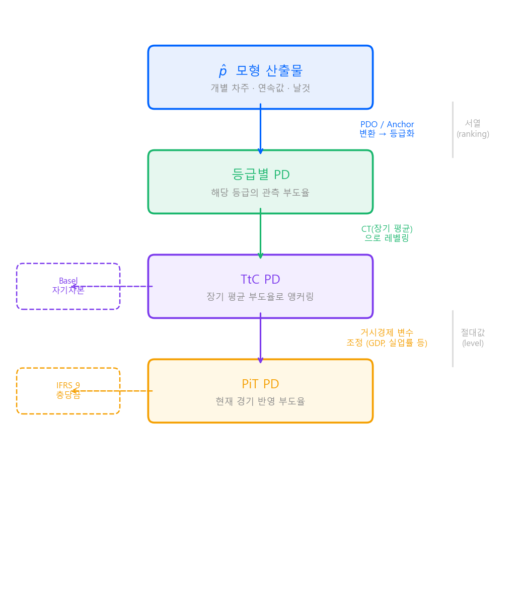
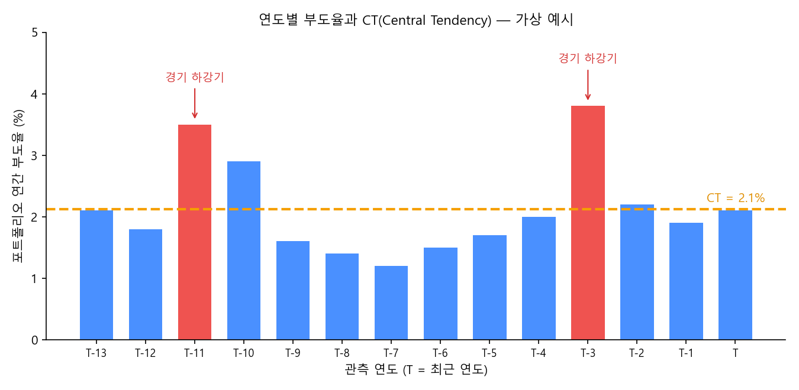
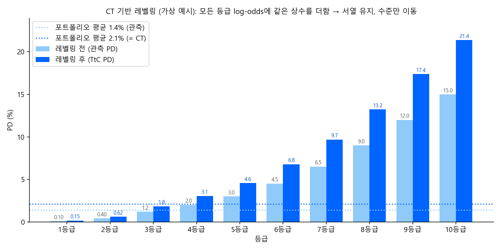

# PD — Probability of Default

"PD"는 여신 프로세스의 거의 모든 단계에서 등장하지만,
**맥락에 따라 가리키는 대상이 다르다.**
이 페이지에서는 "PD"라는 단어가 실무에서 어떤 층위로 쓰이는지 정리한다.

---

## PD의 네 가지 층위

---

## 1. 모형 산출물 p̂

모형이 log-odds 공간에서 학습한 결과를 sigmoid 함수를 통해
\((0, 1)\) 확률 공간으로 변환한 **날것의 확률값**이다.

$$
\hat{p} = \frac{1}{1 + e^{-(\beta_0 + \beta_1 x_1 + \cdots + \beta_k x_k)}}
$$

- 로지스틱 회귀든 GBM이든, 모형이 개별 차주에 대해 내놓는 연속값
- 이 단계에서는 아직 "PD"라고 부르기보다 **p̂(피햇)**이 정확한 표현
- 관심사는 **서열(ranking)** — 누가 더 위험한지 줄을 잘 세우는 것

!!! note "가이드북에서의 위치"
    [스코어카드 Part 2 — Logit 변환](../../scorecard/part2_theory/logit-transform.md)에서
    log-odds → sigmoid → p̂ 변환 과정을 다루고 있다.

---

## 2. 등급별 PD — 관측 부도율

p̂을 실무에서 바로 쓰지는 않는다. 두 단계의 변환을 거친다.

### 평점(Score) 변환

p̂을 PDO(Points to Double the Odds)와 기준점(Anchor) 개념으로
사람이 읽기 편한 **정수 점수**로 변환한다. 점수는 "높을수록 우량"이 되도록 **Good Odds** 기준으로 만든다.

$$
\text{Score} = \text{Offset} + \text{Factor} \times \ln(\text{Good Odds}),
\qquad \ln(\text{Good Odds}) = \ln\frac{1-\hat p}{\hat p} = -\,\text{logit}(\hat p)
$$

여기서 \(\text{Factor} = \frac{\text{PDO}}{\ln 2}\)이고, Offset은 기준점(예: 특정 Odds에서의 목표 점수)으로 정한다.
모형은 Bad Odds(불량/정상)로 적합하므로, 점수로 바꿀 때 부호를 뒤집어 Good Odds(정상/불량)로 전환하는 것이다.

!!! note "가이드북에서의 위치"
    [스코어카드 Part 5 — 스코어카드 변환 & 등급화](../../scorecard/part5_scorecard/scorecard-and-rating.md)에서
    PDO 변환과 등급화 과정을 다루고 있다.

### 등급화

평점 분포를 구간으로 나누어 1~10등급(또는 기관별 등급 체계)으로 매핑한다.
등급 경계는 등급별 구성비가 지나치게 쏠리지 않는지, 등급이 내려갈수록 불량률이 단조 증가하는지,
인접 등급 간 불량률 차이가 충분한지 등을 기준으로 정한다.
각 등급에 속한 차주들의 **관측 부도율**이 곧 **등급별 PD**가 된다.

| 등급 | 평점 구간 (예시) | 해당 등급 관측 부도율 (예시) |
|:---:|:---:|:---:|
| 1등급 | 850 ~ 1000 | 0.10% |
| 2등급 | 750 ~ 849 | 0.40% |
| 3등급 | 650 ~ 749 | 1.20% |
| 4등급 | 600 ~ 649 | 2.00% |
| 5등급 | 550 ~ 599 | 3.00% |
| 6등급 | 500 ~ 549 | 4.50% |
| 7등급 | 450 ~ 499 | 6.50% |
| 8등급 | 400 ~ 449 | 9.00% |
| 9등급 | 300 ~ 399 | 12.0% |
| 10등급 | ~ 299 | 15.0% |

이 "등급별 PD"는 **모형 개발 대상자**(개발 표본)에서 관측한 부도율이거나,
이후 운영 시 **back rating**(과거 시점 차주를 현재 모형으로 재평가)을 통해 산출한 해당 집단의 부도율이다.
다운샘플링한 개발 표본이라면 표본 불량률이 모집단과 다르므로, 모집단 기준으로 되돌린 부도율을 써야 한다.

### 한계

등급별 PD는 **관측 시점의 경기 상황이 그대로 묻어 있다.**

- 호황기에 관측하면 PD가 낮게 나옴
- 불황기에 관측하면 PD가 높게 나옴

이 한계를 목적에 맞게 보정한 것이 아래의 TtC PD와 PiT PD이다.

---

## 3. TtC PD — Through-the-Cycle PD

### 왜 필요한가

Basel 내부등급법(IRB)은 등급별 PD를 **1년 부도율의 장기 평균**(long-run average of one-year default rates)으로 추정하도록 요구한다(Basel Framework CRE36.63, 소매는 CRE36.82).
규제자본의 목적이 **어떤 경기 국면이든 버틸 수 있는 완충 장치**이기 때문이다.

- 호황기: 실제 부도율 1% → TtC PD는 2.5% → 자본을 넉넉히 쌓아둠
- 불황기: 실제 부도율 5% → TtC PD는 여전히 2.5% → 자본을 급격히 늘리지 않아도 됨

PD가 경기에 따라 출렁이면, 불황에 자본을 더 쌓아야 하고 → 대출을 줄이고 → 경기가 더 나빠지는
**경기순응성(procyclicality)** 문제가 생긴다. TtC PD는 이를 완화한다.

### CT (Central Tendency)

TtC PD의 기준점이 되는 **장기 평균 부도율**을 CT라고 한다.

- **CT**: 경기 순환 주기(Through-the-Cycle) 전체를 아우르는 장기 평균 부도율. 위 예시에서는 14개년 평균 2.1%
- **관측 기간**: Basel은 PD 추정에 쓰는 과거 관측 기간을 최소 5년으로 정하고, 더 긴 관련 데이터가 있으면 그 기간을 쓰도록 한다(CRE36.80, 리테일은 CRE36.83).
  최소 기준만으로는 경기 한 사이클을 다 담지 못할 수 있으므로, 실무에서는 호황과 불황을 모두 포함하도록 가능한 한 긴 시계열(흔히 "CT 셋")을 구축한다.

출처: <a href="https://www.bis.org/basel_framework/chapter/CRE/36.htm" target="_blank">Basel Framework CRE36 · IRB approach: minimum requirements (36.64, 36.80, 36.83)</a>

!!! info "기업 모형에서 CT가 특히 중요한 이유"
    개인(Retail)과 달리 기업(Corporate) 데이터는 두 가지 특수성이 있다.

    1. **부도가 드물다** — 특히 대기업·금융기관처럼 부도 사례가 매우 적은 포트폴리오(Low Default Portfolio)는 1~2년 치로 부도율을 추정하기 어렵다.
    2. **경기를 많이 탄다** — 업종에 따라 호황과 불황의 부도율 차이가 크다.

    호황기 데이터만으로 모형을 만들면 PD를 과소평가하는 위험이 발생한다.
    리테일은 부도 건수가 충분해 CT를 별도 절차로 세우지 않는 경우도 있지만,
    규제 PD가 장기 평균 수준이어야 한다는 요구는 기업·리테일 모두에 적용된다.

### 레벨링 (Calibration)

모형 개발은 최근 데이터로 하되, **PD 수준은 CT에 맞추는** 과정이다.

> **변별력(Ranking)은 최근 데이터로, 레벨(Level)은 장기 데이터(CT)로.**

로지스틱 회귀의 경우 **상수항(intercept)만 조정**하여 포트폴리오 평균 PD가 CT에 맞도록 한다.
모든 차주의 log-odds에 같은 상수 \(\delta\)를 더하는 것과 같다.

$$
\text{조정 전: } \ln\frac{p}{1-p} = \beta_0 + \beta_1 x_1 + \cdots \quad \Rightarrow \quad \text{포트폴리오 평균 PD} = 1.4\%
$$

$$
\text{조정 후: } \ln\frac{p}{1-p} = (\beta_0 + \delta) + \beta_1 x_1 + \cdots \quad \Rightarrow \quad \text{포트폴리오 평균 PD} = 2.1\% \;(= \text{CT})
$$

변수 계수(\(\beta_1, \beta_2, \ldots\))는 건드리지 않으므로 **서열은 그대로, 수준만 이동**한다.
sigmoid가 비선형이므로 평균 PD를 정확히 맞추는 \(\delta\)는 수치적으로 구한다.
아래 가상 예시(등급 구성비가 우량 등급에 몰린 포트폴리오)에서는 \(\delta \approx 0.43\), 즉 모든 등급의 Odds가 약 1.54배가 된다.
Odds를 같은 배수로 키우는 것이므로 PD가 낮은 등급일수록 PD도 거의 같은 배수(1.5배 남짓)로 오르고, PD가 높은 등급에서는 배수가 조금 작아진다.

!!! tip "ML 모형의 레벨링"
    GBM 같은 ML 모형도 원시 출력(raw margin)은 log-odds이므로, 로지스틱 회귀와 똑같이 모든 차주의 출력에
    상수 \(\delta\)를 더해 수준을 옮길 수 있다.
    다만 실무에서는 모형 출력을 건드리기보다 **등급 매핑 단계에서 보정**하는 방식이 더 흔하다.

    - ML 모형의 p̂으로 **서열**을 만들고
    - 등급별 PD를 붙일 때 **CT 기준 테이블**을 사용

    즉 모형 자체는 두고, 등급별 PD 숫자만 CT 기준으로 교체한다.
    모형이 LR이든 GBM이든 **서열은 모형이, 레벨은 등급 테이블이 잡는다**는 구조는 동일하다.

레벨링 후 각 등급의 PD가 CT 기준으로 재산출되며, 이것이 **TtC PD**이다.
아래 예시에서 3등급은 1.2% → 1.8%, 5등급은 3.0% → 4.6%가 된다.
[LGD](lgd.md)·[EAD](ead.md) 페이지의 신용원가 예시는 이 TtC PD를 쓴다.

---

## 4. PiT PD — Point-in-Time PD

### 왜 필요한가

IFRS 9 (2018년~)는 TtC PD와 **반대 방향**의 요구를 한다.
기대신용손실은 과거 정보뿐 아니라 **현재 상황과 미래 경제 상황에 대한 합리적이고 뒷받침 가능한 예측**을 반영해,
여러 가능한 결과를 확률로 가중한 편의 없는 금액이어야 한다(IFRS 9 5.5.17).

배경은 2008년 금융위기이다.
이전 회계기준(IAS 39)은 **발생 손실(Incurred Loss)** — 손실 사건이 실제로 일어나야 충당금을 잡는 구조였고,
손실 인식이 "너무 적게, 너무 늦게(too little, too late)" 이루어진다는 비판을 받았다.

IFRS 9는 이를 뒤집어서 **기대신용손실(Expected Credit Loss, ECL)** —
아직 손실 사건이 일어나지 않았어도 예상되는 손실을 미리 충당금으로 잡도록 했다.

TtC PD는 경기 중립적이므로 경기가 나빠져도 PD가 잘 움직이지 않는다.
하지만 IFRS 9는 "경기가 나빠질 것으로 예상되면 충당금을 더 쌓아라"를 원하므로, **현재와 예상 경기를 반영하는 PiT PD**가 필요하다.

### 산출 방식

TtC PD(또는 등급별 PD)를 출발점으로, **거시경제 전망을 반영하여 조정**하는 방식이 흔하다.
개념적으로 쓰면 다음과 같다.

$$
\text{PiT PD} \approx \text{TtC PD} \times f(\text{GDP 성장률},\; \text{실업률},\; \text{금리},\; \ldots)
$$

| 경기 국면 | 3등급 TtC PD | 조정 계수 | PiT PD | 충당금 |
|---|:---:|:---:|:---:|---|
| 호황기 | 1.8% | × 0.7 | 1.26% | 적게 |
| 평시 | 1.8% | × 1.0 | 1.80% | 보통 |
| 불황기 | 1.8% | × 1.8 | 3.24% | 많이 |

위 곱셈식은 개념 설명용이다. PD에 계수를 곱하면 PD가 높은 등급에서 1을 넘을 수 있으므로,
실무에서는 log-odds나 probit 공간에서 경기 요인만큼 이동시키는 방식(예: Vasicek 단일요인 모형의 체계적 요인 Z를 시나리오별로 조정)이나
거시변수와 부도율의 관계를 따로 추정한 위성모형(satellite model)을 쓴다.
또한 IFRS 9는 **복수의 경기 시나리오**(예: 기본·낙관·비관)별 ECL을 시나리오 확률로 가중 평균하도록 요구한다.

### IFRS 9 Stage 분류

| Stage | 조건 | 충당금 범위 | PD 처리 |
|---|---|---|---|
| Stage 1 | 최초 인식 이후 신용위험이 유의적으로 증가하지 않음 | 향후 **12개월** 안의 부도 사건에 따른 ECL | 12개월 PD |
| Stage 2 | 신용위험이 **유의적으로 증가**(SICR) | 전체 기간 **Lifetime ECL** | Lifetime PD |
| Stage 3 | 신용손상(부도: 90일 이상 연체 등) | Lifetime ECL | 부도 상태이므로 PD = 100%, 손실은 LGD × EAD로 결정 |

Stage 1 → 2 전환의 판단 기준(SICR)은 다음과 같다.

- **비교 대상** — 보고일 현재와 최초 인식 시점의 **잔존 기대존속기간 동안의 부도위험(Lifetime PD)** 변화를 비교한다(IFRS 9 5.5.9). "대출 실행 시점 PD 대비 현재 PD가 유의적으로 올랐는가"를 Lifetime 기준으로 보는 것이다. 실무에서는 Lifetime PD 대신 12개월 PD 변화로 근사하는 경우도 있다.
- **30일 연체 반증 가능 추정(backstop)** — 계약상 지급이 30일을 넘겨 연체되면 신용위험이 유의적으로 증가한 것으로 추정한다. 다른 합리적 정보로 반증할 수 있다(IFRS 9 5.5.11).

Stage 2로 넘어가면 12개월이 아닌 **전체 기간**에 대한 ECL을 잡아야 하므로
충당금이 크게 뛰며, PiT PD의 민감도가 매우 높은 지점이다.

Stage 3이라고 해서 반드시 개별 평가하는 것은 아니다. 기준서는 개별·집합 평가를 모두 허용하며(IFRS 9 5.5.4),
일반적으로 대형 기업 여신은 개별 평가, 리테일은 동질 집단별 집합 평가를 쓴다.

출처: <a href="https://www.legislation.gov.au/F2015L00145/2025-12-31/2025-12-31/text/original/epub/OEBPS/document_1/document_1.html" target="_blank">AASB 9 (IFRS 9와 동일 조문) 5.5.4, 5.5.9, 5.5.11, 5.5.17</a>

### ECL 계산

$$
\text{ECL} = \sum_{t} \text{PD}^{\text{marg}}_t \times \text{LGD}_t \times \text{EAD}_t \times \text{DF}_t \tag{1}
$$

- \(\text{PD}^{\text{marg}}_t\): **기간 \(t\)의 한계(무조건부) 부도확률** — 지금 시점에서 볼 때 기간 \(t\)에 처음 부도날 확률.
  생존확률 \(S(t)\)와 기간별 위험률 \(h_t\)로 쓰면 \(\text{PD}^{\text{marg}}_t = S(t-1)\cdot h_t\)이고, 이를 모두 더하면 누적(Lifetime) PD \(1 - S(T)\)가 된다
  ([Logit 변환 — Cloglog link와 Lifetime PD](../../scorecard/part2_theory/logit-transform.md) 참고)
- \(\text{LGD}_t\): 기간 \(t\)에 부도날 경우의 손실률
- \(\text{EAD}_t\): 기간 \(t\)의 부도 시 익스포저 (분할상환이면 기간이 갈수록 줄어듦)
- \(\text{DF}_t\): 할인 계수 — 미래 손실을 보고일 현재가치로 환산 (최초 유효이자율 등으로 할인)
- Stage 1은 향후 12개월 안의 부도 사건만, Stage 2는 잔존 만기 전체를 합산한다. Stage 3은 이미 부도 상태이므로 PD = 1로 둔다.

---

## 종합 비교

| | 모형 산출물 p̂ | 등급별 PD | TtC PD | PiT PD |
|---|---|---|---|---|
| **기준** | 개별 차주의 모형 출력 | 관측 부도율 (특정 기간) | CT (장기 평균) | TtC 또는 관측 PD + 경기 전망 조정 |
| **경기 반영** | 개발 데이터 기간에 종속 | 관측 시점에 종속 | 중립 (안정적) | 반영 (출렁임) |
| **용도** | 서열(점수·등급) 산출 | 모형 개발·검증 | Basel 자기자본 | IFRS 9 충당금 |
| **요구하는 곳** | 모형 개발팀 | 모형 개발팀 | 감독당국 (Basel) | 회계기준 (IFRS 9) |
| **목적** | 리스크 서열화 | 모형 성능·캘리브레이션 확인 | 경기순응성 완화 | 재무제표의 현실 반영 |

같은 등급 체계(서열)를 기반으로 하되,
**붙이는 PD 숫자가 목적에 따라 달라지는** 구조이다.
