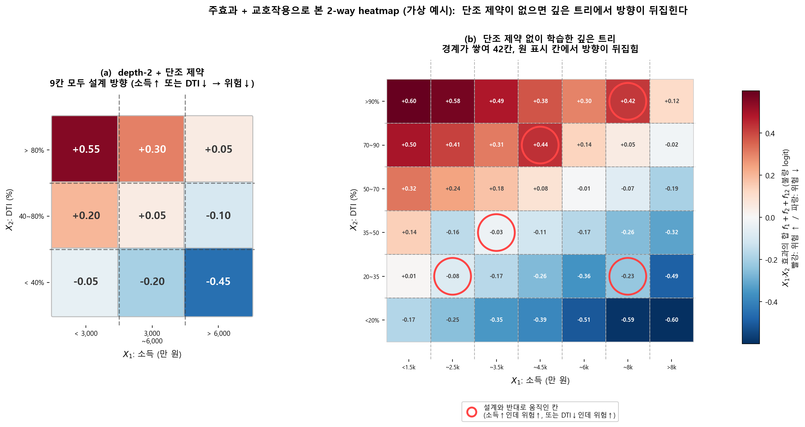
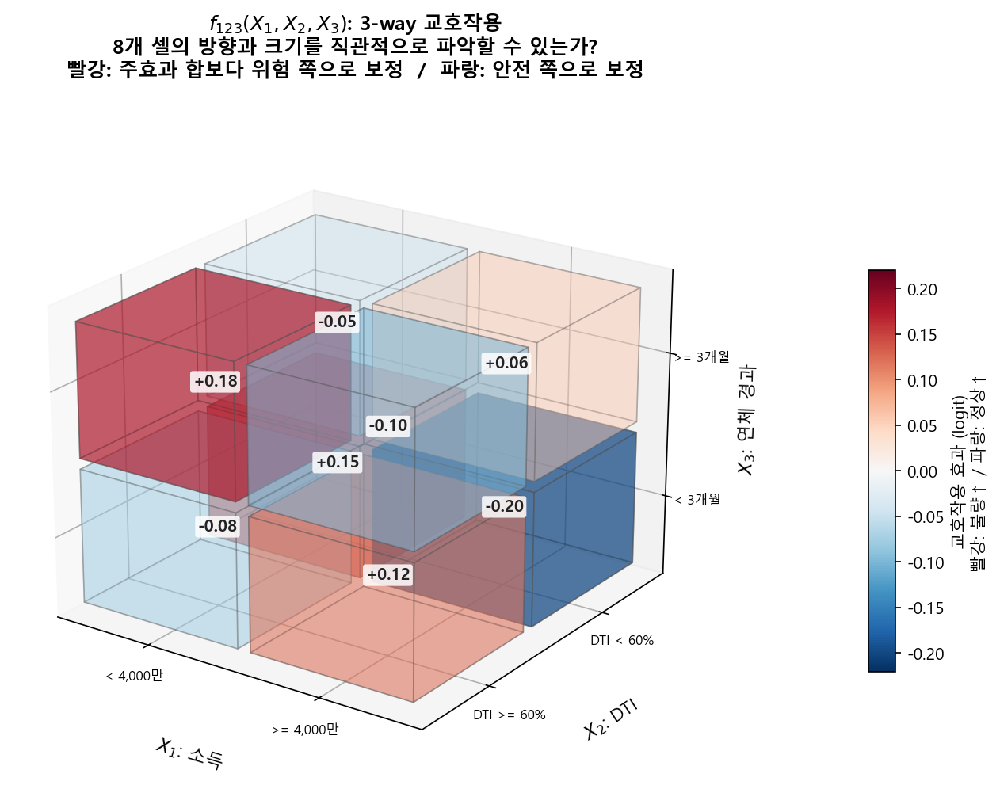

# 4. SHAP vs fANOVA — 무엇이 다른가

---

지금까지 fANOVA의 직교 분해([2절](functional-anova.md))와, 그것을 트리 모형에 사후 적용하는 purification([3절](purification.md))을 살펴보았다. 그렇다면 실무에서 훨씬 많이 쓰이는 **SHAP**은 같은 문제를 어떻게 처리하는가? 이 절에서는 두 프레임워크의 근본적 차이를 정리하고, 각각이 적합한 상황을 비교한다.

## 핵심 차이: 분배 vs 분리

SHAP과 fANOVA는 모두 "변수별 기여"를 구하지만, **교호작용(interaction)을 처리하는 방식**이 근본적으로 다르다. 한 문장으로 요약하면: **SHAP은 교호작용을 변수들에게 나눠주고, fANOVA는 교호작용을 별도의 항으로 분리한다.**

| | **SHAP** | **Functional ANOVA** |
|---|---|---|
| 사상(思想) | **분배**(distribute) | **분리**(decompose) |
| 교호작용 처리 | 관여한 변수들에게 **나눠 줌** (독립 가정의 interventional SHAP에서는 정확히 균등 분배) | 별도의 **교호작용 항으로 분리** |
| 결과물 | 변수당 하나의 숫자 \(\phi_j\) | 주효과 \(f_j\) + 교호작용 \(f_{jk}\) + ... |
| 해석 단위 | **개별 샘플** (local) | **함수 전체** (global), 교호작용 차수가 낮으면 local도 가능 |
| 분포 의존성 | 가치함수(observational/interventional)와 배경 분포에 의존 | 측도(product/joint) 선택에 의존 |
| 공통 한계 | **분포 선택이 값을 바꾼다** | **분포 선택이 분해를 바꾼다** |

이 표만으로는 차이가 와닿지 않을 수 있다. 구체적인 예시로 각 항목이 실제로 무엇을 의미하는지 확인하자.

## 교호작용은 어디로 가는가?

두 변수 \(X_1\)(소득)과 \(X_2\)(부채)가 교호작용을 일으킨다고 하자. 즉, 소득이 높고 부채가 낮을 때 부도 확률이 **비선형적으로** 급감하는 시너지 효과가 있다.

**SHAP의 처리:**

SHAP은 교호작용의 기여분을 관여한 변수들에게 **나눠준다.** 이 관계는 다음 조건에서 정확한 식으로 쓸 수 있다: (1) SHAP의 가치함수가 interventional 방식이고, (2) 배경 분포가 변수 독립(product measure)이며, (3) fANOVA 분해도 같은 product measure로 한 경우. 이때 고객 \(\mathbf{x}\)에 대한 변수 \(j\)의 SHAP 값은

$$
\phi_j(\mathbf{x}) = \sum_{S \ni j} \frac{f_S(\mathbf{x}_S)}{|S|}
= f_j(x_j) + \frac{1}{2}\sum_{k \neq j} f_{jk}(x_j, x_k) + \frac{1}{3}\sum_{k<l} f_{jkl}(x_j, x_k, x_l) + \cdots
\tag{1}
$$

이다 (Herren, Hahn 외, arXiv:2208.09970; Hiabu, Meyer & Wright, 2023). 주효과는 그 변수가 전부 갖고, 2-way 교호작용은 반씩, 3-way는 1/3씩 — Shapley Value의 대칭성 공리가 교호작용을 관여한 변수들에게 **균등하게** 나누는 것이다. 소득(\(X_1\))과 부채(\(X_2\)) 두 변수라면:

$$
\phi_1 = f_1(x_1) + \tfrac{1}{2} f_{12}(x_1, x_2), \qquad
\phi_2 = f_2(x_2) + \tfrac{1}{2} f_{12}(x_1, x_2)
$$

위 조건이 깨지면 — 예를 들어 배경 데이터가 실제 데이터(상관 있음)이거나, TreeSHAP의 기본값인 path-dependent 방식을 쓰면 — 식 (1)은 근사적인 직관으로만 성립한다. 같은 모형·같은 고객이라도 가치함수에 따라 SHAP 값이 달라지는 수치 예시는 [부록 B 3절](../correlation-interpretation/shap-two-modes.md)에서 다룬다.

이렇게 하면 모든 기여가 **변수 수만큼의 숫자**로 깔끔하게 떨어진다. 개별 고객의 예측을 설명하기에는 편리하다. "이 고객의 부도 확률이 높은 이유는 소득 -0.3, 부채 +0.5, ..." 식으로 말할 수 있으니까.

하지만 대가가 있다. 교호작용이 분배되어 녹아들기 때문에, **소득이 동일한 두 차주라도 소득의 SHAP 값이 다를 수 있다.**

> 차주 A: 소득 5,000만 원, 부채 500만 원 → 소득의 SHAP = **-0.8** (부도↓ 크게 기여)
>
> 차주 B: 소득 5,000만 원, 부채 2억 원 → 소득의 SHAP = **-0.2** (부도↓ 약하게 기여)

소득은 같은데 SHAP 값이 다르다. 차주 A에서는 "고소득+저부채" 시너지가 크게 작동하여 소득에 분배되는 교호작용 기여분이 크고, 차주 B에서는 시너지가 약해서 소득의 몫이 줄어든다.

이것이 SHAP이 기본적으로 **local(개별 샘플) 해석** 도구인 이유다. SHAP 값을 모아 dependence plot이나 `mean(|SHAP|)` 같은 global 요약을 만들 수는 있지만, 같은 소득이라도 샘플마다 값이 퍼져 있으므로 "소득의 효과는 이 곡선 하나다"라고 **깔끔하게 말하기는 어렵다.**

!!! warning "SHAP의 교호작용 함정"
    변수별 SHAP 값 \(\phi_j\)에는 교호작용의 몫이 **녹아들어** 있기 때문에, \(\phi_j\)만 보고는 **교호작용이 얼마나 강하고 어떤 변수와 얽혀 있는지 알기 어렵다.** 같은 변수의 SHAP 값이 샘플마다 크게 요동치면 교호작용을 짐작할 수 있을 뿐이다.

    실무에서 `mean(|SHAP|)`로 변수 중요도를 구하는 것이 관행이지만, 이 숫자에는 주효과와 교호작용의 몫이 함께 들어 있다.

**SHAP interaction value로 쌍별 교호작용을 따로 볼 수는 있다.** Lundberg et al. (2020)은 트리 모형에서 변수 쌍 \((j, k)\)의 교호작용 몫 \(\Phi_{jk}\)와 순수 주효과 몫 \(\Phi_{jj}\)를 구하는 SHAP interaction value를 제안했다. 행렬의 각 행을 더하면 원래의 SHAP 값 \(\phi_j\)가 되므로, "소득의 SHAP 값 중 부채와의 교호작용 몫이 얼마인가"를 개별 고객 단위로 확인할 수 있다. 다만 이것도 개별 예측을 변수 쌍에 **나눠 준 값**이라는 점은 같다. 3-way 이상의 효과는 관련된 쌍들에 다시 나뉘어 반영되고, "모형 출력 분산의 몇 %가 교호작용인가"라는 fANOVA식 질문에 직접 답하지는 않는다.

**fANOVA의 처리:**

fANOVA는 교호작용을 분배하지 않고, **별도의 항으로 분리**한다. Integrate-to-Zero 조건([2절](functional-anova.md)의 식 5)에 의해, 주어진 측도 위에서 각 항이 **유일하게** 결정된다:

- \(f_1(X_1)\): 순수하게 소득만의 효과
- \(f_2(X_2)\): 순수하게 부채만의 효과
- \(f_{12}(X_1, X_2)\): 소득과 부채의 **순수 교호작용** — 주효과로는 설명할 수 없는 시너지

소득이 동일한 두 차주에서 \(f_1\)(소득의 순수 효과)은 **항상 같다.** 차이가 있다면 그것은 \(f_{12}\)(교호작용)에 명시적으로 나타난다 — 숨겨지지 않는다.

## 왜 이 차이가 중요한가 — 신용평가 실무 관점

**규제 심사(모형검증)에서 심사역이 묻는 질문:**

> "소득 변수의 효과가 단조적(monotonic)인가?"

이 질문에 SHAP으로 답하면:

- 소득의 SHAP 값에 교호작용 기여분이 섞여 있으므로, 여러 고객의 SHAP 값을 소득 순으로 늘어놓으면 특정 구간에서 **비단조적 패턴**이 나타날 수 있다
- 이것이 소득 자체의 비단조성인지, 다른 변수와의 교호작용 때문인지 변수별 SHAP 값만으로는 **구분하기 어렵다**
- 분해 방식에 따라 주효과의 부호까지 달라질 수 있다는 점은 실제 데이터에서도 확인되었다. Lengerich et al. (2020, 6.1절)의 COMPAS 실험에서, 교호작용 없이 학습한 XGBoost의 주효과 다수가 GAM이나 purification을 거친 모형들의 주효과와 반대 부호였다([3절](purification.md) 참조)

fANOVA(+ purification)로 답하면:

- 주효과 \(f_1(X_1)\)은 소득만의 효과로 분리되어 있으므로, 단조성 여부를 **직접** 확인할 수 있다
- product measure로 분해한 주효과에 비단조 구간이 있다면, 그것은 교호작용 탓이 아니라 모형이 소득에 반응하는 방식 자체다
- 모형 학습 시 소득에 단조 제약을 걸었다면, product measure로 구한 주효과는 단조 함수들의 평균이므로 **반드시 단조**다. 반면 상관을 반영한 joint measure의 주효과나 SHAP 값은 단조 제약 모형에서도 단조가 보장되지 않는다([부록 B 5절](../correlation-interpretation/practical-guide.md))

## 공통 한계 — 분포 선택이 해석을 바꾼다

SHAP과 fANOVA는 접근 방식이 다르지만, **결과가 분포에 의존한다**는 근본적 한계를 공유한다. 어떤 방법론을 쓰든, "이 변수의 효과"를 정의하려면 "다른 변수를 어떻게 처리할 것인가"를 결정해야 하고, 그 결정이 곧 분포 선택이기 때문이다.

**SHAP — 알고리즘에 따라 분포 의존성이 다르다:**

- **TreeSHAP** (트리 모형 전용, 실무에서 주로 사용): 트리 구조를 이용해 Shapley 값을 다항 시간에 **정확히** 계산하는 알고리즘으로, 가치함수를 두 가지 중에서 고를 수 있다.
    - **path-dependent 방식**: 변수가 coalition에 포함되지 않을 때, 해당 변수의 split 노드에서 **양쪽 가지를 모두 따라가면서** 훈련 시 각 가지로 흘러간 샘플 비율로 가중평균을 낸다. 별도의 배경 데이터가 필요 없고, 분포가 **트리 구조에 이미 고정**되어 있다. 이 가치함수는 조건부기대값의 근사로 볼 수 있지만, 트리의 분할 순서에 따라 값이 달라진다.
    - **interventional 방식**: 사용자가 준 배경 데이터로 coalition 밖 변수의 값을 채워 평균을 낸다. 어떤 배경 데이터를 주느냐에 따라 SHAP 값이 달라진다.
    - `shap` 라이브러리의 TreeExplainer는 `feature_perturbation` 인자로 이를 고르며, 기본값("auto")에서는 배경 데이터를 주면 interventional, 주지 않으면 path-dependent 방식을 쓴다([공식 문서](https://shap.readthedocs.io/en/latest/generated/shap.TreeExplainer.html)). 두 방식의 차이는 [부록 B 3절](../correlation-interpretation/shap-two-modes.md)에서 수치로 비교한다.
- **KernelSHAP** (모형 불문 범용): 별도의 배경 데이터셋을 지정해야 한다. 훈련 데이터 전체를 쓸 것인가, k-means 대표점을 쓸 것인가, 특정 하위 집단만 쓸 것인가 — **선택에 따라 SHAP 값 자체가 달라진다.**

**fANOVA — 측도 선택이 곧 분포 선택이다:**

fANOVA의 기대값 계산과 purification의 가중평균은 모두 측도(가중치)에 의존한다. 실무에서는 **훈련 데이터의 구간 조합별 샘플 비율**(empirical distribution)을 가중치로 쓰는 것이 자연스러워 보이지만, 이것은 변수 간 상관을 그대로 담은 **결합 분포(joint measure)**를 택한 것이다. 이 경우 [2절](functional-anova.md)의 분산 분해가 그대로 성립하지 않고 교차공분산 항이 생긴다. 반대로 각 변수의 주변 비중을 곱한 product measure를 쓰면 분해는 깔끔하지만, 데이터에 없는 변수 조합까지 평균에 들어간다. 이 선택의 의미는 [부록 B](../correlation-interpretation/index.md) 전체의 주제다.

희소 구간(예: DTI 최상위 구간에 샘플이 몇 명뿐인 경우)도 주의해야 한다. Lengerich et al. (2020, 5.2절)은 세 가지 가중 방식을 비교했다:

| 가중 방식 | 정의 | 특성 |
|-----------|------|------|
| **Uniform** | 모든 구간 조합에 같은 가중 | 데이터가 거의 없는 조합도 다른 조합과 같은 비중으로 반영됨 |
| **Empirical** | 훈련 데이터 빈도 기반 (결합 분포) | 데이터가 많은 구간의 해석이 안정적, 희소 구간은 추정이 불안정 |
| **Laplace** | Uniform + Empirical | 절충안 — 희소 구간의 극단적 영향을 완화 |

원논문의 실험에서 세 가지 가중 방식으로 purification을 수행하면, **purified main effect의 모양과 크기가 달라졌다.** 즉, "소득 변수의 순수 효과"라는 것 자체가 분포 선택에 따라 다른 답을 줄 수 있다.

!!! warning "해석의 절대적 정답은 없다"
    이것은 fANOVA나 SHAP의 결함이 아니라, **해석 자체의 본질적 한계**다. "이 변수의 효과"를 정의하려면 "다른 변수를 어떻게 처리할 것인가"를 반드시 결정해야 하고, 그 결정이 곧 분포 선택이다. 어떤 방법론이든 이 선택에서 자유로울 수 없다.

    실무적 권장: 해석 목적에 맞는 분포를 **명시적으로** 고르고 문서에 남긴다. 상관이 강한 변수군은 두 측도의 결과를 함께 비교하고, 희소 구간의 해석은 별도로 검증한다. 구체적인 절차는 [부록 B 5절](../correlation-interpretation/practical-guide.md)에서 다룬다.

## fANOVA로 개별 샘플을 설명할 수 있는가?

fANOVA는 global 해석 도구이고, 개별 샘플 설명은 SHAP의 영역이라고 흔히 생각한다. 하지만 이것은 절반만 맞다. **교호작용 차수를 제한한 모형**에서는 fANOVA가 오히려 더 정직한 개별 설명을 제공할 수 있다. 차수가 높아지면 fANOVA의 한계가 드러나고, 그때 SHAP이 필요해진다.

### 2-way까지 제한된 모형 — fANOVA가 더 정직하다

GA\(^2\)M(EBM)이나 depth-2 트리처럼 교호작용을 2-way로 제한한 모형에서는, 개별 고객의 예측을 component별로 직접 제시할 수 있다:

| component | 값 | 의미 |
|---|---|---|
| \(f_0\) | +0.1 | 전체 평균 |
| \(f_{\text{소득}}(5000)\) | -0.3 | 소득의 순수 효과 |
| \(f_{\text{부채}}(2000)\) | +0.5 | 부채의 순수 효과 |
| \(f_{\text{소득,부채}}(5000, 2000)\) | -0.4 | 소득×부채 순수 교호작용 |
| **합계** | **-0.1** | 이 고객의 예측값 |

교호작용을 변수에 나눠줄 필요 없이, **별도의 설명 항목으로 그대로 제시**하면 된다. \(f_{12}\)는 2차원 heatmap으로 시각화도 가능하다. 단, 순수 교호작용 표는 주효과에 더하는 보정값이라 +와 −가 섞이는 것이 정상이며, 방향은 주효과와 더한 표로 읽는다. 이 방식은 SHAP보다 **더 정직한 설명**이다 — 교호작용이 숨겨지지 않고, 무엇이 주효과이고 무엇이 교호작용인지 명확히 구분되니까.

EBM이 이 전략을 쓴다. 교호작용을 **2-way까지만 허용**하고 (GA\(^2\)M의 "²"이 그 뜻이다), 그 중에서도 FAST 알고리즘으로 **유의미한 pair만 선별**한다. 변수 20개 모형이라면:

- main effect: 20개
- 선별된 2-way interaction: 10~20개
- **총 30~40개 항** → 충분히 제시 가능

### 3-way 이상 — fANOVA의 한계가 드러난다

depth가 깊어져서 \(X_1, X_2, X_3\)가 혼재된 3-way interaction이 나타나면, 두 가지 문제가 동시에 발생한다.

**시각화의 벽**: 2-way interaction \(f_{12}(x_1, x_2)\)는 heatmap(2차원 그림)으로 직관적으로 보여줄 수 있다. 하지만 3-way interaction \(f_{123}(x_1, x_2, x_3)\)는 **3차원 텐서**다. 이것을 시각화하려면 3D 등고선, 또는 \(x_3\)를 고정하고 2D slice를 여러 장 그려야 한다. 직관적 이해가 급격히 어려워진다.

<figure markdown="span">
  { width="780" }
  <figcaption>2-way까지는 heatmap 한 장으로 볼 수 있다. 두 그림 모두 주효과와 교호작용을 더한 값이다(가상 예시). 왼쪽은 깊이 2에 단조 제약을 건 모형으로 9칸 모두 설계 방향이고, 오른쪽은 단조 제약 없이 깊게 학습한 모형으로 분할 경계가 쌓여 42칸이 되고 원으로 표시한 칸에서 방향이 뒤집힌다. 단조 제약을 걸면 깊은 모형도 방향은 뒤집히지 않지만, 칸이 많아 검토하기 어려운 문제는 남는다.</figcaption>
</figure>

<figure markdown="span">
  { width="480" }
  <figcaption>3-way interaction은 3차원 큐브가 된다. 각 칸은 주효과와 2-way 합에 더하는 보정값인데, 8개 칸의 방향과 크기를 직관적으로 파악할 수 있는가?</figcaption>
</figure>

**항 수의 폭발**: 변수 20개에서 가능한 interaction 수:

| 차수 | 조합 수 | 시각화 |
|------|---------|--------|
| 2-way | \(\binom{20}{2} = 190\) | heatmap (2D) |
| 3-way | \(\binom{20}{3} = 1{,}140\) | 3D 텐서 → 사실상 불가 |
| 4-way | \(\binom{20}{4} = 4{,}845\) | 불가 |

3-way만 허용해도 1,140개의 interaction 항이 가능하다. 이 중 유의미한 것만 선별하더라도, **하나하나의 해석 자체가 어렵다** (3차원을 직관적으로 이해하기 힘드니까). 항 수의 문제와 개별 항의 이해 가능성 문제가 동시에 발생한다.

이때 SHAP이 빛을 발한다: 교호작용 차수가 아무리 높아도 **변수당 숫자 하나**로 요약해주므로, depth-6 XGBoost 같은 블랙박스에서도 개별 샘플 설명이 가능하다. 교호작용 정보가 숨겨지는 대가를 치르지만, 3-way 이상에서는 그 교호작용을 어차피 해석할 수 없으니 합리적 트레이드오프다. 반대로 이런 모형의 3-way 이상 항을 버리고 주효과와 2-way 표만으로 점수표를 만들면, 단조 제약을 걸었더라도 일부 칸의 방향이 뒤집힐 수 있다([단조 제약은 어디까지 지켜 주나](../../part4_interpretation/interpretability.md#monotone-guarantee)).

**참고 — "설명 가능한 depth 제한"**: depth가 깊더라도, 한 트리 안에서 함께 쓸 수 있는 변수를 2개로 묶어 두면 각 pair는 2D heatmap으로 표현할 수 있다. XGBoost와 LightGBM은 이런 용도의 교호작용 제약(interaction constraints) 옵션을 제공한다. 핵심은 트리의 depth가 아니라 **하나의 interaction 항에 관여하는 변수 수**다. EBM이 2-way로 제한하는 것은 바로 이 이유 — 2차원까지는 그림으로 보여줄 수 있고, 3차원부터는 안 되기 때문이다. 이 가이드북이 해석 조건으로 삼는 "교호작용 2-way 이하, 단조 제약, 점수표 환산 가능"([해석 가능성](../../part4_interpretation/interpretability.md))도 같은 이유에서 나온다.

### 정리

| 교호작용 차수 | 개별 샘플 설명 | 시각화 | 대표 모형 |
|---|---|---|---|
| 없음 (GAM) | 변수당 1개 숫자 | 1D curve | depth-1 GBM |
| **2-way** | main + interaction 별도 제시 | **2D heatmap** | **EBM (GA\(^2\)M)** |
| 3-way 이상 | 항이 너무 많고, 각 항도 이해 어려움 | 3D 이상 → 비현실적 | XGBoost depth-3+ |
| 블랙박스 (제한 없음) | fANOVA 비현실적 → **SHAP** | — | XGBoost depth-6 |

**fANOVA는 "개별 샘플 설명에 부적합"한 것이 아니라, "interaction 차수가 높아지면 설명 항이 폭발하고 시각화가 불가능해진다"는 것이 정확한 한계다.** 2-way로 제한한 모형에서는 SHAP보다 fANOVA가 더 정직하고 유익한 개별 설명을 제공할 수 있다.

## 요약

| | SHAP | fANOVA |
|---|---|---|
| **강점** | 변수 수·interaction 차수 무관하게 변수당 1개 숫자 | 교호작용을 분리해서 보존 → 순수 효과 식별 |
| **약점** | 교호작용이 숨겨짐 → 무엇이 interaction인지 모름 | 고차 interaction에서 항 수 폭발 + 시각화 불가 |
| **적합한 질문** | "이 고객은 왜 거절되었나?" (블랙박스) | "이 변수의 역할은?" (global) + "이 고객은?" (2-way 제한 시) |

---

## 참고문헌

| 문헌 | 내용 |
|------|------|
| Lundberg & Lee (2017) | [SHAP 원논문](https://arxiv.org/abs/1705.07874) (NeurIPS) |
| Lundberg et al. (2020) | [From local explanations to global understanding with explainable AI for trees](https://doi.org/10.1038/s42256-019-0138-9) (*Nature Machine Intelligence* 2) — TreeSHAP, SHAP interaction values |
| Herren, Hahn 외 (2022~) | [Statistical Aspects of SHAP: Functional ANOVA for Model Interpretation](https://arxiv.org/abs/2208.09970) (arXiv:2208.09970) — 독립 가정에서 SHAP = fANOVA 항의 균등 분배 |
| Hiabu, Meyer, Wright (2023) | [Unifying local and global model explanations by functional decomposition of low dimensional structures](https://proceedings.mlr.press/v206/hiabu23a.html) (AISTATS) — interventional SHAP과 함수 분해의 관계 |
| Lengerich, Tan, Chang, Hooker, Caruana (2020) | [Purifying Interaction Effects with the Functional ANOVA](https://proceedings.mlr.press/v108/lengerich20a.html) (AISTATS) — 가중 방식 비교(5.2절), COMPAS 실험(6.1절) |
| Molnar, *Interpretable Machine Learning* (3판) | [22장 Functional Decomposition](https://christophm.github.io/interpretable-ml-book/decomposition.html) |
