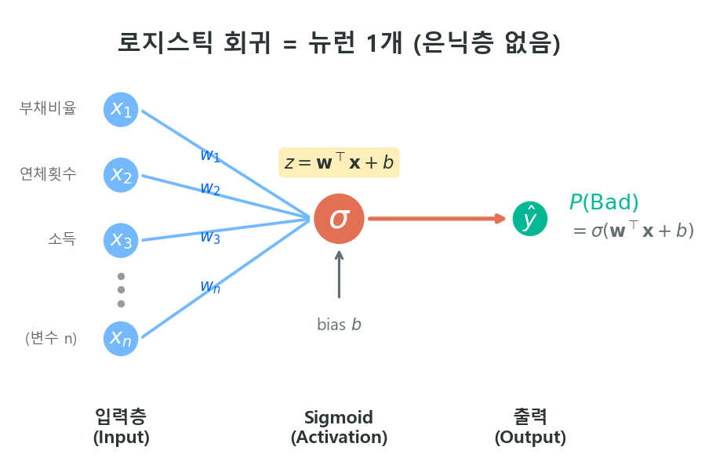

# LR = 단일 뉴런

> 로지스틱 회귀는 가장 단순한 형태의 Fully Connected Neural Network다.

!!! quote "연결의 핵심"
    스코어카드 탭에서 다룬 로지스틱 회귀와, 이 ML 탭에서 다루는 신경망은 **별개의 모형이 아니다**. 로지스틱 회귀는 은닉층이 0개인 신경망이고, 은닉층을 추가하면 MLP가 된다. 전통 스코어카드의 WoE 변환은 사람이 변수마다 설계한 **고정된 비선형 변환**이다. 신경망 쪽에서 가장 가까운 대응물은 변수마다 작은 신경망을 붙여 더하는 가법(additive) 구조다.

---

## 2.1 로지스틱 회귀의 신경망 표현

[앞 장](nn_basics.md)에서 본 퍼셉트론 구조를 떠올려 보자. 입력 \(\mathbf{x}\)에 가중치 \(\mathbf{w}\)를 곱하고 편향 \(b\)를 더한 뒤, 활성함수를 씌우면 출력이 나온다.

$$
\hat{y} = \sigma(\mathbf{w}^\top \mathbf{x} + b) = \frac{1}{1 + e^{-(\mathbf{w}^\top \mathbf{x} + b)}}
\tag{1}
$$

이것이 로지스틱 회귀의 전부다. 신경망 용어로 표현하면:

| 신경망 구성 요소 | 로지스틱 회귀 | 비고 |
|---|---|---|
| 입력층 | \(x_1, x_2, \ldots, x_n\) | 원시 변수 (비닝 없음, 표준화 권장) |
| 은닉층 | 없음 (0개) | |
| 출력 뉴런 | 1개 | 출력 \(\hat{y} = P(\text{Bad})\) |
| 활성함수 | Sigmoid | 로짓의 역함수 |
| 손실함수 | Binary Cross-Entropy | = 음의 로그 우도(Negative Log-Likelihood) |
| 최적화 | 경사하강 계열 | 통계 패키지는 보통 Newton-Raphson(IRLS) |

마지막 행이 중요하다. 신경망 프레임워크와 통계 패키지는 **같은 목적함수**(로그 우도 최대화 = Cross-Entropy 최소화)를 **다른 방법으로** 푼다. 통계 패키지는 2차 미분(Hessian)까지 쓰는 Newton-Raphson, 로지스틱 회귀에서는 반복 재가중 최소제곱(IRLS)으로 부르는 방법을 써서 몇 번의 반복으로 정확한 MLE에 도달한다. 신경망은 파라미터가 수백만 개라 Hessian을 쓸 수 없으므로 1차 미분만 쓰는 경사하강법으로 조금씩 내려간다. 로지스틱 회귀의 손실은 볼록(convex)하므로, MLE가 존재하는 한(완전 분리가 없는 경우) 페널티 없이 충분히 수렴시키면 두 방법의 계수는 같다.



Andrew Ng의 Deep Learning Specialization은 첫 번째 과정의 2주차를 "Logistic Regression as a Neural Network"로 시작한다[^1]. 뉴런 1개로 Forward Propagation과 Backward Propagation의 전체 흐름을 보여준 뒤, 은닉층을 하나씩 추가하며 다층 신경망으로 확장하는 구성이다. 이 접근법이 효과적인 이유는, 로지스틱 회귀를 이미 아는 사람이라면 **신경망의 절반은 이미 알고 있는 셈**이기 때문이다.

---

## 2.2 WoE 변환과 신경망의 은닉층

전통 스코어카드와 ML 신경망의 근본적 차이는 **변수를 어떻게 변환하느냐**에 있다.

### 전통 스코어카드의 파이프라인

```
원시 변수 → [Fine Classing] → [Coarse Classing] → [WoE 변환] → LR 적합
```

Fine Classing → Coarse Classing → WoE 변환은 **사람이 직접 설계한 비선형 변환**이다. 연속형 변수를 구간으로 나누고, 각 구간에 WoE 값을 부여한다. 결과적으로 각 변수는 계단 모양의 함수 \(\text{WoE}_j(x_j)\)로 바뀌고, 로지스틱 회귀는 이를 더한다.

$$
\text{logit}\,P(\text{Bad}) = \beta_0 + \sum_j \beta_j \,\text{WoE}_j(x_j)
\tag{2}
$$

이 가이드북의 WoE 정의(\(\ln(\%\text{Good}/\%\text{Bad})\))에서는 우량 구간의 WoE가 양수이므로, Bad logit을 적합하면 정상 계수는 \(\beta_j < 0\)이다.

### ML 신경망의 파이프라인

```
원시 변수 → [표준화] → NN 적합 (은닉층이 변환을 학습)
```

은닉층의 뉴런들이 데이터로부터 비선형 변환을 **학습**한다. 사람이 구간을 나누거나 WoE를 계산할 필요가 없다.

### 비유를 정확히 하면: 은닉층이 아니라 "가법 구조"

WoE 변환을 흔히 "사람이 만든 은닉층"이라고 비유하지만, 정확한 비유는 아니다. 일반적인 은닉층의 뉴런은 **모든 입력 변수를 섞어** 가중합한 뒤 비선형 변환한다. WoE는 **변수 하나씩 따로** 변환할 뿐 변수끼리 섞지 않는다. 식 (2)는 변수별 함수를 더한 **일반화 가법 모형(GAM)**의 형태다.

신경망 쪽에서 이에 정확히 대응하는 구조가 **Neural Additive Model**(NAM; Agarwal et al., NeurIPS 2021)이다. 변수마다 작은 신경망 \(h_j\)를 따로 두고 그 출력을 더한다.

$$
\text{logit}\,P(\text{Bad}) = \beta_0 + \sum_j h_j(x_j)
\tag{3}
$$

식 (2)와 식 (3)을 나란히 놓으면, WoE 스코어카드는 \(h_j\)를 사람이 계단 함수로 설계한 GAM이고, NAM은 \(h_j\)를 신경망이 학습한 GAM이다. 일반 MLP는 여기서 한 걸음 더 나가 변수를 섞어 교호작용까지 학습한다.

| | 전통 스코어카드 (WoE LR) | NAM (가법 신경망) | MLP (일반 신경망) |
|---|---|---|---|
| 변수별 변환 | 사람이 구간·WoE 설계 (계단 함수) | 변수별 소형 신경망이 학습 (매끄러운 곡선) | 은닉층이 학습 |
| 변수 간 결합 | 더하기만 (교호작용 없음) | 더하기만 (교호작용 없음) | 섞어서 결합 (교호작용 자동 포착) |
| 해석 | 점수표로 완전 투명 | 변수별 곡선으로 투명 | 불투명 (블랙박스) |
| 트리 쪽 대응물 | — | [1-Depth GBM](../part4_interpretation/depth1_gbm.md), [EBM](../part4_interpretation/ebm.md) | 깊은 트리 앙상블 |

!!! tip "핵심 통찰"
    WoE 변환은 **"사람이 경험과 도메인 지식으로 설계한 Feature Engineering"**이다. 전통 스코어카드는 "변수별 변환을 사람이 설계한 가법 모형"이고, 신경망과 트리 앙상블은 그 변환을(필요하면 변수 간 결합까지) 데이터로부터 학습한다. 해석 가능성은 변환을 누가 했느냐보다 **변수를 섞느냐(교호작용)**에 더 크게 좌우된다.

---

## 2.3 그런데 왜 Tabular에서는 트리인가?

로지스틱 회귀가 단일 뉴런이고, 은닉층을 추가하면 MLP가 된다면, 신용평가에서 MLP를 쓰면 되지 않을까?

이론적으로는 가능하지만, 실전에서는 **트리 기반 앙상블(XGBoost, LightGBM)**이 Tabular 데이터에서 대체로 더 좋은 성능을 더 적은 노력으로 낸다. 근거가 된 벤치마크 연구는 [왜 ML인가](../part1_overview/why_ml.md)에서 정리했고, 트리 모형 자체는 [트리 앙상블](../part3_tree_ensemble/index.md)에서 본격적으로 다룬다.

여기서는 핵심만 짚는다:

| | MLP | 트리 앙상블 |
|---|---|---|
| **입력 전처리** | 표준화·결측 대체 필수 | 대부분 불필요 |
| **결측치** | 별도 전처리 필수 | XGBoost·LightGBM 등은 자체 처리 |
| **범주형 변수** | One-hot 또는 Entity Embedding 필요 | 자체 처리(지원 구현) 또는 Target Encoding |
| **교호작용** | 학습 가능하나 불규칙한 임계 패턴에 약함 | Split 구조로 자연스럽게 포착 |
| **튜닝 부담** | 구조·학습률·정규화 등 민감한 설정이 많음 | 상대적으로 적고 기본값도 무난 |
| **재현성** | GPU 비결정성 이슈, 결정적 모드 필요 | 상대적으로 확보 쉬움 (버전·환경 고정은 필요) |

!!! note "MLP가 유리한 경우"
    Entity Embedding으로 고차원 범주형 변수(예: 업종 코드 수백 개)를 저차원 밀집 벡터로 바꾸는 데는 신경망이 유리하다. 이미지·텍스트·거래 시퀀스처럼 비정형 입력을 함께 다뤄야 할 때도 신경망이 자연스럽다. Tabular 전용으로 설계된 [TabNet](tabnet.md) 같은 구조도 있으나, 독립 벤치마크에서는 트리 앙상블에 대체로 밀렸다.

---

## 2.4 정리: 스코어카드에서 딥러닝까지의 스펙트럼

```
 [LR (뉴런 1개)]  →  [MLP (은닉층 추가)]  →  [Deep NN (층 깊게)]
       ↑                    ↑                       ↑
   해석 가능            교호작용 학습            복잡한 패턴
   단순 명쾌            중간 복잡도              블랙박스
   스코어카드용          Tabular 실험용           이미지·텍스트용
```

신용평가 실무에서의 위치:

- **전통 스코어카드**: LR + 수동 WoE 변환 → 규제 환경에서 해석 가능성 확보
- **ML 모형**: 트리 앙상블 (XGBoost/LightGBM) → Tabular에서 성능·튜닝 비용·재현성의 균형이 가장 좋음
- **딥러닝**: CNN, RNN, Transformer → 이미지·텍스트·시계열에는 강하나, 집계된 정형 데이터에서는 이득이 제한적

!!! info "이 가이드북의 흐름"
    스코어카드 탭에서 LR의 수학적 기초를 다졌고, 이 ML 탭에서 그것이 신경망의 특수한 경우임을 확인했다. 다음 단계인 [트리 앙상블](../part3_tree_ensemble/index.md)에서는 Tabular 데이터에서 왜 트리가 신경망보다 실전적인지를 본격적으로 다룬다.

---

## 참고 자료

[^1]: Andrew Ng, *Neural Networks and Deep Learning* (Course 1 of Deep Learning Specialization), Coursera / deeplearning.ai, 2017. [coursera.org/learn/neural-networks-deep-learning](https://www.coursera.org/learn/neural-networks-deep-learning)

- Andrew Ng, *Machine Learning Specialization*, Coursera / Stanford, 2022. — Course 2 "Advanced Learning Algorithms"에서 LR → NN 확장을 단계별로 설명[^2]
- Agarwal et al., "Neural Additive Models: Interpretable Machine Learning with Neural Nets", *NeurIPS*, 2021. — 변수별 신경망을 더하는 가법 구조
- Hastie & Tibshirani, *Generalized Additive Models*, Chapman & Hall, 1990. — GAM의 고전

[^2]: [coursera.org/specializations/machine-learning-introduction](https://www.coursera.org/specializations/machine-learning-introduction)

!!! tip "다음 섹션"
    LR과 신경망의 관계를 이해했다면, [TabNet](tabnet.md)에서 Tabular 데이터에 특화된 Attention 기반 신경망 아키텍처를 살펴본다.
