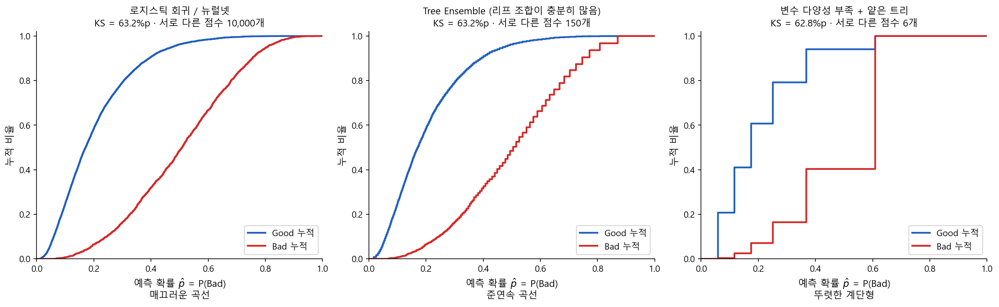

# 트리에서의 Bias-Variance

[Bias-Variance Tradeoff](../part1_overview/bias_variance.md)의 개념은 트리 기반 모델에서 구체적으로 체감된다. 각 하이퍼파라미터가 **트리의 물리적 구조를 어떻게 바꾸는지** 이해하면, Bias-Variance에 미치는 영향이 직관적으로 와닿는다.

이 페이지는 두 부분으로 나뉜다. 3.1절은 지금까지 다룬 **단일 트리와 Random Forest**의 파라미터를 다룬다. 3.2절은 다음 장부터 배울 **Boosting** 파라미터를 Bias-Variance 관점에서 미리 훑어보는 지도다. 각 파라미터의 작동 원리는 [Boosting 기초](boosting_fundamentals.md)~[하이퍼파라미터 튜닝](hyperparameter_tuning.md)에서 다시 다루므로, 3.2절은 Boosting을 배운 뒤 다시 읽어도 좋다.

---

## 3.1 단일 트리·Random Forest의 파라미터

### `max_depth` -- 트리의 깊이 제한

트리가 몇 층까지 분기할 수 있는지를 결정한다.

- **깊이가 깊으면**: 분기가 많아져 세밀한 패턴을 포착 → **Bias ↓**, 하지만 리프 노드당 샘플이 줄어 노이즈에 민감 → **Variance ↑**
- **깊이가 얕으면**: 큰 패턴만 포착, 세부 정보 무시 → **Bias ↑**, 하지만 리프 노드당 샘플이 충분해 안정적 → **Variance ↓**
- [트리 기반 모델](tree_models.md) 1.5절의 결정 경계 그림에서 depth=1(Stump)이 Underfitting, 제약 없는 트리(depth=None)가 Overfitting이었던 이유가 바로 이것이다

### `min_samples_leaf` -- 리프 노드의 최소 샘플 수

리프(최종 노드)에 최소 몇 건의 데이터가 남아야 하는지를 제한한다.

- **크면** (예: 100): 리프당 샘플이 충분해 안정적 → **Variance ↓**, 하지만 세밀한 분기를 하지 못함 → **Bias ↑**
- **작으면** (예: 1): 극단적으로 세밀한 분기 허용 → 리프에 1~2건만 남아 개별 고객의 노이즈를 학습 → **Variance ↑**
- 신용평가에서는 "리프 노드에 Bad가 최소 몇 건" 있어야 통계적으로 의미 있는 추정이 가능한지를 고려한다. 불량률이 3%라면 리프 100건에 Bad는 3건 남짓이다

### `max_features` -- 분할 후보 변수 수 (RF)

[앙상블](ensemble.md) 2.3절에서 본 것처럼, 각 분할에서 일부 변수만 후보로 올린다.

- **작으면**: 트리마다 다른 변수를 쓰게 되어 트리 간 상관 \(\rho\)가 내려감 → 앙상블 **Variance ↓**, 하지만 개별 트리가 최선의 분할을 못 할 수 있음 → **Bias ↑**
- **크면**: 모든 트리가 같은 강한 변수에서 갈라져 비슷해짐 → \(\rho\) ↑ → 평균의 Variance 감소 효과가 약해짐

### `n_estimators` (RF) -- 평균하는 트리 수

RF에서 트리 수는 **Variance만 줄이고 Bias는 바꾸지 않는다**. 트리를 늘려서 과적합되는 일은 없고, 일정 수 이상에서 성능이 평탄해질 뿐이다. 이 점이 다음 절의 Boosting과 결정적으로 다르다.

---

## 3.2 Boosting 파라미터 미리보기

Boosting은 트리를 **순차적으로** 쌓아 이전 트리의 오차를 보정한다([Boosting 기초](boosting_fundamentals.md)). 같은 이름의 파라미터라도 RF와 효과가 다를 수 있다.

### `n_estimators` (Boosting) -- 부스팅 라운드 수

- **라운드가 많으면**: 잔차를 계속 보정하므로 패턴을 더 잘 포착 → **Bias ↓**, 하지만 학습 데이터의 미세한 노이즈까지 보정하기 시작 → **Variance ↑**
- **라운드가 적으면**: 보정이 부족해 패턴을 다 못 잡음 → **Bias ↑**
- RF와 달리 **트리를 너무 많이 쌓으면 과적합된다**. 몇 그루가 적당한지는 탐색 단계에서 Early Stopping으로 찾는다([하이퍼파라미터 튜닝](hyperparameter_tuning.md))

### `learning_rate` -- 각 트리의 기여 비중

각 트리의 예측값에 곱하는 축소 계수(shrinkage). 0.1이면 각 트리의 보정을 10%만 반영한다.

- **낮으면** (예: 0.01): 한 트리가 조금씩만 기여 → 개별 트리의 과적합이 희석되어 **Variance ↓**. 다만 **트리 수를 고정하면** 학습이 덜 되어 Bias가 올라가므로, 같은 성능을 내려면 훨씬 많은 라운드가 필요하다
- **높으면** (예: 0.3): 각 트리가 크게 기여 → 빠르게 학습하지만 노이즈에도 과민 반응 → **Variance ↑**
- 권장 범위는 [하이퍼파라미터 튜닝](hyperparameter_tuning.md)의 학습률 표를 따른다

### `subsample`, `colsample_bytree` -- 랜덤성 주입

각 트리를 학습할 때 전체 데이터/변수의 일부만 사용한다.

- **비율이 낮으면** (예: 0.5): 각 트리가 다른 데이터/변수를 보므로 트리 간 다양성 증가 → **Variance ↓**, 하지만 정보량이 줄어 개별 트리가 약해짐 → **Bias ↑**
- **비율이 높으면** (예: 1.0): 모든 트리가 같은 데이터를 보므로 비슷한 실수를 반복 → **Variance ↑**
- RF의 Bootstrap·Feature Subsampling과 같은 발상이다. Boosting에 행 샘플링을 넣는 것을 Stochastic Gradient Boosting이라 부른다([Boosting 심화](boosting_advanced.md))

### `reg_lambda`, `reg_alpha`, `gamma` -- 정규화

리프 가중치(예측값)와 트리 구조에 페널티를 부과한다.

- `reg_lambda`(L2): 리프 가중치를 0 쪽으로 **연속적으로 수축**시켜 극단적 예측을 억제한다
- `reg_alpha`(L1): 리프 안 gradient 합의 절댓값이 \(\alpha\) 이하이면 그 리프의 가중치를 **정확히 0**으로 만든다(soft-thresholding). 리프 값을 없애는 효과는 있지만, **분할 자체를 막는 장치는 아니다**
- `gamma`(최소 손실 감소량): 분할로 얻는 Gain이 \(\gamma\)보다 작으면 그 분할을 하지 않는다. **분기를 직접 제거하는 것은 이 파라미터다**
- 셋 다 **크면** 보수적이지만 안정적 → **Variance ↓, Bias ↑**

---

## 3.3 요약 테이블

| 하이퍼파라미터 | 트리에 하는 일 | Bias | Variance |
|---------------|-------------|:----:|:--------:|
| `max_depth` ↑ | 더 깊이 분기 허용 | ↓ | **↑** |
| `min_samples_leaf` ↑ | 리프에 최소 샘플 보장 | ↑ | **↓** |
| `max_features` ↓ (RF) | 분할 후보 변수 축소 | ↑ | **↓** |
| `n_estimators` ↑ (RF) | 평균하는 트리 증가 | 변화 없음 | ↓ |
| `n_estimators` ↑ (Boosting) | 보정 라운드 증가 | ↓ | ↑ |
| `learning_rate` ↓ (트리 수 고정) | 각 트리의 기여를 축소 | ↑ | **↓** |
| `subsample` ↓ | 각 트리에 다른 데이터 | ↑ | **↓** |
| `reg_lambda`, `reg_alpha`, `gamma` ↑ | 리프 값·분할에 페널티 | ↑ | **↓** |

!!! info "Bagging vs Boosting의 전략 차이"
    - **Bagging** (Random Forest): 개별 트리를 깊게 키워 Bias를 낮추고, **평균화**로 Variance를 줄임
    - **Boosting** (GBM, XGBoost): 얕은 트리(weak learner)로 시작해 Variance를 낮게 유지하고, **순차 학습**으로 Bias를 줄여나감

    두 앙상블 전략 모두 Bias-Variance Tradeoff를 다루는 방식이지만, 접근 방향이 정반대다.

---

## 3.4 요약

$$
\text{EPE} = \text{Bias}^2 + \text{Variance} + \sigma^2_{\varepsilon}
\tag{1}
$$

\(\sigma^2_{\varepsilon}\)는 어떤 모형으로도 줄일 수 없는 노이즈(irreducible error)다. [Bias-Variance Tradeoff](../part1_overview/bias_variance.md)의 과녁 그림으로 정리하면:

- **멍청한 모형 (1)**: High Bias — 패턴을 못 잡음 → 복잡도를 올려야 함
- **멍청한 모형 (2)**: High Variance — 노이즈를 외움(train↔valid 격차 큼) → 정규화·제약이 필요함
- **멍청한 모형 (3)**: Both Bad — 데이터·구조 자체에 문제 → 데이터 품질부터 재점검
- **똑똑한 모형**: 과녁의 4사분면 중 유일한 Sweet Spot — Train/Valid/Test 성능이 안정적이고 높음
- 모형 튜닝의 본질은 이 **Tradeoff의 최적점**을 찾는 것

---

## 3.5 KS Plot으로 모형 복잡도 진단

KS, AR 같은 요약 지표 하나만 보면 놓치기 쉬운 문제가 있다. **예측 확률 분포의 형태**를 보면 모형의 표현력 부족을 더 직접적으로 체감할 수 있다.

**로지스틱 회귀**는 연속형 \(\hat{p}\) 값을 산출하므로, KS Plot(누적 분포 비교)이나 ROC 곡선이 **매끄러운 곡선** 형태를 띤다. 반면 **트리 기반 모형**은 리프 노드의 수가 곧 예측 확률의 종류 수다. 트리의 분기가 적으면 예측 확률이 몇 가지 값에 집중된다.

| 모형 상태 | 예측 확률 분포 | KS/ROC 곡선 형태 |
|----------|-------------|----------------|
| 로지스틱 회귀 / 뉴럴넷 | 연속적 — 고객마다 다른 \(\hat{p}\) | 매끄러운 곡선 |
| Tree Ensemble | 준연속적 — 리프 수가 충분히 많아 \(\hat{p}\)가 다양 | 곡선에 가까움 |
| **변수 다양성 부족 + 얕은 트리** | **이산적** — 몇 개의 \(\hat{p}\)에 집중 | **계단형, 꺾이는 지점이 뚜렷** |

<figure markdown="span">
  
  <figcaption>예측 확률의 종류가 적을수록 KS 곡선이 계단 모양이 된다. 왼쪽부터 로지스틱 회귀, 충분히 다양한 Tree Ensemble, 변수 다양성이 부족한 얕은 트리 앙상블.</figcaption>
</figure>

!!! warning "depth가 얕다고 반드시 멍청한 것은 아니다"
    `max_depth=2~3` 정도의 얕은 트리라도 **n_estimators가 충분하고 변수 다양성이 확보**되면 좋은 성능을 낼 수 있다. 합산 예측값이 준연속적으로 분포하여 매끄러운 KS 곡선이 나온다. 문제는 depth 자체가 아니라 **변수 다양성이 부족할 때**다 — 같은 변수의 같은 지점에서만 반복 분기되면 500그루를 쌓아도 예측 확률은 소수의 값에 몰린다. 이때 KS Plot은 **뚜렷한 계단 형태**를 보이며, 이는 모형이 데이터의 미세한 리스크 차이를 구분하지 못하고 있다는 신호다.

!!! tip "실무 진단법"
    모형 적합 후 KS Plot을 그려보자.

    - **곡선이 매끄러우면** → 모형이 충분히 다양한 리스크 수준을 표현하고 있다
    - **계단이 뚜렷하면** → 동점자(tied scores)가 많다는 뜻. `max_depth` 증가, 변수 다양성 확보, 또는 `max_leaves` 조정을 검토
    - 동점자 비중이 크면 **등급화(Rating Grade) 시 분해능이 부족**하여, 특정 등급에 고객이 과도하게 몰린다. 몇 %부터 문제인지는 등급 수와 등급별 목표 비중에 따라 다르므로, 점수 분포표에서 한 점수값에 몰린 비중을 직접 확인한다

!!! tip "다음 섹션"
    Bias-Variance 관점에서 트리의 하이퍼파라미터를 정리했으니, 다음에서는 [Boosting 기초](boosting_fundamentals.md)로 넘어가 AdaBoost에서 Gradient Boosting까지의 핵심 아이디어를 학습한다.
