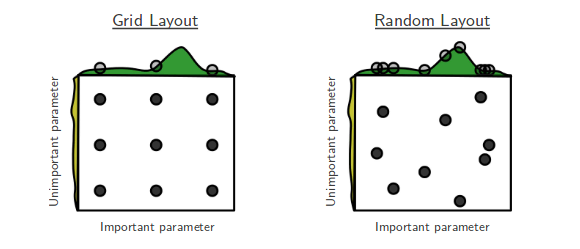
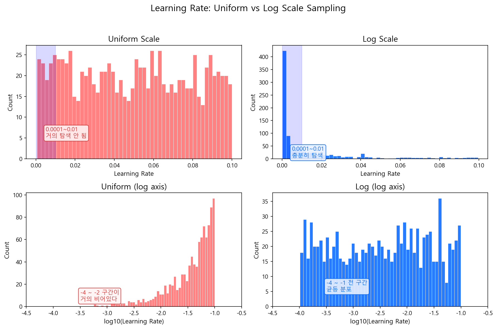

# 하이퍼파라미터 튜닝

!!! quote "설계 사상"
    잘 튜닝된 XGBoost와 잘 튜닝된 LightGBM의 성능 차이는 대개 작다. 튜닝에서 더 중요한 것은 **무엇을 기준으로 고르는가**다. 신용평가에서는 valid 성능이 가장 높은 조합이 아니라, train·valid·OOT 성능이 안정적이고 해석 조건(단조성, 교호작용 제한)을 만족하는 **똑똑한 모형**을 고른다. 이 페이지는 그 기준 아래에서 각 파라미터를 어떻게 다루는지 정리한다.

---

## 7.1 핵심 하이퍼파라미터

### 공통 파라미터

| 파라미터 | XGBoost | LightGBM | 역할 | 탐색 범위 예시 |
|---------|---------|----------|------|----------|
| 학습률 | `learning_rate` | `learning_rate` | 각 트리의 기여도 | 아래 학습률 표 참조 |
| 트리 수 | `n_estimators` | `n_estimators` | 부스팅 라운드 수 | 탐색 단계에서 Early Stopping으로 결정 |
| 트리 깊이 | `max_depth` | `max_depth` | 개별 트리 복잡도·교호작용 차수 상한 | 2 ~ 8 |
| Leaf 수 | `max_leaves` | `num_leaves` | Leaf 노드 최대 수 | LightGBM 기본 31 |
| 최소 Leaf hessian 합 | `min_child_weight` | `min_sum_hessian_in_leaf` | 작은 Leaf 방지 | 아래 설명 참조 |
| 최소 Leaf 샘플 수 | — | `min_child_samples` | 작은 Leaf 방지(건수 기준) | 데이터 크기에 맞춰 설정 |
| 최소 분할 이득 | `gamma` | `min_split_gain` | Gain이 이 값보다 작으면 분할 안 함 | 0 ~ 수 단위 |
| 행 샘플링 | `subsample` | `bagging_fraction` | 각 트리에 사용할 데이터 비율 | 0.7 ~ 0.9 |
| 열 샘플링 | `colsample_bytree` | `feature_fraction` | 각 트리에 사용할 변수 비율 | 0.6 ~ 0.9 |
| L1 정규화 | `reg_alpha` | `reg_alpha` | Leaf 가중치 L1 페널티 | 0 ~ 10 |
| L2 정규화 | `reg_lambda` | `reg_lambda` | Leaf 가중치 L2 페널티 | 0 ~ 10 |
| 단조 제약 | `monotone_constraints` | `monotone_constraints` | 변수별 예측 방향 강제 | 도메인 지식으로 지정 |
| 교호작용 제약 | `interaction_constraints` | `interaction_constraints` | 한 경로에 함께 올 수 있는 변수 그룹 지정 | 업무적으로 납득되는 쌍 |
| 클래스 가중 | `scale_pos_weight` | `scale_pos_weight` | Bad 샘플 가중치 배수 | 신용평가에서는 대개 기본값(1) |

### 학습률 — 이 가이드북의 기준

학습률 권장값은 이 표 한 곳에서 관리한다. 다른 페이지는 이 표를 참조한다.

| 구분 | 학습률 | 트리 수 | 설명 |
|------|-------|--------|------|
| **일반 권장** | **0.01 ~ 0.1** | 탐색 단계에서 결정한 수 | 대부분의 문헌·실무에서 쓰는 범위. 하이퍼파라미터 탐색은 이 범위의 큰 쪽(0.05~0.1)에서 빠르게 하고, 최종 모형에서 낮추는 방식이 흔하다 |
| **저자 선호 (예외)** | \(10^{-4} \sim 10^{-3}\) | 대폭 증가 | 각 트리의 기여를 극도로 줄여 과적합 시점을 최대한 늦추는 방식. 트리 수가 학습률에 대략 반비례해 늘어나므로, 0.01 대비 10~100배의 트리와 그만큼의 학습·예측 시간, 모형 크기를 **감수**해야 한다 |

참고로 라이브러리 기본값은 XGBoost 0.3, LightGBM 0.1이다. [1-Depth GBM](../part4_interpretation/depth1_tools_impl.md)처럼 트리 하나가 매우 단순한 경우에도 위 일반 권장 범위 안에서 낮은 쪽을 쓴다.

### `min_child_weight`는 건수가 아니라 hessian 합이다

`min_child_weight`는 흔히 "Leaf의 최소 샘플 수"로 소개되지만, 정확히는 **Leaf에 속한 샘플들의 hessian 합의 최솟값**이다. LightGBM의 대응 파라미터도 이름 그대로 `min_sum_hessian_in_leaf`다(건수 기준은 별도 파라미터 `min_child_samples`).

Log Loss에서 샘플 하나의 hessian은 \(h_i = p_i(1-p_i)\)다. 따라서 같은 `min_child_weight`라도 예측 확률이 어디에 있느냐에 따라 필요한 건수가 크게 달라진다.

$$
\text{필요 건수} \approx \frac{w_{\min}}{p(1-p)}
\tag{1}
$$

여기서 \(w_{\min}\)은 `min_child_weight` 값이다.

| Leaf 샘플의 예측 확률 \(p\) | \(h = p(1-p)\) | `min_child_weight=20`일 때 | `min_child_weight=100`일 때 |
|:---:|:---:|:---:|:---:|
| 0.5 | 0.25 | 약 80건 | 약 400건 |
| 0.1 | 0.09 | 약 220건 | 약 1,100건 |
| 0.03 | 0.0291 | 약 690건 | 약 3,400건 |

불량률이 3% 수준인 신용평가 데이터에서는 대부분의 샘플이 \(p \approx 0.03\) 근처에서 학습되므로(첫 트리는 모든 샘플이 평균 불량률에서 출발한다), `min_child_weight=100`은 "Leaf당 100건"이 아니라 **"Leaf당 약 3,400건"**에 가까운 강한 제약이 된다. 균형 데이터 기준으로 소개된 권장값을 그대로 가져오면 의도보다 훨씬 보수적인 모형이 되거나, 반대로 너무 작게 잡아 Leaf에 Bad가 몇 건밖에 없는 모형이 될 수 있다. **Leaf당 확보하고 싶은 건수(또는 Bad 건수)를 먼저 정하고 식 (1)로 역산**하는 것이 안전하다.

### `gamma` — 분할을 직접 막는 파라미터

`gamma`(별칭 `min_split_loss`)는 분할로 얻는 손실 감소량이 이 값보다 작으면 분할하지 않게 한다. L1·L2 정규화가 **Leaf 값**을 줄이는 장치라면, `gamma`는 **트리 구조**(분할 개수)를 줄이는 장치다. 작동 시점(성장 중 정지 vs 사후 가지치기)은 [XGBoost와 LightGBM](xgb_lgbm.md)에서 설명했다. 손실 감소량의 크기는 데이터 건수에 비례해 커지므로, 적정 값도 데이터 크기에 따라 달라진다.

### 단조 제약과 교호작용 제약

신용평가에서 해석 가능한 ML을 만들 때 가장 중요한 두 파라미터다. 작동 원리는 [Boosting 심화](boosting_advanced.md)에서 다뤘다.

- **단조 제약**: 연체 일수(+1, 위험 증가), 소득(−1)처럼 방향이 분명한 변수에 건다. 방향 근거가 없는 변수는 0(제약 없음)으로 둔다. 이 가이드북의 WoE 정의(\(\ln(\%\text{Good}/\%\text{Bad})\))로 변환한 변수를 넣는다면 방향은 모두 −1이다
- **교호작용 제약**: 업무적으로 의미 있는 변수 쌍만 그룹으로 지정해, 교호작용을 그 쌍 안에서만 허용한다. `max_depth=2`와 함께 쓰면 교호작용이 2-way로 제한된다

제약을 걸면 학습 데이터 성능은 대개 조금 떨어지지만, train↔valid 격차가 줄고 해석 검토가 가능해진다. 제약 전후의 KS, AR을 OOT에서 비교해 판단한다. 해석 가능 조건의 기준은 [해석 가능성](../part4_interpretation/interpretability.md)에 정리되어 있다.

### `scale_pos_weight` — 불균형 대응의 부작용

`scale_pos_weight`는 양성(Bad) 샘플의 가중치를 키워 불균형을 보정하는 파라미터다. XGBoost 문서는 일반적인 값으로 (음성 건수 / 양성 건수)를 제시한다. 그러나 신용평가에서는 다음 이유로 기본값(1)을 쓰는 경우가 많다.

- **확률이 왜곡된다**: Bad에 가중치를 주면 모형이 Bad 확률을 체계적으로 높게 예측한다. 서열(KS, AR)은 크게 변하지 않는 경우가 많지만, 예측값을 그대로 PD로 쓸 수 없게 되어 별도의 재보정이 필요하다
- **다른 파라미터의 의미가 바뀐다**: 가중치는 gradient·hessian에 곱해지므로, `min_child_weight` 같은 hessian 기반 제약의 실효 건수도 함께 달라진다

변별력 비교가 목적이라면 가중 없이 학습하고, 불균형은 KS, AR처럼 불균형에 영향을 덜 받는 지표로 평가하는 쪽이 단순하다.

### LightGBM `bagging_fraction`의 함정

LightGBM에서 `bagging_fraction`만 1보다 작게 설정하면 **행 샘플링이 일어나지 않는다**. `bagging_freq`(몇 라운드마다 다시 샘플링할지)를 0이 아닌 값으로 함께 지정해야 작동한다. `bagging_freq`의 기본값 0은 "bagging 사용 안 함"이다. XGBoost의 `subsample`에는 이런 조건이 없어, 두 라이브러리를 같은 설정으로 비교할 때 흔히 놓치는 부분이다.

XGBoost Parameters: <a href="https://xgboost.readthedocs.io/en/stable/parameter.html" target="_blank">xgboost.readthedocs.io</a> · LightGBM Parameters: <a href="https://lightgbm.readthedocs.io/en/latest/Parameters.html" target="_blank">lightgbm.readthedocs.io</a>

---

## 7.2 트리 수 결정과 최종 모형 적합

### Early Stopping — 탐색 단계의 도구

- Validation Set의 성능을 매 라운드 모니터링
- 일정 라운드(`early_stopping_rounds`) 동안 개선이 없으면 학습 중단
- 그 조합에서 성능이 가장 좋았던 라운드 수를 기록

`n_estimators`를 처음부터 정확히 맞출 필요는 없다. 탐색 단계에서는 넉넉하게 설정하고 Early Stopping으로 각 조합의 적정 트리 수를 찾는다. 학습률을 낮추면 적정 트리 수가 늘어나므로, 저자 선호 학습률(\(10^{-4}\) 수준)에서는 "넉넉한" 값이 수천 수준으로는 부족할 수 있다.

### 최종 모형은 정한 트리 수를 완주한다

이 가이드북은 트리 수 결정과 최종 적합을 다음처럼 구분한다.

1. **탐색 단계**: 하이퍼파라미터 탐색에서 Early Stopping으로 각 조합의 적정 트리 수를 찾는다
2. **최종 모형**: 고른 조합과 트리 수로 **트리 수를 끝까지 완주**해 적합한다. 최종 적합에서는 Early Stopping을 쓰지 않는다. 최종 모형이 어떤 데이터의 우연한 성능 변동에 따라 길이가 바뀌지 않게 하고, 재현 가능한 사양으로 고정하기 위해서다
3. **성능 보고**: Early Stopping에 쓴 validation의 성능은, 트리 수를 그 데이터에 가장 좋도록 고른 결과라 **낙관적으로 편향**되어 있다. 최종 성능은 학습·탐색에 쓰지 않은 별도의 test 또는 OOT 데이터로 보고한다

### 성능 대신 격차를 보는 중단 기준

라이브러리 기본 Early Stopping은 지정한 평가지표(Log Loss 등)가 더 이상 개선되지 않을 때 멈춘다. 신용평가에서는 다른 관점의 기준도 쓸 수 있다. 저자가 실무에서 써 본 방식은 **KS 격차 기준**이다.

- 학습 초반 일정 라운드까지는 중단 여부를 보지 않는다(초기 학습 구간)
- 그 이후, train KS가 최소 기준을 넘었는데 **train KS와 valid KS의 차이가 정한 한도를 넘으면** 학습을 멈춘다

이 기준은 "valid 성능이 최고인 지점"을 찾는 것이 아니라 **"train↔valid 격차가 커지기 시작하는 지점"**, 즉 멍청한 모형(High Variance)으로 넘어가기 직전을 찾는다. 최고 성능 라운드로 되돌아가지 않으므로, 격차 한도와 최소 KS 기준을 어떻게 정하느냐가 결과를 좌우한다. 이렇게 정한 트리 수도 위 원칙대로 최종 적합에서는 완주한다.

---

## 7.3 하이퍼파라미터 탐색 전략

### Grid Search vs Random Search

**Grid Search**는 모든 조합을 격자로 탐색한다. 조합이 폭발적으로 늘어나고, 중요하지 않은 파라미터에도 동일한 탐색 비용을 쓴다. **Random Search**는 동일 횟수 대비 중요한 파라미터의 탐색 범위를 더 넓게 커버한다 (Bergstra & Bengio, 2012). 실무에서는 Random Search 또는 Bayesian Optimization을 사용한다.

### 왜 Log Scale인가?

어떤 파라미터는 **자릿수(order of magnitude)가 성능을 결정**한다. Learning Rate 0.001과 0.01은 10배 차이로 모형 행동이 크게 달라지지만, 0.091과 0.1은 거의 같다. 이런 파라미터를 균등 간격으로 탐색하면 **작은 값 영역은 거의 건너뛰고, 큰 값 영역에 샘플이 몰린다.**

위 그림에서 왼쪽(Uniform)은 0.0001~0.01 구간에 샘플이 거의 없다. 오른쪽(Log Scale)은 모든 자릿수를 골고루 탐색한다. **로그 스케일 = "각 자릿수에 동일한 탐색 예산을 배분"**하는 것이다. 예를 들어 학습률을 \(10^{-4}\)~\(10^{-1}\)에서 탐색한다면, 지수 \(u\)를 −4와 −1 사이에서 균등하게 뽑은 뒤 \(10^{u}\)를 쓴다.

반면 `max_depth` 같은 파라미터는 3→4→5가 모두 의미 있는 변화다. 이런 파라미터는 **균등 스케일(정수)**로 탐색하면 된다.

!!! tip "핵심 원칙"
    **"0.001 → 0.01이 의미 있는 변화인가?"** Yes → Log Scale. **"3 → 4가 의미 있는 변화인가?"** Yes → 균등/정수 Scale.

### 파라미터별 탐색 스케일 가이드

**Tree 모형 (XGBoost / LightGBM)**

| 파라미터 | 스케일 | 범위 예시 | 이유 |
|---------|--------|----------|------|
| `learning_rate` | **Log** | \(10^{-3}\) ~ \(10^{-1}\) | 자릿수가 수렴 행동을 결정 (저자 선호값은 위 학습률 표 참조) |
| `reg_alpha` (L1) | **Log** | \(10^{-3}\) ~ 10 | 0.001과 0.01, 0.1과 1이 각각 다른 효과 |
| `reg_lambda` (L2) | **Log** | \(10^{-3}\) ~ 10 | 위와 동일 |
| `max_depth` | 정수 | 2 ~ 8 | depth 자체가 Leaf 수의 로그(\(2^d\))이므로 depth를 균등 탐색하면 Leaf 수를 로그 스케일로 탐색하는 셈 |
| `num_leaves` | **이산 Log** | 15, 31, 63, 127 | Leaf 수는 depth가 1 늘 때마다 2배가 되므로, 2배 간격으로 탐색 |
| `min_child_weight` | **Log** | 데이터에 맞춰 역산한 값의 1/10 ~ 10배 | hessian 합 기준이라 데이터 불량률에 따라 적정 자릿수가 달라짐 (식 1) |
| `subsample` | 균등 | 0.6 ~ 1.0 | 비율이므로 균등 간격 |
| `colsample_bytree` | 균등 | 0.5 ~ 1.0 | 비율이므로 균등 간격 |

**Neural Network** (참고 — [딥러닝 파트](../part2_neural_net/index.md)에서 쓰는 파라미터)

| 파라미터 | 스케일 | 범위 예시 | 이유 |
|---------|--------|----------|------|
| `learning_rate` | **Log** | \(10^{-5}\) ~ \(10^{-2}\) | Tree보다 더 넓은 범위, 로그 필수 |
| `weight_decay` | **Log** | \(10^{-5}\) ~ \(10^{-2}\) | 정규화 강도, 자릿수가 핵심 |
| `dropout` | 균등 | 0.0 ~ 0.5 | 비율이므로 균등 간격 |
| `batch_size` | **이산 Log** | 32, 64, 128, 256, 512 | 2의 거듭제곱으로 탐색 |
| `hidden_dim` | **이산 Log** | 32, 64, 128, 256 | 위와 동일 |
| `n_layers` | 정수 | 1 ~ 5 | 한 층씩 추가가 의미 있는 변화 |

### 단계적 접근

한 번에 모든 파라미터를 동시에 탐색하면 조합이 폭발한다. 실무에서는 단계적으로 접근한다. 각 단계에서 비교 기준은 valid의 KS, AR과 **train↔valid 격차**를 함께 본다.

**0단계: 제약 설계** — 해석이 필요한 모형이라면 탐색 전에 단조 제약 방향과 허용할 교호작용 쌍을 정한다. [해석 가능성 조건](../part4_interpretation/interpretability.md)(교호작용 2-way 이하, 단조, 점수표 환산 가능)을 목표로 하면 깊이 상한과 교호작용 제약도 여기서 정한다. 운영 평점표의 관행에 맞춰 변수별 구간 수를 제한할지도 이때 정한다. 제약은 이후 모든 단계에 고정으로 둔다.

**1단계: 기본값으로 Baseline 확보** — 학습률 0.05~0.1에서 Early Stopping으로 트리 수를 정해 기준 성능을 잡는다. 깊이는 해석 모형이면 0단계의 상한(예: 2)을, 성능 탐색이면 [기준선](../part1_overview/baseline_workflow.md)의 2~3에서 5 안팎까지를 쓴다.

**2단계: 트리 구조 파라미터 조정**

- `max_depth` (또는 `num_leaves`): 2 → 3 → … → 8
- `min_child_weight`: Leaf당 확보할 건수에서 역산한 값 주변(식 1)

**3단계: 샘플링 파라미터**

- `subsample` / `bagging_fraction`(+ `bagging_freq`): 0.7, 0.8, 0.9
- `colsample_bytree` / `feature_fraction`: 0.6, 0.7, 0.8, 0.9

**4단계: 정규화**

- `reg_alpha`, `reg_lambda`: 0, 0.1, 1, 5, 10
- `gamma`: 0에서 시작해 트리가 지나치게 큰 경우에만 올린다

**5단계: Learning Rate 낮추고 트리 수 다시 정하기**

- `learning_rate`: 0.1 → 0.05 → 0.01 (일반 권장 범위 안에서)
- 트리 수: 각 학습률에서 Early Stopping으로 다시 정한 뒤, 최종 적합에서는 그 수를 완주

??? note "참고: 자동 탐색 — 베이지안 최적화"
    수동 탐색 대신 **베이지안 최적화**로 탐색을 자동화하는 방법도 있다(Optuna 같은 오픈소스 프레임워크가 널리 쓰인다). 이전 시도 결과를 바탕으로 "성능이 좋을 것 같은 영역"을 추정하여 다음 시도 지점을 선택하는 방식이다. Grid Search가 격자를 전부 돌려보는 것이라면, 베이지안은 몇 번 찍어보고 유망한 곳만 집중 탐색한다.

    탐색 공간은 위 스케일 가이드 그대로 정의한다. 예를 들어 `max_depth`는 2~8 정수, 학습률은 로그 스케일, 샘플링 비율은 균등 구간으로 두고, 각 시도의 목표값은 교차검증 KS 또는 AR로 둔다. 목표값에 train↔valid 격차에 대한 페널티를 더하면 "격차가 작은 조합"을 우선 탐색하게 할 수 있다.

    > **저자의 말** — 이러한 자동 탐색 방법론이 있다는 것은 알고 있지만, 신용평가 모형에서 도입할 필요성은 느끼지 못했다. 탐색할 파라미터가 6~7개에 범위도 좁아서, 위의 수동 단계로 충분히 커버된다.

!!! info "Graduate Student Descent"
    ML 커뮤니티에서는 하이퍼파라미터 튜닝을 "Graduate Student Descent"라 부른다 — Gradient Descent의 패러디로, 결국 사람이 노가다로 찾는다는 뜻이다.

---

## 7.4 요약

| | XGBoost | LightGBM |
|---|---|---|
| **핵심 혁신** | 정규화 목적함수 + 2차 근사 분할 기준 | GOSS + EFB (+ Leaf-wise 기본) |
| **강점** | 깊이 중심의 직관적 제어, 넓은 생태계 | 속도, 대규모 데이터 |
| **신용평가 적합성** | 높음 | 높음 |

실무에서 중요한 것은 알고리즘 선택보다 **제약 설계, 하이퍼파라미터 튜닝, 검증 프로세스**다. 잘 튜닝된 XGBoost와 잘 튜닝된 LightGBM의 성능 차이는 대부분 미미하다. 기본값으로 못 되는 모형이 튜닝으로 된다기보다, **좋은 변수가 좋은 모형을 만든다.**

!!! tip "다음 섹션"
    모형의 성능이 확보되었다면, 다음 질문은 "이 모형이 **왜** 이렇게 예측했는가?"다. [해석과 설명](../part4_interpretation/index.md) 섹션에서 SHAP, 1-Depth GBM, EBM 등 모형 해석 기법을 다룬다.
