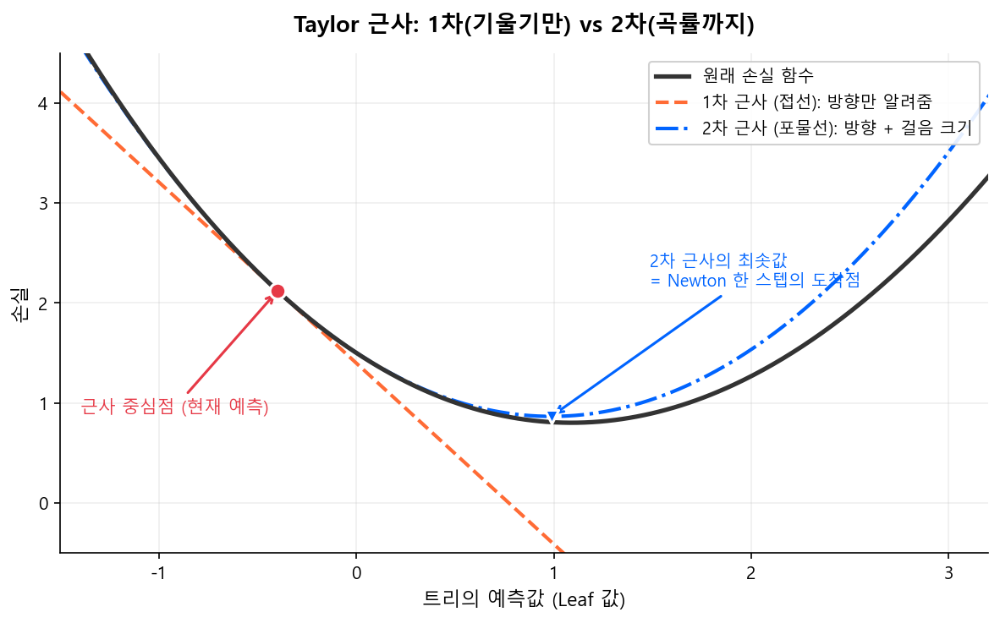
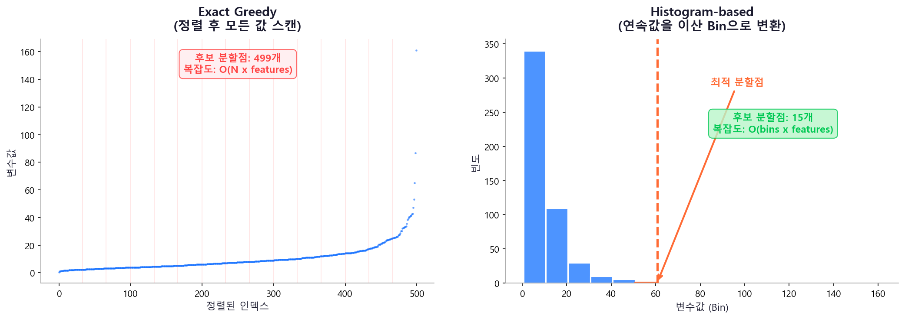
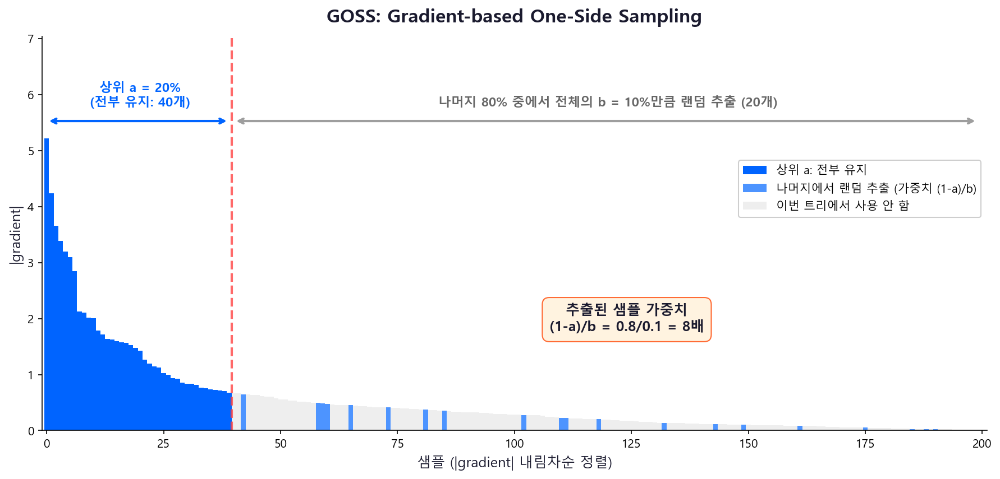
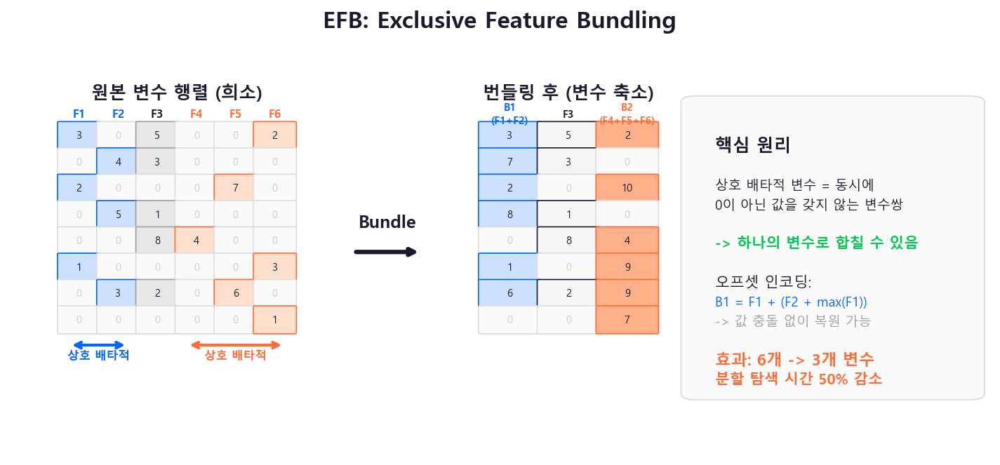
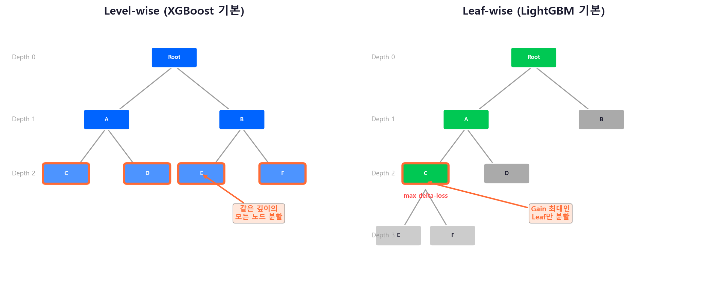

# XGBoost와 LightGBM

## 6.1 왜 XGBoost/LightGBM인가

Gradient Boosting(GBM)의 원리는 2001년에 확립되었지만, 실무에서 폭발적으로 쓰이게 된 것은 **구현의 혁신** 덕분이다.

| | 고전 GBM (sklearn `GradientBoosting*`) | **XGBoost** (공개 2014, 논문 2016) | **LightGBM** (공개 2016, 논문 2017) |
|---|---|---|---|
| 개발 | Friedman 원논문 기반 | Tianqi Chen (U. Washington) | Microsoft Research |
| 속도 | 느림 | **빠름** (Histogram 방식이 2.0부터 기본) | **빠름** (Histogram + GOSS + EFB) |
| 정규화 | Leaf 값에 대한 명시적 L1/L2 페널티 없음 (`subsample`, Leaf 크기 등으로 제어) | L1/L2 정규화 내장 | L1/L2 정규화 내장 |
| 결측치 | 버전에 따라 사전 처리 필요 | **자동 처리** | **자동 처리** |
| 대규모 데이터 | 한계 | GPU 지원 + 분산 학습 | GPU 지원 + GOSS 샘플링 |
| 복잡도 제어 | `max_depth` 등 | 기본은 `max_depth` 중심(Level-wise) | `num_leaves`와 `max_depth`를 함께 제어 |
| 생태계 | 기본 | 매우 넓음 | 넓음 |

scikit-learn에도 히스토그램 기반의 `HistGradientBoosting*`이 있다. LightGBM과 같은 방식을 따르며 결측치·단조 제약을 지원하므로, 위 표의 "고전 GBM"은 Friedman 방식을 그대로 구현한 `GradientBoosting*`을 가리킨다.

!!! info "지금(2026년)도 tabular에서는 GBDT가 표준"
    신용평가 ML 모형의 실무 표준은 여전히 XGBoost 또는 LightGBM이다. 중간 규모(약 1만 건 수준) tabular 데이터 45종을 비교한 연구에서 트리 기반 모형이 딥러닝보다 우수했다(Grinsztajn et al., NeurIPS 2022 Datasets and Benchmarks). 다만 **소규모 데이터**에서는 사정이 바뀌고 있다. 표본 1만 건 이하에서 사전학습된 tabular 기반 모형(TabPFN v2)이 튜닝한 GBDT보다 우수했다는 결과가 보고되었다(Hollmann et al., *Nature*, 2025). 수십만 건 이상을 다루는 신용평가 모형 개발에서는 아직 GBDT가 표준이다.

    <div class="source-ref">Grinsztajn, L., Oyallon, E. &amp; Varoquaux, G. (2022). "Why do tree-based models still outperform deep learning on typical tabular data?" NeurIPS 2022 Datasets and Benchmarks Track; Hollmann, N. et al. (2025). "Accurate predictions on small data with a tabular foundation model." <em>Nature</em>, 637, 319-326.</div>

---

## 6.2 XGBoost의 핵심 혁신

### 정규화된 목적함수

고전 GBM의 목적함수는 손실 함수뿐이었다. XGBoost는 여기에 **트리의 복잡도에 페널티**를 부과하는 정규화 항을 추가했다.

$$
\text{Obj}^{(t)} = \sum_{i=1}^{N} L(y_i, \hat{y}_i^{(t)}) + \sum_{k=1}^{t} \Omega(f_k)
\tag{1}
$$

$$
\Omega(f) = \gamma T + \frac{1}{2}\lambda \sum_{j=1}^{T} w_j^2
\tag{2}
$$

- \(T\): Leaf 노드 수 — \(\gamma\)가 크면 Leaf가 적은(단순한) 트리를 선호. 앞 장에서 \(T\)를 트리 수로 썼던 것과 달리, 이 페이지에서 \(T\)는 **한 트리의 Leaf 수**다
- \(w_j\): Leaf \(j\)의 예측값 — \(\lambda\)가 크면 극단적 예측을 억제
- 추가로 L1 정규화 \(\alpha |w_j|\)도 지원

!!! info "정규화의 효과"
    고전 GBM에서는 과적합을 `max_depth`, `learning_rate`, 행 샘플링, Leaf 최소 크기 같은 간접 장치로 제어했다. XGBoost는 목적함수 자체에 페널티를 내장하여, 트리 구조와 예측값 모두에 대해 **수학적으로 과적합을 제어**한다.

    여기서 \(\frac{1}{2}\lambda \sum w_j^2\)는 [정규화 이론](../part1_overview/regularization.md)에서 다룬 **Ridge(L2) 페널티**와 동일한 원리이고, \(\alpha \sum |w_j|\)는 **Lasso(L1) 페널티**다. 선형 모형에서 계수를 수축시키던 아이디어를, 트리의 Leaf 예측값에 적용한 것이다.

### 2차 Taylor 근사

!!! note "Taylor 근사란?"
    복잡한 함수 \(f(x)\)를 어떤 점 \(a\) 근처에서 **다항식으로 근사**하는 기법이다. 미적분학의 가장 강력한 도구 중 하나로, 함수의 도함수 정보를 이용해 함수 모양을 흉내 낸다.

    $$
    f(x) \approx f(a) + f'(a)(x - a) + \frac{1}{2}f''(a)(x - a)^2 + \cdots
    $$

    - **1차 근사**(선형): 접선으로 근사 — 방향만 알려준다
    - **2차 근사**(이차): 포물선으로 근사 — 방향과 걸음 크기를 함께 알려준다

    1차 근사는 기울기(gradient)만 보고 "어느 방향으로 갈지"를 결정한다. 2차 근사는 곡률(hessian)까지 보고 **"얼마나 갈지"**까지 결정한다. Newton's method가 gradient descent보다 빠르게 수렴하는 이유와 동일한 원리다.

<figure markdown="span">
  { width="100%" }
  <figcaption>1차 근사(주황 접선)는 방향만 알려주지만, 2차 근사(파란 포물선)는 걸음 크기까지 결정한다.</figcaption>
</figure>

고전 GBM과 XGBoost의 차이는 "hessian을 쓰느냐"가 아니라 **"어디에 쓰느냐"**다. [Boosting 기초](boosting_fundamentals.md) 식 (12)에서 보았듯, Friedman(2001)의 분류 GBM도 Leaf 값을 Newton 한 스텝으로 구하므로 hessian을 쓴다. 다만 트리 **구조**(어떤 변수의 어디서 자를지)는 gradient(의사 잔차)에 대한 제곱오차 기준으로 정한다. XGBoost는 아래 식 (5)처럼 **분할 기준 자체를 gradient와 hessian으로 정의**하여, 트리 구조 탐색과 Leaf 값 계산을 같은 2차 근사 목적함수로 통일했다. XGBoost의 속도 우위는 이 수식보다는 뒤에서 볼 시스템 최적화에서 주로 나온다.

손실 함수의 2차 근사:

$$
\text{Obj}^{(t)} \approx \sum_{i=1}^{N} \left[ g_i f_t(x_i) + \frac{1}{2} h_i f_t^2(x_i) \right] + \Omega(f_t)
\tag{3}
$$

- \(g_i = \frac{\partial L}{\partial \hat{y}^{(t-1)}}\): 1차 미분 (gradient)
- \(h_i = \frac{\partial^2 L}{\partial (\hat{y}^{(t-1)})^2}\): 2차 미분 (hessian)

최적 Leaf 가중치:

$$
w_j^* = -\frac{\sum_{i \in I_j} g_i}{\sum_{i \in I_j} h_i + \lambda}
\tag{4}
$$

최적 분할의 Gain:

$$
\text{Gain} = \frac{1}{2}\left[\frac{(\sum_{i \in I_L} g_i)^2}{\sum_{i \in I_L} h_i + \lambda} + \frac{(\sum_{i \in I_R} g_i)^2}{\sum_{i \in I_R} h_i + \lambda} - \frac{(\sum_{i \in I} g_i)^2}{\sum_{i \in I} h_i + \lambda}\right] - \gamma
\tag{5}
$$

- 괄호 안의 손실 감소량이 \(\gamma\)보다 작으면 Gain이 음수가 되어 분할하지 않는다

!!! info "gamma는 언제 작동하는가 — 사전 기준 vs 사후 가지치기"
    \(\gamma\)(`gamma`, 별칭 `min_split_loss`)를 적용하는 시점은 트리 구성 방식(`tree_method`)에 따라 다르다.

    - **`hist`(2.0부터 기본값)**: 노드를 확장하기 전에 손실 감소량이 \(\gamma\)보다 작은지 확인하고, 작으면 그 노드를 더 나누지 않는다. **성장 도중에 멈추는 사전 기준**이다.
    - **`exact`**: 트리를 `max_depth`까지 키운 뒤, 손실 감소량이 \(\gamma\)보다 작은 분할을 아래에서부터 잘라내는 **prune 단계**가 뒤따른다. 사후 가지치기는 아래쪽 분할의 Gain이 클 경우 위쪽의 Gain이 작은 분할을 살려 둘 수 있다는 점이 사전 기준과 다르다.

    XGBoost 공식 튜토리얼이 "최대 깊이까지 키운 뒤 음의 Gain인 분할을 재귀적으로 잘라낸다"고 설명하는 것은 후자의 방식이다. 어느 경우든 \(\gamma\)가 클수록 트리가 작아진다는 효과는 같다.

    <div class="source-ref">XGBoost Parameters 문서(<code>gamma</code>, <code>prune</code> updater): <a href="https://xgboost.readthedocs.io/en/stable/parameter.html" target="_blank">xgboost.readthedocs.io</a></div>

### 결측치 자동 처리

XGBoost는 결측치가 있는 샘플을 **왼쪽과 오른쪽 모두에 보내보고**, Gain이 더 높은 방향을 그 분할의 기본 방향(default direction)으로 학습한다(sparsity-aware split finding). 별도의 결측치 대체(imputation) 없이 원본 그대로 입력하면 된다. LightGBM도 결측치를 별도 방향으로 보내는 방식을 지원한다.

!!! tip "실무 팁"
    결측치를 -999 같은 임의 값으로 채우면, 트리는 결측을 "가장 작은 값"과 항상 같은 쪽으로 묶게 된다. NaN으로 넘기면 분할마다 결측을 어느 쪽에 붙일지 데이터로 정하므로 더 유연하다. 성능 차이는 데이터에 따라 다르므로 두 방식을 비교해 본다.

!!! warning "현실은 녹록지 않다 -- Special Value 처리"
    이론적으로는 "NaN으로 넘기면 된다"이지만, **금융 실무의 전문(API) 데이터에서는 그게 쉽지 않다.**

    CB사 ↔ 금융기관 간 전문에서 결측치는 보통 `9999999`, `99999999` 같은 **Special Value**로 채워져 온다. 전문 필드가 고정 길이(Fixed-length)이고, NULL 표현이 없는 레거시 시스템이 많기 때문이다.

    **문제는 이 Special Value가 변수마다 다를 수 있다는 점이다:**

    - 금액 필드: `9999999999` (10자리)
    - 건수 필드: `999` (3자리)
    - 비율 필드: `99.99`
    - 날짜 필드: `99999999`

    따라서 모형 학습 전에 **전처리(Preprocessing) 단계에서 각 변수별 Special Value를 식별**하는 작업이 필수다. 분포 밖의 코드값은 NaN이나 지시 변수로 바꾸고, 미보유가 0으로 들어오고 그 0이 자연스러운 최저값이면 그대로 둔다. 이 매핑 테이블을 관리하는 것 자체가 하나의 업무가 된다.

    한 가지 더 주의할 점이 있다. Special Value가 여러 종류이고 의미가 다르다면(예: "해당 없음"과 "조회 불가"), 모두 NaN으로 바꾸는 순간 두 집단이 하나로 합쳐진다. 의미가 다른 SV는 별도의 지시 변수(indicator)로 남기거나 그대로 범주로 다루는 방법을 함께 검토한다.

### 시스템 최적화 — 이름값을 하는 eXtreme

XGBoost의 "X"는 **eXtreme**이다. 그런데 이 "Extreme"은 알고리즘이 아니라 **엔지니어링**을 가리킨다. Chen & Guestrin (2016) 논문 제목이 *"XGBoost: A **Scalable** Tree Boosting **System**"*인 이유다. 정규화와 2차 근사가 이론적 기여라면, 아래의 시스템 최적화가 XGBoost를 **실무 표준**으로 만든 진짜 이유다.

#### Column Block — 사전 정렬 구조

트리의 각 노드에서 최적 split을 찾으려면, 변수를 **정렬한 뒤** 왼쪽에서 오른쪽으로 훑으면서 gain을 계산해야 한다.

```
소득을 기준으로 split 탐색:

  정렬 후: [150, 200, 350, 400, 500]
  타겟:    [  1,   1,   0,   0,   0]

  t=150 → 왼쪽{1}   오른쪽{1,0,0,0}  → gain?
  t=200 → 왼쪽{1,1} 오른쪽{0,0,0}    → gain? ← best
  t=350 → 왼쪽{1,1,0} 오른쪽{0,0}    → gain?
```

고전 GBM(sklearn)은 **매 노드마다, 변수마다** 이 정렬을 반복했다. depth 4 트리는 분할 노드가 15개이므로, 트리 500개 × 분할 노드 15개 × 변수 \(p\)개만큼, 변수 100개라면 약 75만 번의 정렬이 발생한다.

XGBoost는 학습 **시작 전에 딱 한 번** 각 변수를 정렬하고, 그 인덱스를 **열(Column) 단위 블록**으로 저장해둔다.

```
Column Block (열 기준, 사전 정렬):

  소득 블록: [(150,샘플3), (200,샘플1), (350,샘플0), (400,샘플4), (500,샘플2)]
  나이 블록: [(25,샘플1),  (28,샘플4),  (35,샘플0),  (38,샘플2),  (42,샘플3)]
  부채 블록: [(50,샘플2),  (80,샘플0),  (100,샘플3), (150,샘플1), (200,샘플4)]
```

변수마다 정렬 순서가 다르므로 블록도 변수별로 따로 저장한다. 각 블록은 "값의 순서"와 "그 값이 어느 샘플인지"만 기억하고, 샘플의 gradient·hessian은 샘플 번호로 찾아간다.

이후 어떤 노드에서든 정렬 없이 블록을 순차 스캔하면 된다. 노드당 **\(O(N \log N)\) → \(O(N)\)**으로 감소한다. 여기에 두 가지 부수 효과가 따른다:

- **Lock-free 병렬화**: 각 변수가 독립된 메모리 블록이므로, split 탐색을 변수별로 병렬 수행할 수 있다
- **Cache-Aware Access**: 정렬 인덱스로 gradient/hessian을 읽으면 메모리 접근이 비순차적(random access)이 되어 CPU 캐시 미스가 급증한다. XGBoost는 통계량을 내부 버퍼에 prefetch하여 순차 접근으로 변환한다. 이 최적화 하나로 약 **2배** 속도 향상이 보고되었다

!!! info "Boosting의 병렬화는 '트리 사이'가 아니라 '트리 안'"
    흔한 오해가 "트리를 병렬로 만든다"는 것이다. Boosting은 이전 트리의 잔차를 다음 트리가 학습하는 순차적 구조이므로, 트리 간 병렬화는 불가능하다. XGBoost가 병렬화한 것은 **한 노드 안에서 변수별 split 탐색**이다. Column Block 구조 덕분에 변수 간 메모리 공유가 없어 lock 없이 병렬화할 수 있다.

#### Approximate Split Finding — Weighted Quantile Sketch

Column Block으로 정렬 비용은 해결했지만, 여전히 **모든 데이터 포인트가 후보 split**이다. 데이터가 1억 건이면 후보도 1억 개다. XGBoost는 quantile 기반으로 후보를 줄인다.

```
Exact:        후보 split = N개 (전체 데이터)
Approximate:  후보 split ≈ 1/ε개 (보통 수백 개)
```

핵심은 **단순 quantile이 아니라 hessian 가중 quantile**이라는 점이다. 식 (3)의 목적함수를 정리하면 각 샘플의 가중 제곱 손실 형태가 되고, 이때 각 샘플의 **"중요도"가 \(h_i\)**(hessian)이다.

$$
\sum_{i=1}^{N} \frac{1}{2} h_i \left( f_t(x_i) - \left(-\frac{g_i}{h_i}\right) \right)^2 + \Omega(f_t) + \text{const}
\tag{6}
$$

따라서 hessian이 큰 구간에는 후보를 촘촘하게, 작은 구간에는 듬성듬성 배치해야 **gain 근사 오차가 최소화**된다.

| 구간 | hessian 크기 | 후보 밀도 |
|------|-------------|---------|
| 불확실한 영역 (예측 확률 ≈ 0.5) | 높음 | 촘촘 |
| 확실한 영역 (예측 확률 ≈ 0 또는 1) | 낮음 | 듬성 |

Log Loss에서 \(h_i = p_i(1-p_i)\)이므로, 예측 확률이 0.5 근처인 샘플의 hessian이 가장 크다. 불량률이 낮은 신용평가 데이터에서는 대부분의 샘플이 \(p \approx 0.01\sim0.05\) 근처라 hessian이 작고, 위험도가 높게 예측되는 소수 구간에 상대적으로 후보가 촘촘하게 배치된다.

!!! info "Weighted Quantile Sketch"
    데이터가 메모리에 안 들어갈 수 있으므로, 전체를 한 번에 정렬해서 quantile을 구하는 것은 불가능할 수 있다. XGBoost는 데이터를 블록 단위로 읽으며 각 블록의 **요약(summary)**을 만들고, 이를 병합(merge)하여 전체의 근사 quantile을 구한다. Greenwald-Khanna (2001) sketch의 **hessian 가중 확장 버전**이다.

!!! tip "tree_method의 변천사"
    | 시기 | 기본 tree_method | 동작 |
    |------|-----------------|------|
    | v1.x | `auto` | 데이터 특성에 따라 `exact` 또는 `approx` 자동 선택 |
    | **v2.0+** (2023.09~) | **`hist`** | Histogram 기반 |

    `hist`는 Approximate의 극단적 형태로, 학습 전에 변수 값을 **최대 256개 bin으로 양자화**(기본 `max_bin=256`)해 두고 bin 경계만 후보로 쓴다. LightGBM이 이 방식으로 압도적 속도를 보여준 뒤, XGBoost도 2.0부터 이를 기본값으로 채택했다. 현재는 XGBoost든 LightGBM이든 **Histogram 방식이 사실상 표준**이다.

    <div class="source-ref">XGBoost 2.0.0 릴리스 노트(2023-09-12): "Starting from 2.0, the hist tree method will be the default." <a href="https://github.com/dmlc/xgboost/releases/tag/v2.0.0" target="_blank">GitHub</a></div>

---

## 6.3 LightGBM의 핵심 혁신

LightGBM은 XGBoost의 원리(2차 근사 목적함수)를 공유하면서, **학습 속도**를 극적으로 개선했다. 히스토그램 방식을 기본 엔진으로 삼고, 그 위에 논문의 두 가지 고유 기여인 **GOSS**와 **EFB**, 그리고 Leaf-wise 성장을 결합했다.

### Histogram-based Splitting

Exact Greedy 방식은 노드마다 정렬된 모든 값을 하나씩 스캔하여 최적 분할점을 찾는다. 히스토그램 방식은 학습 전에 연속값을 **이산 Bin**으로 바꿔 두고, 노드마다 다음 두 단계를 거친다.

1. **히스토그램 구축**: 노드의 샘플을 한 번 훑으며 bin별 gradient·hessian 합을 누적 — 비용 \(O(N \times p)\)
2. **분할점 탐색**: bin 경계만 후보로 Gain 계산 — 비용 \(O(\text{bins} \times p)\)

즉 데이터를 한 번 훑는 비용(1단계)은 그대로이고, 줄어드는 것은 **분할점 탐색**(\(N\)개 후보 → bin 수만큼)과 정렬·메모리 비용이다. 이 방식 자체는 LightGBM의 발명은 아니지만, LightGBM이 이를 기본으로 삼아 압도적 속도를 보여준 뒤 XGBoost도 2.0(2023.09)부터 `hist`를 기본값으로 바꿨다. 현재는 **양쪽 모두 Histogram 방식이 표준**이다.



<div class="source-ref">그림 재구성 출처: Chen, T. & Guestrin, C. (2016). "XGBoost: A Scalable Tree Boosting System." KDD 2016, Section 3.2 Approximate Algorithm. 원본: <a href="https://doi.org/10.1145/2939672.2939785">ACM Digital Library</a>; LightGBM은 히스토그램 기반을 기본값으로 채택, XGBoost도 v2.0부터 동일.</div>

!!! info "히스토그램의 부수 효과"
    Bin 수가 제한되므로(기본 255) 메모리 사용량도 크게 줄어든다. 또한 부모 노드의 히스토그램에서 한쪽 자식을 빼면 다른 자식의 히스토그램을 바로 구할 수 있어(**Histogram Subtraction**), 계산량이 추가로 절반 감소한다.

### GOSS (Gradient-based One-Side Sampling)

모든 샘플이 동등하게 중요한 것은 아니다. Gradient가 큰 샘플(=현재 모형이 크게 틀리고 있는 샘플)이 정보 이득에 더 큰 기여를 한다.



<div class="source-ref">그림 재구성 출처: Ke, G. et al. (2017). "LightGBM: A Highly Efficient Gradient Boosting Decision Tree." NeurIPS 2017, Section 3.1. 원본: <a href="https://papers.nips.cc/paper/2017/hash/6449f44a102fde848669bdd9eb6b76fa-Abstract.html">NeurIPS Proceedings</a></div>

- Gradient 절댓값 기준 **상위 \(a \times 100\%\)** 샘플은 전부 유지
- 나머지 샘플 중에서 **전체 데이터의 \(b \times 100\%\)에 해당하는 개수**만 랜덤 추출
- 추출된 작은-gradient 샘플에는 \(\frac{1-a}{b}\)를 곱해, 버린 샘플만큼의 비중을 보정

예를 들어 \(a = 0.2,\ b = 0.1\)이면 상위 20%는 모두 쓰고, 나머지 80% 중에서 전체의 10%만큼을 뽑아 각 샘플에 \(0.8/0.1 = 8\)배의 가중치를 준다. 학습에 쓰는 데이터는 30%로 줄지만, 작은-gradient 집단의 합계 비중은 원래대로 유지된다.

결과: 데이터 양은 크게 줄이면서, Information Gain 추정의 오차는 이론적으로 제한된다(Ke et al., 2017, 3.2절).

!!! note "원 논문의 표기"
    위 설명은 논문의 Algorithm 2(`randN = b × len(I)`, 가중치 \((1-a)/b\))를 따랐다. 논문 본문 일부에는 \(b\)를 "나머지 샘플 중의 비율"처럼 쓴 문장도 있어 표기가 일관되지 않으므로, 구현 파라미터를 해석할 때는 사용하는 라이브러리 문서를 함께 확인한다.

### EFB (Exclusive Feature Bundling)

고차원 데이터에서 많은 변수가 **상호 배타적**(동시에 0이 아닌 값을 가지지 않음)인 경우가 많다. 예: One-Hot 인코딩된 범주형 변수들.

EFB는 이런 배타적 변수들을 하나의 변수로 묶어(bundle) **변수 차원을 축소**한다. 히스토그램 구축 비용이 \(O(N \times p)\)에서 \(O(N \times \text{번들 수})\)로 줄어든다.

신용평가 변수는 대부분 연속형·조밀(dense)한 집계 변수라, One-Hot이 많은 데이터에 비해 EFB의 이득은 상대적으로 작다.



<div class="source-ref">그림 재구성 출처: Ke, G. et al. (2017). "LightGBM: A Highly Efficient Gradient Boosting Decision Tree." NeurIPS 2017, Section 3.2. 원본: <a href="https://papers.nips.cc/paper/2017/hash/6449f44a102fde848669bdd9eb6b76fa-Abstract.html">NeurIPS Proceedings</a></div>

### Leaf-wise vs Level-wise 성장



<div class="source-ref">그림 재구성 출처: Ke, G. et al. (2017). "LightGBM: A Highly Efficient Gradient Boosting Decision Tree." NeurIPS 2017, Figure 1. 원본: <a href="https://papers.nips.cc/paper/2017/hash/6449f44a102fde848669bdd9eb6b76fa-Abstract.html">NeurIPS Proceedings</a></div>

| | XGBoost (Level-wise) | LightGBM (Leaf-wise) |
|---|---|---|
| 방식 | 같은 깊이의 모든 노드를 분할 | **Gain이 최대인 Leaf만** 분할 |
| 장점 | 균형 잡힌 트리, 과적합 제어 쉬움 | 같은 Leaf 수 대비 **오차 감소가 큼** |
| 단점 | 불필요한 분할도 수행 | 불균형 트리 → 과적합 가능성 |

표의 구분은 각 라이브러리의 **기본값** 기준이다. XGBoost도 `grow_policy='lossguide'`로 Leaf-wise 성장을 쓸 수 있고, LightGBM도 `max_depth`로 깊이를 제한할 수 있다.

!!! warning "Leaf-wise의 과적합 위험"
    LightGBM의 Leaf-wise 성장은 데이터가 적을 때 과적합에 취약하다. LightGBM 문서는 `num_leaves`를 `max_depth` 환산값(\(2^{\text{depth}}\))보다 작게 설정하라고 권한다. 예: `max_depth=6`이면 `num_leaves`는 \(2^6 = 64\)보다 작은 값(예: 31~50). 참고로 LightGBM의 기본값은 `num_leaves=31`, `max_depth=-1`(제한 없음)이다.

---

## 6.4 XGBoost vs LightGBM 비교

| 항목 | XGBoost | LightGBM |
|------|---------|----------|
| **트리 성장** | Level-wise (안정적) | Leaf-wise (공격적) |
| **속도** | 빠름 (`hist` 기본값 이후 격차 축소) | 빠름 (대규모 데이터에서 유리한 경우가 많음) |
| **메모리** | 보통 | **적음** (히스토그램 기반) |
| **복잡도 제어** | 기본은 `max_depth` 중심 | `num_leaves`와 `max_depth`를 함께 제어 |
| **범주형 변수** | 네이티브 지원(1.5부터 실험 기능, 3.1에서 실험 표시 해제) | **네이티브 지원** |
| **결측치** | 자동 처리 | 자동 처리 |
| **GPU** | 지원 | 지원 |
| **과적합 제어** | Level-wise 기본이라 깊이 제어가 직관적 | Leaf-wise 특성상 `num_leaves` 제어 필요 |
| **단조·교호작용 제약** | 지원 | 지원 |

!!! tip "실무 선택 기준"
    - **데이터가 수십만 행 이하**: 속도 차이는 크지 않다. XGBoost의 `max_depth` 중심 제어가 튜닝 진입장벽을 낮춘다
    - **데이터가 수백만 행 이상**: LightGBM의 Leaf-wise 성장과 GOSS가 학습 시간을 줄이는 경우가 많다
    - **범주형 변수가 많을 때**: 두 라이브러리 모두 네이티브 지원이 있으므로, 범주 수가 많은 변수의 과적합 여부를 함께 확인한다
    - **신용평가 실무**: 저자의 경험으로는 XGBoost를 표준으로 쓰는 조직이 많다. 깊이 단위의 직관적 제어와 넓은 생태계가 이유로 꼽힌다. 다만 어느 쪽이든 단조 제약·교호작용 제약을 지원하므로, 라이브러리 선택보다 제약 설계와 검증 절차가 더 중요하다

!!! info "속도 격차, 아직도 크다?"
    LightGBM 논문(2017)은 당시 XGBoost의 Exact 방식 대비 큰 속도 차이를 보고했다. 그러나 XGBoost도 히스토그램 방식(`hist`)을 갖추고 2.0(2023.09)부터 이를 기본값으로 삼으면서 격차가 크게 줄었다. 현재의 격차는 데이터 크기, 변수 구성, 하드웨어, 파라미터에 따라 달라 일률적인 배수로 말하기 어렵다. 신용평가 데이터(보통 수십만~수백만 행)에서 단일 학습 시간 차이는 대개 크지 않고, 수백 회 반복하는 하이퍼파라미터 탐색에서 차이가 누적된다. 중요한 프로젝트라면 실제 데이터로 짧게 측정해 보는 것이 가장 정확하다.

!!! tip "다음 섹션"
    XGBoost와 LightGBM의 알고리즘 혁신을 이해했으니, 다음에서는 이들의 [하이퍼파라미터 튜닝](hyperparameter_tuning.md) 전략을 학습한다.
