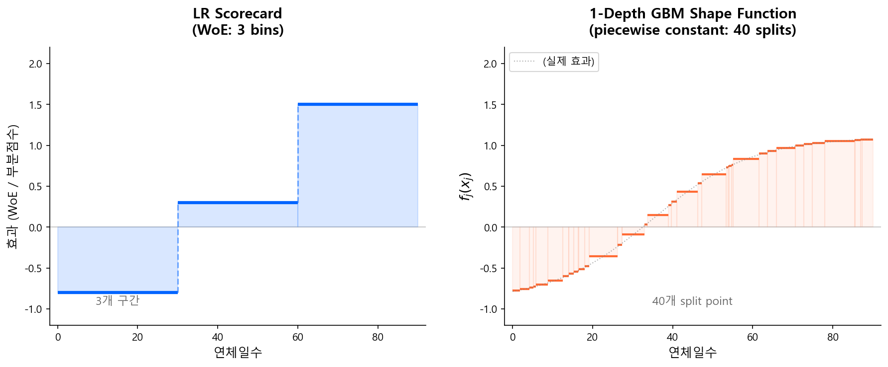

# 1-Depth GBM 스코어카드

## 3.1 변수별 효과 곡선 — Shape Function

1-Depth GBM 스코어카드의 결과물부터 보자.

전통 스코어카드에서는 각 변수의 효과가 WoE 구간별 상수 — **굵은 계단 함수**였다:

```
연체일수:  0~30일 → WoE -0.8
          30~60일 → WoE 0.3
          60일+   → WoE 1.5
```

1-Depth GBM에서는 수백 개의 stump가 합산되면서, 같은 변수의 효과가 **촘촘한 계단 함수(piecewise constant)**로 나타난다:

```
연체일수:  0일 → -0.9
          15일 → -0.5
          30일 → 0.1
          45일 → 0.6
          60일 → 1.2
          90일 → 1.8
```

수학적으로는 여전히 계단 함수이지만, split point가 촘촘하기 때문에 **사실상 곡선처럼** 보인다. 전통 스코어카드의 수 개 구간 계단과 비교하면 해상도가 훨씬 높다.

<figure markdown="span">
  
  <figcaption>같은 변수에 대해 전통 스코어카드(굵은 계단)와 1-Depth GBM(촘촘한 계단)이 표현하는 효과 곡선의 비교.</figcaption>
</figure>

핵심은 이것이다: **비선형 효과를 자동으로 학습하면서도, 각 변수의 효과를 독립적인 곡선 한 줄로 읽을 수 있다.** 전통 스코어카드처럼 "이 변수가 이 값이면 모형이 어떻게 반응하는가"를 일관되게 말할 수 있다는 뜻이다. 대가는 교호작용을 포기한다는 것이다.

!!! warning "촘촘함은 양날의 검이다"
    split point가 많다는 것은 해상도가 높다는 뜻이지만, 동시에 **데이터의 우연한 굴곡까지 계단으로 새겨질 수 있다**는 뜻이기도 하다. 계단이 많을수록 비단조 구간이 생기기 쉽고, 심사역이 검토해야 할 구간도 늘어난다. 이 가이드북의 [해석 가능 조건](interpretability.md)(단조성, 점수표 환산)을 적용하려면 3.2절의 단조 제약을 건다. 운영 평점표의 관행(변수당 구간 5개 안팎)에 맞추려면 최종 점수표로 옮길 때 인접 구간을 묶는 단계를 거친다. 학습 단계에서 히스토그램 bin 수를 줄이거나 사전 구간화한 변수를 넣으면 처음부터 분할점 후보가 제한된다.

왜 이것이 가능한가? 비밀은 **depth = 1**이라는 제약에 있다.

---

## 3.2 왜 가능한가 — depth = 1이면 교호작용이 사라진다

Depth = 1인 트리는 **stump** — 단 하나의 변수로 한 번만 분할하는 트리다.

```
      [변수 A > 30?]
       /          \
  [Leaf: -0.3]  [Leaf: +0.5]
```

이 stump를 Boosting으로 수백~수천 개 쌓는 것이 1-Depth GBM이다. 각 트리가 **정확히 하나의 변수만** 사용하므로:

$$
F(\mathbf{x}) = F_0 + \eta \sum_{t=1}^{T} h_t(x_{j(t)})
\tag{1}
$$

- 각 \(h_t\)는 하나의 변수 \(x_{j(t)}\)에만 의존 (\(\eta\)는 학습률)
- 변수 간 교호작용(interaction)이 **구조적으로 불가능**

같은 변수를 사용한 stump들을 모아 합산하면, 최종 모형은 **Generalized Additive Model (GAM)** 형태 — 각 shape function이 구간별 상수인 가법 모형 — 가 된다:

$$
F(\mathbf{x}) = F_0 + f_1(x_1) + f_2(x_2) + \cdots + f_p(x_p)
\tag{2}
$$

각 \(f_j\)가 바로 앞에서 본 shape function이다. 교호작용이 없기 때문에, 한 변수의 효과가 다른 변수의 값에 따라 달라지지 않는다. **globally 일관된 해석**이 가능한 이유다.

!!! info "이론적 근거: Friedman (2001)"
    이 아이디어는 새로운 것이 아니다. Friedman은 Gradient Boosting Machine을 처음 제안한 논문에서 이미, 트리 크기가 모형이 담을 수 있는 교호작용 수준을 정하며 분할이 하나뿐인 트리(stump)를 쓰면 결과 모형이 원 변수들의 가법 모형(교호작용 없음)이 된다는 점을 설명했다(의역).

    <div class="source-ref">
    출처: Friedman, J.H. (2001). "Greedy Function Approximation: A Gradient Boosting Machine." <em>Annals of Statistics</em>, 29(5):1189-1232.
    <a href="https://projecteuclid.org/journals/annals-of-statistics/volume-29/issue-5/Greedy-function-approximation-A-gradient-boosting-machine/10.1214/aos/1013203451.full" target="_blank">논문 링크</a>
    </div>

### 주의: 단조성(Monotonicity)은 자동 보장이 아니다

1-Depth GBM이 교호작용을 원천 차단한다는 점에서, "변수별 효과도 자동으로 단조적이지 않을까?"라고 오해하기 쉽다. **그렇지 않다.**

개별 stump는 leaf가 2개뿐이므로 당연히 단조적이다. 하지만 같은 변수에 대해 여러 stump가 **서로 다른 split point**에서 잘리면, 앙상블의 누적 효과는 비단조(non-monotonic)가 될 수 있다:

```
Tree  12:  연체일수 < 30 → -0.2,  ≥ 30 → +0.1
Tree  85:  연체일수 < 50 → +0.3,  ≥ 50 → -0.1
Tree 241:  연체일수 < 30 → +0.15, ≥ 30 → -0.05
```

세 stump만 더해 봐도 연체일수 30일 미만은 \(-0.2+0.3+0.15 = +0.25\), 30~50일은 \(+0.1+0.3-0.05 = +0.35\), 50일 이상은 \(+0.1-0.1-0.05 = -0.05\)로, 올라갔다가 50일 이후 오히려 내려간다. 이것은 버그가 아니라, stump 합산이 **piecewise constant function을 자유롭게 근사**하기 때문에 나타나는 자연스러운 현상이다 — GAM의 유연성이란 곧 비단조적 곡선도 학습할 수 있다는 뜻이다.

스코어카드에서 이것이 문제가 되는 이유는 명확하다. "연체일수가 늘었는데 오히려 리스크가 낮아진다"는 구간이 존재하면, 심사 담당자에게도 감독기관에게도 설명할 수 없다.

**해법은 단조 제약(monotone constraints)이다.** 변수마다 다음 셋 중 하나를 지정한다.

- `+1`: 변수 값이 증가하면 예측값(Bad log-odds)도 증가 (양의 단조) — 예: 연체일수
- `-1`: 변수 값이 증가하면 예측값은 감소 (음의 단조) — 예: 소득
- `0`: 제약 없음 (비단조 허용)

XGBoost, LightGBM, CatBoost 모두 이 옵션을 지원한다. 제약이 학습 중에 어떻게 작동하는지는 [Boosting 심화](../part3_tree_ensemble/boosting_advanced.md)에서 다룬다. 감독기관과 심사역에게 변수 효과를 설명해야 하는 스코어카드라면 사실상 필수 조건이다.

!!! warning "WoE 변환 입력에도 제약이 필요하다"
    WoE 변환을 거친 변수는 구간마다 하나의 값만 가지므로 split도 구간 경계에서만 일어난다. 그래도 여러 stump가 서로 다른 경계에서 잘리면 위 예시처럼 합산 결과가 WoE 순서와 어긋날 수 있으므로, WoE 입력이라도 단조 제약을 거는 것이 안전하다.

    방향은 WoE 정의에 따라 정해진다. 이 가이드북의 정의 \(\text{WoE} = \ln(\%\text{Good}/\%\text{Bad})\)에서는 WoE가 클수록 우량 구간이다. 1-Depth GBM이 Bad log-odds를 예측하므로, **모든 WoE 변수의 제약 방향은 −1**로 같다. 로지스틱 회귀에서 WoE 변수의 정상 부호가 \(\beta < 0\)인 것과 같은 이유다.

### 주의: 상관된 변수의 효과는 임의로 나뉜다 (Concurvity)

교호작용이 없다고 해서 변수 간 관계가 사라지는 것은 아니다. 소득과 한도, 대출 건수와 대출 잔액처럼 **서로 강하게 상관된 변수**가 함께 들어가면, 두 shape function이 비슷한 정보를 나눠 갖는다. 이때 어느 변수에 얼마가 배분될지는 데이터의 작은 차이나 학습 순서에 따라 달라질 수 있다.

- Boosting은 매 라운드 가장 Gain이 큰 변수를 고르므로, 조금이라도 앞선 변수가 효과를 **몰아서** 가져가고 다른 변수의 곡선은 평평해질 수 있다
- 재학습할 때마다 두 곡선의 모양이 바뀌면, 개별 곡선을 "그 변수의 효과"로 해석하기 어렵다
- 선형 회귀의 다중공선성과 같은 문제가 비선형 가법 모형에서 나타나는 것으로, GAM 문헌에서는 **concurvity**라고 부른다

대응은 전통 스코어카드와 같다. 강하게 상관된 변수는 사전에 하나만 고르고, 남긴 변수들의 shape function이 재학습(다른 시드, 다른 기간)에서도 안정적인지 확인한다. EBM이 변수를 순서대로 돌아가며 학습하는 방식(round-robin)도 이 쏠림을 줄이려는 장치다([EBM](ebm.md) 참조).

---

## 3.3 전통 LR vs 1-Depth GBM vs Full GBM 비교

| 항목 | 전통 LR (WoE) | **1-Depth GBM** | Full GBM (depth=5~6) |
|------|:---:|:---:|:---:|
| **비선형 포착** | WoE 구간화로 간접 | **자동** (stump 합산) | 자동 |
| **교호작용** | 없음 | **없음** | 있음 |
| **해석 가능성** | 점수표 | **변수별 효과 곡선** | SHAP 필요 |
| **예측 성능** | 기준 | 대개 LR보다 높음 | 대개 가장 높음 |
| **변수 처리** | Classing + WoE 필수 | Raw 입력 가능 | Raw 입력 가능 |
| **규제 수용성** | 매우 높음 | **높음 (GAM 해석)** | 제한적 |

### 성능 비교의 직관

전통 LR이 성능에서 뒤지는 주요 원인 두 가지:

1. **Classing의 정보 손실**: 연속형 변수를 수 개의 구간으로 자르면서 세밀한 패턴이 사라짐
2. **구간 내 상수 가정**: WoE 변환 후에는 같은 구간의 모든 고객이 같은 값을 받으므로, 구간 안의 위험 차이를 포착하지 못함

1-Depth GBM은 이 두 문제를 해결한다:

- Classing 없이 원본 변수를 직접 사용
- stump들이 자동으로 최적 분할점을 찾고, 누적하여 비선형 곡선을 형성

그러나 교호작용이 없기 때문에, 변수 간 시너지를 활용하는 Full GBM보다는 성능이 낮다.

### 성능 격차의 일반적 경향

- **전통 LR → 1-Depth GBM**: 수동 구간화의 정보 손실을 회복하면서 성능이 향상되는 경향이 있다. 비선형 패턴이 복잡한 데이터일수록 격차가 커진다.
- **1-Depth GBM → Full GBM**: 교호작용을 포착하는 만큼 추가 성능 향상이 가능하다. 격차의 크기는 데이터에 교호작용이 얼마나 있는지에 달려 있다.
- **EBM (GA\(^2\)M 모드) → Full GBM**: 선택한 2-way 교호작용만 더해도 블랙박스 모형과의 격차가 상당 부분 줄어든다는 보고가 있다(Lou et al., 2013).

!!! note "성능 격차는 데이터에 따라 다르다"
    교호작용이 중요한 데이터(예: 소득 × 부채비율)에서는 Full GBM과의 격차가 크고, 각 변수가 독립적으로 작용하는 데이터에서는 격차가 거의 없다.

!!! example "업계 사례: Moody's Analytics의 비교 연구"
    Moody's Analytics는 제약이 걸린 로지스틱 회귀(supervised binning + 단조 제약) 스코어카드와 비제약 ML 모형(decision tree, random forest, gradient boosting)을 비교하여, **해석 가능한 모형의 성능 손실이 크지 않고**, 오히려 비제약 모형들이 단조성 같은 업무 제약을 자주 위반한다고 보고했다. 이 연구의 비교 대상은 1-Depth GBM이 아닌 constrained LR이지만, "해석 가능성을 위한 제약이 성능을 크게 희생하지 않는다"는 메시지는 동일하다.

    <div class="source-ref">
    출처: Moody's Analytics. "Automating Interpretable Machine Learning Scorecards." Whitepaper.
    <a href="https://www.moodys.com/web/en/us/insights/resources/Automating-Interpretable-Scorecards.pdf" target="_blank">PDF</a>
    </div>

---

## 3.4 업계 적용 사례

### FICO의 접근: Transmutation

FICO의 Gerald Fahner가 제안한 **transmutation** 방법은:

1. **Tree Ensemble Model (TEM)으로 패턴 발견** — Full GBM으로 변수 간 비선형 관계를 탐색
2. **TEM의 인사이트를 제약 스코어카드로 변환** — 발견된 패턴을 단조성 제약이 있는 세분화된 스코어카드로 변환 (비선형 프로그래밍 사용)
3. **스코어카드를 배포** — 블랙박스 TEM이 아닌, 해석 가능한 스코어카드를 실전에 투입

이 접근은 "ML은 패턴 탐색 도구로 쓰고, 최종 산출물은 전통 스코어카드"라는 실용적 전략이다. FICO는 이 논문이 Data Analytics 2018(IARIA)에서 Best Paper Award를 받았다고 소개한다.

<div class="source-ref">
출처: Fahner, G. (2018). "Developing Transparent Credit Risk Scorecards More Effectively: An Explainable Artificial Intelligence Approach." <em>DATA ANALYTICS 2018</em> (IARIA).
<a href="https://www.philadelphiafed.org/-/media/frbp/assets/events/2018/consumer-finance/fintech-2018/day-1/session_3_paper_3_fico_paper_gerald_fahner.pdf" target="_blank">PDF</a> ·
<a href="https://www.fico.com/blogs/analytics-optimization/fico-score-research-explainable-ai-and-machine-learning-for-credit-scoring/" target="_blank">FICO 블로그</a>
</div>

### 국내 공개 특허 사례: stump 모형의 스코어카드 변환

국내에도 같은 아이디어를 스코어카드 개발 절차로 정리한 공개 특허가 있다. 공개 특허 문서에 적힌 내용을 요약하면 다음과 같다.

!!! example "등록특허 10-1851367 — 신용도를 평가하는 방법, 장치 및 컴퓨터 판독 가능한 기록 매체"
    **특허가 지적하는 기존 방식(전문가 구간화 + 로지스틱 회귀)의 한계**

    1. **시간 비용** — 후보 변수 300~1,000개를 전문가가 일일이 분석·구간화해야 한다
    2. **단변량 구간화의 한계** — 변수별로 독립적으로 정한 구간이 다변량 모형에서는 최적이 아닐 수 있다
    3. **다중공선성에 의한 변수 제한** — 최종 변수가 10~15개 수준으로 줄어 정보가 손실된다
    4. **주관성** — 전문가의 해석에 따라 결과가 달라질 수 있다

    **제안하는 절차 (4단계)**

    - **1차 모형**: 손실을 줄이는 순서로 depth=1 의사결정나무 \(t\)개를 생성하고, 모형은 이 트리들의 선형결합이다. 변수별로 기대 방향(−1, 0, 1)을 관리한다
    - **최적 모형 선택**: 트리를 순서대로 누적하며 검증 데이터의 변별력 지표(AUROC, K-S, AR, IV)가 가장 좋은 \(k\)개까지만 채택한다
    - **신용평가모형 변환**: 같은 변수의 stump들을 묶어 각 분할점을 구간 경계로 삼고, 구간 점수는 해당 구간 예측값의 합으로 정한다 — 가법 모형의 shape function을 구간별 상수로 옮긴 것으로, 전통 스코어카드와 같은 점수표 형태가 된다
    - **스코어카드 생성**: PDO와 BASE를 반영해 최종 점수 스케일로 변환한다

    새로운 학습 알고리즘이라기보다, stump 기반 가법 모형을 **점수표로 옮기는 개발 절차**를 정리한 것으로 읽는 것이 적절하다.

    <div class="source-ref">출처: 등록특허 KR 10-1851367 (출원 2016-07-28, 등록 2018). 발명자: 강신형, 김용대. 특허권자: 코리아크레딧뷰로(주), 서울대학교 산학협력단. <a href="https://patents.google.com/patent/KR101851367B1/ko" target="_blank">Google Patents</a></div>

---

## 3.5 SHAP과의 관계

1-Depth GBM에서는 교호작용이 없으므로:

- **SHAP value** = 해당 변수의 **shape function 값에서 그 기대값을 뺀 것** \(f_j(x_j) - E[f_j(X_j)]\). 기대값을 어떤 가중치로 구하는지는 SHAP 계산 모드에 따라 다르다(TreeSHAP 기본 모드는 트리의 cover 가중치를 쓴다 — [SHAP 이론](shap_theory.md) 참조)
- SHAP dependence plot = 기준값만큼 평행이동한 shape function plot (점들이 한 줄로 모인다)
- SHAP interaction value = **항상 0** (교호작용 자체가 없으므로)

이것은 Full GBM과의 결정적 차이다. Full GBM에서도 TreeSHAP은 SHAP value를 정확히 계산하지만, 교호작용이 관여 변수들에 분배되어 섞이므로 같은 변수·같은 값이라도 차주마다 SHAP이 다르다. 1-Depth GBM에서는 SHAP이 shape function을 그대로 읽는 것과 같아, 같은 값이면 누구에게나 같은 기여가 나온다.

!!! tip "다음 페이지"
    [EBM (GA²M)](ebm.md) --- GA\(^2\)M을 실용적으로 구현한 EBM의 설계 철학과 학습 구조를 다룬다.
