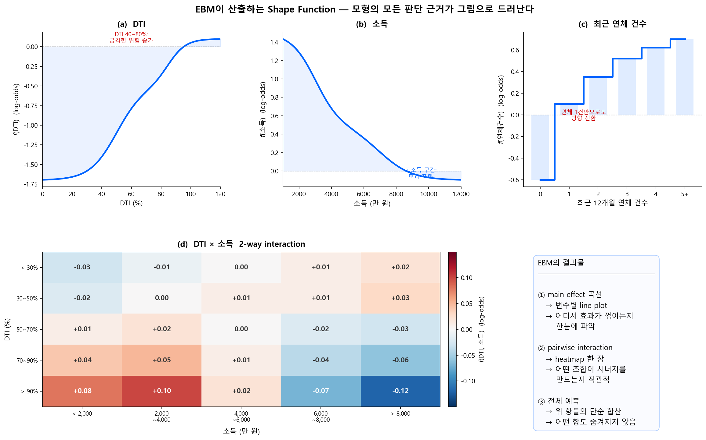

# EBM (GA²M) — Explainable Boosting Machine

## 4.1 핵심 사상 — "개별 먼저, 조합은 최소한으로"

EBM의 설계 철학은 명확하다: **변수 하나하나의 효과를 철저히 학습한 뒤, 그것만으로 설명되지 않는 잔차에서만 2변수 조합 효과를 추가한다.** 3변수 이상의 교호작용은 아예 고려하지 않는다. GA\(^2\)M의 "²"이 바로 이 제한을 뜻한다.

$$
F(\mathbf{x}) = F_0 + \underbrace{\sum_{j} f_j(x_j)}_{\text{1단계: main effects}} + \underbrace{\sum_{(j,k) \in \mathcal{P}} f_{jk}(x_j, x_k)}_{\text{2단계: 선택된 pairwise interactions}}
\tag{1}
$$

\(\mathcal{P}\)는 데이터로 골라낸 소수의 변수 쌍이다. 2-way까지만 허용하는 이유는 사람이 그림 한 장(heatmap)으로 읽을 수 있는 한계가 2차원이기 때문이며, 이는 이 가이드북의 [해석 가능 조건](interpretability.md) 2번과 같은 이유다.

이러한 설계를 **ante-hoc**(라틴어 "사전에") 해석이라 부른다. 모형의 구조 자체를 GA²M 가법 구조로 제한해 학습하는 것이다. 이미 학습이 끝난 블랙박스 모형에 SHAP, PDP 등 외부 도구를 적용하는 **post-hoc**(라틴어 "사후에") 해석과 대비된다.

| | **ante-hoc** ("사전에") | **post-hoc** ("사후에") |
|---|---|---|
| **시점** | 모형 설계·학습 단계 | 학습 완료 후 |
| **방식** | 구조적 제약으로 해석 가능성 **내장** | 외부 도구로 해석 **추출** |
| **예시** | EBM, 1-Depth GBM, 로지스틱 회귀 | SHAP, PDP, Surrogate, Purification |

그래서 EBM을 돌리면 무엇이 나오는가? 아래 그림이 그 답이다.

<figure markdown="span">
  { width="900" }
  <figcaption>EBM의 결과물(가상 예시): 각 변수의 main effect는 곡선 하나로, 2-way interaction은 heatmap 한 장으로 표현된다. 모형의 전체 예측은 이 항들의 단순 합산이므로, 어떤 판단 근거도 숨겨지지 않는다.</figcaption>
</figure>

main effect 곡선 (a~c)을 보면, **각 변수가 모형의 예측에 미치는 영향을 한눈에 읽을 수** 있다. DTI는 40~80%에서 급등하고, 소득은 고소득 구간에서 포화되며, 연체는 1건만으로도 방향이 전환된다. 이것이 변수마다 독립적인 shape function \(f_j(x_j)\)다.

2-way interaction heatmap (d)은 main effect만으로 설명되지 않는 **조합 효과**를 보여준다. 고DTI + 저소득 구간에서 시너지로 위험이 추가 증가하는 패턴이 격자의 색상으로 드러난다.

---

## 4.2 EBM vs 일반 GBM

EBM은 일반적인 gradient boosting과 다른 방식으로 학습한다.

| | 일반 GBM | EBM |
|---|---|---|
| **변수 선택** | 매 스텝에서 Gain이 가장 큰 변수 선택 | 변수를 **순서대로 돌아가며**(round-robin, cyclic) 학습 |
| **Bagging** | 선택 사항 | **Outer bagging**: 데이터를 여러 번 나눠 학습한 결과를 평균 (InterpretML 기본 14회) |
| **결과** | 깊은 트리에서는 변수 간 효과가 섞임 | 항별로 효과가 분리된 가법 구조 |
| **교호작용** | 트리 깊이에 따라 자동 | 선택한 2-way만 추가 (FAST 알고리즘) |

### Round-robin이 해석 품질을 높이는 이유

일반 GBM은 매 라운드 Gain이 가장 큰 변수를 고른다. 소득과 한도처럼 상관된 두 변수가 있으면, 조금이라도 앞선 변수가 계속 선택되어 효과를 **몰아서** 가져가고 다른 변수의 곡선은 평평해지기 쉽다([1-Depth GBM — concurvity](depth1_gbm.md) 참조). EBM은 모든 변수에 차례로 기회를 주고, 아주 낮은 학습률로 조금씩만 반영하므로, 상관된 변수들이 효과를 **고르게 나눠** 갖게 된다. 여기에 outer bagging으로 여러 번 학습한 곡선을 평균하므로 곡선이 매끄럽고 재학습에도 안정적이다. 이것이 EBM이 단순한 1-Depth XGBoost보다 **해석 품질이 높은** 이유다.

최근 버전의 InterpretML은 순환 방식에 일부 탐욕적(greedy) 선택 단계를 섞는 옵션을 기본으로 사용하므로, 엄밀히는 순수한 round-robin과 차이가 있다.

출처: Nori, H., Jenkins, S., Koch, P., and Caruana, R. (2019). "InterpretML: A Unified Framework for Machine Learning Interpretability." arXiv:1909.09223.
<a href="https://arxiv.org/abs/1909.09223" target="_blank">arXiv</a> ·
<a href="https://github.com/interpretml/interpret" target="_blank">GitHub</a>

---

## 4.3 학술적 계보: Lou-Caruana 연구 (Microsoft Research)

EBM의 현대적 기반은 Microsoft Research의 **Rich Caruana** 그룹이 만들었다.

### Lou et al. (2012) --- 최적 GAM 적합법 비교

Lou, Caruana, Gehrke는 GAM의 shape function을 표현하는 방법(spline, 트리 등)과 적합하는 방법(backfitting, gradient boosting 등)의 조합을 대규모로 비교했다. 저차원~중간 차원 데이터에서는 **잎이 몇 개뿐인 얕은 트리를 bagging하여 gradient boosting으로 쌓는 방법**이 가장 정확했다. 이것이 트리 기반 boosting을 GAM 적합의 핵심 엔진으로 자리잡게 한 논문이다.

출처: Lou, Y., Caruana, R., and Gehrke, J. (2012). "Intelligible Models for Classification and Regression." <em>KDD 2012</em>.
<a href="https://www.cs.cornell.edu/~yinlou/papers/lou-kdd12.pdf" target="_blank">PDF</a>

### Lou et al. (2013) --- GA\(^2\)M: 2-way 교호작용 추가

순수 GAM은 교호작용을 포착하지 못한다. Lou et al.은 **GA\(^2\)M**(GAM + 선택된 pairwise interactions, 식 (1))을 제안하여, 선택된 2-way 교호작용만 추가해도 블랙박스 모형과의 성능 격차를 상당 부분 줄일 수 있음을 보였다.

출처: Lou, Y., Caruana, R., Gehrke, J., and Hooker, G. (2013). "Accurate Intelligible Models with Pairwise Interactions." <em>KDD 2013</em>.
<a href="https://dl.acm.org/doi/10.1145/2487575.2487579" target="_blank">논문 링크</a>

### Caruana et al. (2015) --- "해석 가능한 모형이 생명을 구한다"

이 논문은 해석 가능한 ML의 필요성을 가장 강력하게 보여준 사례로 널리 인용된다.

폐렴 위험 예측에 GA\(^2\)M을 적용한 결과, 모형이 **"천식 환자의 폐렴 사망 위험이 낮다"**는 패턴을 학습했다. 이는 실제로는 천식 환자가 더 적극적인 치료를 받았기 때문에 나타난 데이터 편향이었다. 블랙박스 모형이었다면 이 위험한 패턴이 드러나지 않았겠지만, 가법 구조 덕분에 임상의가 곡선을 보고 즉시 식별하고 교정할 수 있었다.

!!! warning "신용평가에서도 같은 위험이 존재한다"
    신용평가 모형은 **과거에 승인되어 실제로 대출을 받은 고객**의 성과로만 학습한다(거절된 신청자는 성과가 없다). 예컨대 과거 심사에서 특정 직업군은 매우 엄격하게 골라서만 승인했다면, 승인된 소수는 부도율이 낮게 나타나고 모형은 "이 직업군은 안전하다"고 학습할 수 있다. 실제로는 심사 정책이 만든 **선택 편향(selection bias)**이다. 해석 가능한 모형은 이런 패턴을 곡선에서 바로 보여주므로 **발견하기 훨씬 쉽다**. 승인 데이터만으로 학습하는 문제 자체는 거절 추론(reject inference)의 영역이다.

출처: Caruana, R., Lou, Y., Gehrke, J., Koch, P., Sturm, M., and Elhadad, N. (2015). "Intelligible Models for HealthCare." <em>KDD 2015</em>.
<a href="https://dl.acm.org/doi/10.1145/2783258.2788613" target="_blank">논문 링크</a>

---

## 4.4 2-Stage 학습

### 1단계 — 변수 하나씩, 철저하게

변수를 하나씩 순환하면서, 각 변수에 대해 **그 변수 하나만 쓰는 아주 얕은 트리**를 잔차에 적합한다(InterpretML 최근 버전의 분류 기본값은 Leaf 2개, 즉 stump):

- \(X_1\)으로 트리 → \(X_2\)로 트리 → ... → \(X_p\)로 트리 → 다시 \(X_1\)부터
- **매우 낮은 learning rate**(InterpretML 분류 기본값 0.015)로 한 번에 조금씩만 학습한다. 변수 순서가 결과에 미치는 영향을 최소화하기 위한 것이다
- 이것을 수천~수만 라운드 반복한다(내부 검증 데이터로 멈출 시점을 정한다)

각 트리가 변수 1개만 분할하므로, 이 단계에서 학습된 함수는 구조적으로 가법 모형(\(f_0 + \sum f_j(x_j)\))이다. 여기까지는 교호작용이 **원천적으로 불가능**하다.

### 2단계 — 효과 큰 변수 쌍만 빠르게 골라서 (FAST)

1단계 예측으로 설명되지 않은 잔차에서, 이번에는 **2변수 조합**의 교호작용을 학습한다. 그런데 변수가 20개면 가능한 쌍이 \(\binom{20}{2} = 190\)개다. 이것을 전부 학습하면 해석력이 사라지므로, **효과가 큰 쌍만 선별**해야 한다.

이때 쓰이는 것이 **FAST 알고리즘**(Lou et al., KDD 2013)이다:

1. 190개 쌍 전부에 대해, 각 변수를 1번씩만 자르는 **2×2 격자(4칸짜리 모델)**를 잔차에 적합
2. 미리 계산해 둔 누적 히스토그램을 쓰므로 4칸 모델 하나를 평가하는 비용이 매우 작아, 190개 쌍을 빠르게 훑을 수 있음
3. 각 쌍의 RSS(잔차제곱합) 감소량으로 interaction 강도를 랭킹
4. **상위 일부만 선택**해서 본격적으로 2변수 트리로 학습 (InterpretML 기본값은 변수 수의 0.9배 개수)

---

## 4.5 단조성과 bin 수 — 기본값 그대로는 해석 조건을 만족하지 않는다

EBM은 해석 가능 모형이지만, **기본 설정 그대로** 이 가이드북의 [해석 가능 조건](interpretability.md)을 만족하지는 않는다.

| 조건 | EBM 기본값 (InterpretML) | 조건을 맞추려면 |
|------|------|------|
| 교호작용 ≤ 2-way | 구조적으로 만족 | — |
| 단조성 | 제약 없음 | 단조 제약 옵션 사용(0.6.0부터 학습 중 제약 지원) 또는 학습 후 단조화 보정 |
| 점수표 환산 | 구조상 가능(main effect 곡선 + 2-way 표), 다만 main effect 최대 1,024 bin, 교호작용 최대 64 bin | 점수표로 쓰려면 bin 수 상한을 낮추거나 사전 구간화(Coarse Classing)한 변수를 입력. 구간 수 자체는 운영 평점표 관행의 문제 |

기본값으로 학습하면 main effect 곡선은 수백 구간의 촘촘한 계단이 되고, 교호작용 heatmap은 최대 64×64 격자가 된다. 곡선은 눈으로 방향을 볼 수 있지만, heatmap을 사람이 칸 단위로 검토하거나 점수표로 옮겨 적기는 어렵다. InterpretML 변경 이력(v0.6.0)은 학습 중 단조 제약을 지원하면서도 **학습 후 보정(post-processed monotonization)을 여전히 더 권장**한다고 밝히고 있으므로, 두 방식을 비교해 선택한다.

InterpretML 소스 및 변경 이력(기본값: <code>max_bins</code>, <code>max_interaction_bins</code>, <code>outer_bags</code>, <code>learning_rate</code>, <code>interactions</code>; 단조 제약은 v0.6.0에서 추가): <a href="https://github.com/interpretml/interpret/blob/develop/CHANGELOG.md" target="_blank">GitHub CHANGELOG</a>

---

## 4.6 효과 누출과 Purification

### 그래도 누출은 발생한다

EBM의 2-stage 설계는 main effect를 먼저 학습하므로, 처음부터 교호작용을 함께 학습하는 depth-2 GBM보다 누출이 적을 것으로 기대된다. 그러나 **완전히 없지는 않다:**

- 1단계가 유한 라운드에서 끝나므로, main effect가 100% 학습되지 않을 수 있다. 학습되지 못한 main effect는 잔차에 남는다
- 2단계 트리가 그 잔차를 학습할 때, 남은 main effect와 순수 교호작용을 **구분하지 않고** 함께 흡수한다

Lengerich et al. (2020)은 MIMIC-III(중환자 데이터)에서 이를 확인했다. 많은 교호작용에 참여한 BUN(혈중요소질소) 변수에서 purification 전후로 main effect shape function이 **크게 변했다.** 논문의 표현을 빌리면:

> "Even though the GA2M algorithm was designed to estimate interactions based only on residuals after estimating the main effects, it is apparent that the interaction terms still capture some main effects."

### Purification으로 잔여 누출 보정

이 잔여 누출을 보정하려면, 학습 후 **purification**을 적용한다.

- **InterpretML (EBM)**: 학습이 끝나면 각 항을 평균 0으로 맞추는 처리(중심화)는 하지만, 교호작용 항에 섞인 main effect를 main effect 쪽으로 옮기는 **purification은 기본으로 적용되지 않는다**. 라이브러리가 제공하는 purify 유틸리티를 별도로 호출해야 한다
- 저자들이 공개한 [GAM Purification](https://github.com/AdaptInfer/gam_purification) 라이브러리로도 적용할 수 있다

purification 후 각 \(f_j\)는 주효과를, 각 \(f_{jk}\)는 순수 교호작용만 담으며, 모형의 전체 예측값은 변하지 않는다. 단, 무엇을 "순수"로 볼지는 분해의 기준이 되는 분포(측도)를 무엇으로 정하느냐에 따라 달라진다 — [fANOVA 개념과 Purification](fanova_concepts.md) 참조.

출처: Lengerich, B., Tan, S., Chang, C.-H., Hooker, G., and Caruana, R. (2020). "Purifying Interaction Effects with the Functional ANOVA." <em>AISTATS 2020</em>, PMLR 108:2402-2412.
<a href="https://arxiv.org/abs/1911.04974" target="_blank">arXiv</a>

!!! abstract "Purification 알고리즘 상세"
    Purification이 구체적으로 어떻게 작동하는지 — Mass-Moving 알고리즘, 수렴 정리, 비균등 가중 예시 등은 [부록 A: SHAP과 Functional ANOVA](../appendix/shap-fanova/index.md)에서 다룬다.

!!! tip "다음 페이지"
    [fANOVA 개념과 Purification](fanova_concepts.md) --- 분배(SHAP) vs 분리(fANOVA), Variance Decomposition, Purification 직관을 다룬다.
