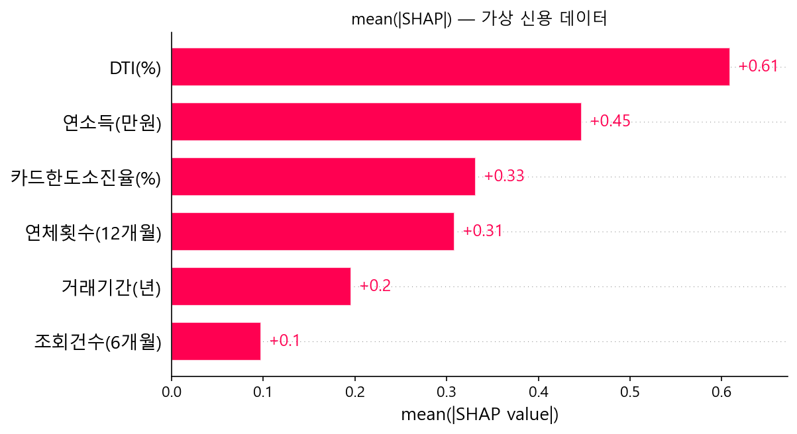
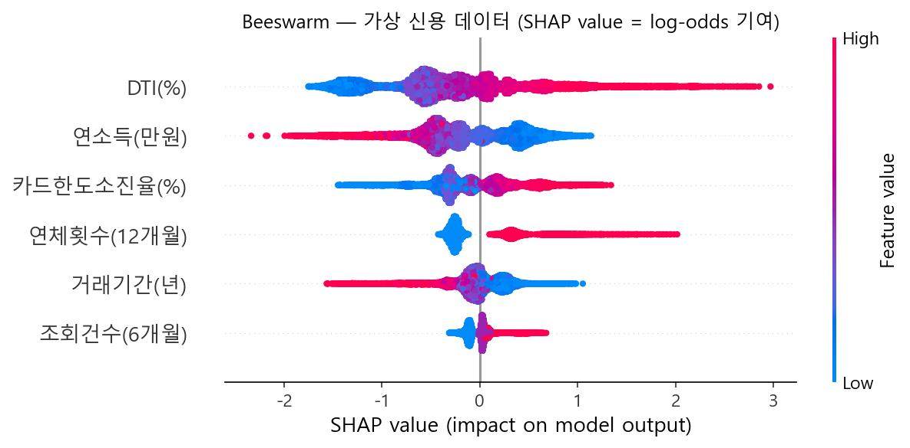
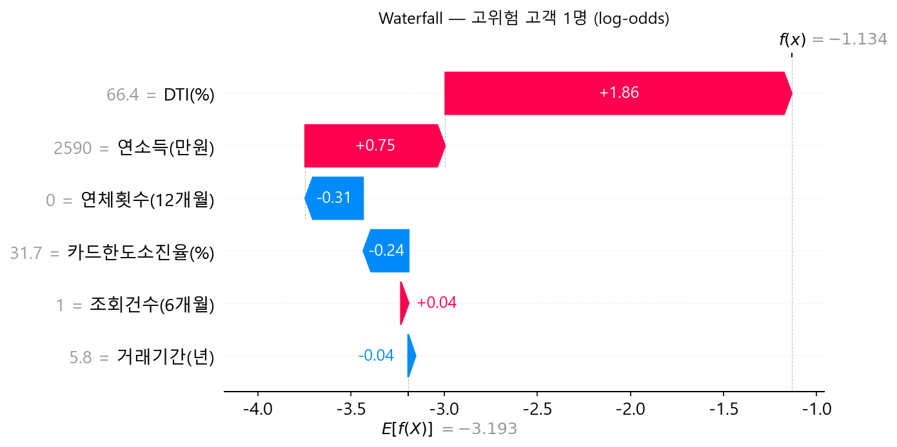
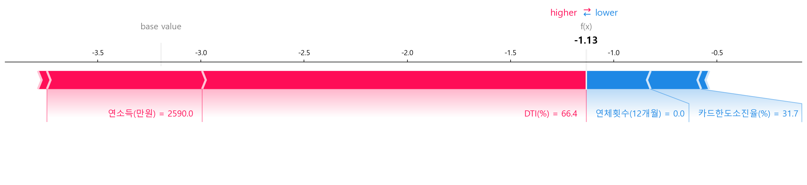
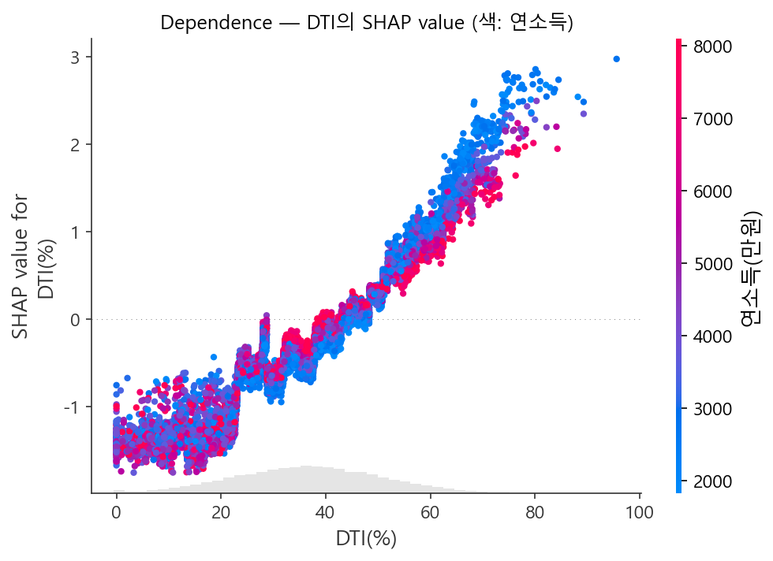

# SHAP 이론

[Lundberg & Lee (2017)](https://arxiv.org/abs/1705.07874)가 제안한 SHAP(SHapley Additive exPlanations)은 현재 **ML 해석의 사실상 표준**이다. 게임이론의 Shapley Value를 ML에 적용하여, 개별 예측값을 변수별 기여분으로 정확히 분해한다.

---

## 2.1 Shapley Value의 직관

> "각 변수가 예측에 기여한 공정한 몫은 얼마인가?"

5명이 팀 프로젝트를 했는데 최종 점수가 90점이다. 각자의 기여도를 공정하게 분배하고 싶다면?

Shapley Value의 방법: **모든 가능한 팀 조합에서, 해당 멤버가 참여할 때와 참여하지 않을 때의 점수 차이를 평균**낸다.

변수 \(j\)의 SHAP value:

$$
\phi_j = \sum_{S \subseteq \{1,...,p\} \setminus \{j\}} \frac{|S|!(p-|S|-1)!}{p!} \left[v(S \cup \{j\}) - v(S)\right]
\tag{1}
$$

- \(S\): 변수 \(j\)를 제외한 변수들의 부분집합
- \(v(S)\): 집합 \(S\)에 포함된 변수만 "알고 있을 때"의 모형 예측값 — **가치함수(value function)**라 부른다
- 가중치 \(\frac{|S|!(p-|S|-1)!}{p!}\)는 변수들을 무작위 순서로 한 명씩 투입한다고 할 때, \(j\) 직전까지 정확히 \(S\)가 들어와 있을 확률이다 — 모든 순열을 균등하게 가중한 결과다

!!! example "신용평가 직관"
    차주 A의 예측 log-odds가 평균보다 2.0 높다면, 이 2.0을 만든 "공범"은 누구인가? SHAP은 DTI가 +0.9, 연체 이력이 +0.6, 소득이 +0.4, 나머지 변수가 +0.1을 기여했다는 식으로, **각 변수의 몫을 공정하게 분배**한다. 신용평가 모형(Log Loss로 학습한 GBM)에서 TreeSHAP은 기본적으로 확률이 아니라 **log-odds**를 분해한다는 점에 주의한다.

### 가치함수 — "변수를 모른다"는 것을 어떻게 정의하는가

식 (1)에서 가장 중요한 것은 \(v(S)\), 즉 **\(S\) 밖의 변수를 모를 때 모형이 무엇을 예측하는가**의 정의다. 대표적인 두 가지가 있다.

| | Observational (관측적) | Interventional (개입적) |
|---|---|---|
| 정의 | \(v(S) = E[\hat f(X) \mid X_S = x_S]\) | \(v(S) = E_{X_{\bar S}}[\hat f(x_S, X_{\bar S})]\) |
| 모르는 변수를 채우는 방식 | \(x_S\)와 **함께 관측되는** 값들로 (상관 반영) | 배경 데이터에서 **독립적으로** 가져와서 (상관 무시) |
| 성격 | "데이터에 충실" | "모형에 충실" |
| 상관 변수에서의 문제 | 모형이 쓰지 않는 변수에도 기여가 배분될 수 있음 | 현실에 없는 조합(외삽)에서 모형을 평가 |

두 정의는 변수들이 서로 독립이면 같지만, 소득·부채·한도처럼 상관된 신용 변수에서는 결과가 달라질 수 있다. 어느 쪽이 맞다기보다 **질문이 다르다**. 상세한 비교와 실무 권장은 [부록 B — SHAP의 두 모드](../appendix/correlation-interpretation/shap-two-modes.md)에서 다룬다.

---

## 2.2 SHAP의 핵심 성질

Shapley Value는 다음 4가지 공리를 **유일하게** 만족하는 분배 방법이다(Shapley, 1953).

| 성질 | 의미 |
|------|------|
| **Efficiency** (효율성) | 모든 변수의 SHAP 합 = 예측값 − 기대값 |
| **Symmetry** (대칭성) | 기여가 동일한 변수는 같은 SHAP 값 |
| **Dummy** (무관 변수) | 어떤 조합에 넣어도 예측을 바꾸지 않는 변수의 SHAP = 0 |
| **Additivity** (가산성) | 두 모형의 **합**에 대한 SHAP = 각 모형 SHAP의 **합** |

Additivity는 트리 앙상블에서 특히 유용하다. GBM은 트리들의 **합**이므로 전체 SHAP은 트리별 SHAP의 **합**이고, Random Forest처럼 트리들의 **평균**을 내는 모형은 트리별 SHAP의 **평균**이 된다. 덕분에 트리 하나씩 계산해서 더하면 된다.

!!! note "Lundberg & Lee의 표현"
    SHAP 논문은 같은 내용을 설명 모형의 관점에서 **Local accuracy**(= Efficiency), **Missingness**(입력에 없는 변수의 기여는 0), **Consistency**(모형이 바뀌어 어떤 변수의 한계 기여가 커지면 그 변수의 SHAP도 줄지 않음) 세 성질로 정리하고, 이를 만족하는 가법 설명은 Shapley Value뿐임을 보였다.

### Efficiency가 특히 중요하다

$$
\hat{f}(x) = \underbrace{\phi_0}_{\text{base value}} + \sum_{j=1}^{p} \phi_j(x)
\tag{2}
$$

개별 예측값이 **기준값(base value) + 각 변수의 기여분**으로 정확히 분해된다. 남거나 빠지는 것이 없다. 이것이 SHAP을 단순 변수 중요도 이상의 도구로 만드는 성질이다.

base value \(\phi_0 = v(\varnothing)\)은 "아무 변수도 모를 때의 예측", 즉 **배경 데이터에 대한 모형 출력의 기대값**이다. 여기서 두 가지를 정확히 해 둔다.

- **출력 공간**: 신용평가 GBM에서는 log-odds의 기대값이다. 평균 불량률 \(\bar p\)의 log-odds \(\ln(\bar p/(1-\bar p))\)와는 일반적으로 **같지 않다**. log 변환은 비선형이라 "평균의 log-odds"와 "log-odds의 평균"이 다르기 때문이다
- **배경 데이터와 가중치**: Interventional 모드에서는 지정한 배경 데이터(보통 학습 데이터)에 대한 예측 log-odds의 단순 평균이다. TreeSHAP의 기본 모드(path-dependent)는 배경 데이터 대신 **트리 노드에 저장된 학습 통계(cover)**를 가중치로 쓰는데, XGBoost의 cover는 샘플 수가 아니라 **hessian 합**이다. 그래서 기본 모드의 base value는 학습 데이터 예측 log-odds의 단순 평균과 다를 수 있다

!!! example "실제로 얼마나 다른가 — 가상 데이터 계산"
    2.4절 그림에 쓴 가상 신용 데이터(불량률 4.1%)로 XGBoost를 학습해 세 값을 계산하면 다음과 같다.

    | 값 | log-odds |
    |---|---:|
    | 평균 불량률의 log-odds \(\ln(0.041/0.959)\) | −3.15 |
    | TreeSHAP 기본 모드의 base value | −3.19 |
    | 학습 데이터 예측 log-odds의 단순 평균 | −3.77 |

    이 데이터에서는 기본 모드의 base value가 단순 평균보다 평균 불량률의 log-odds에 가깝게 나왔다. hessian \(p(1-p)\)가 작은 저위험 다수의 가중치가 줄어든 결과로 보인다. 세 값의 관계는 데이터마다 다르므로 일반 법칙으로 받아들이지는 않는다. 어느 값을 기준으로 삼든 식 (2)의 분해는 정확하지만, **"평균 고객 대비"의 평균이 무엇인지**는 보고서에 명시해야 한다.

### 숫자 예시 — SHAP value가 예측을 분해하는 과정

DTI, 연체일수, 소득 3개 변수를 사용하는 부도 예측 모형을 생각하자. 계산을 단순하게 하기 위해 base value가 \(-2.94\)라고 하자. 확률로 바꾸면 약 5%다.

$$
\phi_0 = -2.94 \quad\Rightarrow\quad \frac{1}{1+e^{2.94}} \approx 5\%
$$

이제 3명의 차주에 대해 SHAP value를 계산하면, 다음과 같은 **SHAP value matrix**가 산출된다:

| 차주 | \(\phi_{\text{DTI}}\) | \(\phi_{\text{연체}}\) | \(\phi_{\text{소득}}\) | SHAP 합계 | \(\phi_0+\sum\phi\) | 부도확률 |
|:---:|---:|---:|---:|---:|---:|---:|
| A | +0.8 | +1.2 | +0.3 | **+2.3** | -0.64 | **34.5%** |
| B | -0.3 | +0.1 | -0.5 | **-0.7** | -3.64 | **2.6%** |
| C | +0.2 | -0.1 | +0.0 | **+0.1** | -2.84 | **5.5%** |

**읽는 법:**

- **차주 A**: 기준(-2.94)에서 DTI가 +0.8, 연체가 +1.2, 소득이 +0.3을 밀어올려 최종 -0.64(부도확률 34.5%)에 도달. "연체일수가 가장 큰 위험 요인"
- **차주 B**: DTI가 -0.3, 소득이 -0.5로 끌어내려 -3.64(부도확률 2.6%). "소득이 높아서 안전"
- **차주 C**: 기준과 거의 동일. 어떤 변수도 크게 밀어내지 않음

시각화하면 이 과정이 더 명확해진다. 차주 A를 예시로:

```
                     기준값
  φ0 = -2.94         │
                     │  DTI      +0.8
                     ├──────────→ -2.14
                     │  연체일수  +1.2
                     ├──────────────────→ -0.94
                     │  소득      +0.3
                     ├────────→ -0.64  = f̂(x_A)
                                        ↓
                                  부도확률 34.5%
```

**모든 관측치가 같은 출발점(기준값)에서 시작하고, 각자의 변수값에 따라 다른 방향으로 이동하여 최종 예측에 도달한다.** 이 이동량의 합이 정확히 예측값 − 기준값이 되는 것이 Efficiency 성질이다. 이동량은 log-odds 단위이므로, 같은 +0.3이라도 출발점이 어디냐에 따라 확률로는 다른 크기의 변화가 된다.

---

## 2.3 왜 트리에서는 SHAP이 정확히 계산되는가

### 일반 모형의 문제 — KernelSHAP

Shapley Value 식 (1)을 정직하게 계산하려면, 변수 \(p\)개에 대해 **\(2^p\)개의 부분집합**을 전부 평가해야 한다. 변수가 20개면 약 100만 개, 50개면 약 \(10^{15}\)개 — 현실적으로 불가능하다.

KernelSHAP(Lundberg & Lee, 2017)은 이 문제를 **샘플링 + 가중 선형회귀**로 근사한다. 전체 \(2^p\)개 조합 중 일부만 뽑아서, 가중치를 준 선형 모형으로 SHAP을 추정한다. 어떤 모형이든 적용할 수 있다는 장점이 있지만:

- **느리다**: 관측치 하나당 수천~수만 회의 모형 호출이 필요
- **근사다**: 샘플링에 기반하므로 매번 결과가 약간 달라진다
- 변수가 많을수록 정확도가 떨어진다

### 트리의 특수한 구조 — TreeSHAP

**TreeSHAP** ([Lundberg et al., 2020](https://www.nature.com/articles/s42256-019-0138-9))은 트리 구조를 활용하여 \(2^p\)개 조합을 **전부 평가하지 않고도 정확한 값을 계산**한다. 왜 가능한가?

TreeSHAP의 기본 모드(path-dependent)에서 "변수 \(j\)를 모른다"는 것은, 해당 변수의 분기점을 만났을 때 **양쪽 자식으로 다 내려가되, 각 자식에 학습 데이터가 얼마나 갔는지(cover)의 비율로 가중 평균**을 취하는 것으로 정의된다. 즉, 변수를 "빼는" 연산이 트리의 경로를 따라가면서 자연스럽게 정의된다.

```
         DTI < 40?
        /          \
      소득 < 300?    leaf: 0.02
      /       \
  leaf: 0.15  leaf: 0.08
```

이 트리에서 "DTI를 빼고 소득만 참여"시키려면:

- DTI 분기를 만나면 → 양쪽으로 다 내려감 (왼쪽 70%, 오른쪽 30% — 학습 시 cover 비율)
- 소득 분기를 만나면 → 실제 소득값에 따라 한쪽만 감

핵심은, 이 "양쪽으로 다 내려가면서 가중 평균" 연산을 **경로를 따라 재귀적으로 한 번 순회**하는 동안 모든 부분집합의 기여를 동시에 누적할 수 있다는 것이다. \(2^p\)개를 하나씩 계산하는 대신, 경로 위의 변수 조합만 다항식 시간에 추적한다.

결과적으로 설명할 관측치 하나당 복잡도는:

$$
O(TLD^2)
\tag{3}
$$

- \(T\): 트리 수, \(L\): 트리 하나의 최대 리프 수, \(D\): 트리의 최대 깊이

변수 수 \(p\)에 지수적으로 의존하지 않고 트리의 크기(\(T, L, D\))에만 의존하므로, 변수가 수백 개여도 빠르게 정확한 값을 얻는다.

!!! info "TreeSHAP이 정확하다는 것의 의미"
    TreeSHAP은 **근사 알고리즘이 아니라 정확한 알고리즘**이다. 다만 정확하다는 것은 "path-dependent 가치함수(cover 가중 평균)로 정의한 Shapley value를 오차 없이 계산한다"는 뜻이다. 이 가치함수 자체는 observational 조건부 기대값을 트리 구조로 흉내 낸 것으로, 엄밀한 조건부 기대값과 같지는 않다. Interventional 가치함수에 대해서도 정확한 TreeSHAP 알고리즘이 있으며, 배경 데이터 \(R\)건을 쓰면 관측치당 \(O(TRL)\) 수준의 계산이 든다. 두 모드의 차이는 [부록 B — SHAP의 두 모드](../appendix/correlation-interpretation/shap-two-modes.md)에서 다룬다.

### KernelSHAP vs TreeSHAP 비교

| | KernelSHAP | TreeSHAP |
|---|---|---|
| **적용 대상** | 어떤 모형이든 (model-agnostic) | 트리 기반 모형만 |
| **계산** | 샘플링 + 가중 선형회귀(WLS) (**근사**) | 트리 순회 (**정확**) |
| **속도** | 느림 (관측치당 수천 회 호출) | 빠름 (식 (3)) |
| **결과 재현성** | 매번 미세하게 다름 | 항상 동일 |

### 실무적 의미

- XGBoost, LightGBM, CatBoost에 **내장**되어 있어 별도 근사 없이 정확한 값을 계산 가능
- 트리 기반 모형을 사용하는 신용평가에서는 사실상 TreeSHAP이 표준
- DNN 등 비트리 모형에서는 KernelSHAP이나 DeepSHAP 같은 근사 방법을 사용해야 한다 — 이것이 트리 모형의 해석 측면에서의 또 하나의 이점이다

<div class="source-ref">
출처: Lundberg, S.M., Erion, G., Chen, H., et al. (2020). "From local explanations to global understanding with explainable AI for trees." <em>Nature Machine Intelligence</em>, 2:56-67.
<a href="https://www.nature.com/articles/s42256-019-0138-9" target="_blank">논문 링크</a>
</div>

---

## 2.4 SHAP 시각화

SHAP 라이브러리는 다양한 시각화를 제공한다. 각각의 용도가 다르다. 아래 그림은 모두 **가상 신용 데이터**(약 2만 건, 불량률 약 4%, 변수 6개)로 XGBoost(depth 3)를 학습한 뒤 TreeSHAP 기본 모드로 계산한 것이다. 데이터에는 "DTI가 높고 소득이 낮으면 위험이 추가로 커지는" 교호작용을 일부러 넣었다. SHAP value의 단위는 모두 **log-odds**다.

### Bar Plot — mean(|SHAP|)

**Global 변수 중요도**를 가장 간결하게 보여주는 시각화다. 각 변수의 |SHAP value|를 전체 샘플에 대해 평균내어 내림차순으로 정렬한다.

<figure markdown="span">
  { width="560" }
  <figcaption>Bar Plot — 가상 신용 데이터. DTI(0.61), 연소득(0.45), 카드한도소진율(0.33), 연체횟수(0.31) 순으로 예측에 미치는 평균 영향이 크다.</figcaption>
</figure>

- 방향(양/음)은 알 수 없고, **절대적 기여 크기**만 보여준다
- 빠른 개요용으로 가장 많이 사용되며, 보고서의 "변수 중요도" 시각화에 적합

### Summary Plot (Beeswarm)

**Global 변수 중요도 + 방향**을 한 장에 보여주는 가장 대표적인 시각화다. 각 점은 하나의 샘플이며, x축은 SHAP value, 색상은 변수값의 크기를 나타낸다.

<figure markdown="span">
  { width="600" }
  <figcaption>Beeswarm Plot — 가상 신용 데이터. 각 점이 한 명의 차주이며, x축이 SHAP value(log-odds 기여), 색상이 변수값(빨강=높음, 파랑=낮음)이다.</figcaption>
</figure>

- 변수 중요도 순서 (위에서 아래)
- 각 변수가 예측을 높이는지 낮추는지 (좌우 방향)
- 변수값과 기여도의 관계 (색상 패턴)

예를 들어 위 그림에서 DTI는 **값이 높을수록**(빨간 점) SHAP value가 양수(오른쪽, 위험 증가)에 분포하고, 연소득과 거래기간은 반대로 값이 높을수록 왼쪽(위험 감소)에 분포한다 — 신용 상식과 맞는 방향을 모형이 학습했는지 한눈에 점검할 수 있다.

### Waterfall Plot

**개별 예측 건**의 분해를 보여준다. base value에서 출발하여 각 변수의 기여가 순차적으로 누적되어 최종 예측값에 도달하는 과정을 시각화한다.

<figure markdown="span">
  { width="560" }
  <figcaption>Waterfall Plot — 예측 위험이 상위 2% 수준인 가상 차주 1명. base value −3.193에서 출발하여 DTI 66.4%가 +1.86, 연소득 2,590만 원이 +0.75를 더하고, 연체 이력 없음(−0.31)과 낮은 한도소진율(−0.24)이 일부 상쇄해 최종 −1.134(부도확률 약 24%)에 도달한다.</figcaption>
</figure>

- 거절 사유 설명에 가장 직관적
- 상위 N개 변수만 표시하고 나머지는 합산 가능

### Force Plot

Waterfall과 **같은 정보를 가로 레이아웃**으로 표현한 것이다. 빨간 화살표(예측을 높이는 변수)와 파란 화살표(낮추는 변수)가 base value에서 출발하여 양쪽에서 밀어붙이는 "힘겨루기"를 시각화한다.

<figure markdown="span">
  { width="700" }
  <figcaption>Force Plot — 위의 Waterfall과 동일한 차주. 빨강(DTI, 연소득 등)이 오른쪽(위험 증가)으로 밀고, 파랑(연체횟수, 카드한도소진율 등)이 왼쪽으로 밀어 최종 −1.13에 도달한다.</figcaption>
</figure>

- Waterfall보다 한 줄로 압축되어 있지만, 변수가 많으면 라벨이 겹쳐 가독성이 떨어진다
- 여러 관측치를 세로로 쌓아 **전체 데이터의 패턴**을 보는 것도 가능

### Dependence Plot

특정 변수의 **값(x축) vs SHAP value(y축)** 산점도다.

- 변수의 비선형 효과를 시각화
- 색상으로 교호작용 변수를 표시하면, 같은 변수값에서도 SHAP이 달라지는 원인을 확인 가능
- 교호작용이 없는 가법 모형(예: [1-Depth GBM](depth1_gbm.md))에서는 점들이 한 줄로 모이며, 이것이 곧 **shape function**(기준값만큼 평행이동한 것)과 같다

<figure markdown="span">
  { width="560" }
  <figcaption>Dependence Plot — DTI 값(x축)과 DTI의 SHAP value(y축), 색은 연소득. DTI가 높아질수록 위험 기여가 커지고, 특히 DTI가 높은 구간에서 저소득(파랑) 차주의 SHAP이 고소득(빨강) 차주보다 위에 있다. 데이터에 넣은 "고DTI × 저소득" 교호작용이 DTI의 SHAP에 섞여 들어온 모습이다.</figcaption>
</figure>

!!! info "SHAP과 교호작용"
    Dependence Plot에서 점들이 하나의 곡선에 모이지 않고 퍼져 있다면, 교호작용이 존재한다는 신호다. SHAP은 이 교호작용을 관여한 변수들에 **분배**한다 — 이것이 "같은 변수, 같은 값인데 차주마다 SHAP이 다른" 현상의 원인이다. 차주별로 두 변수 사이의 교호작용 몫을 따로 떼어 보고 싶다면 **SHAP interaction value**(Lundberg et al., 2020)를 쓸 수 있다. 교호작용을 분배하지 않고 함수 수준에서 **분리**하는 접근(Functional ANOVA)은 [fANOVA 개념과 Purification](fanova_concepts.md)에서 다룬다.

---

## 2.5 참고 자료

| 자료 | 유형 | 내용 |
|------|------|------|
| **[Lundberg & Lee (2017)](https://arxiv.org/abs/1705.07874)** | 논문 (NeurIPS) | SHAP 최초 제안. Shapley Value + ML 해석 통합 |
| **[Lundberg et al. (2020)](https://www.nature.com/articles/s42256-019-0138-9)** | 논문 (Nature MI) | TreeSHAP, SHAP interaction values |
| **[SHAP GitHub](https://github.com/shap/shap)** | 라이브러리 | 이론 설명과 시각화 예시가 잘 정리되어 있다 |
| **[Molnar — Interpretable ML](https://christophm.github.io/interpretable-ml-book/shap.html)** | 온라인 서적 | SHAP 이론의 가장 접근하기 쉬운 설명 |

!!! tip "다음 페이지"
    [1-Depth GBM 스코어카드](depth1_gbm.md) --- depth=1 제약으로 교호작용을 제거한 가법 모형을 다룬다.
