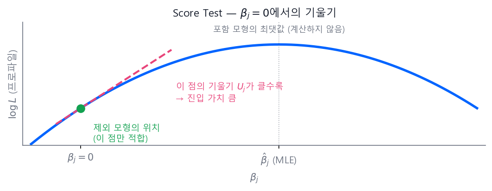
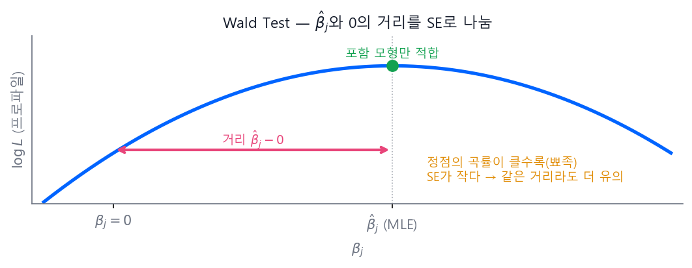
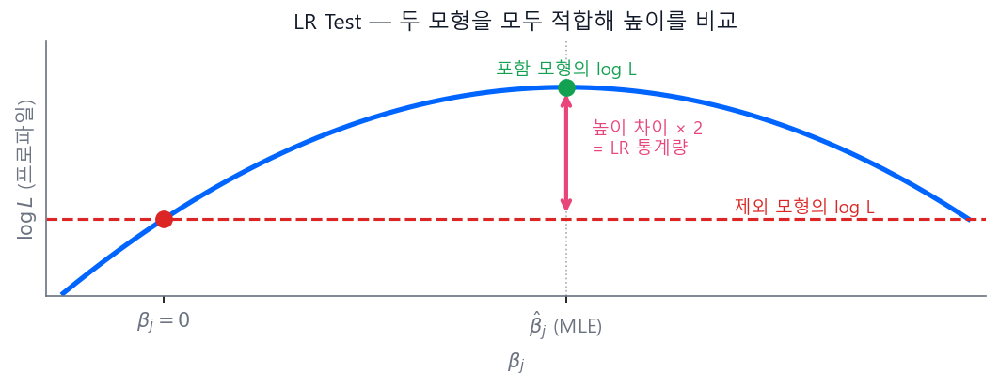
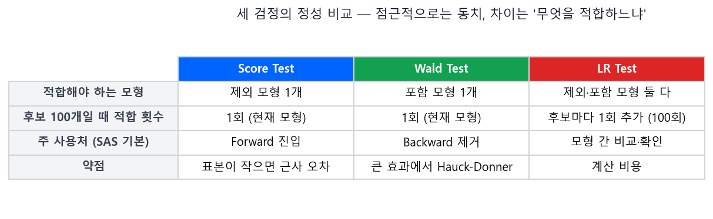

# 통계 검정 이론: Score · Wald · LR Test

## 4.1 배경: 로그우도함수와 MLE

로지스틱 회귀에서 계수를 정하는 기준은 **로그우도(log-likelihood)** 다. 이 페이지에서는 \(\log L\)로 표기한다([용어집](../glossary.md)의 \(\ell\)과 같다).

$$
\log L(\beta) = \sum_{i=1}^{n} \left[ y_i \log p_i + (1-y_i) \log(1-p_i) \right] \tag{1}
$$

\(p_i\)는 모형이 예측한 불량 확률, \(y_i\)는 실제 불량 여부(1=Bad)다. \(\log L\)을 최대로 만드는 \(\beta\)가 MLE 추정값 \(\hat{\beta}\)다.

!!! tip "산 비유"
    \(\log L\)을 산이라고 생각하면, **정상(MLE \(\hat{\beta}\))에서 \(\log L\)이 최대**다. 세 검정은 모두 "\(\beta_j = 0\)인가?"라는 같은 질문을 하지만, 산의 어느 위치에서 어떤 정보를 보느냐가 다르다. 아래 그림의 곡선은 다른 계수를 각 \(\beta_j\)마다 최적으로 맞춘 **프로파일 로그우도**다.

---

## 4.2 Score Test (Lagrange Multiplier Test)

**언제:** Stepwise Forward 진입 단계. 변수를 **아직 모형에 넣지 않은 상태**에서 사용.

**핵심 아이디어:** **"현재 모형이 설명하지 못한 잔차를 새 변수 \(X_j\)가 얼마나 설명할 수 있는가?"**

현재 모형(변수 \(j\) 제외)의 잔차 \((y_i - \hat{p}_i^{(0)})\)가 있다. 새 변수와 이 잔차의 관련이 강하면 \(X_j\)를 넣었을 때 잔차가 줄어들 것이므로 진입 가치가 있다. 이 판단에는 \(X_j\)를 넣고 다시 적합할 필요가 없다. 수식으로는 "\(\beta_j = 0\)으로 고정된 현재 위치에서 \(\log L\)의 기울기"이며, 기울기가 가파를수록 진입 가치가 높다.

**수식:**

$$
U_j = \frac{\partial \log L}{\partial \beta_j}\bigg|_{\beta_j=0} = \sum_{i=1}^{n}(y_i - \hat{p}_i^{(0)}) \cdot x_{ij} \tag{2}
$$

$$
\text{Score Stat} = \frac{U_j^2}{\tilde{I}_{j}} \sim \chi^2(1), \qquad \tilde{I}_{j} = I_{jj} - I_{j0}\, I_{00}^{-1}\, I_{0j} \tag{3}
$$

여기서 \(I\)는 제외 모형의 추정값에서 계산한 Fisher 정보행렬(4.6절)이고, 첨자 0은 이미 모형에 있는 계수(절편 포함), \(j\)는 후보 변수를 뜻한다. \(\tilde I_j\)는 "후보 변수의 정보량 중 **기존 변수로 설명되지 않는 부분**"이다. 분모를 단순히 \(\sum_i \hat p_i(1-\hat p_i)x_{ij}^2\)(=\(I_{jj}\))로 쓰면, 후보 변수가 기존 변수와 겹치는 정보까지 정보량으로 세게 되어 통계량이 틀어진다.

!!! note "가장 단순한 경우 — 현재 모형이 절편뿐일 때"
    제외 모형이 절편만 있으면 \(\hat p_i^{(0)} = \bar y\)이고, 식 (3)의 분모는 \(\bar y(1-\bar y)\sum_i (x_{ij} - \bar x_j)^2\)가 된다. 즉 \(x\)를 **평균 중심화**한 뒤의 제곱합이다. 4.7절 예시에서 이 차이를 수치로 확인한다.

\(U_j\)를 \(\sqrt{\tilde I_j}\)로 나누는 것은 변수의 척도·분산 차이를 표준화하기 위함이다. t-검정에서 평균을 표준오차로 나누는 것과 같은 원리다.

!!! success "재적합이 필요 없는 이유"
    \(U_j\)와 \(\tilde I_j\) 계산에 필요한 것은 세 가지뿐이다.

    1. \(y_i\): 실제 정답 → 데이터에 있음
    2. \(\hat{p}_i^{(0)}\): 현재(제외) 모형의 예측값 → 이미 계산됨
    3. \(x_{ij}\): 후보 변수의 값 → 데이터에 있음

    후보 변수가 100개여도 현재 모형 적합은 1번이면 된다.

**더미 방식에서의 결합 Score Test:** "\(\gamma_1 = \gamma_2 = 0\)" 결합 제약 하에서 벡터·행렬 형태로 확장된다.

$$
\text{Score Stat} = \mathbf{U}_{X1}^\top \, \big[I^{-1}\big]_{X1} \, \mathbf{U}_{X1} \sim \chi^2(\text{구간수}-1) \tag{4}
$$

\([I^{-1}]_{X1}\)은 전체 정보행렬의 역행렬에서 X1 더미들에 해당하는 블록이다. 이 블록이 식 (3)의 \(1/\tilde I_j\)를 행렬로 일반화한 것이다.

---

## 4.3 Wald Test

**언제:** Stepwise Backward 제거 단계. 변수가 **이미 모형에 포함된 상태**에서 사용.

**핵심 아이디어:** 이미 추정된 \(\hat{\beta}_j\)가 0에서 얼마나 떨어져 있는지를 표준오차(불확실성)로 나눠 평가한다. "추정값이 0과 유의하게 다른가?"

$$
W_j = \left(\frac{\hat{\beta}_j}{\text{SE}(\hat{\beta}_j)}\right)^2 \sim \chi^2(1), \quad \text{SE}(\hat{\beta}_j) = \sqrt{[I(\hat{\beta})^{-1}]_{jj}} \tag{5}
$$

다시 적합할 필요가 없고, 이미 추정된 계수와 분산-공분산 행렬만으로 계산된다. 표준오차는 정보행렬의 **역행렬**의 대각 원소에서 나온다. 정보행렬의 대각 원소를 바로 뒤집은 \(1/\sqrt{I_{jj}}\)가 아니라는 점에 주의한다(다른 변수와의 상관이 반영되지 않는다).

!!! warning "Hauck-Donner 현상"
    \(\hat{\beta}_j\)가 0에서 매우 멀어지면 SE가 더 빠르게 커져서, 효과가 클수록 Wald 통계량이 오히려 작아지는 구간이 생길 수 있다. 완전 분리(Perfect Separation)에 가까운 데이터에서 주로 나타난다. 이때는 LR Test가 더 신뢰할 만하다.

**더미 방식에서의 결합 Wald Test:** \(\hat{\gamma}_1\), \(\hat{\gamma}_2\)의 공분산까지 반영한다.

$$
W_{X1} = \hat{\boldsymbol{\gamma}}_{X1}^\top \cdot \mathbf{V}(\hat{\boldsymbol{\gamma}}_{X1})^{-1} \cdot \hat{\boldsymbol{\gamma}}_{X1} \sim \chi^2(\text{구간수}-1) \tag{6}
$$

---

## 4.4 LR Test (Likelihood Ratio Test)

**언제:** 모형 간 비교, 경계선에 있는 변수의 확인, 또는 Stepwise를 직접 구성할 때 Score Test 대신.

**핵심 아이디어:** 변수를 포함한 모형과 제외한 모형 **2개를 실제로 적합한 뒤** 로그우도를 직접 비교한다.

$$
\text{LR} = 2(\log L_{\text{포함}} - \log L_{\text{제외}}) \sim \chi^2(df) \tag{7}
$$

2를 곱하면 귀무가설 하에서 \(\chi^2\) 분포를 따르게 된다(Wilks 정리). 자유도 \(df\)는 추가된 모수 수이므로, 더미 방식에서 구간 수가 많으면 \(df\)가 커져 같은 LR 값에서도 p-value가 커진다. 이것이 **자유도 부담**의 본질이다.

!!! note "Stepwise를 직접 구성할 때 LR을 쓰는 경우"
    통계 패키지에 따라 Score 검정을 따로 호출해야 하거나 결합 검정 구성이 번거로워, 후보마다 포함 모형을 적합하고 LR Test로 진입을 판단하는 구성도 흔하다. 후보 수만큼 적합이 늘어 느리지만 결과의 신뢰성은 Score Test 이상이다.

---

## 4.5 세 검정 비교

| | Score Test | Wald Test | LR Test |
|---|-----------|-----------|---------|
| **필요한 적합** | 제외 모형만 | 포함 모형만 | 둘 다 |
| **사용 정보** | 제외 모형 잔차 + 후보 변수 | 추정된 \(\hat{\beta}\)와 SE | 두 모형의 \(\log L\) |
| **재적합** | 불필요 | 불필요 | 후보마다 필요 |
| **통계량의 성격** | 점근 근사 | 점근 근사 | 점근 근사(유한표본에서 대개 가장 안정적) |
| **약점** | 소표본에서 근사 오차 | Hauck-Donner 현상 | 계산 비용 |
| **SAS Stepwise 사용처** | Forward 진입 | Backward 제거 | (모형 비교에 별도 사용) |

!!! info "세 검정의 점근적 동등성"
    표본이 충분히 크면 세 검정은 귀무가설 근처에서 점근적으로 같은 결론을 낸다. 표본이 작거나 효과가 클수록 차이가 벌어지며, 이때는 **LR Test를 기준으로 삼는 것**이 일반적인 권고다.

    Stepwise가 Forward에 Score, Backward에 Wald를 쓰는 것은 정확도의 차이 때문이 아니다. **두 단계 모두 "이미 적합된 모형 하나"만으로 계산되는 검정을 고른 것**이다. Forward 시점에는 제외 모형만, Backward 시점에는 포함 모형만 적합되어 있기 때문이다.

---

## 4.6 Fisher 정보행렬 — 로지스틱 회귀에서의 구체적 형태

위 세 검정에 반복 등장하는 Fisher 정보행렬 \(I(\boldsymbol{\beta})\)의 로지스틱 회귀에서의 형태는 다음과 같다.

$$
I(\boldsymbol{\beta}) = -E\!\left[\frac{\partial^2 \log L}{\partial \boldsymbol{\beta} \partial \boldsymbol{\beta}^\top}\right] = \mathbf{X}^\top \mathbf{W} \mathbf{X} \tag{8}
$$

여기서 \(\mathbf{W} = \text{diag}(p_1(1-p_1), \ldots, p_n(1-p_n))\)는 관측치별 가중치 행렬이다.

| 구성요소 | 의미 |
|---------|------|
| \(\mathbf{X}\) | \(n \times (k+1)\) 설계행렬 (절편 포함) |
| \(\mathbf{W}\) | \(n \times n\) 대각행렬. \(p_i(1-p_i)\)는 베르누이 분산이자 시그모이드의 기울기 — \(p = 0.5\)에서 최대 |
| \(\mathbf{X}^\top \mathbf{W} \mathbf{X}\) | 가중 최소자승의 정규방정식과 같은 구조. MLE를 구하는 IRLS(Newton-Raphson) 알고리즘의 핵심 |

Wald Test의 표준오차는 이 행렬의 **역행렬** 대각 원소에서 나온다: \(\text{SE}(\hat{\beta}_j) = \sqrt{[I(\hat{\boldsymbol{\beta}})^{-1}]_{jj}}\).

---

## 4.7 수치 계산 예시 — 8명 미니 데이터셋

개념 이해를 위한 최소 예시다. 변수 1개(\(X\), 클수록 위험한 원점수 지표 — WoE가 아니므로 \(\beta_1 > 0\)이 자연스럽다), 관측치 8명, 절편 포함. Bad가 \(X\)의 중간값(1.0)과 높은 값에 섞여 있고 \(X = 2.5\)에도 Good이 있으므로 **완전 분리가 아니어서 MLE가 존재**한다.

| 고객 | A | B | C | D | E | F | G | H |
|---|---|---|---|---|---|---|---|---|
| \(X\) | 0.0 | 0.5 | 1.0 | 1.5 | 1.5 | 2.0 | 2.5 | 3.0 |
| \(y\) (1=Bad) | 0 | 0 | 1 | 0 | 0 | 1 | 0 | 1 |
| \(\hat{p}\) (MLE) | 0.100 | 0.158 | 0.241 | 0.349 | 0.349 | 0.476 | 0.606 | 0.722 |

IRLS로 수렴시킨 MLE는 \(\hat{\beta}_0 = -2.202\), \(\hat{\beta}_1 = 1.053\)이다(점수 방정식 \(\sum(y_i - \hat p_i) = 0\), \(\sum(y_i-\hat p_i)x_i = 0\)을 만족).

**Wald Test (\(\beta_1\)에 대해):**

\(\mathbf{W} = \text{diag}(0.090, 0.133, 0.183, 0.227, 0.227, 0.249, 0.239, 0.201)\)

\(I = \mathbf{X}^\top\mathbf{W}\mathbf{X} = \begin{pmatrix} 1.548 & 2.628 \\ 2.628 & 5.534 \end{pmatrix}\), \(\det I = 1.660\)

\([I^{-1}]_{11} = 1.548 / 1.660 = 0.933\) → \(\text{SE}(\hat{\beta}_1) = \sqrt{0.933} = 0.966\)

\(W = (1.053 / 0.966)^2 = 1.19 \sim \chi^2(1)\), p ≈ 0.276

(만약 역행렬 대신 \(1/\sqrt{I_{11}} = 1/\sqrt{5.534} = 0.425\)를 SE로 쓰면 \(W\)가 6.1로 부풀려져 "유의"로 잘못 판정된다.)

**LR Test:**

\(\log L(\text{Full}) = \sum[y_i\ln\hat p_i + (1-y_i)\ln(1-\hat p_i)] = -4.559\)

\(\log L(\text{Null})\): 절편만 있으면 \(\hat p = \bar y = 3/8 = 0.375\)이므로 \(3\ln 0.375 + 5\ln 0.625 = -5.293\)

\(\text{LR} = 2 \times (-4.559 - (-5.293)) = 1.47 \sim \chi^2(1)\), p ≈ 0.226

**Score Test (제외 모형 = 절편만):**

\(U = \sum_i (y_i - 0.375)\,x_i = 1.50\)

분모(식 3): \(\bar y(1-\bar y)\sum(x_i - \bar x)^2 = 0.375 \times 0.625 \times 7.0 = 1.641\) (\(\bar x = 1.5\))

\(\text{Score} = 1.50^2 / 1.641 = 1.37 \sim \chi^2(1)\), p ≈ 0.242

(중심화하지 않은 \(\bar y(1-\bar y)\sum x_i^2 = 5.859\)를 분모로 쓰면 0.38이 되어 크게 틀린다.)

| 검정 | 통계량 | p-value |
|---|---:|---:|
| Wald | 1.19 | 0.276 |
| LR | 1.47 | 0.226 |
| Score | 1.37 | 0.242 |

!!! note "8명은 너무 적다"
    세 검정 모두 비유의로 나온 것은 표본이 극히 적기 때문이다. 같은 \(\hat\beta_1\)이라도 표본이 커지면 SE가 \(1/\sqrt{n}\) 속도로 줄어 통계량이 커진다. 세 통계량의 값이 서로 조금씩 다른 것도 소표본이기 때문이며, 표본이 커지면 가까워진다. 이 예시는 **검정 통계량의 산출 절차**를 이해하기 위한 것이다.

예시 데이터는 가상이며, MLE와 검정 통계량은 직접 계산(IRLS 수렴)한 값이다.

