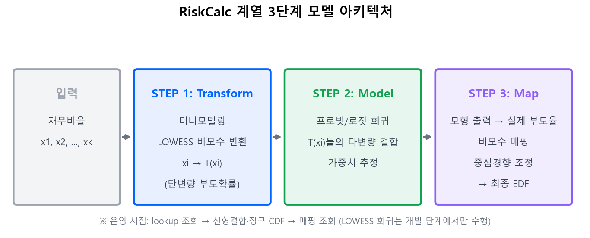

# 3단계 모델 아키텍처: Transform → Model → Map

미니모델링은 RiskCalc 계열 모형 구조의 **첫 번째 단계**에 해당한다. 전체 구조는 변환(Transformation), 모델링(Modeling), 매핑(Mapping)의 3단계다. RiskCalc 개발자 Falkenstein은 이 절차를 (1) 각 입력의 단변량 부도빈도 추정, (2) 변환값을 로짓 또는 프로빗 함수로 결합하는 다변량 추정, (3) 모형 출력을 과거 부도율에 매핑하고 표본과 모집단의 부도율 차이를 보정하는 단계로 설명한다.

<div class="source-ref">출처: <a href="https://efalken.com/papers/garp.htm" target="_blank">Falkenstein, E., "Building a statistical model for middle-market credit risk"</a></div>

---

## 3.1 전체 흐름



> **STEP 1 · Transform (미니모델링)** — 각 재무비율 \(x_i\)를 단변량 부도확률 \(T(x_i)\)로 변환. LOWESS 등 비모수 기법 사용.
>
> → **STEP 2 · Model (다변량 추정)** — 변환된 \(T(x_i)\)들을 프로빗 또는 로짓 모형에 투입해 다변량 가중치 추정.
>
> → **STEP 3 · Map (최종 매핑)** — 모형 출력을 실제 부도율(EDF)에 비모수적으로 매핑. 표본 부도율과 모집단 부도율의 차이(중심경향) 조정.

!!! example "예시 — 차주 1명이 EDF까지 가는 흐름"
    연속 예시의 제조업 외감기업 A가 EDF 산출을 받는다고 하자. 5개 재무비율의 산업 내 백분위와, [직관적 이해](intuition.md)에서 다루는 lookup table이 반환한 \(T(x)\) 값은 다음과 같다(가상 수치).

    **STEP 1 · Transform** — 5개 변수 각각의 lookup table 조회

    | 변수 | raw 값 | 산업 내 백분위 | \(T(x_i)\) (단변량 PD) |
    |---|:---:|:---:|:---:|
    | 부채비율 | 50% | 30 | 0.0219 |
    | ROA | 8% | 75 | 0.012 |
    | 유동비율 | 1.8배 | 60 | 0.018 |
    | 이자보상배율 | 4.5배 | 65 | 0.015 |
    | 영업이익률 | 12% | 80 | 0.010 |

    부채비율 \(T = 0.0219\)는 [정의 페이지](index.md)의 "숫자로 따라가기" 절에서 계산한 값이다.

    **STEP 2 · Model (Probit)** — 변환된 5개 \(T(x_i)\)를 다변량 프로빗에 투입

    가상의 추정 계수 \(\beta_0 = -2.4\), \((\beta_1, \ldots, \beta_5) = (3, 4, 2.5, 4, 2)\)를 적용하면:

    $$
    \begin{aligned}
    \eta &= \beta_0 + \sum_k \beta_k \, T(x_k) \\
        &= -2.4 + 3(0.0219) + 4(0.012) + 2.5(0.018) + 4(0.015) + 2(0.010) \\
        &= -2.4 + 0.066 + 0.048 + 0.045 + 0.060 + 0.020 \\
        &\approx -2.161
    \end{aligned}
    $$

    프로빗 출력 \(\Phi(\eta)\)로 바꾸면 \(\Phi(-2.161) \approx 0.0153\), 즉 다변량 프로빗이 추정한 A의 부도확률은 약 **1.5%** 다.

    **검산 — 평균적인 기업은?** 각 \(T(x)\)는 단변량 부도확률이므로 모집단 평균이 모집단 부도율(이 예시에서 약 4.4%)과 같다. 다섯 변수 모두 \(T = 0.0445\)인 "평균 기업"을 넣으면 \(\eta = -2.4 + 15.5 \times 0.0445 = -1.71\), \(\Phi(-1.71) = 0.044\)로 모집단 부도율이 재현된다. 모든 비율이 평균보다 양호한 A(1.5%)가 평균 기업(4.4%)보다 낮게 나오는 것이 정상이다. 계수를 정할 때 이런 검산으로 수준이 맞는지 확인한다.

    **STEP 3 · Map (최종 매핑)** — 실제 부도율과의 보정

    프로빗 출력 0.0153은 학습 표본의 부도율이 실제 모집단과 다르거나 꼬리 구간이 과대·과소 추정되는 등의 편향을 가질 수 있어, 출력 구간별 실제 부도율로 한 번 더 보정한다. 매핑이 0.0153 → 0.0145로 조금 낮춘다고 가정하면 A의 최종 **EDF = 0.0145**(약 1.45%)다.

    **요약 — raw 5개 변수 → EDF 한 줄로 압축하면**

    ```
    raw (50%, 8%, 1.8배, 4.5배, 12%)
        │  [STEP 1] 5개 lookup table 조회
        ▼
    T = (0.0219, 0.012, 0.018, 0.015, 0.010)
        │  [STEP 2] β와 결합 → Probit
        ▼
    η = -2.161  →  Φ(η) = 0.0153
        │  [STEP 3] 출력 → 실제 부도율 매핑
        ▼
    EDF = 0.0145  (외감기업 A의 최종 부도확률 약 1.45%)
    ```

    운영 시점에 이 흐름은 **lookup 5회 + 선형결합 1회 + 정규 CDF 1회 + 매핑 lookup 1회**로 끝난다. LOWESS 회귀는 개발 단계에서만 돌고, 운영은 표 조회와 산술 연산으로 이뤄진다.

    <div class="source-ref">예시 계수와 수치는 가상이며 직접 계산했다.</div>

---

## 3.2 Step 1: Transform (미니모델링)

[정의와 LOWESS 기초](index.md)와 [RiskCalc 프로세스와 사상](riskcalc.md)에서 다뤘다. 각 재무비율을 하나씩 단변량 부도확률로 바꾸는 단계다.

---

## 3.3 Step 2: 다변량 프로빗 모형

변환된 \(T(x_i)\)들을 프로빗 모형에 투입한다.

$$
P(\text{default}) = \Phi\!\left(\eta\right) \tag{1}
$$

$$
\eta = \beta_0 + \beta_1 \cdot T(x_1) + \beta_2 \cdot T(x_2) + \cdots + \beta_k \cdot T(x_k) \tag{2}
$$

여기서:

- \(\Phi\) = 표준정규 누적분포함수 (프로빗 모형)
- \(T(x_i)\) = 미니모델링으로 변환된 각 재무비율(클수록 위험)
- \(\beta_i\) = 각 변환값의 가중치. \(T\)가 클수록 위험하므로 **양수가 정상**이며, 유의해야 포함한다

변수마다 비선형 변환을 먼저 하고 그 결과를 선형으로 더하는 이 구조는 **일반화 가법 모형(GAM)** 과 같은 형태다. 비선형성은 변환 단계에서 잡고, 결합 단계는 선형으로 단순하게 유지해 투명성을 지킨다.

!!! note "왜 프로빗인가?"
    본 가이드북에서 다룬 소매 CSS는 **로짓(logit)**, 이 부록의 예시는 **프로빗(probit)** 을 쓴다. Falkenstein은 RiskCalc 절차를 설명하면서 다변량 결합을 "로짓 또는 프로빗 함수"로 한다고 서술하며, 둘을 바꿔 쓸 수 있는 선택지로 다룬다. 두 모형은 공통 구조 \(g(p_i) = \eta_i,\; \eta_i = \beta_0 + \sum_k \beta_k x_{ki}\)를 공유하고, 차이는 link function \(g(\cdot)\) 하나뿐이다.

    **로짓 link** — odds의 자연로그를 \(\eta\)에 매핑한다.

    $$
    \text{logit}(p_i) = \log\!\frac{p_i}{1 - p_i} = \eta_i \quad\Longleftrightarrow\quad p_i = \frac{1}{1 + e^{-\eta_i}}
    $$

    **프로빗 link** — 정규 CDF의 역함수를 \(\eta\)에 매핑한다.

    $$
    \text{probit}(p_i) = \Phi^{-1}(p_i) = \eta_i \quad\Longleftrightarrow\quad p_i = \Phi(\eta_i)
    $$

    두 곡선은 모양이 매우 비슷하고, 로지스틱 분포의 꼬리가 조금 더 두꺼운 정도의 차이다. 같은 데이터에 적합하면 로짓 계수가 프로빗 계수의 약 1.6~1.8배가 되는 스케일 차이가 있을 뿐, 예측 순위와 실무 성능은 대개 거의 같다.

    프로빗은 "보이지 않는 연속적 신용상태(잠재변수)가 정규분포를 따르고 어떤 임계값 아래로 떨어지면 부도"라는 해석과 잘 맞는다는 점에서 부도 모형에 자주 쓰인다. 반면 소매 CSS는 계수 \(\beta_k\)가 그대로 "\(x_k\) 한 단위 증가 시 log-odds 변화"로 읽히고 점수(PDO) 체계와 바로 연결되는 로짓이 표준이 되었다.

!!! info "연혁 메모"
    RiskCalc는 2000년 Moody's가 비상장기업용 모형으로 내놓았고(Falkenstein, Boral & Carty, 2000), 이후 Moody's가 구조모형(Merton 계열) 기반 EDF로 알려진 KMV를 인수하면서 Moody's KMV 제품군에 편입되었다. 즉 RiskCalc는 KMV 구조모형에서 출발한 모형이 아니다. 프로빗 선택이 구조모형 전통 때문이라는 식의 설명은 공개 문헌으로 확인되지 않는다.

---

## 3.4 Step 3: 최종 매핑

다변량 모형의 출력은 실제 부도율을 **과대 또는 과소 추정**할 수 있다. 개발 표본의 부도율이 실제 모집단과 다르거나(표본 구성 차이), 특정 구간에서 모형이 체계적으로 치우치기 때문이다. 이를 바로잡기 위해 모형 출력과 실제 부도율의 관계를 **비모수적으로 추정**하는 최종 매핑 단계를 둔다.

- **출력 → 부도율 매핑**: 모형 출력을 구간으로 나누고 구간별 실제 부도율을 평활해 연결한다. 입력 변환(Step 1)과 같은 아이디어를 출력 쪽에 한 번 더 적용하는 셈이다.
- **중심경향(central tendency) 조정**: 개발 표본의 평균 부도율을 장기 평균 부도율 같은 목표 수준에 맞춰 전체 곡선의 높이를 이동한다. 소매 CSS의 캘리브레이션(절편 보정)과 같은 역할이다.

### 소매 CSS와의 구조 비교

| 단계 | RiskCalc 계열 (기업) | 소매 CSS (본 가이드북) |
|------|----------------|-------------------|
| **Step 1: 변환** | LOWESS → 단변량 부도확률 \(T(x)\) | WoE 변환 (구간화 + 로그 Odds) |
| **Step 2: 모형** | 프로빗(또는 로짓) 회귀 | 로지스틱 회귀 (Bad logit) |
| **Step 3: 교정** | 출력 → 부도율 매핑, 중심경향 조정 | 점수 변환 → 등급 매핑 → 등급별 PD 캘리브레이션 |
| **산출물** | EDF (Expected Default Frequency) | 점수 → 등급 → PD |

두 접근법은 **"변환 → 결합 → 교정"이라는 같은 3단계 구조**를 공유하며, 기법의 선택만 다르다.
