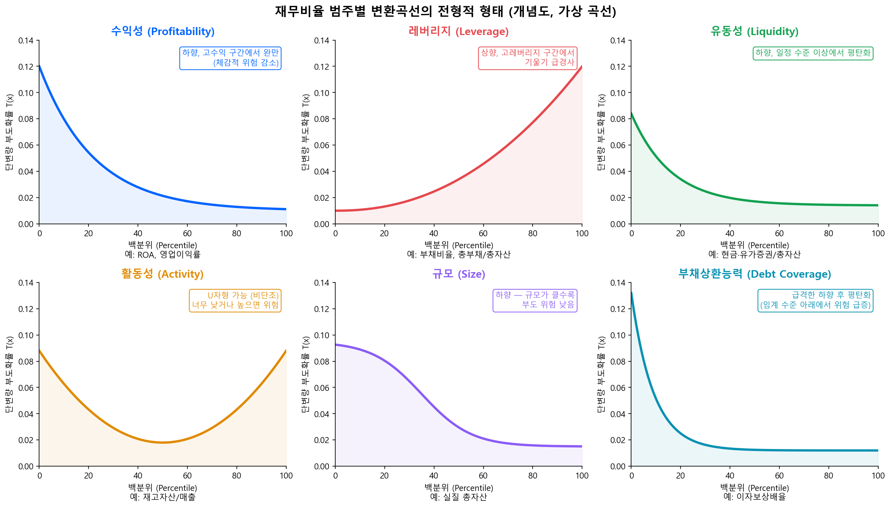

# 미니모델링의 효과와 비율별 변환 특성

## 2.1 변환의 5가지 효과

### 효과 1 — 비선형성 포착

재무비율의 원시 값(raw level)을 그대로 선형 모형에 넣으면 비율과 부도 사이의 체감·체증 관계가 무시된다. 미니모델링은 이 관계를 데이터에서 직접 추정해, 특정 구간에서 위험이 급변하는 **임계 영역(threshold region)** 을 곡선에 반영한다.

### 효과 2 — 입력 정규화(Normalization)

단위와 분포가 서로 다른 재무비율들(예: ROA는 −20%~+30%, 부채비율은 0%~500%)이 모두 **0~1 범위의 부도확률**이라는 같은 척도로 바뀐다. 그래서 다변량 프로빗 모형에서 각 변수의 계수를 "부도확률 1%p 변화당 기여"라는 같은 단위로 비교할 수 있다.

### 효과 3 — 이상치 통제(Outlier Control)

극단적 재무비율(예: 자본잠식 기업의 음수 자기자본비율, 매출이 거의 없는 기업의 비정상적 회전율)이 모형 전체를 끌고 가는 문제를 줄인다. 백분위 변환에서 극단값은 0 또는 100 근처로 눌리고, LOWESS는 그 위치의 이웃 평균 수준으로 평활하므로 하나의 극단값이 곡선을 크게 휘게 하지 못한다.

### 효과 4 — 한계효과 모니터링

비율별 변환곡선을 따로 그려 볼 수 있으므로, 각 비율이 부도 예측에 기여하는 방식을 투명하게 파악할 수 있다. 이는 **모형 검증**과 **감독당국 설명** 양쪽에서 이점이다.

### 효과 5 — 표본 외 강건성(Out-of-Sample Robustness)

비모수 변환은 함수 형태를 미리 정하지 않으므로 표본 내 적합만 좋고 표본 외에서 무너지는 것 아니냐는 우려가 있다. 실제로는 대역폭을 적절히 잡으면 곡선이 구간별 우연한 변동을 걸러내므로(→ [직관적 이해 4.5절](intuition.md)) 표본 외에서도 형태가 유지되는 경우가 많다. RiskCalc 공개 방법론 문서는 입력 비율의 세심한 변환이 모형 예측력의 상당 부분을 차지한다고 서술한다(Falkenstein, Boral & Carty, 2000). 다만 표본 외 성과는 데이터마다 다르므로, 변환 방식별로 walk-forward 검증 결과를 직접 비교해 확인해야 한다([실무 활용 5.4절](application.md)).

!!! tip "소매 CSS 실무자를 위한 대응"
    이 논점은 소매 CSS에서 "원시 비율 투입 vs WoE 변환 투입"과 본질적으로 같다. WoE 변환도 비모수적 단변량 위험 변환의 일종이며, 구간화를 통해 이상치와 비선형성을 함께 처리한다.

---

## 2.2 재무비율 범주별 변환 특성

기업 신용평가에서는 재무비율을 보통 수익성, 레버리지, 유동성, 활동성, 규모, 부채상환능력, 성장성 등의 범주로 나눈다. 범주마다 부도확률과의 관계 형태가 다르다.

위 그림은 범주별 변환곡선의 **전형적인 형태**를 개념적으로 그린 가상 곡선이다. 가로축은 해당 비율의 백분위, 세로축은 단변량 부도확률이다. 실제 곡선의 수준과 모양은 포트폴리오마다 다르다.

| 범주 | 대표 비율 예시 | 전형적인 변환 형태 |
|---|---|---|
| **수익성** | ROA, 영업이익률 | 하향. 고수익 구간에서 기울기가 완만해진다(체감적 위험 감소) |
| **레버리지** | 부채비율, 총부채/총자산 | 상향(단조 증가). 고레버리지 구간에서 기울기가 가팔라진다 |
| **유동성** | 현금·유가증권/총자산 | 하향. 일정 수준 이상에서는 평탄해진다 |
| **활동성** | 재고자산/매출 | **비단조(U자형) 가능**. 산업별 차이가 크다 |
| **규모** | 실질 총자산 | 하향. 규모가 클수록 부도 위험이 낮다 |
| **부채상환능력** | 이자보상배율 | 급격히 하향한 뒤 평탄해진다. 임계 수준 아래에서 위험이 급증한다 |
| **성장성** | 매출 증가율 | 양 극단(급감·급증)이 모두 위험할 수 있다 |

!!! note "비율의 방향은 정의에 따라 바뀐다"
    같은 범주라도 비율의 분자·분모 정의에 따라 방향이 반대가 된다. 예를 들어 레버리지 범주라도 "자기자본/총자산"이나 "이익잉여금/유동부채"처럼 **클수록 건전한** 비율은 하향 곡선이 정상이다. 변수마다 "클수록 위험한가, 안전한가"를 먼저 정의해 두고(2.3절의 expected direction), 곡선을 그 기준으로 검증한다.

!!! note "비단조 변환의 의미"
    활동성 비율의 비단조 패턴은 특히 주목할 만하다. 예를 들어 재고/매출 비율이 너무 낮으면 공급·영업 기반이 약하다는 신호일 수 있고, 너무 높으면 재고 부실 위험이 있어 **U자형 관계**가 나타날 수 있다. 이런 패턴은 선형 모형이나 단조 제약을 건 구간화로는 표현할 수 없으며, LOWESS의 비모수적 유연성이 장점이 되는 영역이다.

---

## 2.3 단조성을 보장하지 않는다 — 의도된 비단조 vs 잡음 역전

LOWESS의 **비모수적 유연성**은 양날의 검이다. 활동성 비율처럼 진짜 U자형 관계가 있으면 그대로 반영하지만, **데이터의 우연한 변동까지 따라가** 단조였어야 할 변수에서도 작은 역전(reversal)을 만들 수 있다.

### 두 종류의 단조성 위반을 구별해야 한다

| 유형 | 원인 | 처리 방향 |
|---|---|---|
| **신호로서의 비단조** | 경제적 의미가 있는 진짜 U자/역U자 (활동성, 일부 성장률) | **유지 + 문서화** |
| **잡음으로서의 역전** | 꼬리 구간의 관측치 부족, Bad 표본 희소 | **제거 또는 평탄화** |

둘을 구분하는 핵심은 **기대 방향(expected direction)** 이다. 변수마다 경제 논리상 기대되는 방향을 사전에 정의해 둔다 — 부채비율은 증가, 수익성은 감소, 활동성은 비단조 가능 등.

### 단조성 진단 항목

LOWESS 곡선을 그린 뒤 다음을 점검한다.

- **위반 횟수(violation count)**: 기대 방향과 어긋나는 구간 수
- **최대 역전 폭(max reversal size)**: 이웃한 평가점 사이 \(T(x_{j+1}) - T(x_j)\)가 반대 방향으로 가장 크게 튄 크기
- **누적 역전 폭(total reversal size)**: 모든 위반의 합
- **꼬리 점프(tail jump)**: 양 끝 구간에서의 급격한 점프 — 관측치 부족의 가장 흔한 증상
- **경제적 설명 가능성**: 위반 구간이 산업 사이클, 회계 이슈 등으로 설명되는지

### 처리 정책의 4단계

위반이 잡음으로 판정되면 가벼운 순서부터 적용한다.

1. **허용 + 기록** — 위반 폭이 무의미하게 작으면 그대로 두고 검증 보고서에 기록
2. **대역폭 확대** — \(f\)를 키워 평활을 강하게 → 꼬리 잡음 흡수
3. **구간 수 축소** — 백분위 구간을 굵게 잡아 구간당 표본 부족 자체를 해소. 단, 구간 정의가 바뀌면 lookup table 좌표도 바뀌므로 이전 버전 곡선과의 비교 방법을 함께 정한다
4. **Isotonic regression 후처리** — 위 셋으로 해결되지 않으면 단조 보정을 강제 적용

!!! tip "단조 보정을 적용할 때의 순서와 이유"
    권장 순서는 다음과 같다.

    $$
    \text{LOWESS } \hat{y} \;\rightarrow\; \text{clip}([p_{\min}, p_{\max}]) \;\rightarrow\; \text{가중 isotonic 회귀} \tag{1}
    $$

    - **clip을 먼저 하는 이유**: Isotonic 회귀(PAVA 알고리즘)는 순서가 어긋난 이웃 값들을 **평균으로 합쳐** 단조로 만든다. 범위를 벗어난 값(예: 꼬리의 음수 추정값)이 남아 있으면 이 평균을 끌어내려 주변 정상 구간까지 왜곡한다. 그래서 확률 범위로 먼저 잘라 둔다.
    - **isotonic 후 다시 clip할 필요는 없다**: Isotonic 회귀의 결과는 입력값들의 가중평균이므로 입력의 최솟값~최댓값 범위를 벗어나지 않는다. clip된 입력이면 결과도 이미 범위 안이다.
    - **순서를 바꿔도 단조성은 깨지지 않는다**: clip은 단조 비감소 함수이므로 단조 수열에 적용해도 순서가 유지된다. 순서가 중요한 이유는 단조성이 아니라 위의 **평균 왜곡** 때문이다.
    - **가중치**: Isotonic 회귀에는 구간 표본 수 \(n_{\text{obs}}\)를 가중치로 준다. 표본이 많은 구간의 추정값이 덜 움직여야 하기 때문이다.

!!! warning "투명성 원칙과의 연결"
    [RiskCalc 사상 절](riskcalc.md)에서 다룬 **투명성 원칙** — "레버리지가 증가했는데 부도 위험이 감소하는 것은 직관에 반한다" — 이 단조성 검증을 요구하는 근거다. 비모수의 유연성은 이 원칙과 충돌할 수 있고, 그 충돌을 다루는 방법이 위 4단계 정책이다. 결국 미니모델링은 **데이터에 맡길 부분과 사전 원칙으로 통제할 부분을 명시적으로 나누는** 작업이다.
