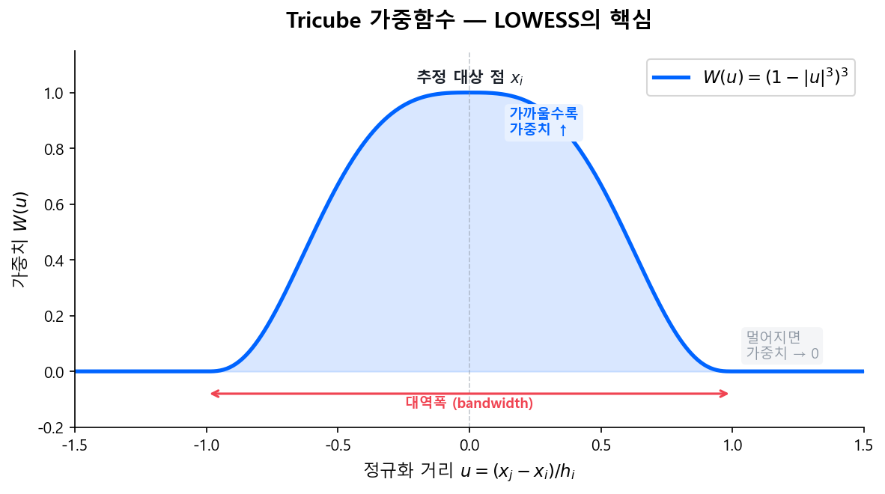
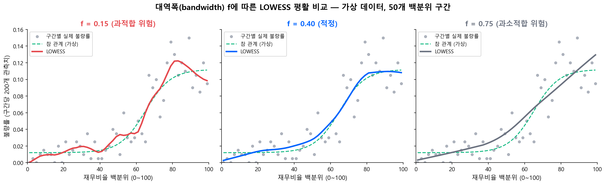

# 부록 C: LOWESS 기반 미니모델링 — 재무비율 변환과 기업 여신 신용평가

> Moody's RiskCalc 계열 모형에서 쓰이는 비모수적 재무비율 변환 기법의 방법론, 사상, 효과, 그리고 실무 적용 구조

!!! note "이 부록의 위치"
    본문 [단변량 로지스틱 회귀](../../part3_variable_selection/univariate_lr/index.md)가 다루는 **소매 여신 관점**을 보완해, **기업 여신(corporate lending)** 영역의 재무비율 변환 방법론을 다룬다. Moody's RiskCalc 공개 문헌에 소개된 "단변량 부도빈도 변환"의 구조와, 그것을 LOWESS로 구현하는 실무 절차를 정리한다.

!!! tip "소매 WoE와 기업 미니모델링"
    본문에서 다룬 방식은 **소매 CSS**의 WoE(구간화) 기반 변환이다. 이 부록의 LOWESS 기반 미니모델링은 기업 재무비율을 **연속적인 단변량 부도확률 곡선**으로 바꾸는 방식이다. "변수를 먼저 단변량 위험으로 바꾼 뒤 다변량 모형에 넣는다"는 접근 철학은 같고, 구간을 나누느냐 곡선으로 평활하느냐가 다르다.

## 이 부록에서 다루는 내용

| 섹션 | 제목 | 내용 |
|------|------|------|
| 1 | [RiskCalc 프로세스와 사상](riskcalc.md) | 변환 절차, 백분위 변환, 비모수적 접근의 사상(비선형성·투명성·간결성) |
| 2 | [효과와 비율별 변환](effects.md) | 변환의 5가지 효과, 재무비율 범주별 변환 형태, 단조성 처리 |
| 3 | [3단계 모델 아키텍처](architecture.md) | Transform → Model → Map 구조, 프로빗 모형, 최종 매핑 |
| 4 | [직관적 이해](intuition.md) | Weight & Smoothing 본질, KNN 비교, Lookup Table, Smoothing vs 실제 불량률 |
| 5 | [실무 활용과 한계](application.md) | 기업 여신 활용 영역, 적용 조건, 국내 은행 접점, 품질 검증 5축, 한계 |

!!! example "이 부록 전체에서 쓰는 연속 예시"
    **제조업 외감기업 A의 부채비율 50%.** 제조업 모집단에서 부채비율 50%는 **산업 내 백분위 30**에 해당하고(1.1절), LOWESS 변환으로 얻은 단변량 부도확률은 **\(T(30) = 0.0219\)**(약 2.2%)다(아래 계산). 이 값이 아키텍처(3절)와 lookup table(4절) 예시에 그대로 이어진다. 모든 수치는 가상 데이터다.

---

## 미니모델링의 정의와 LOWESS 통계 기초

### 미니모델링이란

"미니모델링"은 현업에서 **재무비율 하나하나를 그 비율만 썼을 때의 단변량 부도확률로 바꾸는 작업**을 부르는 말이다. 변수마다 작은 모형(부도확률 곡선)을 하나씩 만든다는 뜻이다.

이 작업은 Moody's RiskCalc의 첫 단계와 같다. RiskCalc 개발자 Falkenstein은 모형 구축 절차의 1단계를 "각 입력 변수의 수준에 대한 **5년 누적 단변량 부도빈도**를 추정한다"로 설명하고, 2단계에서 이 변환값들을 로짓 또는 프로빗 함수로 결합하며, 3단계에서 모형 출력을 과거 부도율에 매핑한다. RiskCalc 공개 방법론 문서도 모형 예측력의 상당 부분이 "치우친 분포를 가진 재무비율 입력의 **세심한 변환**"에서 나온다고 서술한다.

출처: <a href="https://efalken.com/papers/garp.htm" target="_blank">Falkenstein, E., "Building a statistical model for middle-market credit risk"</a>; Falkenstein, Boral & Carty (2000), "RiskCalc for Private Companies: Moody's Default Model", Moody's Investors Service.

변환에 쓰는 대표 기법이 **LOWESS**(Locally Weighted Scatterplot Smoothing) 같은 국소 회귀다. 이하에서는 LOWESS로 이 변환을 구현하는 방법을 다룬다.

---

### LOWESS — Locally Weighted Scatterplot Smoothing

!!! info "정의"
    William S. Cleveland(1979)가 제안한 **비모수적 회귀 기법**. 각 평가점마다 가까운 데이터만 골라 거리에 따라 가중한 최소자승 회귀(보통 1차 직선)를 적합하고, 그 평가점에서의 적합값만 취한다. 이를 모든 평가점에 반복해 **함수 형태를 미리 가정하지 않고** 변수 간 관계를 추정한다.

    
Cleveland, W.S. (1979). "Robust Locally Weighted Regression and Smoothing Scatterplots." JASA 74(368): 829-836. / <a href="https://www.itl.nist.gov/div898/handbook/pmd/section1/pmd144.htm" target="_blank">NIST/SEMATECH e-Handbook — LOESS</a>

### 알고리즘 구조

데이터 \((x_k, y_k)\), \(k = 1,\dots,n\)에서 평가점 \(x_i\)의 평활값 \(\hat{y}_i\)를 구하는 절차는 다음과 같다.

**1단계 — 이웃과 대역폭(bandwidth) 결정**

대역폭 \(f\)(span, \(0 < f \le 1\))는 국소 회귀에 쓸 이웃의 **비율**이다. 이웃 수와 거리 척도는 다음과 같이 정한다.

$$
q = \lceil f \cdot n \rceil, \qquad h_i = x_i\text{에서 } q\text{번째로 가까운 이웃까지의 거리} \tag{1}
$$

(\(q\)의 반올림 방식은 구현마다 조금 다르다.) \(h_i\)는 평가점마다 달라진다. 데이터가 촘촘한 곳에서는 작고, 성긴 곳(양 끝)에서는 커진다.

**2단계 — 삼차 가중함수(tricube weight function) 적용**

$$
W(u) = \begin{cases} (1 - |u|^3)^3 & \text{if } |u| < 1 \\ 0 & \text{otherwise} \end{cases}, \qquad u_k = \frac{x_k - x_i}{h_i} \tag{2}
$$

가장 먼 이웃(\(q\)번째)은 \(|u| = 1\)이 되어 가중치가 0이고, 가까울수록 1에 가깝다.

**3단계 — 국소 가중 최소자승(WLS) 적합**

$$
(\hat a_i, \hat b_i) = \arg\min_{a,b} \sum_k W(u_k)\,\big(y_k - a - b\,(x_k - x_i)\big)^2, \qquad \hat{y}_i = \hat a_i \tag{3}
$$

중심을 \(x_i\)로 옮겨 적합했으므로 평가점에서의 적합값은 절편 \(\hat a_i\)다.

**4단계 — (선택) 강건성(robustness) 반복**

1~3단계의 잔차 \(r_k = y_k - \hat y_k\)로 이상치 가중치를 만들어 다시 적합한다. Cleveland(1979)의 정의는 다음과 같다.

$$
\delta_k = B\!\left(\frac{r_k}{6s}\right), \quad s = \text{median}\,|r_k|, \qquad B(u) = \begin{cases}(1 - u^2)^2 & |u| < 1 \\ 0 & \text{otherwise}\end{cases} \tag{4}
$$

다음 적합에서는 거리 가중치 \(W(u_k)\)에 \(\delta_k\)를 곱해 쓰고, 이 과정을 보통 2회 정도 반복한다. 잔차가 중앙값의 6배를 넘는 관측치는 가중치가 0이 된다.

### 대역폭에 따른 평활 결과 비교

대역폭 \(f\)는 LOWESS의 가장 중요한 파라미터다. 아래 그림은 같은 가상 데이터(50개 백분위 구간, 구간당 200개 관측치)에 \(f\)를 다르게 적용한 결과다.

- **\(f = 0.15\)** (왼쪽): 소수의 이웃만 사용 → 구간별 우연한 변동까지 따라감 (과적합)
- **\(f = 0.4\)** (가운데): 적절한 범위 → 참 관계의 S자 형태를 잘 포착
- **\(f = 0.75\)** (오른쪽): 대부분의 점을 사용 → 급변 구간이 직선처럼 펴짐 (과소적합)

### 핵심 파라미터

| 파라미터 | 역할 | 영향 |
|----------|------|------|
| **\(f\) (bandwidth/span)** | 국소 회귀에 쓰는 이웃 비율 (\(0 < f \leq 1\)) | 작을수록 국소 패턴에 민감, 클수록 매끈 |
| **Tricube weight** | 거리에 따른 가중치 감소 | 가까운 포인트에 높은 가중치 |
| **국소 차수** | 국소 회귀의 차수(보통 1차) | 0차면 가중 이동평균, 2차면 곡률까지 국소 반영 |
| **Robustness iteration** | 이상치 영향 저감 | 잔차 큰 관측치의 가중치 하향 |

---

### 입력 데이터 구조 — 관측치 단위 vs 구간 요약 테이블

LOWESS를 신용평가에 적용할 때 입력은 두 형태 중 하나다.

**(a) 관측치 단위 입력** — 차주별 \((x_k, \text{TARGET}_k)\) 행을 그대로 투입한다. \(\text{TARGET}_k\)는 0/1이다. 각 행이 표본 1개이므로 별도의 표본 가중치는 필요 없다.

**(b) 구간 요약 테이블 입력** — 백분위 구간을 먼저 만들고, 구간별로 집계한 표를 투입한다.

| 구간 | x_center (백분위 중점) | n_obs | n_bad | bad_rate |
|:---:|:---:|:---:|:---:|:---:|
| 1 | 2 | 400 | 2 | 0.0050 |
| 2 | 6 | 404 | 4 | 0.0099 |
| 3 | 10 | 398 | 2 | 0.0050 |
| ... | ... | ... | ... | ... |

\(x\)는 구간 대표값(백분위 중점), \(y\)는 구간별 실제 불량률 \(n_{\text{bad}} / n_{\text{obs}}\)다. 기업 여신처럼 부도가 희소한 상황에서는 (b)가 계산 효율과 감사 가능성 면에서 자주 쓰인다.

!!! warning "구간 요약 입력에서는 가중치가 두 종류 결합된다"
    구간 요약 테이블을 쓰면 WLS 가중치는 **거리 가중치 하나로 부족**하다. 각 구간의 불량률이 100개 관측치에서 나왔는지 10,000개에서 나왔는지에 따라 신뢰도가 다르기 때문이다. 따라서 두 가중치를 곱해 최종 가중치로 쓴다.

    $$
    w_b^{\text{final}} = \underbrace{W\!\left(\frac{x_b - x_j}{h_j}\right)}_{\text{거리 가중치 (tricube)}} \times \underbrace{n_{\text{obs}, b}}_{\text{표본 가중치}} \tag{5}
    $$

    거리 가중치는 "이 이웃이 평가점에 얼마나 가까운가"를, 표본 가중치는 "이 이웃의 불량률이 얼마나 믿을 만한가"를 반영한다. 관측치 단위 입력 (a)에서는 각 행이 이미 표본 1개이므로 표본 가중치가 자동으로 1이 된다.

---

### 한 평가점에서 LOWESS가 굴러가는 모습 — 숫자로 따라가기

제조업 외감기업 모집단(가상, 10,000개사, 불량률 4.4%)의 부채비율을 백분위 폭 4인 25개 구간으로 나누고(중점 2, 6, …, 98), 연속 예시의 평가점 \(x_j = 30\)에서 LOWESS를 계산한다. 대역폭은 \(f = 0.28\)이다.

**Step 1 · 이웃 선택 + 거리 정규화**

\(q = \lceil 0.28 \times 25 \rceil = 7\)이므로 평가점에서 가까운 7개 구간(중점 18, 22, 26, 30, 34, 38, 42)이 이웃이다. 가장 먼 이웃까지 거리가 12이므로 \(h = 12\)이고, \(u_b = (x_b - 30)/12\)다.

| 구간 중점 \(x_b\) | n_obs | n_bad | bad_rate | \(u_b\) |
|:---:|:---:|:---:|:---:|:---:|
| 18 | 396 | 5 | 0.0126 | −1.000 |
| 22 | 401 | 5 | 0.0125 | −0.667 |
| 26 | 403 | 8 | 0.0199 | −0.333 |
| 30 | 399 | 9 | 0.0226 | 0.000 |
| 34 | 400 | 9 | 0.0225 | +0.333 |
| 38 | 397 | 13 | 0.0327 | +0.667 |
| 42 | 402 | 12 | 0.0299 | +1.000 |

중점 18과 42는 \(|u| = 1\)이라 tricube 가중치가 0이 되므로 실제 계산에서는 빠진다.

**Step 2 · Tricube 거리 가중치 \(W(u_b) = (1 - |u_b|^3)^3\)**

| \(\lvert u_b\rvert\) | \(W(u_b)\) |
|:---:|:---:|
| 0 | 1.000 |
| 1/3 | \((1 - 1/27)^3 = 0.893\) |
| 2/3 | \((1 - 8/27)^3 = 0.348\) |
| 1 | 0 |

**Step 3 · 표본 가중치 결합 (식 5)**

| 구간 중점 | \(W(u_b)\) | n_obs | \(w_b^{\text{final}}\) |
|:---:|:---:|:---:|:---:|
| 22 | 0.348 | 401 | 139.7 |
| 26 | 0.893 | 403 | 359.9 |
| 30 | 1.000 | 399 | 399.0 |
| 34 | 0.893 | 400 | 357.2 |
| 38 | 0.348 | 397 | 138.3 |
| **합계** | | | **1,394.1** |

가까운 이웃의 영향력은 먼 이웃의 약 3배다.

**Step 4 · 국소 1차 WLS 적합 (식 3)**

\(\text{bad rate} = a + b\,(x_b - 30)\)을 위 가중치로 적합하면 \(\hat a = 0.02186\), \(\hat b = 0.00090\)(백분위 1당 0.09%p)이다. 이웃이 평가점 좌우에 거의 대칭으로 놓여 있어 적합값은 가중평균(0.02184)과 거의 같다.

$$
T(30) = \hat a = 0.0219 \tag{6}
$$

**Step 5 · 범위 확인 후 lookup table 한 칸 채우기**

\([0, 1]\) 범위 안이므로 범위 보정(cap)이 작동할 일은 없고, **\(T(30) = 0.0219\)** 가 lookup table의 백분위 30 칸에 저장된다. 이 절차를 25개 평가점 모두에서 반복하면 lookup table이 완성된다(양 끝 평가점에서는 \(h\)가 커진다. 예: \(T(2) = 0.0056\), \(T(98) = 0.1011\)).

!!! tip "이 0.0219가 무엇인가"
    제조업 모집단에서 부채비율 백분위 30(즉 부채비율이 낮은 편) 차주의 **부채비율 단변량 부도확률 추정값**이 약 2.2%라는 뜻이다. 다른 변수(ROA, 유동비율 등)는 무시하고 부채비율 하나만 봤을 때의 추정이며, 다변량 프로빗 단계에서 다른 변수들의 \(T\) 값과 결합되어 최종 EDF가 정해진다([3단계 아키텍처](architecture.md)).

!!! tip "직관적 이해"
    위 수식과 절차의 직관적 의미 — 대역폭은 왜 필요한지, 회귀선은 몇 번 긋는지, 산출물은 결국 무엇인지 — 는 [4. 직관적 이해](intuition.md)에서 다룬다.

예시 데이터는 가상이며, 계산은 Cleveland(1979)의 정의(식 1~3, 5)로 직접 수행했다.

---

**참고 문헌**

- Falkenstein, E., Boral, A., & Carty, L. (2000). "RiskCalc for Private Companies: Moody's Default Model." Moody's Investors Service.
- Falkenstein, E. "Building a statistical model for middle-market credit risk." [efalken.com](https://efalken.com/papers/garp.htm)
- Dwyer, D., Kocagil, A., & Stein, R. (2004). "The Moody's KMV EDF RiskCalc v3.1 Model." Moody's KMV.
- Cleveland, W.S. (1979). "Robust Locally Weighted Regression and Smoothing Scatterplots." JASA 74(368): 829-836.
- NIST/SEMATECH e-Handbook of Statistical Methods, "LOESS (aka LOWESS)." [itl.nist.gov](https://www.itl.nist.gov/div898/handbook/pmd/section1/pmd144.htm)

