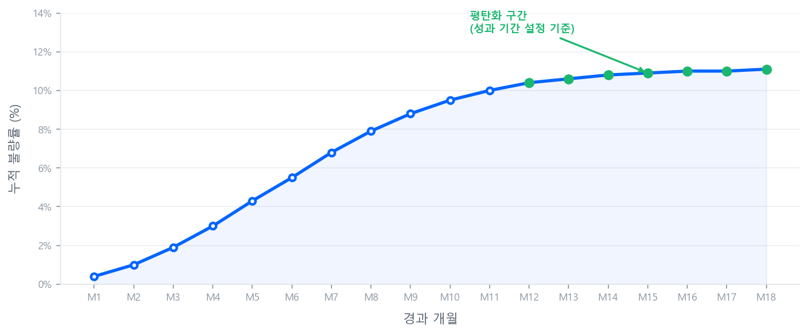
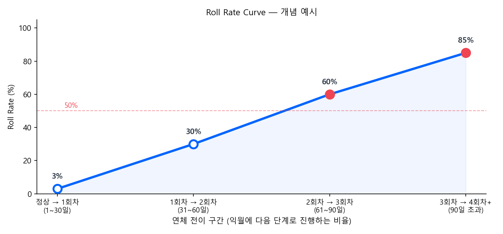

# 요건 정의

모형 개발의 출발점이다. **누구를 대상으로(모집단)**, **어떻게 나눌 것인지(세그먼트)**, **무엇을 예측할 것인지(Target)**, **어떤 기간을 볼 것인지(성과 기간)**를 확정한다.

## 3.1 모집단과 세그먼트

### 사전 제외 대상군

모집단을 정의하기에 앞서, 모형 개발 대상에서 **사전에 제외해야 할 대상**을 먼저 정한다. 개발 단계의 이 작업은 운영 단계의 필터링(사전 거절, 등급 상한)과 구분해 "제외"라고 부른다. 이들은 신용평가의 대상이 아니거나, 이미 결과가 확정되어 모형이 판별할 필요가 없거나, 성과(y)를 관측할 수 없는 집단이다.

| 제외 사유 | 대상 예시 | 제외 근거 |
|------|------|------|
| **평가 부적격** | 미성년자, 사망자, 외국인(국내 전용 상품의 경우) | 제도적으로 평가 대상이 아니거나, 일반 차주와 리스크 특성이 근본적으로 다름 |
| **기불량·채무불이행** | 관찰 시점에 Bad 정의 수준(예: 90일 이상)의 연체가 해제되지 않은 차주, Bad 정의에 포함된 채무불이행 등록자, 회생·파산 진행 중 | 이미 부실이 확정된 대상으로, 신용 리스크 **예측**의 의미가 없음. Bad 정의에 못 미치는 미해제 연체(예: 90일 미만) 보유자는 표본에서 빼지 않는다 |
| **정책 거절** | 내부 심사 기준 미달로 자동 거절된 건 | 대출이 실행되지 않아 **성과(Good/Bad)를 관측할 수 없음**. 거절 정책 자체가 아니라 성과가 없다는 이유로 빼는 것이다(아래 거절추론 참고) |
| **특수 거래** | 임직원 대출, 정부 보증·정책 대출, 극소액·테스트 건 | 일반 고객과 리스크 구조가 다르거나 데이터 노이즈에 해당 |

!!! warning "사전 제외와 모집단 편향"
    사전 제외 기준은 **명확하고 일관되게** 적용해야 하며, 개발 시점과 운영 시점에 같은 기준을 써야 한다. 제외 기준이 모호하거나 운영 기준과 다르면 모형 개발 표본이 실제 평가 대상 모집단을 대표하지 못하게 되어, 모형 적용 시 예측력이 저하될 수 있다. 제외는 정해 둔 순서대로 적용하고, 단계마다 제외 건수, 제외 대상의 불량률, 제외 전후 불량률을 기록한다. 세그먼트별 제외율이 유난히 높으면 기준이 지나치게 넓지 않은지 다시 본다.

!!! info "거절추론(Reject Inference) — AS모형의 표본 선택 편향"
    AS모형은 **신청자 전체**에게 적용되지만, 성과(y)는 **승인되어 대출이 실행된 건**에서만 관측된다. 정책 거절 건뿐 아니라 기존 모형·심사로 거절된 건도 마찬가지다. 승인 건만으로 모형을 만들면, 과거에 거절되던 위험 구간의 정보가 빠져 그 영역의 위험을 과소평가하는 **표본 선택 편향**이 생긴다.
    이를 보정하려는 방법을 통틀어 거절추론이라 한다. 대표적인 접근은 다음과 같다.

    - **재가중(Augmentation)** — 승인 확률이 낮은 영역의 승인 건에 더 큰 가중치를 주어, 승인 표본이 신청자 전체를 대표하도록 맞춘다.
    - **확률적 배분(Parceling, Fuzzy Augmentation)** — 거절 건에 추정 불량률을 부여하고, 그 확률에 따라 Good/Bad를 나누어(또는 가중치로) 개발 표본에 추가한다.
    - **외부 성과 활용** — 거절된 신청자가 이후 다른 금융기관에서 대출을 받았다면, 그 상환 결과를 CB 정보로 관측해 성과로 쓴다.
    - **제한적 승인** — 거절 구간의 일부를 정책적으로 승인해 실제 성과를 관측한다(비용이 드는 대신 가장 직접적이다).

    어느 방법이든 "거절 건이 승인되었다면 어떻게 되었을지"에 대한 가정에 기대므로 효과를 검증하기 어렵다. 거절 비율이 낮으면 영향이 작고, 거절 비율이 높은 상품일수록 신중하게 검토해야 한다.
    (참고: Siddiqi, N. (2017), *Intelligent Credit Scoring*, 2nd ed., Wiley — 거절추론 장)

    한 가지 구분할 점이 있다. 위 표의 "정책 거절"은 대출이 실행되지 않아 성과가 없는 건을 빼는 것이다. 운영에서 어차피 거절할 차주를 개발 표본에서 미리 지우는 것과는 다르다. 그렇게 지우면 정책이 바뀔 때마다 모형을 다시 만들어야 하므로, 거절 정책은 등급 보정과 승인율 시뮬레이션 단계에서 반영한다.

### 기불량 판정

관찰 시점에 이미 Bad 상태인 차주(**기불량**)는 개발 표본에서 뺀다. 같은 신용 사건이라도 관찰 시점과의 선후에 따라 쓰임이 갈린다.

| 신용 사건의 시점 | 쓰임 |
|------|------|
| 관찰 시점 **이전**에 발생해 이미 해제된 이력 | 설명변수 |
| 관찰 시점 **현재** 해제되지 않은 Bad 정의 수준의 상태 | 개발 대상에서 제외(기불량) |
| 성과 기간에 **새로** 발생한 사건 | Bad 라벨 |

!!! warning "기불량 판정에서 흔한 실수"
    - **과거에 한 번이라도 불량이면 모두 지우는 방식**은 회복해 정상 거래를 이어 가는 차주를 표본에서 없애 생존편향을 만든다. 판정은 관찰 시점을 기준으로 한다. 데이터에 따라 관찰 시점 현재의 미해제 상태로 보기도 하고 직전 관찰 시점의 부도 여부로 보기도 하는데, 어느 쪽이든 관찰 시점 뒤의 정보를 쓰지 않는 것이 핵심이다. 직전 시점 방식은 첫 관찰 시점과 새로 유입된 차주를 판정하지 못하므로 보완 규칙을 함께 정하고, 판정 결과는 행을 지우지 말고 플래그로 남겨 방식 간 비교를 재현할 수 있게 한다.
    - **연체를 건수로 판정하면**("미해제 연체 건수 > 0") 1일 연체도 기불량이 되어, 모형이 가장 배워야 할 연체 초기 위험군이 표본에서 빠진다. 연체는 연체일수로 판정하고 임계는 Bad 정의의 연체일수와 같게 둔다. 채무불이행 같은 등록 정보도 Bad 정의에 포함된 종류만 제외한다.
    - Bad 라벨을 성과 기간에 **새로 발생한** 사건으로 정의했다면, 기불량을 남겨 둘 때 이들은 새 불량으로 잡히지 않아 정상으로 집계되고 불량률이 실제보다 낮게 나온다. 등록 상태의 유지까지 Bad로 세는 정의라면 반대로 Bad가 부풀려진다. 어느 쪽이든 라벨이 오염되므로 표본에서 뺀다.
    - 기불량에 못 미치는 미해제 연체나 등록 정보 보유자는 **표본에 남긴다.** 표본에 남아 있어야 그 정보를 가진 차주와 그렇지 않은 차주의 불량률을 비교해 [등급 상한](../part5_scorecard/scorecard-and-rating.md) 같은 룰의 근거를 만들 수 있다.
    - Bad 정의에 드는지 애매한 등록 정보는, 그 정보를 가진 차주의 성과 기간 불량률이 Bad와 사실상 같은 수준인지로 가린다. 같은 수준이면 제외하고, 아니면 표본에 남겨 설명변수나 룰의 재료로 쓴다.

### 개인 신용평가 — 세그먼트

CSS 모형은 평가 대상에 따라 **개인(Retail)**과 **기업(Corporate)**으로 크게 나뉘며, 각각의 세그먼트 구성과 모형 구조가 다르다.
개인 CSS는 기업 대비 모집단이 크고 데이터가 정형화되어 있어 단일 스코어카드로 개발하는 경우가 많으나, 세그먼트를 분리하면 예측력이 향상될 수 있다.

세그먼트를 나누는 근본적인 이유는 **모집단의 특성이 동질하지 않기 때문**이다. 서로 다른 성격의 차주를 하나의 모형으로 평가하면, 변수의 의미와 영향력이 집단마다 다르게 나타나 모형의 변별력이 희석된다. 예를 들어, Prime 고객에서 유의미한 변수가 Sub-Prime에서는 전혀 작동하지 않을 수 있고, Thick-File에서 강력한 예측력을 보이는 CB 변수가 Thin-File에서는 값 자체가 존재하지 않는다. 따라서 **동질한 집단끼리 묶어 각 집단의 리스크 특성에 맞는 모형을 개발**하는 것이 세그먼테이션의 핵심이다.

실무에서 가장 대표적인 세그먼트 기준은 다음과 같다.

**(1) 리스크 수준·신용이력·거래 관계 기준**

| 세그먼트 기준 | 구분 | 특성 | 모형 관점 | 대표 업권 |
|------|------|------|------|------|
| **리스크 수준** | **Prime** (우량) | CB 신용평점 상위, 연체 이력 없음. 불량률이 낮아 변별력 확보가 상대적으로 어려움. | 변수 구성·Bad 정의가 다를 수 있어 별도 모형이 효과적. Prime은 미세한 리스크 차이를 포착하는 것이 핵심. | 시중은행 |
| | **Near-Prime** (중간) | Prime과 Sub-Prime의 경계 영역. 연체 가능성이 있으나 회복 여력도 존재. | Prime·Sub-Prime 어느 쪽에도 잘 맞지 않아 별도 모형이 유리할 수 있음. 승인/한도 전략에서 특히 중요한 구간. | 카드사, 인터넷전문은행 (주) |
| | **Sub-Prime** (비우량) | CB 신용평점 하위, 연체 경험 있음. 불량률이 높고 변수 패턴이 Prime과 이질적. | 회복 가능성과 추가 부실 가능성을 구분하는 것이 핵심. | 저축은행, 캐피탈, 대부업체 |
| **신용이력** | **Thick-File** | CB 거래 이력이 풍부. 전통 변수만으로 충분한 변별력 확보 가능. | 표준적인 스코어카드 파이프라인 적용. | — |
| | **Thin-File** (사회초년생·주부 등) | CB 이력이 부족하거나 전무. 전통 변수만으로는 평가가 어려움. | 대안정보(통신·공공요금 납부, 계좌 입출금 등) 활용 또는 Generic/Pooled 모형으로 초기 평가. | — |
| **기존 관계** | **기존고객** | 내부 거래 이력(수신·여신·카드)이 풍부. | BS모형 활용 가능. 내부 변수의 변별력이 높음. | — |
| | **신규고객** | 내부 이력 없음. CB·신청서 등 외부 정보에 의존. | AS모형만 적용 가능. CB 변수 의존도가 높음. | — |

(주) 인터넷전문은행(카카오뱅크, 토스뱅크, 케이뱅크)의 고객은 Prime부터 Near-Prime까지 걸쳐 있으나, 시중은행과 저축은행 사이의 중금리 대출 시장을 주요 영역으로 삼는 경우가 많아 Near-Prime 업권 예시로 분류하였다.

**(2) 직업군·소득 특성 기준**

위 기준과 별개로, **차주의 직업군·소득 구조**에 따라 세그먼트를 분리하는 것도 실무에서 흔히 사용된다.

| 세그먼트 | 특성 | 모형 관점 |
|------|------|------|
| **급여소득자** | 소득 증빙이 용이(원천징수, 건강보험료). 고용 안정성이 상대적으로 높음. | 소득 대비 상환 부담(DTI·DSR), 근속기간 등이 유효한 변수로 작용. |
| **자영업자** | 소득 변동성이 크고 증빙이 어려움. 사업 리스크가 개인 신용에 직결. | 카드매출, 사업자 업종·업력, 대안정보 활용 비중이 높아짐. |
| **전문직** (의사·변호사 등) | 소득 수준이 높으나 초기 부채(학자금 등)가 클 수 있음. 직업 안정성 높음. | 별도 세그먼트로 분리 시 직업군 특성을 반영한 모형 가능. |

!!! tip "세그먼트 분리의 판단 기준"
    세그먼트를 분리하면 각 그룹에 특화된 모형을 개발할 수 있어 예측력이 향상될 수 있지만, 그룹별로 **계수를 안정적으로 추정할 만큼의 Bad 표본**이 확보되어야 한다. 필요한 Bad 건수는 투입 변수 수와 변수당 구간(Bin) 수에 따라 달라지며, 기관마다 내부 기준을 둔다. 표본이 부족한 경우 무리한 세그먼트 분리보다는 통합 모형에서 해당 특성을 변수로 반영하는 것이 현실적이다. 분리 효과는 "세그먼트별 모형을 합친 성능이 통합 모형보다 의미 있게 높은가"로 판단한다. 위 기준들은 조합하여 적용할 수도 있다(예: 기존고객-Prime / 기존고객-Sub-Prime / 신규고객).

### 기업 신용평가 — 모형 구성과 세그먼트

기업 CSS는 일반적으로 **재무모형**과 **비재무모형**을 따로 개발한 뒤, 기업 규모 등에 따라 가중 결합하여 최종 스코어를 산출하는 구조를 취한다. 대표자 개인의 신용정보는 비재무모형의 한 영역으로 넣거나, 소규모 기업에 한해 별도로 추가 반영한다.

> **재무모형** (재무비율·현금흐름) **+** **비재무모형** (업종·업력·거래이력·공공정보·대표자 정보) **→** **통합 스코어** (규모별 가중 결합)

기업 평가에서 핵심 세그먼트는 **재무제표의 가용성과 신뢰도**에 따라 구분된다.

| 세그먼트 | 특성 | 모형 구조 특징 |
|------|------|------|
| **외감기업** (외부감사 대상) | 감사받은 재무제표가 존재하여 **재무 데이터의 신뢰도가 높음**. 자산·매출 규모가 크고 데이터 품질이 양호. | 재무모형의 비중이 높음. 부채비율, 이자보상배율, 영업이익률 등 정교한 재무비율 분석 가능. |
| **비외감기업** (외부감사 비대상) | 재무제표가 있으나 **감사를 받지 않아 신뢰도가 상대적으로 낮음**. 중소기업이 대부분이며 재무 데이터의 품질 편차가 큼. | 재무모형의 비중을 줄이고 비재무(거래이력, 공공정보, 대표자 정보) 비중을 높이는 것이 일반적. |
| **소기업·개인사업자** | 별도의 재무제표가 없거나 간편장부 수준. **사업체와 대표자의 재무가 혼재**되는 특성. | 대표자 개인 신용정보가 핵심. 사업자등록 정보, 매출 추정(카드매출 등), 업종·업력 등 비재무 변수 중심. |

!!! example "CB사 기업평가 — 기업 규모별 재무/비재무 반영 비중"
    국내 CB사가 공시한 기업 규모별 반영 비중은 다음과 같다.

    | 기업 규모 | NICE평가정보 (재무 / 비재무) | KCB (재무 / 계량 비재무) |
    |------|------|------|
    | 중견기업 | — | 80% / 20% |
    | 외감기업 | 70% / 30% | 60% / 40% |
    | 비외감기업 | 60% / 40% | 40% / 60% |
    | 소기업 | 30% / 70% | 30% / 70% |

    두 회사 모두 기업 규모가 작을수록 재무 비중을 줄이고 비재무 비중을 키운다. 대표자 정보의 반영 방식은 서로 다르다. NICE평가정보는 *"소기업에 한해 대표자 CB 스코어를 추가적으로 평가에 반영"*한다고 밝히고 있고, KCB는 계량 비재무모형 안에서 대표자정보를 일부 활용한다고 공시하고 있다. 각 모형의 구체적인 가중치는 기관마다 다르다.

    

    출처: <a href="https://www.niceinfo.co.kr/creditrating/bi_score_1_3.nice" target="_blank">NICE평가정보 · 평가 요소별 비중 및 반영 기간</a>,
    <a href="https://www.bizground.co.kr/static-root/download/KCB_%EA%B8%B0%EC%97%85%EC%8B%A0%EC%9A%A9%ED%8F%89%EA%B0%80_%EC%8B%A0%EC%9A%A9%ED%8F%89%EA%B0%80%EC%B2%B4%EA%B3%84%EA%B3%B5%EC%8B%9C_2022%EB%85%843%EC%9B%94.pdf" target="_blank">KCB · 기업신용평가체계 공시 (2022.03)</a>
    

!!! tip "기업 신용평가에서 추가로 볼 점"
    - **세그먼트 기준:** 모형 성능만으로 나누지 말고 정보 커버리지, 집단 크기, 여신 운용 단위를 함께 본다. 규모 기준을 쓴다면 재평가 때 경계 근처 기업이 자주 옮겨 다니지 않도록 변동이 작은 변수(예: 총자산)가 낫다.
    - **제외 판정의 주체:** 기불량 여부는 Bad 라벨의 주체인 차주 기준으로 본다. 법인 대표자 개인의 연체는 법인의 제외 사유가 아니라 설명 정보다. 개인사업자는 대표자가 곧 차주이므로 대표자 개인의 기불량이 제외 사유가 된다.
    - **폐업과 경쟁위험:** 소규모 법인은 폐업이 부도 관측을 가로챌 수 있다. 연체가 길수록 부도율이 오히려 떨어지는 역전이 보이면, 라벨 오류보다 폐업 여부를 먼저 확인한다. 관찰 시점에 이미 폐업한 기업은 부도를 정상적으로 관측할 수 없으므로 표본 정의에서 빼고, 폐업 여부를 변수로 쓰지 않는다. 운영에서는 폐업 기업이 평가에 들어오지 않아 그런 변수는 늘 같은 값이 된다. 무한책임인 개인사업자는 폐업해도 부도가 기록되는 경우가 많아 이 왜곡이 작다.
    - **재무 위험징후는 제외 사유가 아니다:** 자본잠식, 감사의견 부적정, 연속 적자 같은 징후는 부도가 아니라 살아 있는 고위험 신호다. 빼면 모형이 가장 위험한 구간을 배우지 못하므로 변수나 등급 상한 후보로 둔다.
    - **정보 매핑이 만드는 편향:** 특정 기업정보의 매핑 여부를 표본 요건으로 쓰면 영세 기업이 빠져 표본이 우량 쪽으로 치우칠 수 있다.

!!! note "기업 모형의 실무적 난제"
    비외감기업과 소기업·개인사업자는 재무 데이터의 신뢰성이 낮아 재무모형 단독으로는 충분한 변별력을 확보하기 어렵다. 이 때문에 대표자 개인의 신용 정보(CB 신용평점, 연체 이력 등)가 기업 신용평가에서 중요한 보완 역할을 한다. 대표자 정보는 비재무모형의 한 영역으로 넣기도 하고, 재무, 비재무와 나란한 별도 하부모형으로 만들어 결합 가중치로 합치기도 한다. 소유와 경영이 분리된 대형 법인에는 대표자 정보를 쓰지 않는 것이 보통이다.

## 3.2 Target(타겟 변수) 정의

### Good / Bad / Indeterminate

CSS 모형은 이진 분류(Binary Classification) 모형이다. 모형의 타겟 변수(Target)는 다음과 같이 정의된다.

| 구분 | 기호 | 정의 | 실무 예시 |
|------|------|------|------|
| **Good** (우량) | \(y = 0\) | 성과 기간 내 불량 미발생 | 연체 없이 정상 상환 |
| **Bad** (불량) | \(y = 1\) | 성과 기간 내 기준 이벤트 발생 | 90일 이상 연체, 부도, 회생·파산 등 |
| **Indeterminate** (판단미정) | 제외 | 우량 또는 불량으로 판단하기 애매한 영역 | 30일 이상~90일 미만 연체 |

!!! note "Indeterminate 처리"
    판단미정 차주는 모형 개발 표본에서 **제외**한다. 이를 통해 Good과 Bad 간의 경계가 명확해져 모형 예측력이 향상된다. 단, 판단미정의 구성비가 지나치게 크면 개발 표본이 실제 모집단을 대표하지 못하고, 운영 시 이 집단에 대한 점수가 검증되지 않은 채 쓰이게 되므로 적정 범위 내에서 정의해야 한다. 조기 상환, 중도 해지 등 성과 기간 내 충분한 이력이 관찰되지 않은 차주도 마찬가지로 제외 대상이다.

!!! tip "실무 포인트"
    **Bad 정의(Bad Definition)**는 모형 개발 전 가장 먼저 확정해야 할 사항이다. 동일 데이터라도 Bad를 "30일 연체"로 보느냐 "90일 연체"로 보느냐에 따라 불량률, 변수 변별력, 모형 성능이 모두 달라진다. Bad 정의는 **업무 목적(AS / BS / Collection 모형)**과 **감독 규정(Basel 부도 정의 등)**을 모두 반영해야 한다.

!!! warning "Bad Odds와 스코어 방향"
    모형 개발 단계(Part 1~4)에서는 관심 이벤트인 **불량(Bad)을 \(y=1\)**로 놓고, **Bad Odds** \(p/(1-p)\)(정상 대비 불량)의 로그, 즉 Bad logit을 모델링한다. 로지스틱 회귀의 출력값이 클수록 불량 확률이 높다는 뜻이다.

    그런데 최종 **신용점수(Score)**는 "점수가 높을수록 우량"이라는 직관적 방향으로 전달된다. 그래서 스코어카드 변환(Part 5)에서는 계수를 다시 적합하지 않고, 같은 계수로 \(\ln(\text{Good Odds}) = -\,\text{logit}_{\text{Bad}}\)를 계산해 **Good Odds** \((1-p)/p\)(불량 대비 정상) 기준으로 뒤집은 뒤 점수로 환산한다. 이 과정이 **스코어 변환(Score Conversion)**이며, [스코어카드 변환](../part5_scorecard/scorecard-and-rating.md)에서 상세히 다룬다.

    따라서 스코어카드 변환 이전까지 Odds는 모두 **Bad Odds** \(p/(1-p)\)를 의미하고, 스코어카드 변환 단계에서 Good Odds로 전환된다는 점에 유의한다.

### Bad Definition 기준

Bad 정의는 불량 성향이 가장 강한 요건부터 우선순위를 부여하여, **불량 → 판단미정 → 우량** 순서로 결정한다. 일반적인 원칙은 다음과 같다.

| 분류 | 일반적 기준 | 비고 |
|------|------|------|
| **Bad** | 부도, 회생·파산, 90일 이상 연체 (내부 + CB) | Basel 부도 정의와 맞추는 것이 일반적 |
| **Indeterminate** | 30일 이상 ~ 90일 미만 연체 | 기관별로 구간 범위가 다름. 구성비가 과도하지 않게 관리 |
| **Good** | 30일 미만 연체 또는 무연체 | 정상 상환 차주 |

실무에서는 내부 연체(자사 여신)와 CB 연체(타 금융기관)를 모두 고려한다. 차주가 타 금융기관에서 먼저 연체를 경험하는 경우도 불량 징후로 포착하기 위함이다. 구체적인 세부 기준(연체 일수 구간, 우선순위 등)은 기관·상품·규제 요건에 따라 다르며, 모형 개발 착수 전 업무 부서·리스크 부서와 합의하여 확정한다.

!!! note "정의 순서의 원칙"
    한 차주가 복수의 조건에 해당할 수 있으므로, 불량 성향이 가장 강한 조건부터 먼저 적용하는 **워터폴(Waterfall) 방식**으로 분류한다. 예를 들어 90일 이상 연체이면서 동시에 부도인 차주는 "부도" 기준으로 Bad가 된다.

### 실무에서의 Bad 정의 변형

**"12개월 / 90일 이상 연체"**가 표준적인 Bad 정의이나, 모형의 목적과 상황에 따라 다양한 변형이 존재한다.

**(1) 단기 성과 기간 모형**

규제 PD와 연결되지 않는 **전략모형**(승인·한도 전략, Collection 모형 등, [심사모형 vs 전략모형](what-is-css.md) 참고)에서는 의사결정의 시의성이 중요하므로, 성과 기간을 **6개월**로 짧게 가져가고 Bad 기준도 **30일 연체** 등으로 낮추는 경우가 있다. 모형을 더 자주 갱신할 수 있고 최신 데이터를 활용할 수 있다는 장점이 있다.

**(2) 12개월 / 60일 이상 연체 기준**

최종 Bad 정의는 90일 이상 연체이더라도, 모형 개발 시에는 **60일 이상 연체**를 Bad 기준으로 사용하는 관행이 존재한다. 주요 근거는 다음과 같다.

- **Bad 표본 확보:** 90일 이상 연체는 발생 건수가 적어 모형 학습에 충분한 Bad 표본이 부족할 수 있다. 60일 기준으로 확대하면 Bad 건수가 늘어나 계수 추정이 안정된다.
- **조기 포착 효과:** 아래 Roll Rate 예시처럼 60일 초과 연체(3회차, 61~90일) 차주의 대부분이 90일 초과로 진행하는 포트폴리오라면, 60일 기준 Bad는 "향후 90일 연체로 진행될 차주"를 거의 같은 집단으로 더 일찍 잡는다. 실제 전이율은 자사 데이터로 확인해야 한다.

!!! warning "60일 기준으로 개발했다면"
    Bad 정의를 넓히면 모형의 서열(어떤 차주가 더 위험한가)은 크게 달라지지 않더라도, p̂의 **수준**은 60일 기준 불량률에 맞춰진다. 등급별 PD를 규제·회계 목적(90일 부도 기준)으로 쓰려면, 개발 후 **90일 부도 기준의 실현 부도율로 다시 캘리브레이션**해야 한다. 또한 60일 Bad 중 90일로 진행하지 않고 회복한 차주가 많다면 두 정의의 서열이 어긋날 수 있으므로, 90일 기준으로도 KS·AR을 함께 확인한다.

## 3.3 성과 기간(Performance Window) 설정

### 기준 시점과 세 가지 기간

CSS 모형 개발에서 시간 축은 하나의 **기준 시점**과 **세 가지 기간**으로 구성된다.

| 구분 | 정의 | 실무 예시 |
|------|------|------|
| **관찰 시점** (Observation Point) | 차주 특성(X)을 측정하는 기준 시점. 이 시점 이후의 정보는 X에 쓰지 않는다 | AS: 대출 신청일 / BS: 기준 월말 |
| **관찰 기간** (Observation Window) | 관찰 시점 **이전**에 X를 집계하는 기간 | "직전 12개월 연체 횟수", "직전 6개월 평균 잔액" |
| **성과 기간** (Performance Window) | 관찰 시점 **이후** Bad 발생 여부(y)를 판단하는 기간 | 일반적으로 12~24개월. Basel PD는 1년 기준 |
| **표본 기간** (Sample Window) | 개발 표본으로 모으는 관찰 시점들의 범위 | "20XX년 1~12월 신청 건" |

> **관찰 기간** (X 집계) ← **관찰 시점** → **성과 기간** (y 판단, 12~24개월)
>
> 표본 기간 = 관찰 시점들을 모은 구간 (예: 12개월치 신청 건)

표본 기간은 **성과 기간이 모두 끝난** 시점들로만 잡아야 한다. 최근 신청 건은 성과 기간이 아직 끝나지 않아 Bad 여부를 확정할 수 없기 때문이다. 그래서 개발 데이터는 필연적으로 1~2년 전 차주들이며, 표본 기간 이후 구간의 데이터는 [OOT 검증](../part5_scorecard/oot-validation.md)에 쓴다.
표본 기간을 너무 짧게 잡으면 특정 시기의 영향(계절성, 일시적 정책 변화)이 섞이고, 너무 길게 잡으면 오래된 차주의 특성이 현재와 달라질 수 있다. 기간을 줄일 때는 "최근 자료가 낫다"가 아니라 어느 구간이 대표성이 없는지(정책 조치로 불량이 억제되거나 정보가 지워진 구간)를 근거로 든다. 이때 변별(항목 선정과 가중치)은 대표성 있는 구간으로 학습하더라도, 부도율 수준은 그 구간을 빼지 않고 장기 자료와 보수적 조정으로 맞춘다([PD 캘리브레이션](../part5_scorecard/scorecard-and-rating.md)).

!!! note "시점 정합성"
    X에는 관찰 시점에 **실제로 쓸 수 있었던 정보만** 붙인다. 재무제표처럼 공시가 늦는 정보는 결산일이 아니라 입수 가능 시점을 기준으로 붙인다. 또 신용정보는 종류에 따라 보존기간이 달라, 과거 관찰 시점으로 갈수록 일부 정보나 부도 사유가 관측되지 않을 수 있다. 표본 기간의 시점별로 정보가 같은 수준으로 관측되는지 먼저 확인한다.

### Vintage 분석

**Vintage 분석**은 동일 시점(코호트)에 실행된 대출 집단의 경과 월별 누적 불량률 곡선(Vintage Curve)을 그려서, 성과 기간을 결정하는 방법이다.

전형적인 Vintage Curve는 다음과 같은 개형을 보인다.

- **초기(M1~M6):** 누적 불량률이 빠르게 증가한다. 대출 실행 직후 일정 기간 내에 불량이 집중적으로 발생하기 때문이다.
- **중기(M7~M12):** 증가 속도가 점차 둔화되며, 곡선의 기울기가 완만해진다.
- **후기(M12 이후):** 곡선이 거의 평탄(flatten)해지며, 추가 불량 발생이 미미해진다. 이 평탄화 시점을 성과 기간으로 설정하는 것이 원칙이다.

!!! warning "실무 참고"
    이론적으로는 Vintage Curve가 평탄해지는 시점을 성과 기간으로 정의한다. 그러나 실제로는 곡선이 지속적으로 우상향하여 명확한 안정화 시점을 찾기 어려운 경우가 많다. 이에 따라 실무에서는 Basel 체계와의 일관성 — 부도 정의(90일 초과 연체 또는 상환 불가능성, CRE36.69)와 **1년 PD**(CRE32.3) — 을 이유로 **성과 기간을 12개월로 고정하는 경우가 많다**.

    

    출처: <a href="https://www.bis.org/basel_framework/chapter/CRE/36.htm" target="_blank">Basel Framework CRE36.68</a>, <a href="https://www.bis.org/basel_framework/chapter/CRE/32.htm" target="_blank">CRE32.3</a>
    

### Roll Rate 분석

**Roll Rate 분석**은 현재 월(M0)의 연체 상태가 익월(M1)에 어떻게 전이되는지를 관찰하는 분석이다. 연체 회차 간 **전이 행렬(Transition Matrix)**을 구성하고, 각 단계에서 다음 단계로 진행되는 비율(Roll Rate)을 산출한다.

아래는 전형적인 전이 행렬의 개념 예시이다. 각 **행**은 현재 월의 연체 상태, 각 **열**은 익월의 연체 상태를 나타낸다.

| 현재 월 \ 익월 | **정상** | **1회차** (1~30일) | **2회차** (31~60일) | **3회차** (61~90일) | **4회차+** (90일 초과) |
|------|:------:|:------:|:------:|:------:|:------:|
| **정상** | 97% | **3%** | – | – | – |
| **1회차** | 60% | 10% | **30%** | – | – |
| **2회차** | 20% | 10% | 10% | **60%** | – |
| **3회차** | 5% | 3% | 2% | 5% | **85%** |
| **4회차+** | 2% | 1% | 1% | 1% | 95% |

!!! note "전이행렬(Transition Matrix) 해석"
    각 행의 합계는 100%이다. 예를 들어 2회차 연체 차주 중 **60%**가 익월 3회차로 진행(Roll)하고, 20%는 정상으로 회복(Cure)한다. 굵게 표시한 값은 **대각선 바로 오른쪽(한 단계 진행)** 원소로, 연체 회차가 깊어질수록 이 진행 비율이 급격히 높아지는 것이 핵심 패턴이다. 마지막 행의 95%는 진행이 아니라 4회차+ 상태에 **머무는 비율**이다.

이 전이 행렬에서 **각 행의 Roll Rate**(다음 단계로 진행하는 비율, 굵은 값)만 추출하면 Roll Rate Curve가 된다.

- **정상→1회차 (3%):** 전이율이 매우 낮다. 대부분의 차주가 정상 상환을 유지한다.
- **1→2회차 (30%), 2→3회차 (60%):** 전이율이 급격히 상승한다. 2회차(31~60일)에서 3회차(61~90일)로 넘어가는 비율이 50%를 넘으면서, 연체가 스스로 해소되기보다 진행되는 쪽이 우세해진다. 이 지점이 **"회복 가능 영역"과 "불량 진행 영역"의 분기점**이 된다.
- **3→4회차+ (85%):** 3회차(61~90일)에 도달한 차주의 대부분이 90일 초과로 진행하며, 사실상 자력 회복이 어려운 상태다.

!!! success "Bad 정의와의 연결"
    진행 비율이 50%를 넘는 회차(위 예시에서는 2→3회차) 이후의 연체 상태는 대부분 더 깊은 연체로 이어진다. 따라서 그 이상의 연체 수준을 Bad로 정의하는 것이 통계적으로 타당하다. 위 예시에서 3회차(61~90일) 차주의 85%가 90일 초과로 진행하므로, **90일 초과 연체**를 Bad로 잡으면 "거의 확정된 불량"을 정의하는 셈이고, 이는 Basel의 90일 부도 기준과도 일치한다. 60일 기준 Bad(3.2절)는 같은 집단을 한 달 먼저 잡는 선택이다. 단, 실제 전이율은 기관·상품·경기 상황에 따라 다르므로 반드시 **자사 데이터에 기반한 분석**이 필요하다.
