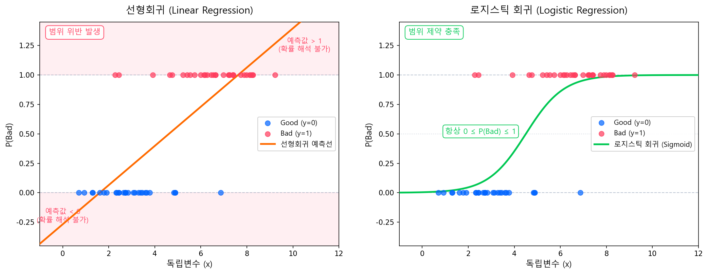

# 문제 정의: Binary Classification

## 1.1 수학적 문제 정의

개요에서 다룬 바와 같이, CSS 모형은 차주의 불량 여부를 예측하는 이진 분류 문제다. 본 파트에서는 이를 수학적으로 정식화한다.

| 구분 | 기호 | 정의 |
|------|------|------|
| **Good** | \(y = 0\) | 정상 (성과 기간 내 불량 미발생) |
| **Bad** | \(y = 1\) | 불량 (기준 이벤트 발생) |

모형의 목표는 차주의 특성 벡터 \(\mathbf{x} = (x_1, x_2, \ldots, x_k)\)가 주어졌을 때, 불량 발생 확률 \(P(y=1 \mid \mathbf{x})\)를 추정하는 것이다. 변수를 고려하지 않은 모집단 전체의 불량 확률 \(p = P(y=1)\)은 표본의 **불량률(Bad Rate)**, 즉 관찰 대상 중 Bad로 분류된 비율로 추정한다.

$$
\hat{p} = \frac{N_{\text{Bad}}}{N_{\text{Total}}}, \quad 0 \leq \hat{p} \leq 1
$$

!!! note "개요 참조"
    Bad/Good/Indeterminate 정의, 성과 기간 설정(Vintage·Roll Rate 분석) 등 모형 개발의 요건 정의에 관한 내용은 [개요 — 요건 정의](../part1_overview/requirements.md)에서 상세히 다루고 있다.

## 1.2 왜 선형회귀를 직접 쓸 수 없는가

선형회귀 모형 \(\hat{y} = \beta_0 + \beta_1 x_1 + \cdots + \beta_k x_k\)를 직접 이진 결과(0/1)에 적용하면(선형확률모형, Linear Probability Model) 세 가지 구조적 문제가 발생한다.

---

**① 예측값이 확률 범위를 벗어난다**

선형회귀 예측값은 \((-\infty, +\infty)\) 범위를 가지지만, 확률은 반드시 \([0, 1]\) 안에 있어야 한다. 예측값이 음수이거나 1을 초과하면 확률로 해석할 수 없다.

---

**② 오차의 통계적 가정이 깨진다**

OLS 추정과 그 위에서 이루어지는 통계적 추론(\(t\)-검정, \(F\)-검정)은 "모든 관측치의 오차 분산이 동일하다(등분산)"는 가정에 기대고, 소표본에서 정확한 추론을 하려면 "오차가 정규 분포를 따른다"는 가정까지 필요하다. 그런데 결과값이 0 아니면 1뿐인 이진 변수에서는 이 가정들이 **구조적으로 성립할 수 없다.**

- **이분산성**: 불량 확률이 50%인 차주는 예측 불확실성이 최대이고, 거의 확실한 Good/Bad 차주는 불확실성이 작다. 즉 차주마다 오차 분산이 다르다.
- **비정규 잔차**: 실제값이 0 또는 1 두 가지뿐이므로, 주어진 \(\mathbf{x}\)에서 잔차도 두 값으로만 나뉘어 정규 분포가 될 수 없다.

이분산성 때문에 OLS는 더 이상 최소분산 추정량이 아니게 되고, 보통의 표준오차 공식이 틀려져 \(t\)-검정·\(F\)-검정 결과를 그대로 믿을 수 없다.

??? note "수학적 도출 — 왜 분산이 관측치마다 다른가"
    OLS가 선형 불편 추정량 중 분산이 가장 작은 추정량(BLUE)이 된다는 **Gauss-Markov 정리**의 조건은 다음과 같다.

    1. **선형성** — 종속변수가 계수에 대해 선형인 모형으로 표현됨
    2. **외생성** — 오차의 조건부 기댓값이 0: \(E[\epsilon_i \mid \mathbf{X}] = 0\)
    3. **등분산·무상관** — 모든 관측치의 오차 분산이 같고 서로 상관이 없음: \(\text{Var}(\epsilon_i \mid \mathbf{X}) = \sigma^2\)
    4. **완전 계수** — 설명변수 사이에 완전한 선형 종속이 없음

    오차의 **정규성은 Gauss-Markov 정리의 조건이 아니다.** 정규성은 소표본에서 \(t\)·\(F\) 분포를 이용한 정확한 추론을 할 때 추가로 필요한 가정이다.

    이진 결과에서 깨지는 것은 3번(등분산)이다. \(y_i \in \{0,1\}\)은 베르누이 분포를 따르므로:

    $$
    E[y_i] = p_i, \quad \text{Var}(y_i) = p_i(1-p_i)
    $$

    **도출:** \(E[y_i^2] = 0^2 \cdot (1-p_i) + 1^2 \cdot p_i = p_i\)이므로, \(\text{Var}(y_i) = E[y_i^2] - (E[y_i])^2 = p_i - p_i^2 = p_i(1-p_i)\).

    분산이 \(p_i\)에 의존하므로 관측치마다 달라진다. 구체적인 수치를 보면:

    | \(p_i\) | \(\text{Var}(y_i) = p_i(1-p_i)\) | 의미 |
    |---------|----------------------------------|------|
    | 0.05 | 0.048 | 거의 확실한 Good → 분산 작음 |
    | 0.20 | 0.160 | 불량률 중간 |
    | 0.50 | **0.250** | 분산 최대 — 불확실성이 가장 큼 |
    | 0.80 | 0.160 | 불량률 높음 |
    | 0.95 | 0.048 | 거의 확실한 Bad → 분산 작음 |

    \(p=0.5\)에서 분산이 최대이고, 0이나 1에 가까울수록 분산이 줄어든다. 이것이 등분산 가정 위반(이분산성)의 수학적 근거다. 게다가 확률을 직선으로 놓는 선형성 자체도, 확률이 0과 1 근처에서 포화되는 현실과 맞지 않는다(①).

---

**③ 확률과 설명변수의 관계가 직선이 아니다**

변수 값이 한 단위 바뀔 때 불량 확률이 늘 같은 폭으로 움직인다는 선형확률모형의 가정은 비현실적이다. 확률이 이미 1%인 우량 차주와 50%인 차주에게 같은 변화가 같은 폭(예: +5%p)의 확률 변화를 준다고 보기 어렵다. 실제로는 확률이 0이나 1에 가까워질수록 변화 폭이 줄어드는 S자형 관계가 자연스럽다.

---

!!! warning "결론 — Logit 변환이 왜 이 문제를 해결하는가"
    위 문제의 근본 원인은 **확률 \(p \in [0,1]\)이라는 제한된 범위**의 값을 선형회귀로 직접 모델링하려 했기 때문이다.

    Logit 변환은 확률 \(p\)를 **Log Odds**로 바꾼다:

    $$
    \text{logit}(p) = \ln\!\left(\frac{p}{1-p}\right) \in (-\infty, +\infty)
    $$

    이 변환을 거치면:

    - **범위 문제 해소** — 변환된 값이 \((-\infty, +\infty)\)이므로, 선형 결합의 범위와 일치한다.
    - **S자형 관계** — log-odds 공간에서의 직선이 확률 공간에서는 S자 곡선이 되어, 0과 1 근처의 포화를 자연스럽게 표현한다.
    - **회귀 프레임워크 적용 가능** — "Log Odds = \(\beta_0 + \beta_1 x_1 + \cdots\)" 형태로, 익숙한 선형 결합 구조를 그대로 쓸 수 있다.
    - **추정 방식 전환** — OLS 대신 **MLE(최대우도추정)**를 사용하며, 베르누이 분포를 직접 모형화하므로 등분산·정규 잔차 가정이 애초에 필요하지 않다.

    즉 Logit 변환은 "확률을 직접 예측"하는 대신 "Log Odds를 예측"하는 문제로 바꿔서, 선형회귀의 구조적 한계를 우회한다. 이것이 **로지스틱 회귀**의 출발점이다.

!!! success "로지스틱 회귀의 주요 가정 — OLS와 비교"
    위에서 OLS가 등분산(그리고 소표본 추론을 위한 정규 잔차)을 전제함을 보았다. 로지스틱 회귀는 베르누이 분포를 직접 모형화하고 MLE를 사용하므로 **등분산과 정규 잔차 가정이 필요 없다.** 대신 아래 조건을 충족해야 한다.

    | OLS의 가정 | 로지스틱 회귀에서는? |
    |----------|---------------------|
    | 등분산 (\(\text{Var}(\epsilon_i) = \sigma^2\)) | **불필요** — 분산 \(p_i(1-p_i)\)가 모형에 내장되어 있고, MLE가 이를 반영 |
    | 정규 잔차 (추론용) | **불필요** — 베르누이 분포를 직접 모형화 |
    | 선형성 | **Log-odds와 독립변수 간 선형 관계**로 전환 |

    추가로 필요한 가정:

    - **반응변수의 이진성:** \(y \in \{0, 1\}\)로 이진 분류여야 한다.
    - **관측치 간 독립성:** 각 관측치 \((y_i, \mathbf{x}_i)\)는 서로 독립이어야 한다. 같은 차주가 여러 기준월에 반복 등장하는 BS 표본처럼 이 가정이 약해지는 경우에는 표준오차 해석에 주의한다.
    - **Log-odds와 독립변수 간 선형 관계:** \(\text{logit}(p) = \beta_0 + \boldsymbol{\beta}^\top\mathbf{x}\)가 성립해야 한다. 원시 변수와 log-odds의 관계가 곡선이면 이 가정이 깨지는데, 변수를 구간화해 구간별 WoE(구간의 log-odds 차이)로 바꾸어 투입하면 구간 단위에서 선형성이 성립한다. 이것이 WoE 변환을 쓰는 이론적 근거이며, [Classing](../part3_variable_selection/classing/index.md)에서 상세히 다룬다.
    - **다중공선성이 심하지 않을 것:** 독립변수 간 높은 상관관계는 계수 추정을 불안정하게 만든다.
    - **완전분리(Complete Separation) 부재:** 특정 변수 조합이 Good/Bad를 완벽히 분리하면 우도가 계수를 무한히 키울수록 계속 커져 **유한한 MLE가 존재하지 않는다.** 일부 구간에서만 완벽히 분리되는 준완전분리(Quasi-complete Separation)도 같은 문제를 일으킨다. Bad가 0건인 구간이 있는 변수에서 흔히 발생한다.
