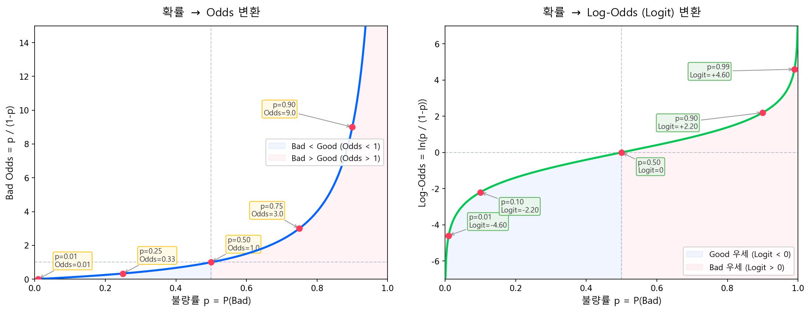
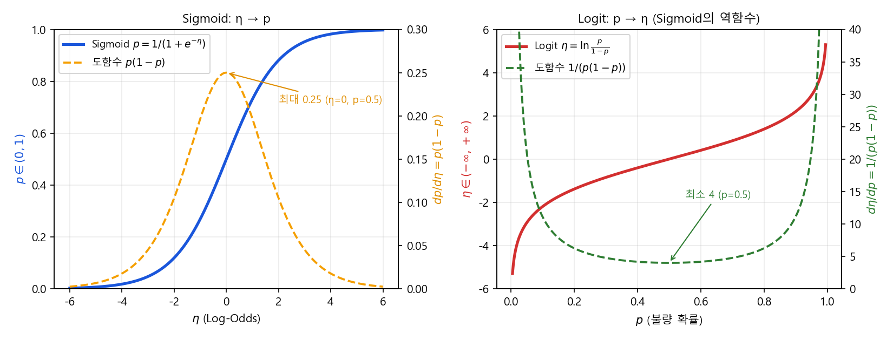

# Logit 변환: 확률 공간 → 실수 공간

## 2.1 Odds: 첫 번째 변환

확률 \(p\)는 \([0,1]\) 범위로 제한되어 있다. 첫 번째 변환으로 **Odds**(오즈)를 도입한다.

$$
\text{Odds} = \frac{p}{1-p} \tag{1}
$$

식 (1)에서 Odds는 범위가 \([0, +\infty)\)로 확장된다. \(p=0.5\)이면 Odds = 1(Bad와 Good이 동등), \(p \to 1\)이면 Odds \(\to \infty\), \(p \to 0\)이면 Odds \(\to 0\)이다.

!!! warning "Odds 방향 — Bad Odds vs Good Odds"
    본 가이드북에서 \(p = P(y=1) = P(\text{Bad})\)이므로, \(\text{Odds} = p/(1-p)\)는 **Bad Odds**(정상 대비 불량) 기준이다. 이는 로지스틱 회귀에서 Bad를 타겟(\(y=1\))으로 모델링하는 표준 관례를 따른 것이다.

    반면 스코어카드 실무에서는 점수가 높을수록 우량해야 직관적이므로, 점수 변환(PDO) 시 **Good Odds \(= (1-p)/p\)**(불량 대비 정상)로 방향을 뒤집어 사용한다. 이때 계수를 다시 적합하지 않고, 같은 계수로 \(\ln(\text{Good Odds}) = -\,\text{logit}(p)\)를 계산한다. 이 전환은 [스코어카드 변환](../part5_scorecard/scorecard-and-rating.md)에서 상세히 다룬다.

    | 단계 | Odds 기준 | 이유 |
    |------|-----------|------|
    | 모형 적합 (Part 1~4: 개요 ~ Full Model) | Bad Odds = \(p/(1-p)\) | Bad를 타겟(\(y=1\))으로 모델링 |
    | 스코어카드 변환 (Part 5~) | Good Odds = \((1-p)/p\) | 점수 ↑ = 우량, 직관적 해석 |

!!! tip "직관적 이해"
    불량률이 25%라면 Bad Odds = \(\frac{0.25}{0.75} = \frac{1}{3} \approx 0.333\), 즉 Good 3건당 Bad 1건이다. 같은 상황을 Good Odds로 쓰면 3이다. Bad Odds가 1보다 크면 Bad가 Good보다 더 많다는 의미다.

| 불량률 \(p\) | Odds \(= p/(1-p)\) | 해석 |
|-------------|---------------------|------|
| 0.01 (1%) | 0.0101 | Bad 1건 : Good 99건 |
| 0.05 (5%) | 0.0526 | Bad 1건 : Good 19건 |
| 0.25 (25%) | 0.333 | Bad 1건 : Good 3건 |
| 0.50 (50%) | 1.000 | Bad = Good |
| 0.90 (90%) | 9.000 | Bad 9건 : Good 1건 |

아래 그래프는 확률 \(p\)가 Odds와 Log-Odds(Logit)로 어떻게 변환되는지를 보여준다. 왼쪽은 Odds 변환(\((0,1) \to (0,+\infty)\)), 오른쪽은 여기에 로그를 취한 Logit 변환(\((0,1) \to (-\infty,+\infty)\))이다.

## 2.2 Log-Odds (Logit 변환): 두 번째 변환

Odds에 자연로그를 적용하면 범위가 \((-\infty, +\infty)\)로 완전히 확장된다.

$$
\text{Logit}(p) = \ln\left(\frac{p}{1-p}\right) \tag{2}
$$

식 (2)에 의해 이제 선형 결합 구조를 적용할 수 있다.

$$
\ln\left(\frac{p}{1-p}\right) = \beta_0 + \beta_1 x_1 + \beta_2 x_2 + \cdots + \beta_k x_k \tag{3}
$$

| 불량률 \(p\) | Odds | Log-Odds \(= \ln(\text{Odds})\) |
|-------------|------|-------------------------------|
| 0.01 | 0.0101 | −4.60 |
| 0.05 | 0.0526 | −2.94 |
| 0.25 | 0.333 | −1.10 |
| 0.50 | 1.000 | 0.00 |
| 0.75 | 3.000 | +1.10 |
| 0.99 | 99.0 | +4.60 |

??? note "왜 로그를 취하고, 왜 자연로그인가"
    **(1) 로그를 취하는 이유 — 범위와 대칭성**

    Odds는 \([0, +\infty)\)에 머물고, 1을 기준으로 비대칭이다(Bad가 우세한 쪽은 1~∞, Good이 우세한 쪽은 0~1에 몰린다). 로그를 취하면 범위가 실수 전체로 펼쳐지고, \(\ln(\text{Odds})\)와 \(\ln(1/\text{Odds}) = -\ln(\text{Odds})\)처럼 Bad·Good 방향이 0을 중심으로 **대칭**이 된다. 위 표에서 \(p = 0.01\)과 \(p = 0.99\)의 Log-Odds가 −4.60과 +4.60인 것이 그 예다.

    **(2) 밑(base)은 본질이 아니다**

    \(\log_{10}\)이나 \(\log_2\)를 써도 \(\log_b(\text{Odds}) = \ln(\text{Odds}) / \ln b\)이므로, 모든 계수가 같은 상수배로 바뀔 뿐 **같은 모형**이다. 단조성, 우도의 오목성, 예측 확률은 밑과 무관하게 똑같다.

    **(3) 그래도 자연로그를 쓰는 이유 — 해석과 계산이 가장 깔끔하다**

    - **역변환이 간단하다.** 식 (2)의 Logit \(\eta = \ln\!\left(\frac{p}{1-p}\right)\)을 \(p\)에 대해 풀면 지수함수 하나로 표현된다.

        $$
        p_i = \frac{1}{1 + e^{-(\beta_0 + \boldsymbol{\beta}^\top \mathbf{x}_i)}} \tag{4}
        $$

        이 함수를 **시그모이드(Sigmoid) 함수**라 한다.
    - **계수가 곧 오즈비가 된다.** \(e^{\beta_j}\)가 \(x_j\) 한 단위 증가 시 Odds가 몇 배가 되는지를 그대로 나타낸다(아래 "β 해석").
    - **Gradient가 단순하다.** 베르누이 분포에서 Logit은 정준 연결함수(canonical link)이므로, Log-Likelihood의 기울기가 \(\sum_i (y_i - p_i)\mathbf{x}_i\)라는 단순한 형태가 된다(도출은 [MLE](mle.md) 참고).

        $$
        \frac{\partial \ell}{\partial \boldsymbol{\beta}} = \sum_{i=1}^{n}(y_i - p_i)\mathbf{x}_i
        $$

    **참고 — 우도에 로그를 취하는 것은 별개의 이야기다.** MLE에서 개별 확률의 곱 대신 로그 합을 쓰는 것은 수치 **Underflow 방지**(예: \(0.001\)을 1,000번 곱하면 컴퓨터에서 0이 됨)와 미분 편의 때문이며, Odds에 로그를 취하는 Logit 변환과는 목적이 다르다.

## 2.3 로지스틱 함수: 역방향 변환

식 (3)의 Log-Odds \(\eta = \beta_0 + \boldsymbol{\beta}^\top \mathbf{x}\)로부터 확률 \(p\)로 되돌아가는 역변환이 **로지스틱 함수(Sigmoid)**이다.

$$
p = P(y=1 \mid \mathbf{x}) = \frac{1}{1 + e^{-\eta}} = \frac{e^\eta}{1 + e^\eta} \tag{5}
$$

Sigmoid와 Logit은 서로 **역함수 관계**다. 실무에서 자주 쓰이는 역변환 예시:

| Log-Odds \(\eta\) | 확률 \(p = 1/(1+e^{-\eta})\) | 실무 해석 |
|-------------------|------------------------------|----------|
| −3.0 | 0.047 (4.7%) | 불량 확률 낮음 |
| −1.0 | 0.269 (26.9%) | 중간~위험 구간 |
| 0.0 | 0.500 (50.0%) | Bad/Good 동등. 기준점 |
| 0.5 | 0.622 (62.2%) | 불량 확률 높음 |
| 2.0 | 0.881 (88.1%) | 매우 고위험 |

예를 들어 "이 차주의 log-odds가 0.5이면 불량 확률은?" → \(p = 1/(1+e^{-0.5}) \approx 0.622\), 즉 약 62%다.

### 두 함수의 기울기

아래 그림의 왼쪽은 Sigmoid와 그 도함수, 오른쪽은 Logit과 그 도함수다.

- **Sigmoid의 도함수** \(\dfrac{dp}{d\eta} = p(1-p)\)는 \(p = 0.5\)(\(\eta = 0\))에서 **최대 0.25**이고, \(p\)가 0이나 1에 가까울수록 0에 가까워진다. log-odds가 같은 폭만큼 움직여도, 불확실성이 가장 큰 \(p \approx 0.5\) 부근에서 확률이 가장 크게 변하고 0·1 근처에서는 거의 변하지 않는다는 뜻이다. MLE에서 이 값 \(p_i(1-p_i)\)는 각 관측치의 가중치(Fisher 정보량)로 등장하므로, \(p \approx 0.5\) 부근의 관측치가 계수 추정에 가장 많은 정보를 준다.
- **Logit의 도함수** \(\dfrac{d\eta}{dp} = \dfrac{1}{p(1-p)}\)는 Sigmoid 도함수의 역수다. \(p = 0.5\)에서 **최소 4**이고, \(p\)가 0이나 1에 가까울수록 무한히 커진다.

    **도출:** \(\ln\!\left(\frac{p}{1-p}\right) = \ln p - \ln(1-p)\)이므로, 미분하면 \(\frac{1}{p} + \frac{1}{1-p} = \frac{1}{p(1-p)}\).

    즉 확률이 0이나 1에 가까운 영역에서는 확률이 조금만 달라져도 log-odds가 크게 달라진다. 불량률 1%와 2%의 차이는 확률로는 1%p지만 log-odds로는 약 0.70(Odds 약 2배)이다.

!!! note "Sigmoid vs Logit 비교"
    | | **Sigmoid** (η → p) | **Logit** (p → η) |
    |---|---|---|
    | 입력 | 선형 결합 \(\eta \in (-\infty, +\infty)\) | 확률 \(p \in (0, 1)\) |
    | 출력 | 확률 \(p \in (0, 1)\) | Log-odds \(\eta \in (-\infty, +\infty)\) |
    | 도함수 | \(p(1-p)\), \(p=0.5\)에서 최대 0.25 | \(1/(p(1-p))\), \(p=0.5\)에서 최소 4 |
    | 역할 | 선형 결합값을 확률로 압축 | 확률을 실수 전체로 확장 |

!!! success "핵심 정리"
    로지스틱 회귀는 log-odds 공간에서 선형 모형을 적합시킨 후, 로지스틱 함수로 확률로 변환한다. 이로써 범위 위반, 이분산성, 비정규 잔차 문제가 동시에 해결된다.

> **확률 \(p \in (0,1)\)** → **Odds \(\in (0,\infty)\)** → **Log-Odds \(\in (-\infty,\infty)\)** → **선형 모형 \(\beta_0 + \boldsymbol{\beta}^\top\mathbf{x}\)**

!!! tip "β 해석 — 계수 하나의 의미"
    다변량 로지스틱 회귀에서 계수 \(\beta_j\)는 다른 변수를 고정한 채 \(x_j\)가 1단위 증가할 때 **log-odds가 \(\beta_j\)만큼 변한다**는 의미다.

    → \(e^{\beta_j}\)는 **오즈비(Odds Ratio)**: 예) \(\beta_j = 0.5\)이면 해당 변수 1단위 증가 시 Bad Odds가 \(e^{0.5} \approx 1.65\)배 증가한다.

    WoE로 변환한 변수는 우량 구간일수록 WoE가 크므로 정상 계수가 **음수**다. 예를 들어 \(\beta_j = -0.8\)이면 WoE가 1 증가할 때 Bad Odds가 \(e^{-0.8} \approx 0.45\)배로 줄어든다([모델링 — 왜 로지스틱 회귀인가](../part1_overview/model-fitting.md)).

!!! note "CB사 평점과 로지스틱 회귀"
    CB사가 공시하는 개인신용평점의 평가부문별 반영 비중은 [변수 선정 — KCB 주요 평가부문](../part1_overview/x-variables.md)에 정리되어 있다. 공시는 평가부문과 비중을 밝힐 뿐 구체적인 통계 기법을 명시하지 않으므로, 특정 CB사의 평점이 어떤 모형으로 산출되는지는 단정하지 않는다.

??? note "더 알아보기: GLM 관점 — Link Function을 바꾸면 다른 모형이 된다"
    로지스틱 회귀는 **일반화 선형모형(Generalized Linear Model, GLM)**의 한 특수한 경우다. GLM에서 **Link Function**이란 반응변수의 기대값과 선형결합 \(\eta = \beta_0 + \boldsymbol{\beta}^\top\mathbf{x}\)를 연결하는 함수 \(g(\cdot)\)를 말한다. 로지스틱 회귀는 베르누이 분포 + **Logit link** \(g(p) = \ln\frac{p}{1-p}\)를 선택한 것이다.

    **Link function을 바꾸면 같은 프레임워크에서 전혀 다른 모형**이 된다.

    | Link Function | \(g(p)\) | 특징 |
    |---------------|----------|------|
    | **Logit** | \(\ln\frac{p}{1-p}\) | 대칭, 오즈비 해석 가능. **스코어카드 표준** |
    | **Cloglog** | \(\ln[-\ln(1-p)]\) | 비대칭. 이산시간 비례위험모형(Discrete-time Proportional Hazards Model)과 동치 |

    스코어카드에서 Logit이 표준인 이유는 \(e^{\beta_j}\) = Odds Ratio라는 깔끔한 해석 때문이다. 반면 Cloglog link는 IFRS 9 Lifetime PD 추정처럼 **"부도 시점"**을 모형화할 때 쓰이며, Cox 비례위험모형(Cox PH Model)의 이산 버전에 해당한다.

    이처럼 link function의 선택에 따라 모형의 성격이 달라지며, 신용리스크 분야에서는 생존분석(Survival Analysis)과 결합하여 IFRS 9 Lifetime PD 추정, 행동평점, 조기상환 모형 등 **"부도 여부"가 아닌 "부도 시점"**을 모형화하는 방향으로도 확장된다.

    ---

    **Cloglog Link의 실무 적용: IFRS 9 Lifetime PD**

    Cloglog link가 어떻게 쓰이는지를 이해하려면, Cox PH Model의 연속시간 위험함수에서 출발한다.

    $$
    h(t \mid \mathbf{x}) = h_0(t) \cdot \exp(\boldsymbol{\beta}^\top\mathbf{x})
    $$

    여기서 \(h_0(t)\)는 기저 위험함수(baseline hazard), \(\exp(\boldsymbol{\beta}^\top\mathbf{x})\)는 차주 특성에 의한 위험 배율이다. 그러나 실무 데이터는 연속시간이 아니라 **월 단위, 분기 단위** 등 이산 구간으로 관측된다. 구간 \([t,\; t+1)\)에서의 이산 위험률(discrete hazard)을 정의하면:

    $$
    h_t = P(T \in [t,\; t+1) \mid T \ge t)
    $$

    연속시간 비례위험 가정 아래에서 이를 구간별로 묶으면 다음 식이 된다(\(\alpha_t\)는 구간 \(t\)의 기저 위험을 누적한 값의 로그).

    $$
    h_t = 1 - \exp\!\bigl[-\exp(\alpha_t + \boldsymbol{\beta}^\top\mathbf{x})\bigr]
    $$

    양변에 변환을 적용하면:

    $$
    \ln\!\bigl[-\ln(1 - h_t)\bigr] = \alpha_t + \boldsymbol{\beta}^\top\mathbf{x}
    $$

    좌변이 바로 **cloglog link function**이다. 즉, **이항 GLM에서 link function만 cloglog로 지정하면 Cox PH의 이산 버전**(grouped proportional hazards model)이 된다(Prentice & Gloeckler, 1978).

    **데이터 준비 — Person-Period 패널 변환**

    Lifetime PD 산출을 위해, 원본 대출 데이터를 월 단위로 펼쳐 person-period 형태로 변환한다.

    | 차주 | 월(\(t\)) | 부도여부(\(y\)) | DSR | 연체횟수 | … |
    |------|-----------|----------------|-----|---------|---|
    | A | 1 | 0 | 0.45 | 0 | … |
    | A | 2 | 0 | 0.45 | 1 | … |
    | A | 3 | 0 | 0.47 | 1 | … |
    | A | **4** | **1** | 0.50 | 2 | … |
    | B | 1 | 0 | 0.30 | 0 | … |
    | B | 2 | 0 | 0.30 | 0 | … |
    | … | … | … | … | … | … |
    | B | 6 | 0 | 0.32 | 0 | … |

    - 차주 A: 4개월차에 부도 → 4행 생성, 마지막 행만 \(y=1\)
    - 차주 B: 6개월까지 생존(중도절단, censored) → 6행 생성, 전부 \(y=0\)
    - 연체횟수 등 **시변(time-varying) 변수**는 매 월 값이 갱신됨

    **모형 적합**

    이 패널 데이터에 이항 GLM을 적합하되, 연결함수를 cloglog로 지정하고 설명변수로 **경과 기간 더미(\(\alpha_t\))와 차주 특성 변수**를 넣는다. 경과 기간 더미가 기저 위험의 시간 패턴을, 차주 특성 계수가 위험 배율(Hazard Ratio의 로그)을 맡는다.

    **Lifetime PD 산출**

    적합된 모형에서 각 월별 위험률 \(h_t\)를 예측한 뒤, 생존확률을 누적 곱하여 Lifetime PD를 산출한다.

    $$
    S(T) = \prod_{k=1}^{T}(1 - h_k), \qquad \text{Lifetime PD} = 1 - S(T)
    $$

    아래는 월별 위험률이 0.50%에서 매월 0.02%p씩 늘어나는(\(h_t = 0.005 + 0.0002(t-1)\)) 가상 예시를 계산한 것이다. **한계 PD**는 지금 시점에서 볼 때 그 달에 처음 부도날 확률 \(S(t-1)\cdot h_t\)이며, 이를 더하면 누적 PD가 된다([PD — ECL 계산](../../lending_process/terms/pd.md)).

    | 월(\(t\)) | \(h_t\) (월별 위험률) | 생존확률 \(S(t)\) | 누적 PD \(1-S(t)\) | 한계 PD \(S(t-1)\,h_t\) |
    |-----------|---------------------|------------------|---------|---------|
    | 1 | 0.50% | 0.9950 | 0.50% | 0.500% |
    | 2 | 0.52% | 0.9898 | 1.02% | 0.517% |
    | 3 | 0.54% | 0.9845 | 1.55% | 0.535% |
    | … | … | … | … | … |
    | 12 | 0.72% | 0.9292 | 7.08% | 0.674% |
    | 24 | 0.96% | 0.8387 | 16.13% | 0.813% |
    | 36 | 1.20% | 0.7354 | 26.46% | 0.893% |

    - **12개월 PD** = \(1 - S(12)\) → IFRS 9 **Stage 1** ECL 산출에 투입
    - **Lifetime PD** = \(1 - S(\text{만기})\) → **Stage 2** ECL 산출에 투입 (Stage 판정 기준은 [PD — IFRS 9 Stage 분류](../../lending_process/terms/pd.md) 참고)

    **Logit vs Cloglog — 왜 구분하는가**

    | | Logit link | Cloglog link |
    |--|-----------|-------------|
    | 계수 해석 | Odds Ratio | **Hazard Ratio** |
    | 이론적 배경 | 오즈비 기반 | **Cox PH Model의 이산 버전** |
    | 주 용도 | 스코어카드(12개월 PD) | **IFRS 9 Lifetime PD** |
    | 모형 명칭 | "로지스틱 회귀" | "이산시간 비례위험모형" |

    Logit link로도 같은 패널 구조에서 월별 위험률을 추정할 수 있고, 위험률이 작을 때는 두 결과가 비슷하다. Cloglog을 쓰면 계수를 생존분석의 Hazard Ratio로 그대로 해석할 수 있고, 관측 구간의 길이(월·분기)를 바꿔도 계수의 의미가 유지된다는 장점이 있다.

    

    참고: Prentice, R. L., & Gloeckler, L. A. (1978). Regression analysis of grouped survival data with application to breast cancer data. <em>Biometrics</em>, 34(1), 57–67.
    

    !!! quote "저자의 말"
        클로드 코드와 스터디하면서 오랜만에 생존분석(Survival Analysis)의 Cox PH Model 내용을 리뷰하였다. 본인의 경우, 실무에서 Logit 변환 외 다른 link function을 사용해 본 적은 없지만, Cloglog 변환을 통해 PD 추정을 하는 경우도 있다고 한다.

!!! note "스코어카드에서 로지스틱 회귀를 쓰는 이유"
    해석가능성(계수·오즈비), 검증 용이성, WoE 인코딩과 결합했을 때의 단조성 보장, 배점표로 이어지는 가산성 등 스코어카드 실무에서 로지스틱 회귀가 표준이 된 이유는 [모델링 — 왜 로지스틱 회귀인가](../part1_overview/model-fitting.md)에서 정리한다.
