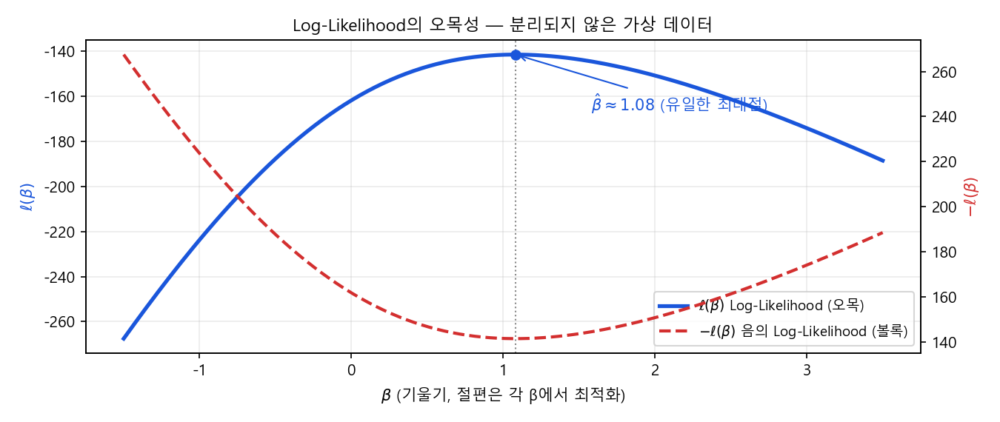

# MLE (최대우도추정)

## 3.1 개념

선형회귀는 잔차제곱합(RSS)을 최소화하는 OLS(최소자승법)를 사용하지만, 로지스틱 회귀는 **최대우도추정(MLE, Maximum Likelihood Estimation)**으로 계수를 추정한다.

> OLS는 \(\hat{\boldsymbol{\beta}} = (\mathbf{X}^\top\mathbf{X})^{-1}\mathbf{X}^\top\mathbf{y}\)라는 **해석적 해(closed-form solution)**가 존재하지만, 로지스틱 회귀의 우도 방정식은 계수에 대해 비선형이라 닫힌 해가 없다. 따라서 반복적 수치 최적화가 **필수**다.

!!! tip "직관적 이해"
    MLE는 "실제로 관찰된 데이터가 나타날 확률을 최대로 만드는 파라미터는 무엇인가?"를 찾는 방법이다. 실제 Bad인 차주에게는 높은 \(\hat{p}\)를, 실제 Good인 차주에게는 낮은 \(\hat{p}\)를 부여하는 \(\boldsymbol{\beta}\)를 찾는다.

## 3.2 Likelihood 정의

\(n\)개의 독립 관측치 \((y_i, \mathbf{x}_i)\)에 대해, 모형의 예측 확률 \(p_i = P(y_i = 1 \mid \mathbf{x}_i)\)를 이용하면 개별 관측치의 확률은 다음과 같다.

$$
P(y_i \mid \mathbf{x}_i) = p_i^{y_i}(1-p_i)^{1-y_i} \tag{1}
$$

식 (1)로부터, 전체 데이터의 결합 우도(Likelihood)는:

$$
L(\boldsymbol{\beta}) = \prod_{i=1}^{n} p_i^{y_i}(1-p_i)^{1-y_i} \tag{2}
$$

| 고객 | 실제 \(y_i\) | 예측 \(\hat{p}_i\) | 평가 | 기여도 \(P(y_i \mid \mathbf{x}_i)\) |
|------|-------------|-------------------|------|----------------------------------|
| 고객 A | Bad (\(y=1\)) | 0.90 | 높은 \(\hat{p}\) → 올바름 | \(0.90^1 \cdot 0.10^0 = 0.90\) |
| 고객 B | Bad (\(y=1\)) | 0.05 | 낮은 \(\hat{p}\) → 틀림 | \(0.05^1 \cdot 0.95^0 = 0.05\) |
| 고객 C | Good (\(y=0\)) | 0.08 | 낮은 \(\hat{p}\) → 올바름 | \(0.08^0 \cdot 0.92^1 = 0.92\) |
| 고객 D | Good (\(y=0\)) | 0.85 | 높은 \(\hat{p}\) → 틀림 | \(0.85^0 \cdot 0.15^1 = 0.15\) |

틀린 예측을 한 관측치(B, D)는 기여도가 작아 결합 우도를 크게 끌어내린다. MLE는 이런 관측치가 줄어들도록 \(\boldsymbol{\beta}\)를 조정한다.

## 3.3 Log-Likelihood와 최적화

식 (2)의 곱셈 형태 \(L(\boldsymbol{\beta})\)는 직접 최대화하기 어렵고, 작은 확률을 수천 번 곱하면 컴퓨터에서 0이 되어 버린다(Underflow). 로그를 취하면 합산 형태로 변환된다. 로그는 단조증가 함수이므로 최대점의 위치는 바뀌지 않는다.

$$
\ell(\boldsymbol{\beta}) = \ln L(\boldsymbol{\beta}) = \sum_{i=1}^{n} \left[ y_i \ln p_i + (1-y_i)\ln(1-p_i) \right] \tag{3}
$$

!!! note "리마인드 — 여기서 \(p_i\)는:"
    $$p_i = P(y_i = 1 \mid \mathbf{x}_i) = \frac{1}{1+e^{-\eta_i}} = \frac{e^{\eta_i}}{1+e^{\eta_i}}, \quad \eta_i = \beta_0 + \boldsymbol{\beta}^\top \mathbf{x}_i$$

    즉, 단순한 숫자가 아니라 **\(\boldsymbol{\beta}\)의 함수**다. \(\ell(\boldsymbol{\beta})\)를 최대화하는 것은 곧 이 \(p_i\)들을 실제 \(y_i\)에 가장 근접하게 만드는 \(\boldsymbol{\beta}\)를 찾는 것이다.

### Gradient(Score 함수) 도출

\(\ell(\boldsymbol{\beta})\)를 \(\boldsymbol{\beta}\)로 편미분하면 최적화에 사용할 Gradient(Score 함수)를 얻는다.

**Step 1 — 체인 룰 적용:**

$$
\frac{\partial \ell}{\partial \beta_j} = \sum_{i=1}^{n} \frac{\partial}{\partial \beta_j}\left[ y_i \ln p_i + (1-y_i)\ln(1-p_i) \right]
$$

**Step 2 — 각 항을 \(p_i\)에 대해 미분한 뒤 \(p_i\)를 \(\beta_j\)로 미분:**

\(\frac{\partial \ln p_i}{\partial p_i} = \frac{1}{p_i}\), \(\frac{\partial \ln(1-p_i)}{\partial p_i} = \frac{-1}{1-p_i}\)이고, 시그모이드 함수의 미분 성질에 의해 \(\frac{\partial p_i}{\partial \eta_i} = p_i(1-p_i)\), \(\frac{\partial \eta_i}{\partial \beta_j} = x_{ij}\)이므로:

$$
\frac{\partial \ell}{\partial \beta_j} = \sum_{i=1}^{n}\left[\frac{y_i}{p_i} - \frac{1-y_i}{1-p_i}\right] \cdot p_i(1-p_i) \cdot x_{ij}
$$

**Step 3 — 정리:**

괄호 안을 통분하면 \(\frac{y_i(1-p_i) - (1-y_i)p_i}{p_i(1-p_i)} = \frac{y_i - p_i}{p_i(1-p_i)}\)이므로:

$$
\boxed{\frac{\partial \ell}{\partial \beta_j} = \sum_{i=1}^{n}(y_i - p_i)\, x_{ij}} \tag{4}
$$

벡터 형태로 쓰면 \(\nabla_{\boldsymbol{\beta}}\ell = \mathbf{X}^\top(\mathbf{y} - \mathbf{p})\). 이 결과의 직관적 의미: **실제값과 예측값의 차이(\(y_i - p_i\))를 입력 변수(\(x_{ij}\))로 가중 합산**한 것이다. 최적점에서는 이 값이 0이 되므로, 절편이 있는 모형에서는 \(\sum_i y_i = \sum_i \hat{p}_i\) — **예측 불량 건수의 합이 실제 불량 건수와 정확히 같아진다**(표본 평균 수준의 캘리브레이션).

### Binary Cross-Entropy와의 관계

식 (3)을 최대화하는 것은 **이진 교차 엔트로피(Binary Cross-Entropy, BCE) 손실을 최소화**하는 것과 동치이다.

$$
\text{BCE Loss} = -\frac{1}{n}\ell(\boldsymbol{\beta}) = -\frac{1}{n}\sum_{i=1}^{n}\left[y_i \ln \hat{p}_i + (1-y_i)\ln(1-\hat{p}_i)\right]
$$

즉 머신러닝에서 "BCE Loss를 최소화한다"와 통계학에서 "Log-Likelihood를 최대화한다"는 **동일한 최적화 문제의 서로 다른 표현**이다. 부호와 스케일링(\(1/n\))만 다를 뿐 최적해 \(\hat{\boldsymbol{\beta}}\)는 동일하다.

!!! success "오목성(Concavity) — 전역 최적해의 조건"
    \(\ell(\boldsymbol{\beta})\)는 \(\boldsymbol{\beta}\)에 대해 **오목(concave)** 함수이므로, 음수를 취한 \(-\ell(\boldsymbol{\beta})\)는 **볼록(convex)** 함수다. 따라서 지역 최적해가 곧 전역 최적해이며, 함정이 되는 지역 최솟값이 없다. 다만 다음 두 조건이 함께 성립해야 **유한하고 유일한** 최적해가 존재한다.

    - **설계행렬이 완전 계수(full column rank)일 것** — 어떤 변수가 다른 변수들의 선형 결합이면(예: 같은 정보를 담은 더미를 모두 넣은 경우) 우도가 평평한 방향이 생겨 해가 유일하지 않다.
    - **완전분리·준완전분리가 없을 것** — Good/Bad가 어떤 변수 조합으로 완벽히 나뉘면, 계수를 키울수록 우도가 계속 증가해 유한한 최대점이 없다. 알고리즘은 "수렴"하지 않고 계수가 발산한다([문제 정의 — 로지스틱 회귀의 주요 가정](binary-classification.md)).

    두 조건이 성립하면 \(-\ell\)은 엄격히 볼록이 되어, 합리적인 초기값에서 시작한 Newton-Raphson 계열 알고리즘이 같은 해에 도달한다.

위 그림은 Good/Bad가 겹쳐 있는(분리되지 않은) 가상 데이터에서 기울기 \(\beta\)에 따른 Log-Likelihood다(절편은 각 \(\beta\)마다 최적화). 곡선이 한 점에서 최대가 되고 양쪽으로 내려가므로 유일한 \(\hat\beta\)가 존재한다. 만약 데이터가 완전분리되어 있다면 곡선은 \(\beta\)가 커질수록 계속 올라가며 0에 다가갈 뿐 최대점이 생기지 않는다.

!!! note "OLS vs MLE 비교"
    선형회귀의 OLS는 잔차제곱합(RSS)을 최소화하며, RSS가 \(\boldsymbol{\beta}\)에 대해 볼록(convex)하므로 전역 최적값이 보장된다. 로지스틱 회귀의 MLE는 음의 로그-우도 \(-\ell(\boldsymbol{\beta})\)를 최소화하며, 이 역시 볼록 함수이다. 두 방법 모두 볼록 최적화 문제이나, OLS는 닫힌 해가 존재하는 반면 MLE는 수치 최적화가 필요하다는 차이가 있다.

## 3.4 최적화 알고리즘

로그-우도 함수는 \(\boldsymbol{\beta}\)에 대한 해석적 해(Closed-form Solution)가 없으므로 수치 최적화를 사용한다.

| 알고리즘 | 원리 | 특징 |
|----------|------|------|
| **경사 상승법** (Gradient Ascent) | \(\boldsymbol{\beta}^{(t+1)} = \boldsymbol{\beta}^{(t)} + \alpha \nabla\ell\) | \(\ell\)을 최대화하므로 Gradient 방향으로 이동한다(\(-\ell\)에 대한 경사 하강법과 같다). 단순하고 대용량 데이터에 적합. 학습률 \(\alpha\) 조정 필요 |
| **Newton-Raphson** | 헤시안(Hessian) 행렬로 곡률을 반영, 2차 수렴 | 빠른 수렴. 변수가 많으면 헤시안 계산·역행렬 비용이 높음 |
| **IRLS** (반복 가중 최소자승) | 가중 선형회귀를 반복. 로지스틱 회귀에서는 Newton-Raphson과 동치 | 전통적 통계 소프트웨어의 GLM 적합에 널리 쓰이는 방식. 표준오차가 함께 계산됨 |
| **L-BFGS** (Limited-memory BFGS) | 헤시안을 직접 계산하지 않고 Gradient 이력으로 근사하여 메모리 절약 | 변수가 많고 표본이 큰 경우에 효율적. 머신러닝 라이브러리에서 흔히 쓰임 |

!!! success "수렴 판단"
    반복 과정에서 로그-우도의 변화량 \(\lvert\ell^{(t+1)} - \ell^{(t)}\rvert\)나 Gradient의 크기가 충분히 작아지면(예: \(10^{-6}\) 미만) 수렴으로 판단한다. 최대 반복 횟수 안에 수렴하지 못했다는 경고가 나오면, 반복 횟수를 늘리기 전에 **분리 문제나 변수 스케일 문제**가 없는지부터 확인한다.

!!! warning "라이브러리 기본값 주의 — 순수 MLE가 아닐 수 있다"
    일부 머신러닝 라이브러리의 로지스틱 회귀는 **기본값으로 L2 규제(Ridge)**가 걸려 있다. 예를 들어 scikit-learn의 로지스틱 회귀는 공식 문서에 "정규화가 기본으로 적용된다"고 명시하고 있으며, 기본 규제 강도가 \(C = 1.0\)이다. 이 상태로 적합한 계수는 MLE가 아니라 **0 쪽으로 축소된 추정치**이므로, 스코어카드의 계수 부호·크기 해석이나 Wald 검정에 그대로 쓰면 안 된다. 순수 MLE가 필요하면 규제를 끄거나 통계 패키지의 GLM 적합을 사용한다.

    

    출처: <a href="https://scikit-learn.org/stable/modules/generated/sklearn.linear_model.LogisticRegression.html" target="_blank">scikit-learn 공식 문서 · 로지스틱 회귀 API 문서</a>
    

## 3.5 Hessian과 표준오차 — 검정의 출발점

Newton-Raphson은 Gradient에 더해 **2차 미분(Hessian)**을 쓴다. 식 (4)를 한 번 더 미분하면

$$
\mathbf{H}(\boldsymbol{\beta}) = \frac{\partial^2 \ell}{\partial \boldsymbol{\beta}\,\partial \boldsymbol{\beta}^\top} = -\,\mathbf{X}^\top \mathbf{W} \mathbf{X}, \qquad \mathbf{W} = \text{diag}\big(p_i(1-p_i)\big) \tag{5}
$$

이다. \(\mathbf{W}\)의 대각 원소가 모두 양수이므로 \(\mathbf{H}\)는 음의 준정부호이고, 이것이 위에서 말한 오목성의 근거다. 설계행렬이 완전 계수이면 음의 정부호가 되어 최적해가 유일해진다.

Newton-Raphson의 갱신식은 \(\boldsymbol{\beta}^{(t+1)} = \boldsymbol{\beta}^{(t)} - \mathbf{H}^{-1}\nabla\ell\)이며, 이를 정리하면 가중치 \(\mathbf{W}\)로 가중 최소자승을 반복하는 IRLS가 된다.

\(-\mathbf{H} = \mathbf{X}^\top\mathbf{W}\mathbf{X}\)는 **Fisher 정보량(Information Matrix)**이다. 정보량이 클수록 계수가 정밀하게 추정되며, MLE의 분산은 그 역행렬로 근사된다.

$$
\widehat{\text{Var}}(\hat{\boldsymbol{\beta}}) = (\mathbf{X}^\top \hat{\mathbf{W}} \mathbf{X})^{-1}, \qquad \text{SE}(\hat\beta_j) = \sqrt{\big[(\mathbf{X}^\top \hat{\mathbf{W}} \mathbf{X})^{-1}\big]_{jj}}
$$

- \(p_i(1-p_i)\)가 가중치이므로, \(p \approx 0.5\) 부근의 관측치가 정보를 가장 많이 주고, 불량률이 극히 낮은 표본에서는 같은 건수라도 표준오차가 커진다([Logit 변환 — 두 함수의 기울기](logit-transform.md)).
- 변수 사이에 상관이 높으면 \(\mathbf{X}^\top\mathbf{W}\mathbf{X}\)가 역행렬을 구하기 어려운 상태에 가까워져 표준오차가 부풀려진다. 다중공선성이 계수를 불안정하게 만드는 이유가 여기에 있다.

이 표준오차로 \(z = \hat\beta_j / \text{SE}(\hat\beta_j)\)를 계산한 것이 **Wald 검정**이며, 변수 선택에서 쓰는 Score 검정·LR 검정과 함께 [Score·Wald·LR 검정](../appendix/logistic-fitting/score-wald-lr-test.md)에서 자세히 다룬다.
