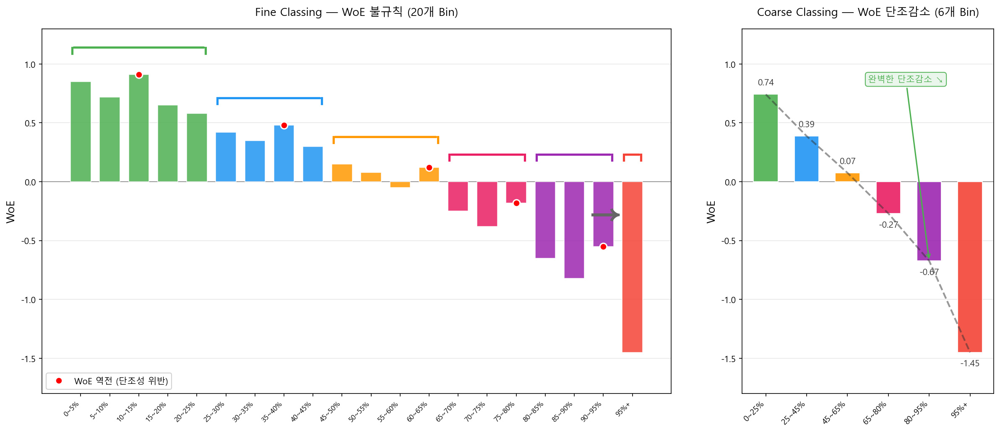

# Coarse Classing

## 3.1 개념과 목적

Coarse Classing은 Fine Classing의 세밀한 구간을 **통계적으로 안정적이고 업무적으로 의미 있는 최종 구간**으로 합병하는 과정이다. 최종 Bin 수는 통상 **3~10개** 범위에서 결정되며, 실제 스코어카드 변수 1개당 5개 안팎으로 수렴하는 경우가 많다.

!!! note "Bin 수에 대한 실무 기준"
    실무에서는 변수당 5개 안팎이 흔하고, 표본과 변별력에 따라 더 많거나 적어진다([기준값 정본](decision-criteria.md)). **핵심은 Bin 개수 자체가 아니라, 각 Bin이 최소 표본 기준을 충족하면서 WoE 단조성과 업무 논리를 동시에 만족하는가**에 있다. 최소 표본 기준(각 Bin ≥ 전체의 5%, Bad 건수 하한)의 정본은 [의사결정 기준 종합](decision-criteria.md)에 있다.

!!! tip "왜 너무 적거나 너무 많으면 안 되는가"
    - **너무 적으면 (2개 이하):** 변수의 변별력을 충분히 활용하지 못한다. 최소 3개 구간은 있어야 비선형 패턴(U자형 등)을 표현할 수 있다. 단, "연체 유무"처럼 본래 이진인 변수는 2개 Bin이 자연스럽다.
    - **너무 많으면 (11개 이상):** 각 Bin의 표본이 적어 WoE가 불안정해지고, 과적합 위험과 스코어카드 해석 부담이 커진다.

### Coarse Classing 전·후 WoE 패턴 비교

Fine Classing(20개 Bin)의 불규칙한 WoE를 Coarse Classing(6개 Bin)으로 합병하면 단조성과 안정성이 확보된다. 아래 차트에서 **같은 색상의 Fine Bin들이 하나의 Coarse Bin으로 합병**되는 과정을 확인할 수 있다.

왼쪽 차트에서 빨간 점(●)으로 표시된 구간이 WoE 역전(단조성 위반)이 발생한 지점이다. 예를 들어 10~15% 구간의 WoE(0.91)가 5~10% 구간(0.72)보다 오히려 높은데, 이는 해당 구간의 표본이 적어 WoE 추정이 흔들린 결과다. 이런 역전 구간을 인접 Bin과 합병하면 오른쪽 차트처럼 WoE가 0.74 → 0.39 → 0.07 → −0.27 → −0.67 → −1.45로 **단조감소**한다. 사용률이 높을수록 WoE가 음(−)으로 내려가므로, "한도를 많이 쓸수록 위험"이라는 업무 논리와도 맞는다.

!!! success "핵심 포인트"
    Coarse Classing의 목표는 WoE가 **단조적이면서** 각 Bin이 충분한 표본을 보유하고, 인접 Bin끼리 위험 수준이 실제로 구분되는 상태를 만드는 것이다. WoE가 단조적이면 로지스틱 회귀에서 해당 변수의 계수가 안정적으로 추정된다.

---

## 3.2 합병 알고리즘

!!! note "실무 활용도"
    아래 세 가지 방식은 모두 실무에서 쓰인다. 최근에는 (3)의 최적화 기반 도구(예: 오픈소스 라이브러리 OptBinning)로 후보안을 빠르게 만든 뒤, (1)·(2)의 원리와 업무 논리로 검토·조정하는 방식이 일반적이다.

### (1) 단조성 기반 합병 (Monotonic Binning)

Bad Rate가 단조증가 또는 단조감소하도록 인접 Bin을 합병한다. 가장 기본적이고 직관적인 방법이다.

1. Fine Classing 결과에서 Bad Rate 단조성을 깨는 Bin 쌍 탐색
2. 위반하는 인접 Bin 중 **Delta WoE가 가장 작은 쌍**부터 합병
3. 합병 후 WoE 재계산
4. 단조성이 확보되거나 목표 Bin 수에 도달할 때까지 반복

!!! note "Delta WoE란?"
    인접한 두 Bin \(i, i+1\)의 WoE 차이의 절댓값이다.

    $$\Delta \text{WoE}_i = \lvert \text{WoE}_{i+1} - \text{WoE}_i \rvert \tag{1}$$

    Delta WoE가 **클수록** 두 Bin 간 위험도 차이가 크므로 분리 유지 가치가 높다. 반대로 Delta WoE가 **작을수록** 두 Bin을 구분하는 실질적 의미가 줄어 합병 후보가 된다. 실무에서는 0.05~0.1 정도를 경험적 경계로 쓰는 경우가 많지만, 이 값은 표본 크기를 반영하지 못한다. 최종 판단은 인접 Bin 차이의 통계적 유의성으로 한다([유의성 검정](../univariate_lr/significance-test.md)).

    단조성을 깨는 Bin 쌍이 여러 개일 때 Delta WoE가 가장 작은 쌍부터 합병하는 것은 정보 손실을 최소화하려는 탐욕(greedy) 규칙이다. *WoE의 계산 방법과 해석 기준은 [WoE](../woe_iv/woe.md)에서 다룬다.*

### (2) Chi-Square Merge (ChiMerge)

인접 Bin 간 Bad Rate 차이가 통계적으로 유의한지를 카이제곱 검정으로 판단하여 합병한다. Kerber(1992)가 제안한 알고리즘이며, 많은 자동 구간화 도구가 같은 원리를 사용한다.

$$\chi^2 = \sum_{j=1}^{2}\sum_{k=1}^{2} \frac{(O_{jk} - E_{jk})^2}{E_{jk}} \tag{2}$$

\(O_{jk}\): 두 Bin(\(j\))의 관측 Good/Bad(\(k\)) 건수, \(E_{jk}\): 두 Bin의 Bad Rate가 같다고 가정할 때의 기대 건수. 자유도는 1이다.

1. 인접한 모든 Bin 쌍에 대해 \(\chi^2\) 통계량 산출
2. \(\chi^2\)가 가장 작은 쌍 = Bad Rate 차이가 가장 유의하지 않은 쌍
3. 그 쌍의 p-value > 0.05이면 합병하고, 합병된 Bin으로 인접 쌍의 \(\chi^2\)를 다시 계산
4. 모든 인접 쌍이 유의해지거나(가장 작은 \(\chi^2\)의 p ≤ 0.05) 목표 Bin 수에 도달할 때까지 반복

!!! tip "ChiMerge 구체 예시 — 매출액 변수 (5개 초기 Bin)"

    | Bin | 구간 | Good | Bad | Bad Rate |
    |-----|------|------|-----|---------|
    | A | 0~1억 | 180 | 20 | 10.0% |
    | B | 1~3억 | 350 | 30 | 7.9% |
    | C | 3~10억 | 480 | 20 | 4.0% |
    | D | 10~50억 | 250 | 10 | 3.8% |
    | E | 50억+ | 140 | 5 | 3.4% |

    **1단계: 모든 인접 쌍의 χ² 산출**

    | 쌍 | Bad Rate 차이 | χ² | p-value |
    |----|-------------|-----|---------|
    | A-B | 2.1%p | 0.74 | 0.391 |
    | B-C | 3.9%p | 6.11 | 0.013 |
    | **C-D** | 0.2%p | **0.011** | 0.918 ← 최소, 합병 |
    | D-E | 0.4%p | 0.041 | 0.839 |

    **2단계:** C+D 합병(Bad Rate 4.1%) 후 재계산 → A-B 0.74, B-CD 7.92(p=0.005), **CD-E 0.082(p=0.775) ← 최소, 합병**

    **3단계:** C+D+E 합병(3.9%) 후 재계산 → **A-B 0.74(p=0.391) ← 최소, 합병**, B-CDE 9.04(p=0.003)

    **4단계:** A+B(8.6%) vs C+D+E(3.9%) → χ² = 14.80, p < 0.001 → 유의하므로 종료

    **최종 결과:** [0~3억] / [3억 이상] → **2개 Bin**.

    합병 순서가 "χ²가 가장 작은 쌍부터"라는 점에 주의한다. 1단계에서 A-B(0.74)가 비유의하더라도, 그보다 작은 CD-E(0.082)가 먼저 합병된다. 또한 원래의 E 구간(Bad 5건)은 그 자체로 Bad 건수 하한에 미달하므로, ChiMerge와 무관하게 단독 Bin으로 남길 수 없다. 2개 Bin은 변별력 활용이 부족하므로, 실무에서는 Fine 구간을 더 세분해 다시 시작하거나 업무상 의미 있는 경계(예: 10억)를 후보로 넣어 재검토한다.

### (3) 최적화 기반 구간화 (Optimal Binning)

오픈소스 라이브러리 **OptBinning**(Guillermo Navas-Palencia)은 구간화를 **수학적 최적화 문제**로 푼다. 원리는 다음 두 단계다.

1. **사전 분할(Pre-binning):** 의사결정나무(CART)로 후보 경계를 만든다. 기본 설정은 최대 20개 사전 구간, 구간당 최소 5%다.
2. **최적화:** 후보 경계 중 어떤 것을 남길지를 결정변수로 두고, IV 같은 분리도(divergence)를 **목적함수로 최대화**한다. 이때 단조 방향, Bin 최소·최대 크기, 인접 Bin 간 p-value 상한 같은 조건을 **제약**으로 건다. 풀이 엔진은 제약 프로그래밍(CP, 기본값)과 혼합정수계획(MIP) 중에서 고른다.

(1)의 단조 합병과 (2)의 ChiMerge가 한 쌍씩 합치는 탐욕적 절차인 반면, 이 방식은 제약을 만족하는 **조합 전체** 중에서 분리도가 가장 큰 안을 찾는다는 점이 다르다. 라이브러리 README는 "scorecardpy보다 17배 빠르고 IV가 평균 12% 높다"는 저자 벤치마크를 제시한다(저자 자체 비교 결과다).

출처: <a href="https://github.com/guillermo-navas-palencia/optbinning" target="_blank">OptBinning GitHub (README)</a>, <a href="https://gnpalencia.org/optbinning/binning_binary.html" target="_blank">OptBinning 문서 — Binary target</a>

!!! warning "단조 방향 옵션은 '불량률' 기준이다"
    OptBinning의 단조 방향 옵션(증가·감소·자동·U자·역U자 등)은 **Event rate(불량률)** 의 방향을 뜻한다. 가이드북의 WoE = ln(%Good/%Bad)는 불량률과 반대로 움직이므로, **"불량률 증가" = "WoE 감소"** 다. 이 방향을 거꾸로 지정하면 최적화가 업무 논리와 반대인 구간을 만든다. 또한 위의 "구간당 최소 5%"는 사전 분할 단계의 기본값이고, 최적화 단계의 최종 Bin 최소 크기는 기본값이 지정되어 있지 않으므로(미지정 시 제약 없음), 5% 같은 기준은 분석가가 명시적으로 걸어야 한다.

!!! example "최적화 기반 구간화 결과 예시 — 대출 한도 사용률 (가상 데이터 10,000건, 불량률 9.0%)"

    | 구간 | 건수 (비중) | 정상 | 불량 | 불량률 | WoE | IV 기여 |
    |------|-----------|------|------|-------|-----|--------|
    | 20% 미만 | 1,500 (15.0%) | 1,470 | 30 | 2.0% | +1.578 | 0.2023 |
    | 20~40% | 2,200 (22.0%) | 2,090 | 110 | 5.0% | +0.631 | 0.0678 |
    | 40~60% | 2,350 (23.5%) | 2,150 | 200 | 8.5% | +0.061 | 0.0009 |
    | 60~80% | 2,100 (21.0%) | 1,830 | 270 | 12.9% | −0.400 | 0.0396 |
    | 80% 이상 | 1,850 (18.5%) | 1,560 | 290 | 15.7% | −0.631 | 0.0952 |
    | **합계** | **10,000** | **9,100** | **900** | **9.0%** | — | **IV = 0.406** |

    - 불량률이 2.0% → 15.7%로 **단조 증가**(불량률 기준 "증가" 제약 충족) ⇔ WoE는 +1.578 → −0.631로 **단조 감소**
    - 모든 Bin 비중 ≥ 15% → 최소 5% 기준 충족
    - IV = 0.406 → "강한 변별력"(0.3~0.5) 구간 ([IV 기준](../woe_iv/iv.md))

    부록 [A. OptBinning 실무 가이드](../../appendix/optbinning/index.md)에서 이 도구의 세부 동작을 더 다룬다.

---

### (4) 두 검정의 구분 — Wald 검정 vs 카이제곱 검정

Classing 과정에서는 두 종류의 검정이 등장한다. 수식 유도와 해석은 [유의성 검정](../univariate_lr/significance-test.md)에서 수치 예시와 함께 다루고, 여기서는 쓰임새만 구분한다.

| 구분 | Wald 검정 | 카이제곱(χ²) 검정 |
|------|----------|-----------------|
| **사용 맥락** | 단변량 로지스틱 회귀(One-Hot 더미 방식) 후, 구간별 계수 또는 **인접 구간 계수 차이**의 유의성 | ChiMerge: 인접 두 Bin 간 Bad Rate 차이 유의성 |
| **검정 대상** | 예: \(H_0: \beta_i = \beta_{i+1}\) (인접 구간 위험 동일) | \(H_0\): 두 Bin의 Good/Bad 비율 동일 |
| **계산 방식** | \(W = \left(\dfrac{\text{추정치}}{SE}\right)^2 \sim \chi^2(1)\) | \(\chi^2 = \sum \dfrac{(O-E)^2}{E}\) (자유도 1) |
| **관계** | 인접 Bin 차이를 검정할 때 두 검정은 같은 가설을 보며, 대표본에서 거의 같은 값을 준다 | |
| **실무 활용** | Coarse Classing 후 확인 단계 | Coarse Classing 중 합병 기준 |

!!! warning "구간별 β는 One-Hot 방식에서만 존재한다"
    WoE 값을 하나의 변수로 투입하면(WoE 치환) 변수당 계수는 하나뿐이다. 구간별 계수와 그 Wald 검정은 구간마다 더미를 만든 One-Hot 방식에서만 나온다. 두 방식의 관계는 [One-Hot + No Intercept](../univariate_lr/one-hot-no-intercept.md)에서 다룬다.

!!! note "세 알고리즘 비교"
    단조성 기반은 구현이 단순하고 업무 논리와 자연스럽게 연결된다. ChiMerge는 통계적 근거가 명확하고 자동화에 적합하지만, 결과가 업무 논리와 항상 일치하지 않아 후처리가 필요하다. 최적화 기반은 제약을 만족하는 안 중 분리도가 가장 큰 안을 찾아 주지만, 제약 설정(특히 단조 방향)이 틀리면 결과도 틀린다. **실무에서는 최적화 기반 도구로 후보안을 만들고, 업무 논리로 수동 조정**하는 방식이 일반적이다.

---

## 3.3 합병 기준 (우선순위 순)

각 기준의 기준값과 근거는 [의사결정 기준 종합](decision-criteria.md)에 모아 두었다. 여기서는 순서만 정리한다.

| 우선순위 | 기준 | 구체적 조건 |
|---------|------|-----------|
| **1 최우선** | 표본 최소 기준 | Coarse Bin마다 전체의 5% 이상, Bad 건수 하한 충족. 미달 시 합병. ([정본](decision-criteria.md)) |
| **2 필수** | 단조성 | Bad Rate(또는 WoE)가 단조증가 또는 단조감소. 위반 시 합병. (U자형 등 업무 논리가 명확한 예외는 문서화) |
| **3 권고** | 인접 Bin 구분 | 인접 Bin의 위험이 실제로 다른가 — Delta WoE(경험칙) + 인접 Bin 차이 검정. 비유의면 합병 검토. ([정본](../univariate_lr/significance-test.md)) |
| **4 최종 확인** | 업무 논리 정합성 | 감독 기준, 여신 정책, 경제적 해석 가능성. 통계 기준을 통과해도 업무 논리에 어긋나면 조정. |

## 3.4 후보안 생성과 최종 선택

!!! tip "실무 접근법"
    Coarse Classing에 하나의 정답은 없다. 합병 알고리즘과 기준을 달리 적용하여 **2~3개의 후보안**을 만든 뒤, 단변량 로지스틱 회귀 결과(인접 Bin 차이 유의성, 변수 LRT)와 변별력(IV, AR 중심, KS 보조)을 비교해 최종안을 고른다.

| 평가 항목 | 후보안 A (5 Bin) | 후보안 B (7 Bin) | 후보안 C (6 Bin) |
|----------|----------------|----------------|----------------|
| WoE 단조성 | 완전 단조 | 완전 단조 | 1곳 역전 |
| 인접 Bin 차이 유의 | 4/4 쌍 | 6/6 쌍 | 4/5 쌍 |
| 전체 평균과 구분되지 않는 Bin | 0개 | 1개 (중간 구간, WoE ≈ 0) | 1개 |
| 변수 KS (%p) | 28.3 | 31.7 | 29.4 |
| 업무 논리 | 자연스러움 | 자연스러움 | 일부 구간 설명 어려움 |
| **최종 선택** | | **선택** | |

**B를 고른 이유:** B에는 전체 평균과 통계적으로 구분되지 않는 Bin이 하나 있지만, 이는 WoE ≈ 0인 중간 구간으로 단조 흐름 위에 정상적으로 놓인 구간이다. 판단 기준은 개별 Bin이 평균과 다른지가 아니라 **인접 Bin끼리 구분되는가**이고, B는 6쌍 모두 유의하다. 단조성과 업무 논리도 충족하면서 변별력(이 표에서는 KS)도 가장 높으므로 B를 선택한다. C는 단조성이 깨지고 인접 1쌍이 구분되지 않아 탈락한다. 이 판단 규칙의 정본은 [유의성 검정](../univariate_lr/significance-test.md)이다.

실제 비교에서는 IV와 AR을 주로 보고 KS는 보조로 본다. KS는 누적분포 격차가 가장 큰 한 점의 값이라, 중간 경계를 바꿔도 후보안끼리 같게 나올 수 있다.

!!! tip "두 항목을 교차한 합성항목"
    두 항목이 함께 나타날 때 위험이 크게 달라진다면(예: 비은행 대출과 카드론 보유), 두 항목의 교차표를 하나의 변수로 classing한 합성항목을 검토할 수 있다. 재료 단독안과 합성안은 모두 classing을 마친 상태에서 비교하고, 합성 구간은 불량률이 단조이면서 정의를 한 줄로 설명할 수 있어야 한다. 합성항목을 쓰면 재료 원항목은 같은 모형에서 뺀다. 비율 지표에 건수 지표를 곱한 것처럼 단위가 다른 지표를 한 값으로 섞는 합성은 해석이 흐려지므로 피하고, 각각 별도 항목으로 둔다.

    보유자는 매우 적지만 불량률이 평균의 몇 배인 정보는, 합성항목의 가장 나쁜 구간으로 올리거나 모형 밖의 [등급 상한](../../part5_scorecard/scorecard-and-rating.md)으로 처리한다. 그대로 두면 다른 대출이 없는 그 차주가 가장 좋은 구간에 서게 된다. 두 곳에 모두 쓴다면 등급 상한을 관대하게 두어 바닥 역할만 하게 한다.
