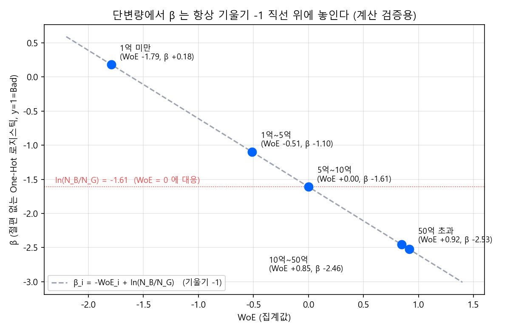

# β = −WoE + 상수: 수학적 증명

## 3.1 증명 — 절편 없는 One-Hot 모형

!!! note "왜 부호가 반대인가"
    Part 1~4는 **y = 1 = Bad(불량)** 로 적합하므로, 회귀가 추정하는 것은 Bad log-odds \(\ln(P_B/P_G)\)다. 반면 WoE는 \(\ln(\%\text{Good}/\%\text{Bad})\)로 우량할수록 커진다. **두 지표의 방향이 반대**이므로 부호가 뒤집히는 것은 오류가 아니라 정의의 차이다. 이 가이드북은 이 규약을 일관되게 쓴다: WoE 변수의 정상 계수는 음수다.

기호: 구간 \(i\)의 정상·불량 건수 \(n_{G,i}, n_{B,i}\), 구간 건수 \(n_i = n_{G,i} + n_{B,i}\), 전체 정상·불량 \(N_G, N_B\).

**Step 1 — 로그우도와 score equation**

절편 없는 One-Hot 모형에서 구간 \(i\)의 모든 고객은 같은 예측 확률 \(p_i = 1/(1+e^{-\beta_i})\)를 갖는다. 로그우도는 구간별로 분리된다.

$$
\ell(\beta_1,\ldots,\beta_k) = \sum_{i=1}^{k}\Big[\, n_{B,i}\ln p_i + n_{G,i}\ln(1-p_i) \,\Big] \tag{1}
$$

\(\partial p_i/\partial\beta_i = p_i(1-p_i)\)를 이용해 \(\beta_i\)로 미분하면(score equation)

$$
\frac{\partial \ell}{\partial \beta_i} = n_{B,i}(1-p_i) - n_{G,i}\,p_i = n_{B,i} - n_i\,p_i = 0 \tag{2}
$$

**Step 2 — 닫힌 해**

식 (2)에서 \(\hat p_i = n_{B,i}/n_i\), 즉 **예측 확률 = 구간의 실제 불량률**이다. 이를 log-odds로 바꾸면

$$
\hat\beta_i = \ln\!\left(\frac{\hat p_i}{1-\hat p_i}\right) = \ln\!\left(\frac{n_{B,i}}{n_{G,i}}\right) \tag{3}
$$

로그우도는 각 \(\beta_i\)에 대해 오목하므로 이 해가 유일한 최대점이다(단, \(n_{B,i}\)나 \(n_{G,i}\)가 0이면 해가 무한대로 발산한다 — Bad 0건 Bin을 허용하지 않는 이유).

**Step 3 — WoE와 연결**

WoE 정의를 전개하면

$$
\text{WoE}_i = \ln\!\left(\frac{n_{G,i}/N_G}{n_{B,i}/N_B}\right) = -\ln\!\left(\frac{n_{B,i}}{n_{G,i}}\right) + \ln\!\left(\frac{N_B}{N_G}\right)
$$

이므로, 식 (3)과 합치면

$$
\boxed{\;\hat{\beta}_i = -\text{WoE}_i + \ln\!\left(\frac{N_B}{N_G}\right)\;} \tag{4}
$$

!!! success "결론"
    절편 없는 One-Hot 모형(y=1=Bad)의 구간 계수는 \(\hat{\beta}_i = -\text{WoE}_i + \ln(N_B/N_G)\)로 **정확히** 결정된다. 반복 계산의 수렴 결과가 아니라 대수적 항등식이다. \(\ln(N_B/N_G)\)는 모든 구간에 공통인 상수이므로, \(\hat{\beta}_i\)와 \(\text{WoE}_i\)는 **부호가 반대이고 상수만큼 평행 이동한 관계**다.

### 두 지표의 기준점

- **\(\hat{\beta}_i\)의 기준점(0):** "이 구간의 불량과 정상이 1:1" (불량률 50%)
- **WoE의 기준점(0):** "이 구간의 Bad/Good 비율이 전체 평균과 같음"

그래서 상수 \(\ln(N_B/N_G)\)(전체 Bad log-odds)만큼 차이가 난다. 이 차이가 [유의성 검정](significance-test.md)에서 Wald 검정의 귀무가설을 고를 때 중요해진다.

### 수치로 확인 — 매출액 5구간 (Good 1,000 / Bad 200)

\(\ln(N_B/N_G) = \ln(200/1000) = -1.609\)

| Bin | 불량률 | \(\text{WoE}_i\) | \(-\text{WoE}_i\) | \(\hat{\beta}_i = \ln(n_{B,i}/n_{G,i})\) | \(\hat\beta_i + \text{WoE}_i\) |
|-----|------|------|------|------|------|
| 1 (1억 미만) | 54.5% | −1.792 | +1.792 | ln(60/50) = **+0.182** | −1.609 |
| 2 (1억~5억) | 25.0% | −0.511 | +0.511 | ln(50/150) = **−1.099** | −1.609 |
| 3 (5억~10억) | 16.7% | 0.000 | 0.000 | ln(40/200) = **−1.609** | −1.609 |
| 4 (10억~50억) | 7.9% | +0.847 | −0.847 | ln(30/350) = **−2.457** | −1.609 |
| 5 (50억 초과) | 7.4% | +0.916 | −0.916 | ln(20/250) = **−2.526** | −1.609 |

- WoE가 가장 낮은 Bin 1에서 \(\hat\beta\)가 가장 크다(Bad log-odds 최고). 불량률이 50%를 넘으므로 \(\hat\beta\)는 양수다.
- 불량률이 50% 미만인 구간은 \(\hat\beta\)가 음수다. 그래서 **WoE가 음수인데 \(\hat\beta\)도 음수**인 구간(Bin 2)이 정상적으로 생긴다. "β와 WoE의 부호가 같으면 오류"라는 판정은 틀린 규칙이다.
- 마지막 열이 모두 같다는 것이 식 (4)의 내용이다.

!!! info "균형 표본에서는 상수가 사라진다"
    개발 표본을 Bad:Good = 1:1로 맞추면 \(\ln(N_B/N_G) = 0\)이므로 \(\hat\beta_i = -\text{WoE}_i\)가 그대로 성립한다. 교재에서 "β ≈ −WoE"라고 쓰는 것은 대개 이 경우다. 불균형 표본에서는 상수만큼 평행 이동한다.

---

## 3.2 WoE 치환 모형 — \(\hat\beta = -1\)도 정확히 성립한다

연속형 변수 \(X\)를 구간의 WoE 값으로 바꾼 변수 \(X_{\text{WoE}}\)를 만들어 **절편을 포함한** 로지스틱 회귀를 하면

$$
\ln\!\left(\frac{P(\text{Bad})}{P(\text{Good})}\right) = \beta_0 + \beta \cdot X_{\text{WoE}} \tag{5}
$$

\(\beta_0 = \ln(N_B/N_G)\), \(\beta = -1\)을 넣으면 각 구간의 예측 log-odds가 \(-\text{WoE}_i + \ln(N_B/N_G)\), 즉 식 (4)의 포화 모형 해와 **완전히 같아진다**. 포화 모형의 로그우도는 구간 단위 모형이 도달할 수 있는 최대값이므로, 이 점이 식 (5)의 최대우도해다.

$$
\hat\beta = -1, \qquad \hat\beta_0 = \ln\!\left(\frac{N_B}{N_G}\right) \quad \text{(정확히)} \tag{6}
$$

직관적으로는, WoE가 1 증가하면 Bad log-odds가 정확히 1 감소하도록 WoE가 **만들어져 있기** 때문이다.

!!! info "Part 5 예고 — Good Odds로 볼 때는 +1"
    [Part 5 스코어카드](../../part5_scorecard/scorecard-and-rating.md)는 계수를 다시 적합하지 않는다. 같은 계수를 쓰고 \(\ln(\text{Good Odds}) = -\text{logit}_{\text{Bad}}\)로 부호만 뒤집는다. 그래서 Good log-odds 기준으로 보면 WoE의 기울기는 +1이 된다. 교재에서 흔히 "WoE 치환 시 β = 1"이라고 설명하는 것은 y=1=Good으로 적합한 경우다.

---

## 3.3 그렇다면 β와 WoE의 비교는 어디에 쓰는가

식 (4)·(6)은 Classing이 좋든 나쁘든 개발 표본에서 **항상** 성립한다. 따라서 단변량 단계의 "β ≈ −WoE 확인"은 진단이 아니라 **계산 검증(sanity check)** 이다 — 어긋나면 집계·조인·코딩 오류를 의심한다.

β와 WoE의 관계가 실제 진단 정보가 되는 곳은 두 군데다.

| 상황 | 확인 방법 | 정상 | 이상 신호 |
|------|---------|------|---------|
| **다변량 모형** | Full Model의 WoE 변수 계수 | −1 ~ 0 사이의 음수(다른 변수와 정보를 나눔) | 양수(부호 역전), 또는 \(\lvert\beta\rvert > 1\)(억제효과·공선성 의심) — [다변량 회귀](../../part4_modeling/multivariate-regression.md) |
| **검증(OOT) 표본** | 개발 표본의 WoE를 OOT 표본에 적용한 뒤 단변량 재적합 | \(\hat\beta\)가 −1 근처, Bin별 실제 log-odds가 직선 근처 | \(\lvert\hat\beta\rvert\)가 크게 줄어듦(WoE 패턴 약화), 특정 Bin이 직선에서 크게 이탈 |

!!! note "Two Approaches 정리"

    | 방법 | 설계 | 개발 표본 결과 (y=1=Bad) | 쓰임 |
    |------|------|------|------|
    | **One-Hot + No Intercept** | \(k\)개 더미, 절편 제거 | \(\hat{\beta}_i = -\text{WoE}_i + \ln(N_B/N_G)\) (정확) | 구간별 SE → 인접 Bin 차이 검정 |
    | **WoE 치환 + Intercept** | \(X_{\text{WoE}}\) 단일 변수, 절편 포함 | \(\hat{\beta} = -1\) (정확) | 본 모형의 입력 형태. 진단은 다변량·OOT에서 |
