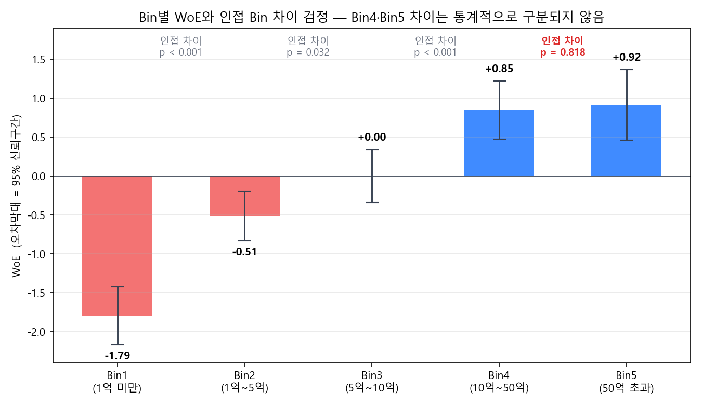

# Classing 피드백 루프

단변량 로지스틱 회귀에서 **인접 Bin이 구분되지 않거나** 단조성이 의심되면, Coarse Classing으로 돌아가 구간을 다시 합친다. 판단 기준의 정본은 [유의성 검정 4.3절](significance-test.md)이다.

위 그림은 [단변량 예시](concept.md)의 매출액 5구간이다. 오차막대는 WoE의 95% 신뢰구간(\(\pm 1.96 \times SE\))이고, 위쪽 숫자는 인접 Bin 차이 검정의 p-value다. Bin 4와 Bin 5는 신뢰구간이 거의 겹치고 차이 검정 p = 0.818이다. 두 구간의 위험은 구분되지 않는다.

## 5.1 Bin 합병 의사결정 규칙

인접 Bin 차이가 비유의한 쌍이 발견되면, 아래 규칙에 따라 합병 방향을 정한다.

  1
  차이가 가장 비유의한 쌍부터 합병

인접 차이 검정의 p-value가 가장 큰(= 가장 구분되지 않는) 쌍부터 합친다. 한 번에 하나씩 합치고 다시 검정한다 — 합병하면 이웃 쌍의 검정 결과도 바뀌기 때문이다.

  2
  한 Bin이 양쪽 모두와 구분되지 않을 때는 불량률이 더 가까운 쪽으로

어느 쪽과 합쳐도 되는 경우, 불량률이 더 비슷한 쪽과 합친다. 그래도 비슷하면 표본이 더 작은 쪽과 합쳐 최소 표본 기준을 함께 충족시킨다.

  3
  통계적으로 동등하면 업무 논리 우선

통계적으로 어느 쪽도 우열이 없다면 업무적으로 의미 있는 경계(예: 정책 기준 금액)가 남도록 합친다.

!!! warning "단조성을 깨는 방향으로 합병 금지"
    합병 후 반드시 WoE 단조성을 재확인한다. 단조성이 깨지면 다른 방향으로 다시 시도한다.

## 5.2 Worked Example — Bin 4·5 합병

| 지표 | 합병 전 (5구간) | 합병 후 (4구간) |
|------|--------------|--------------|
| 구간 | 1억 미만 / 1억~5억 / 5억~10억 / 10억~50억 / 50억 초과 | 1억 미만 / 1억~5억 / 5억~10억 / **10억 이상** |
| 마지막 구간 | 7.9% (WoE +0.847) · 7.4% (WoE +0.916) | **7.7% (WoE +0.875)**, 건수 650, Bad 50 |
| IV | 0.8059 | 0.8054 (−0.06%) |
| 변수 LRT | 136.07 (df = 4) | 136.02 (df = 3), p < 0.001 |
| 인접 Bin 차이 p | < 0.001 / 0.032 / 0.001 / **0.818** | < 0.001 / 0.032 / < 0.001 |
| 단조성 | 유지 | 유지 |

- IV와 LRT가 사실상 그대로다. **Bin 4·5의 경계는 정보를 거의 담고 있지 않았다**는 뜻이다.
- 합병 후 모든 인접 쌍이 p < 0.05로 구분된다. 마지막 구간은 Bad 50건으로 표본 기준([정본](../classing/decision-criteria.md))도 여유 있게 충족한다.
- 이 변수는 4구간으로 확정되어 다음 단계로 넘어간다.

## 5.3 최종 Classing 확정 의사결정 순서

| 순서 | 체크 항목 | Pass 기준 | Fail 시 조치 |
|------|----------|----------|-------------|
| 0 | 정의 점검, 계산 검증 (먼저) | \(\hat{\beta}_i + \text{WoE}_i\)가 모든 구간에서 같음 | 관찰 시점 뒤 정보가 섞인 항목, 설명할 수 없는 정의는 여기서 뺀다. 계산 검증이 틀리면 집계·코딩 오류를 고친다. 둘 다 아래 판정을 무의미하게 만들므로 가장 먼저 본다 |
| 1 | Bin별 최소 표본 | [기준값 정본](../classing/decision-criteria.md) (각 Bin ≥ 5%, Bad 최소 10건·권장 30건) | 인접 Bin 합병 → 처음부터 재확인 |
| 2 | WoE 단조성 | 단조증가 또는 단조감소 | 위반 Bin 합병 → 1부터 재확인 |
| 3 | 변수 전체 LRT | p < 0.05 (df = k − 1) | Classing 재설계 또는 변수 제거 |
| 4 | 인접 Bin 차이 | 모든 인접 쌍 p < 0.05 ([정본](significance-test.md)) | 가장 비유의한 쌍부터 합병 → 1부터 재확인 |
| 5 | IV 수준 | 통상 IV ≥ 0.10 ([IV 기준](../woe_iv/iv.md); 0.02~0.10은 다른 변수와 조합 시에만) | Classing 재검토 또는 변수 제거 |
| 6 | 업무 논리 정합성 | 감독 기준·여신 정책 위반 없음 | 수동 조정 후 1부터 재확인 |
| 7 | 시점 안정성 | 시점별 표본에서 구간 순서와 변별력이 유지됨(구간 구성비 PSI, 연도별 IV) | 흔들리는 구간 합병 또는 변수 제외 |

!!! tip "루프가 끝나지 않을 때"
    합병을 반복할수록 개발 표본에 맞춘 구간이 되어 과적합 위험이 커진다. 2~3회 반복해도 기준을 충족하지 못하면, Fine Classing부터 다시 보거나(경계 후보 재설정) 변수 정의 자체를 재검토한다.

!!! success "모든 기준 통과 시"
    해당 Coarse Classing 안으로 확정한다. 동일 과정을 모든 후보 변수에 적용한 뒤 [정보영역별 변수 선정](../domain_selection/index.md) 단계로 이동한다. 단변량 LR에서 확정된 변수 목록이 정보영역별 Partial LR의 입력이 된다.
