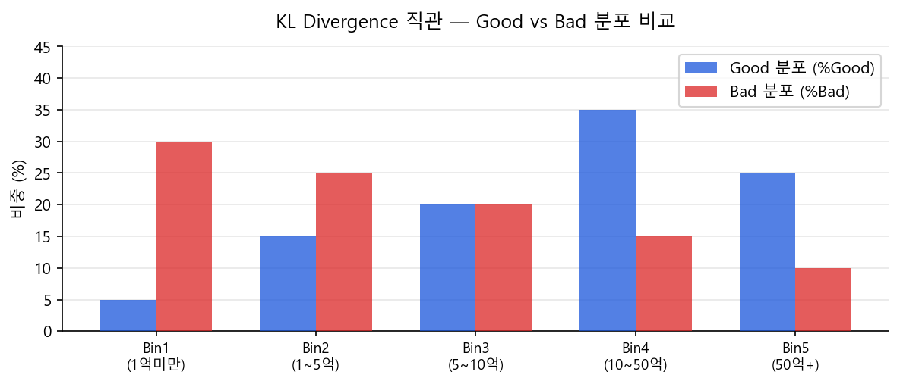
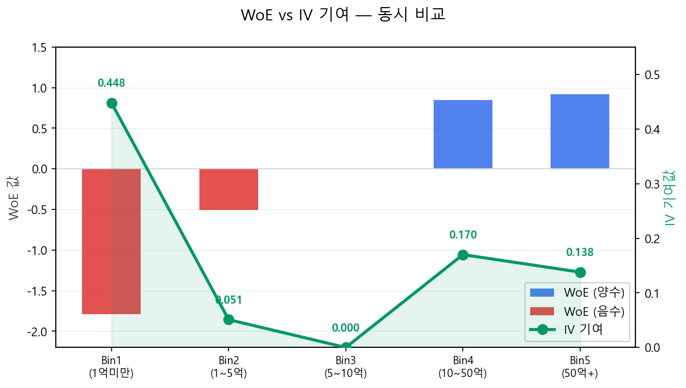

# IV: 정의·산출·변수 선택

## 3.1 IV의 본질

!!! tip "IV의 본질 — Good 분포와 Bad 분포 사이의 거리"
    WoE가 "구간 하나의 위험 수준"이라면, IV는 **"변수 전체의 변별력 총합"**이다. 수학적으로 Good→Bad 방향과 Bad→Good 방향의 KL Divergence를 합한 값(대칭 KL, Jeffreys divergence)과 같다. 두 분포가 완전히 같으면 \(\text{IV} = 0\)이고, 차이가 클수록 IV가 커진다.

### KL Divergence란 무엇인가

!!! tip "비유: 두 집단이 Bin에 흩어진 모양의 차이"
    Good 고객 1,000명과 Bad 고객 200명이 5개 Bin에 각자의 비율로 흩어져 있다고 하자. **KL Divergence**는 "두 분포가 얼마나 다른가"를 측정하는 수치다. 분포가 똑같으면 0, 다를수록 커진다.

KL Divergence의 일반 정의:

$$
D_{\text{KL}}(P \| Q) = \sum_{i} P_i \ln\!\left(\frac{P_i}{Q_i}\right) \tag{1}
$$

KL은 방향에 따라 값이 다르다(\(D_{\text{KL}}(P\|Q) \neq D_{\text{KL}}(Q\|P)\)). IV는 두 방향을 합친 **대칭 KL Divergence**다.

$$
\text{IV} = D_{\text{KL}}(\text{Good} \| \text{Bad}) + D_{\text{KL}}(\text{Bad} \| \text{Good})
$$

$$
= \sum_i \%\text{Good}_i \cdot \ln\!\frac{\%\text{Good}_i}{\%\text{Bad}_i} + \sum_i \%\text{Bad}_i \cdot \ln\!\frac{\%\text{Bad}_i}{\%\text{Good}_i}
$$

$$
= \sum_i (\%\text{Good}_i - \%\text{Bad}_i) \times \text{WoE}_i \tag{2}
$$

### KL Divergence 해석 카드

| 두 분포가 같을 때 | Good이 많이 몰릴 때 | Bad이 많이 몰릴 때 |
|:---:|:---:|:---:|
| %Good = %Bad | %Good > %Bad | %Bad > %Good |
| WoE = 0, KL = 0 | WoE > 0 (우량 구간) | WoE < 0 (불량 구간) |
| **IV 기여 = 0** | **IV 기여 증가** | **IV 기여 증가** |

!!! note "요약"
    KL Divergence는 "두 확률 분포 사이의 정보 거리"다. IV는 Good 분포와 Bad 분포가 Bin들에 얼마나 다르게 흩어져 있는지를 모든 Bin에 걸쳐 합산한 값이다. 두 분포가 구분되지 않으면(변별력이 없으면) IV → 0이 되고, 선명하게 갈라질수록 IV가 커진다.

## 3.2 산출식

식 (2)를 건수로 풀어 쓰면 다음과 같다(\(k\) = Bin 수).

$$
\text{IV} = \sum_{i=1}^{k} \left(\frac{n_{G,i}}{N_G} - \frac{n_{B,i}}{N_B}\right) \times \ln\!\left(\frac{n_{G,i}/N_G}{n_{B,i}/N_B}\right)
$$

두 값(\(\%\text{Good}_i - \%\text{Bad}_i\)와 \(\text{WoE}_i\))의 부호는 항상 같으므로 각 항의 기여분은 0 이상이다. 따라서 **IV는 항상 0 이상**이며, 모든 Bin에서 %Good = %Bad일 때만 0이 된다.

## 3.3 예시: 매출액 변수 IV 계산

[WoE 1.3절](woe.md)의 매출액 5구간 예시(Good 1,000 / Bad 200)를 그대로 쓴다.

| Bin | %Good | %Bad | 차이 | WoE | IV 기여 |
|-----|-------|------|------|-----|---------|
| 1 | 5.0% | 30.0% | −25.0% | −1.792 | \((-0.250) \times (-1.792) = 0.4479\) |
| 2 | 15.0% | 25.0% | −10.0% | −0.511 | \((-0.100) \times (-0.511) = 0.0511\) |
| 3 | 20.0% | 20.0% | 0.0% | 0.000 | \(0.0000\) |
| 4 | 35.0% | 15.0% | +20.0% | +0.847 | \((+0.200) \times (+0.847) = 0.1695\) |
| 5 | 25.0% | 10.0% | +15.0% | +0.916 | \((+0.150) \times (+0.916) = 0.1374\) |
| | | | | **합계** | **IV = 0.8059** |

IV 기여는 반올림 전 WoE로 계산한 값이다(표시된 WoE로 곱하면 끝자리가 조금 다를 수 있다).

!!! note "WoE와 IV 기여의 관계"
    Bin1은 WoE가 −1.79로 가장 위험한 구간이고, 평균에서 멀리 떨어져 있으므로 IV 기여(0.448)도 가장 크다. Bin3은 WoE = 0으로 평균과 같아 IV 기여가 0이다. **WoE는 방향과 크기(구간 단위), IV 기여는 그 구간이 변수 전체 변별력에 보태는 양**이라고 이해하면 된다.

!!! warning "이 예시의 IV는 '의심' 구간이다"
    IV = 0.806은 아래 3.4절 기준표에서 "> 0.5, 과적합·Data Leakage 확인" 구간에 해당한다. 이 예시는 계산 과정을 보여주려고 분리를 크게 잡은 가상 데이터다. 실제 변수에서 이런 값이 나오면 정의·관측 시점부터 확인한다.

## 3.4 IV 기준의 변수 선택

| IV 값 | 변별력 판단 | 실무 처리 |
|--------|------------|-----------|
| < 0.02 | 변별력 없음 (Useless) | 변수 제거 |
| 0.02 ~ 0.10 | 약한 변별력 (Weak) | 단독 투입 비권장. 다른 변수와 조합 시 고려 |
| 0.10 ~ 0.30 | 보통 변별력 (Medium) | 투입 검토. 단변량 LR로 확인 |
| 0.30 ~ 0.50 | 강한 변별력 (Strong) | 투입 권장 |
| > 0.50 | 매우 강함 (Very Strong) | 과적합·Data Leakage 반드시 확인 |

### IV 기준값은 절대적인가?

위 기준표(< 0.02, 0.02~0.10, …)는 Siddiqi(2006) 등 스코어카드 실무서에 소개된 이후 업계 표준처럼 쓰이지만, **특정 포트폴리오에서 경험적으로 정한 벤치마크**라는 점을 유의해야 한다.

**IV가 무엇에 영향을 받는가:**

IV는 %Good·%Bad, 즉 **Good 집단과 Bad 집단 각각의 분포**만으로 계산된다. 전체 불량률(Event Rate)이 바뀌어도 두 집단의 분포 모양이 같으면 IV는 그대로다(KS, AR도 같은 성질을 가진다). 따라서 "불량률이 높으면 IV가 낮게 나온다"는 식의 직접적인 관계는 없다. 실제로 IV를 흔드는 것은 다음 두 가지다.

- **Bad 건수가 적을 때**(예: 우량 기업 대출, 저부도 포트폴리오) — Bin별 %Bad 추정이 불안정해진다. 표본 변동은 %Good과 %Bad를 서로 다르게 만드는 방향으로만 작용하므로, 변별력이 없는 변수도 IV가 0보다 크게 나온다(**상향 편의**). Bin 수가 많을수록 이 편의가 커진다. 같은 IV 값이라도 신뢰구간이 넓어 판단 근거가 약하다.
- **Bin 구성** — Fine 구간 그대로 계산하면 IV가 과대 측정되고, 지나치게 합치면 과소 측정된다. 변수 간 IV를 비교할 때는 Bin 수가 비슷한지 확인한다.

따라서 표준 기준표는 **출발점**으로 쓰고, 자신의 데이터에서 IV 분포를 먼저 확인해 기준을 조정한다. Bad 건수가 매우 적은 포트폴리오에서는 IV만으로 변수를 고르지 말고, 단변량 KS·AR과 부트스트랩 등으로 본 IV의 안정성을 함께 본다.

### 다변수 IV 우선순위 결정

IV가 비슷한 변수가 여러 개일 때 하나만 선택해야 하는 상황에서의 판단 기준:

| 판단 기준 | 설명 |
|-----------|------|
| **상관관계** | IV가 비슷한 변수 A, B의 상관이 높으면(예: r > 0.7) 중복 후보로 표시해 둔다. 바로 하나를 지우기보다, 다변량 단계에서 VIF, β 부호, 업무 의미를 함께 보고 남길 쪽을 정한다. 정보 성격이 다르면 상관이 높아도 둘 다 남길 수 있다 |
| **안정성(PSI)** | IV가 같다면 시점 간 구성비 변화(PSI)가 더 작은 변수를 우선 |
| **비즈니스 해석력** | "신용조회 건수"와 "최근 3개월 대출 신청 건수"의 IV가 같다면, 심사역이 더 직관적으로 해석할 수 있는 변수를 우선 |
| **데이터 가용성** | 변수 수집 난이도, 결측률, 향후 운영 시 지속 수집 가능 여부 |

!!! tip "IV는 높지만 설명하기 어려운 변수"
    예를 들어 "고객 등록 시각(새벽 vs 주간)"이 IV = 0.25로 보통 수준의 변별력을 보이더라도, 심사역에게 "새벽에 가입한 고객이 더 위험하다"는 논리를 설명하기 어렵다면 모형 수용성이 떨어진다. 이런 변수는 내부 참고용 모형에서는 검토할 수 있지만, 심사 결과를 고객에게 설명해야 하는 모형에서는 제외하는 쪽이 안전하다.

!!! warning "IV 맹신 금지 — 업무 논리 동반 필수"
    - **① Data Leakage:** 성과 기간 이후의 정보가 관찰 시점 변수에 섞인 경우. 날짜 기준을 엄격히 확인한다.
    - **② Overfitting:** Coarse Classing 없이 Fine Classing 그대로 IV를 산출하면 실제보다 과대 측정된다.

    IV는 **변수 선택의 1차 필터**일 뿐이다. 항상 업무 논리와 단변량 로지스틱 회귀 결과를 함께 검토한다.

!!! example "CB사 공시 — 평가부문별 활용 비중 (KCB)"
    KCB는 개인신용평점의 평가부문별 활용 비중을 공시한다. 일반고객 기준으로 상환이력 21%, 부채수준 24%, 신용거래기간 9%, 신용거래형태 38%, 비금융/마이데이터 8%다(장기연체경험고객은 32/25/5/27/11%). 공시에 개별 변수의 IV는 나오지 않지만, 어느 정보영역이 점수에 크게 기여하는지 보여주므로 [정보영역별 변수 선정](../domain_selection/index.md)에서 영역 구성을 설계할 때 참고가 된다. 모형 성능 공시 기준은 [성능 평가](../../part5_scorecard/performance-ks-ar-gini.md)에 정리했다.

    
출처: KCB 올크레딧 — <a href="https://www.allcredit.co.kr/screen/sc0682112929">주요 평가부문</a>

