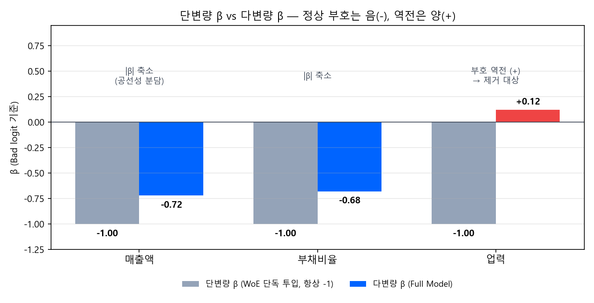

# 다변량 WoE 로지스틱 회귀 구성

## 2.1 Full Model 구성 원칙

[정보영역별 변수 선정](../part3_variable_selection/domain_selection/index.md)에서 각 영역의 대표 변수가 확정되었다. Full Model은 이 대표 변수들을 **모두 통합**하여 최종 다변량 로지스틱 회귀(y=1=Bad)를 수행하는 단계다.

$$
\ln\!\left(\frac{p_i}{1-p_i}\right) = \beta_0 + \beta_1 \cdot \text{WoE}_{i,1} + \beta_2 \cdot \text{WoE}_{i,2} + \cdots + \beta_k \cdot \text{WoE}_{i,k} \tag{1}
$$

\(p_i\)는 불량 확률이고 WoE는 우량할수록 크므로, **정상 계수는 모두 음수**다.

  1
  전체 영역 통합 다변량 회귀

모든 정보영역의 대표 변수를 한꺼번에 투입한다. 이 단계에서 정보영역 **간** 상관까지 통제된다. VIF, β 부호·크기, 유의성을 다시 검토하고, 단계적 선택(Forward/Backward/Both) 또는 LRT로 최종 변수를 확정한다.

  2
  최종 검토: 업무 논리 + 규제 부합성

통계 기준 외에 비즈니스 논리(변수가 신용도와 논리적으로 연관되는가), 감독 지침 부합 여부, 과거 심사 경험과의 일치성을 종합 검토하고, 모형 문서(Model Documentation)를 작성한다.

---

!!! note "Full Model은 절편을 포함한다"
    단변량 단계에서는 구간별 검정을 위해 절편 없는 One-Hot 모형도 썼지만, Full Model은 WoE 변수와 **절편 \(\beta_0\)** 을 포함한다. 각 \(\beta_j\)는 다른 변수를 통제한 후의 고유 기여도다. 모든 WoE가 0(모든 변수가 평균 수준 구간)일 때의 logit이 \(\beta_0\)이므로, \(\beta_0\)는 대략 포트폴리오 평균 Bad log-odds \(\ln(N_B/N_G)\) 근처에 온다(로짓의 비선형성 때문에 정확히 같지는 않다).

!!! info "참고: 다운샘플링(Under-sampling)과 절편 보정"
    불량률이 극단적으로 낮은(예: 0.5% 미만) 포트폴리오에서 정상 표본을 줄여 비율을 조정하는 경우가 있다. 로지스틱 회귀에서 표본을 **목표변수 기준으로** 추출하면 기울기(\(\beta_j\))는 영향을 받지 않고 **절편만** 표본 비율만큼 이동한다. 그래서 다운샘플링을 했다면 절편을 되돌려야 한다.

    $$
    \beta_0^{\text{보정}} = \beta_0^{\text{표본}} - \ln\!\left(\frac{\text{표본 Bad Odds}}{\text{모집단 Bad Odds}}\right)
    $$

    다만 MLE의 안정성은 클래스 비율보다 **불량 절대 건수**에 좌우되므로, 불량이 수백 건 이상 확보되면 원본 비율 그대로 적합해도 기울기와 순위 변별력에 실질적인 차이가 없다. 다운샘플링을 하지 않으면 보정도 필요 없다.

## 2.2 단변량 β vs 다변량 β — 왜 달라지는가?

Full Model을 구성하면 단변량에서 구한 β와 값이 달라진다. 이 현상을 이해하지 못하면 "변수가 이상한 것 아닌가?"라는 혼선이 생긴다.

!!! info "단변량 β (WoE 치환, 절편 포함)"
    - 변수 \(X_j\) 단독으로 y를 설명할 때의 효과
    - 개발 표본에서는 **정확히 −1** (WoE가 그렇게 만들어져 있음 — [증명](../part3_variable_selection/univariate_lr/beta-woe-proof.md))
    - 상관 변수의 정보까지 흡수한 상태

!!! success "다변량 β (Full Model)"
    - 다른 변수 \(X_{-j}\)를 통제한 후 \(X_j\)의 고유 효과
    - 상관 변수가 이미 설명하는 부분만큼 \(\lvert\beta\rvert\)가 줄어듦 → 보통 −1과 0 사이
    - 상관이 클수록 축소 폭도 커짐

!!! tip "β 변화 패턴 — 실무에서 자주 보는 케이스"
    - **\(\lvert\beta\rvert\) 축소 (가장 흔함):** 매출액 −1.00 → −0.72. 업력과 상관이 있어 일부 설명을 나눠 가짐.
    - **부호 역전 (위험 신호):** 음수여야 할 β가 양수로. 대부분 다중공선성이나 억제효과가 원인. 원칙적으로 제거 대상.
    - **\(\lvert\beta\rvert > 1\) (주의 신호):** 단변량보다 더 큰 가중치를 받는 경우. 다른 변수와의 억제효과·공선성 가능성이 높으므로 원인을 확인한다.
    - **β가 −1 근처로 유지:** 다른 변수들과 상관이 낮은 독립적 변수. 모형에서 가장 안정적인 변수.

### 수치 예시: 6개 변수 Full Model

[정보영역별 변수 선정](../part3_variable_selection/domain_selection/partial-lr.md)에서 확정한 6개 대표 변수(재무 3, 신용거래 2, 기본 1)를 투입한 결과를 가정한 예시다. β·p-value는 설명용 가상 값이고, VIF는 WoE 변수 간 상관(매출액-업력 r = 0.62 등)을 가정해 계산했다.

| 변수 | 정보영역 | β (단변량) | β (다변량) | VIF | p-value | 판정 |
|------|---------|-----------|-----------|-----|---------|------|
| 매출액 | 재무 | −1.00 | −0.72 | 1.78 | <0.001 | ✅ 유지 |
| 부채비율 | 재무 | −1.00 | −0.68 | 1.21 | <0.001 | ✅ 유지 |
| 영업이익률 | 재무 | −1.00 | −0.42 | 1.21 | 0.004 | ✅ 유지 |
| 연체건수 | 신용거래 | −1.00 | −0.93 | 1.30 | <0.001 | ✅ 유지 (독립적 변수) |
| 조회건수 | 신용거래 | −1.00 | −0.39 | 1.26 | 0.006 | ✅ 유지 |
| 업력 | 기본정보 | −1.00 | **+0.12** | 1.64 | 0.35 | ❌ 제거 (부호 역전 + 비유의) |

**업력의 β 부호 역전 원인 분석:**

- 단변량에서 업력은 β = −1.00으로 "업력이 길수록(WoE 클수록) 우량"이라는 합리적 방향
- 다변량에서 매출액(r = 0.62)과 함께 투입되자, 업력이 설명하던 위험 차이의 대부분이 "업력이 긴 기업은 규모도 크다"는 매출액 효과였음이 드러남
- 업력의 고유 효과가 0 근처로 줄고, 표본 변동으로 양수(+0.12)가 됨. p = 0.35로 0과 구분되지도 않음
- **VIF는 1.64로 낮다.** VIF가 높지 않아도 부호 역전은 생길 수 있으므로, VIF만 보고 안심하면 안 된다 → **업력 제거, 매출액 유지**

!!! note "제거 후 재적합 — 최종 5변수 모형"
    업력 제거 후 5개 변수로 재적합하면 매출액이 업력과 나눠 갖던 설명력을 되찾아 β가 −0.72 → −0.81로 커진다. 나머지 변수의 β·VIF·p-value도 다시 확인한다.

    | 변수 | 절편 | 매출액 | 부채비율 | 영업이익률 | 연체건수 | 조회건수 |
    |------|------|-------|--------|----------|--------|--------|
    | β (최종, Bad logit) | −2.75 | −0.81 | −0.70 | −0.45 | −0.95 | −0.40 |
    | VIF | — | 1.14 | 1.20 | 1.21 | 1.30 | 1.26 |

    이 최종 모형이 [스코어카드 변환](../part5_scorecard/scorecard-and-rating.md)의 입력이 된다(절편 −2.75는 평균 불량률 약 6%에 해당하는 가상 값).

## 2.3 다중공선성(VIF) 진단과 활용

변수 간 상관이 높으면 \(\hat{\beta}\)의 분산이 커져 불안정해진다. VIF(Variance Inflation Factor, 분산팽창인수)로 진단한다.

$$
\text{VIF}_j = \frac{1}{1 - R_j^2} \tag{2}
$$

\(R_j^2\)는 **"변수 j를 나머지 모든 변수로 OLS 회귀했을 때의 결정계수"**다. 즉 변수 j가 다른 변수들로 얼마나 설명되는지를 나타낸다. 스코어카드에서는 모형에 실제로 들어가는 **WoE 변수끼리** VIF를 계산한다(원래 값으로 계산한 VIF는 모형의 공선성과 다르다).

### VIF와 상관관계(Corr)는 어떻게 다른가?

!!! info "단순 상관관계 (Correlation)"
    - **측정 대상:** 변수 A와 변수 B 두 개의 1:1 관계
    - **범위:** −1 ~ +1
    - **한계:** 다변량 맥락을 무시한다. 쌍별 상관이 모두 중간 정도여도 A가 B, C의 조합으로 거의 완벽히 설명될 수 있다
    - **적합:** 탐색적 분석, 쌍별(Pairwise) 관계 파악

!!! success "VIF"
    - **측정 대상:** 변수 j와 나머지 모든 변수들의 관계
    - **범위:** 1 ~ ∞ (1이면 다른 변수와 무상관, 클수록 공선성 심각)
    - **강점:** 3개 이상 변수 간 결합 공선성까지 포착
    - **적합:** 다변량 회귀에서 변수 선택 최종 판단

!!! tip "핵심 차이 예시 — 상관관계가 놓치는 것"
    재무 변수 중 순차입금(A) = 총차입금(B) − 현금성자산(C)처럼 **회계 항등식**으로 엮인 변수들이 있다고 하자.

    A-B 상관 = 0.6, A-C 상관 = −0.6, B-C 상관 = 0.2 → 쌍별 상관의 절댓값이 모두 0.7 미만이라 "괜찮아 보인다."

    그러나 A를 B, C로 회귀하면 \(R^2 = \dfrac{0.6^2 + 0.6^2 - 2(0.6)(-0.6)(0.2)}{1 - 0.2^2} = 0.90\) → **VIF(A) = 1/(1 − 0.90) = 10.0**, B·C도 각각 6.67이다.

    → 심각한 다중공선성이다. 쌍별 상관만 봤다면 놓쳤을 것이다.

    반대로 쌍별 상관이 0.6, 0.55, 0.5로 비슷해 보여도 항등식 관계가 없으면 \(R^2 = 0.44\), VIF = 1.80에 그친다. 쌍별 상관의 크기만으로는 VIF를 짐작할 수 없다.

### VIF 실질 계산 절차

| 단계 | 내용 |
|------|------|
| ① 대상 변수 선택 | VIF를 구할 변수 \(X_j\) 지정 (예: 매출액 WoE) |
| ② 보조 회귀(OLS) | \(X_j\)를 나머지 변수(j 제외)로 OLS 회귀 |
| ③ R² 산출 | 보조 회귀의 결정계수 \(R_j^2\) 확인 |
| ④ VIF 계산 | \(\text{VIF}_j = 1 / (1 - R_j^2)\) |
| ⑤ 전체 변수 반복 | 모든 변수에 대해 ①~④ 반복. 통계 패키지 대부분이 일괄 산출 기능을 제공한다 |
| ⑥ 판정 및 조치 | VIF가 높은 변수 중 IV가 낮은 쪽, 부호 이상 쪽, 커버리지 낮은 쪽을 제거 |

| VIF 값 | 판단 | 조치 |
|--------|------|------|
| 1 ~ 3 | 다중공선성 낮음 | 유지 |
| 3 ~ 5 | 중간 수준 | 모니터링, 필요 시 제거 |
| 5 ~ 10 | 높음 | VIF 높은 쌍 중 IV·업무논리 약한 쪽 제거 검토 |
| > 10 | 심각한 다중공선성 | 반드시 하나 제거, 또는 변수 재설계(비율화·합성 등) |

!!! note "VIF 처리 원칙"
    VIF가 높다고 무조건 제거하지 않는다. 업무 논리상 반드시 포함해야 할 변수가 있다면, 그 변수와 상관된 상대방을 제거하는 방향으로 판단한다. VIF ≥ 5인 변수 쌍에서는 IV가 더 낮은 쪽, 데이터 커버리지가 낮은 쪽, β 부호가 직관에 반하는 쪽을 우선 제거 후보로 본다. 반대로 위 업력 사례처럼 **VIF가 낮아도 부호 역전은 생길 수 있다.** 어떤 임계(5 또는 10)를 쓸지는 개발 전에 하나로 정해 두고, 결과를 본 뒤 기준을 바꾸지 않는다. 국내 선례에는 VIF 10 미만을 사전 기준으로 둔 곳도 있다.

## 2.4 다변량 회귀 계수 검토 — 실무·규제 관점

다변량 회귀 결과가 나왔다고 바로 스코어카드로 변환하지 않는다. 내부 모형검증 부서와 감독당국(국내 금융감독원 등)의 검토에 대비해 아래 항목을 점검한다.

  1
  β 부호(Sign) — 방향 점검

- **WoE 변수의 β가 양수(+)이면 → 즉시 원인 분석.** Bad logit 모형에서 양수 β는 "우량 구간(WoE 큼)일수록 불량 확률이 높다"는 뜻으로, 변수의 업무 논리와 정면으로 어긋난다.
- 부호 역전의 주요 원인: ① 다중공선성(가장 흔함), ② 억제(Suppressor) 효과, ③ WoE 단조성 위반·구간 불안정, ④ 표본 편향 — 상세는 [β 부호 이상과 범주 재조정](../part3_variable_selection/domain_selection/sign-feedback.md).
- 부호 역전 변수는 원칙적으로 제거한다. 명확한 이론적·업무 근거가 있는 예외에만 유지하며, 모형 문서에 사유를 기재한다.

  2
  β 크기(Magnitude) — WoE 모형의 기준점은 −1

- WoE 변수의 단변량 계수는 −1이므로, 다변량 계수는 보통 **−1과 0 사이**에 온다. \(\lvert\beta\rvert\)가 작을수록 다른 변수와 정보를 많이 나눴다는 뜻이다.
- **\(\lvert\beta\rvert > 1\)** 이면 그 변수가 단독일 때보다 더 큰 가중치를 받는다. 억제효과나 공선성의 신호이므로 원인을 확인한다(VIF, 변수를 하나씩 빼 본 β 변화).
- \(\lvert\beta\rvert\)가 0에 가깝고(예: < 0.1) 유의하지도 않으면 실질적 기여가 없다 → 제거 검토.
- **점수 영향 범위**도 확인한다. 변수 j가 점수에 주는 최대 차이는 \(\text{Factor} \times \lvert\beta_j\rvert \times (\text{WoE}_{\max} - \text{WoE}_{\min})\)이다([스코어카드 변환](../part5_scorecard/scorecard-and-rating.md)). 한 변수가 전체 점수 범위의 대부분을 좌우하면 편중이다.

  3
  통계적 유의성 — p값과 신뢰구간

- Wald 검정 기준 **p < 0.05**를 통과하지 못한 변수는 원칙적으로 제거 대상.
- 업무적으로 반드시 포함해야 하는 변수(정책상 필수 항목 등)는 p ≥ 0.05여도 포함할 수 있으나 모형 문서에 사유를 기재한다.
- 95% 신뢰구간이 0을 포함하는 경우(p ≥ 0.05와 같은 뜻)도 동일하게 취약 신호로 처리한다.

  4
  VIF — 다중공선성 최종 확인

- 개별 VIF ≥ 5인 변수는 β가 불안정 → 제거 검토 또는 변수 재설계(위 VIF 처리 원칙).
- 평균 VIF가 3을 넘으면 모형 전체의 공선성이 높다는 경고 신호로 본다(경험칙).

  5
  변수별 상대적 기여도 — 편중 점검

- 점수 영향 범위(\(\text{Factor} \times \lvert\beta_j\rvert \times\) WoE 범위)로 변수별 실질 기여도를 비교한다.
- 한두 개 변수에 기여도가 극단적으로 몰린 모형은 그 변수의 데이터 품질이나 분포 변화에 취약하다.

  6
  정보영역 균형

- 최종 변수가 특정 정보영역에 몰리면(예: 재무 5개 + 신용거래 0개), 그 정보가 없는 거래처(신규법인 등)에서 모형을 쓰기 어렵고 해당 정보원의 품질 문제가 모형 전체로 번진다.
- 영역별 커버리지(해당 영역 변수의 유효값 비율)를 함께 보고한다.

---

!!! warning "재검토 트리거 — 다음 중 하나라도 해당하면 모형 재구성 검토"
    - β 부호 역전(양수)이 2개 이상 발생 → 변수 구성 전면 재검토
    - 전체 변수 절반 이상이 p ≥ 0.05 → 변수 풀(Pool) 재설계 또는 선택 기준 재검토
    - 개발 표본 KS·AR이 기대치보다 현저히 낮은데 통계는 통과 → WoE·Binning 재검토 ([벤치마크](../part5_scorecard/performance-ks-ar-gini.md))
    - 개발 표본 대비 OOT 표본의 KS·AR 하락이 허용폭을 넘음 → 과적합 또는 표본 대표성 문제 ([OOT 허용폭 기준](../part5_scorecard/oot-validation.md))
