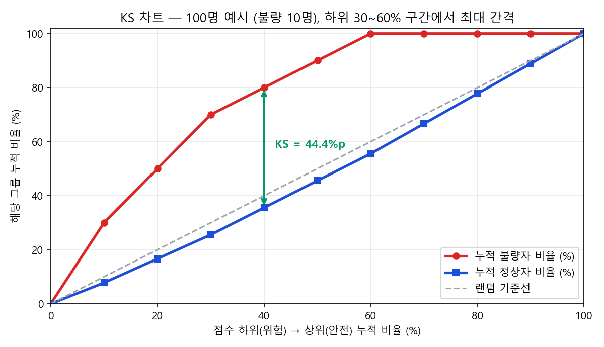
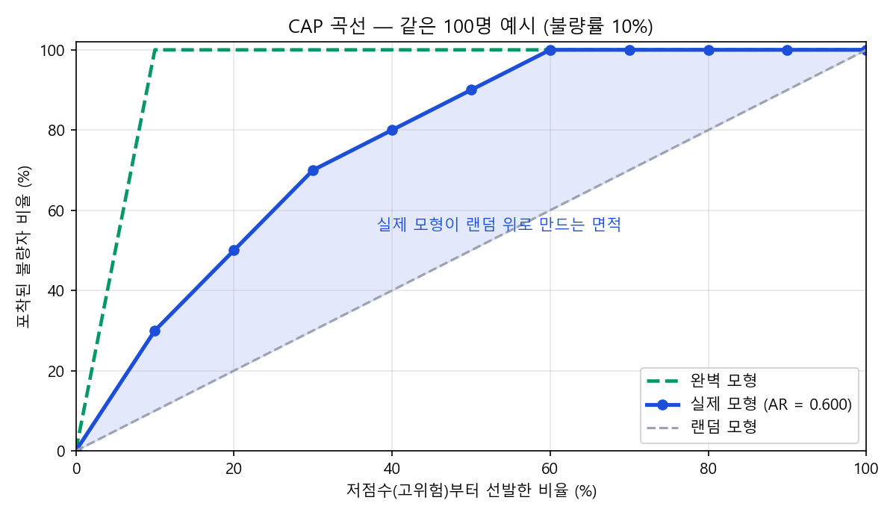

# 모형 성능 평가: KS · AR

44.4

KS (%p, 예시)

Good/Bad 두 누적분포 사이의 최대 거리. 높을수록 변별력 우수.

0.600

AR (= Gini, 예시)

CAP 곡선 기반. 완벽 모형 대비 현재 모형의 면적 비율. AR = 2·AUC − 1 (이 예시의 AUC = 0.800).

0.019

PSI (예시)

개발 시점 대비 점수 분포의 이동량. 변별력이 아니라 안정성 지표.

!!! note "상단 카드"
    KS = 44.4, AR = 0.600은 아래 2.1·2.2절의 **100명 예시(불량 10명)** 에서 계산한 값이고, PSI = 0.019는 2.5절 예시 값이다. 이 페이지에서 KS는 %p(0~100), AR은 소수(0~1)로 표기한다.

## 2.1 KS (Kolmogorov-Smirnov) 통계량

KS는 **"고객을 점수 낮은 순(위험한 쪽)부터 나열했을 때, 누적 불량자 비율과 누적 정상자 비율의 최대 차이"** 다. 쉽게 말하면 **모형이 불량자를 저점수 쪽에 얼마나 몰아 두는지의 최대 분리 정도**다.

$$
\text{KS} = \max_t \left| F_{\text{Bad}}(t) - F_{\text{Good}}(t) \right| \times 100 \tag{1}
$$

\(F_{\text{Bad}}(t)\), \(F_{\text{Good}}(t)\)는 점수 \(t\) 이하인 불량자·정상자의 누적 비율이다.

### KS 차트의 x축

KS 차트의 x축 **"점수 하위 → 상위(%)"** 는 전체 고객을 점수순으로 정렬했을 때 **위험한 쪽(저점수)부터 안전한 쪽(고점수)으로의 누적 비율**이다.

- x = 10%: "전체 고객 중 점수가 가장 낮은(가장 위험한) 10%"
- 불량자 누적 비율이 앞쪽에서 빠르게 올라갈수록 → 모형이 불량자를 저점수에 잘 몰아 두고 있다는 뜻
- 정상자 누적 비율은 천천히 올라가야 한다 (정상자는 주로 고점수에 있으므로)

### 완벽 모형과 랜덤 모형

!!! info "랜덤 모형 (Random Baseline)"
    점수가 신용도와 완전히 무관한 경우. 모든 구간에 불량자·정상자가 같은 비율로 섞인다.

    → 누적 불량비율 = 누적 정상비율 (45도 대각선) → KS = 0, AR = 0

!!! success "완벽 모형 (Perfect Model)"
    모든 불량자를 가장 낮은 점수에 배치한 이상적 모형.

    → 불량률이 10%이면 하위 10%에서 이미 불량 100% 포착, 정상은 0% → KS = 100, AR = 1

### KS 계산 예시

전체 100명(불량 10명, 정상 90명)을 점수 하위(위험)부터 10분위로 나눈 예시다. 불량 수·정상 수는 **해당 분위의 인원**이고, 누적 비율은 처음부터 그 분위까지의 합이다.

| 구간 (하위 기준) | 불량 수 | 정상 수 | 누적 불량비율(%) | 누적 정상비율(%) | 차이(%p) |
|-----------------|--------|--------|----------------|----------------|---------|
| 하위 10% (가장 위험) | 3명 | 7명 | 30.0 | 7.8 | 22.2 |
| 하위 20% | 2명 | 8명 | 50.0 | 16.7 | 33.3 |
| **하위 30%** | **2명** | **8명** | **70.0** | **25.6** | **44.4 ← KS 최대** |
| 하위 40% | 1명 | 9명 | 80.0 | 35.6 | 44.4 |
| 하위 50% | 1명 | 9명 | 90.0 | 45.6 | 44.4 |
| 하위 60% | 1명 | 9명 | 100.0 | 55.6 | 44.4 |
| 하위 70% | 0명 | 10명 | 100.0 | 66.7 | 33.3 |
| 하위 80% | 0명 | 10명 | 100.0 | 77.8 | 22.2 |
| 하위 90% | 0명 | 10명 | 100.0 | 88.9 | 11.1 |
| 하위 100% (전체) | 0명 | 10명 | 100.0 | 100.0 | 0 |

!!! note "KS 판독 방법"
    차이(%p) 열에서 최대값을 찾는다. 위 예시에서는 하위 30~60% 구간이 모두 44.4%p로 같다. 이 구간의 각 분위에는 불량 1명(불량 전체의 10%)과 정상 9명(정상 전체의 10%)이 들어 있어, 두 누적 비율이 **같은 속도(10%p씩)로** 늘어나기 때문이다. 이렇게 최대값이 여러 구간에서 같으면 보통 처음 도달한 구간(하위 30%)을 KS 발생 지점으로 보고한다. 이 모형의 **KS = 44.4**다.

KS 값을 어떻게 평가할지는 포트폴리오에 따라 다르다. 기준표는 2.4절에 하나로 모았다.

---

## 2.2 AR (Accuracy Ratio) / Gini 계수

AR은 **CAP 곡선(Cumulative Accuracy Profile)** 기반의 성능 지표다. KS가 "최대 분리 지점 하나"를 보는 반면, AR은 **모든 Cut-off에 걸친 분리 정도**를 하나의 숫자로 요약한다.

$$
\text{AR} = \frac{\text{실제 모형의 CAP 면적} - \text{랜덤 모형의 CAP 면적}}{\text{완벽 모형의 CAP 면적} - \text{랜덤 모형의 CAP 면적}} \tag{2}
$$

### CAP 곡선의 축

- **x축 "저점수부터 선발한 비율(%)":** 점수가 가장 낮은(위험한) 고객부터 차례로 N%를 골랐을 때
- **y축 "포착된 불량자 비율(%)":** 고른 집단 안에 전체 불량자의 몇 %가 들어 있는가
- 좋은 모형일수록 저점수 소수만 골라도 불량자를 많이 포착 → CAP 곡선이 왼쪽 위로 휘어진다

### CAP 곡선 데이터 예시 (2.1절과 같은 100명, 불량률 10%)

| 저점수부터 선발한 비율 | 선발 인원 | 랜덤 모형 불량 포착 | 실제 모형 불량 포착 | 완벽 모형 불량 포착 |
|-------------------|----------|-------------------|-------------------|-------------------|
| 10% | 10명 | 1명 (10%) | 3명 (30%) | 10명 (100%) |
| 20% | 20명 | 2명 (20%) | 5명 (50%) | 10명 (100%) |
| 30% | 30명 | 3명 (30%) | 7명 (70%) | 10명 (100%) |
| 50% | 50명 | 5명 (50%) | 9명 (90%) | 10명 (100%) |
| 100% | 100명 | 10명 (100%) | 10명 (100%) | 10명 (100%) |

완벽 모형은 하위 10%만 골라도 불량자 100%를 포착한다(불량률 = 10%이므로). 이 데이터의 CAP 면적으로 계산한 **AR = 0.600**이다.

### AR, Gini, AUC의 관계

ROC 곡선 아래 면적(AUC)과 AR은 1:1로 대응한다.

$$
\text{AR} = \text{Gini 계수} = 2 \times \text{AUC} - 1 \tag{3}
$$

점수가 높을수록 우량인 체계에서 **AUC = P(임의로 고른 정상 고객의 점수 > 임의로 고른 불량 고객의 점수)** 이다(동점은 1/2로 계산). 위 예시의 AUC는 0.800이고 AR = 2 × 0.800 − 1 = 0.600으로 CAP 면적 계산과 일치한다. AR과 Gini는 같은 값이며, 이 가이드북은 **KS와 AR**을 대표 지표로 쓴다(AUC는 필요할 때 괄호로 병기).

---

## 2.3 KS와 AR의 관계 — 수리적 특성과 실무 해석

!!! info "KS — 최대 분리 지점"
    - **측정 방식:** 하나의 Cut-off에서의 두 누적분포 최대 거리
    - **강점:** 직관적. "이 점수에서 자르면 불량은 몇 %, 정상은 몇 %가 걸린다"를 바로 보여 준다
    - **약점:** 최대 지점 밖의 분리 정도는 반영하지 못한다

!!! success "AR — 전체 범위 누적 변별력"
    - **측정 방식:** 모든 Cut-off에 걸친 분리 정도의 요약(= 정상·불량 쌍의 순위가 맞을 확률을 변환한 값)
    - **강점:** 모형 전체의 순위 품질을 단일 숫자로 요약. 등급 체계 전체를 평가하기에 적합
    - **약점:** 특정 Cut-off에서의 성능을 직접 말해 주지 않는다

두 지표 모두 **점수의 순위만** 사용한다. 점수를 단조 변환해도(예: PDO를 바꿔도) 값이 변하지 않고, 예측 PD의 수준이 맞는지(캘리브레이션)는 알려 주지 않는다.

### KS와 AR이 다르게 움직이는 경우

두 분포가 정규분포 모양이고 분산이 같다고 가정(등분산 이항정규 가정)하면 KS와 AR은 거의 일대일로 대응한다.

| AR | 0.20 | 0.30 | 0.40 | 0.50 | 0.60 | 0.70 | 0.80 |
|----|-----|-----|-----|-----|-----|-----|-----|
| 대응 KS (%p) | 14.2 | 21.5 | 28.9 | 36.7 | 44.8 | 53.6 | 63.5 |

위 100명 예시(KS 44.4, AR 0.600)도 이 대응에 가깝다. 실제 모형에서 둘이 이 대응에서 크게 벗어난다면 점수 분포 모양을 확인할 신호다.

!!! tip "분리 패턴에 따른 KS vs AR 차이"
    - **분리가 한 점수대에만 몰린 경우:** 특정 점수 근처에서는 불량과 정상이 크게 갈리지만 그 위·아래에서는 거의 섞여 있다. 최대 거리(KS)는 높게 나오지만, 나머지 대부분의 Cut-off에서 분리가 약해 AR은 대응표보다 낮다. 그 Cut-off 하나로 승인/거절만 한다면 문제없지만, 등급 체계 전체의 순위 품질은 기대보다 떨어진다.
    - **분리가 넓은 범위에 고르게 퍼진 경우:** 어느 한 지점의 거리가 아주 크지는 않지만 모든 구간에서 조금씩 갈린다. KS는 대응표보다 낮고 AR은 상대적으로 높다.
    - **실무 함의:** KS가 AR에 비해 "낙관적"으로 보이면, 모형이 특정 점수대에서만 잘 작동하는지 등급별 불량률을 확인한다.

!!! tip "어떤 지표를 언제 쓰는가?"
    - **KS:** 승인 Cut-off를 정할 때. "이 점수 이하는 거절"처럼 단일 기준점이 필요할 때 가장 직접적.
    - **AR:** 같은 모집단, 같은 표본에서 여러 모형의 전체 품질 비교(모집단과 불량률 구조가 다른 세그먼트 모형끼리의 AR 차이는 품질 순위가 아니다), 등급 체계 평가. 공개 보고서·검증 보고서에서 KS와 함께 가장 많이 쓰인다.
    - **PSI:** 운영 단계의 분포 안정성 모니터링용. 변별력 지표가 아니다(2.5절).

    **실무 권장:** KS와 AR을 함께 보고한다. 두 지표가 위 대응표에서 크게 벗어나면 불량자 분포 특성을 점검한다.

### 소매와 기업이 주로 보는 지표가 다른 이유

실무에서는 **소매(Retail) 포트폴리오는 KS**, **기업(Wholesale) 포트폴리오는 AR**을 1차 지표로 쓰는 경우가 많다. 공식 규칙은 아니고 관행이지만, 이유는 다음과 같다.

| 구분 | 소매 → KS 선호 | 기업 → AR 선호 |
|------|----------------|----------------|
| **의사결정 방식** | 승인/거절 **단일 Cut-off** — "몇 점 이상이면 자동 승인" | 등급 부여 후 **등급별 금리·한도 차등** |
| **핵심 관심** | 최대 분리 **지점** — Cut-off 설정에 직결 | 전체 구간의 **순위(rank-ordering)** 품질 |
| **데이터 규모** | 수십만~수백만 건 → 누적분포가 안정적이라 한 지점의 값도 믿을 만함 | 상대적으로 적고 부도가 드묾 → 한 지점에 의존하면 표본 변동에 취약 |

!!! warning "문서화 시 관례"
    소매든 기업이든 성능 보고서에는 **KS와 AR을 모두 산출해 보고**하고, 개발·검증·OOT 표본을 나란히 제시한다. 주력 지표가 하나라고 해서 나머지를 생략하지 않는다. AUC는 AR과 1:1로 환산되므로 따로 판단 기준을 두지 않고 필요 시 병기한다.

---

## 2.4 KS·AR 벤치마크 (기준값 정본)

이 표가 가이드북 전체의 **KS·AR 벤치마크 정본**이다. 다른 페이지는 이 표를 참조한다. 공개 출처가 있는 값과 실무 경험칙(참고값)을 구분했다.

| 구분 | KS (%p) | AR | 안정성 | 근거 |
|------|--------|-----|-------|------|
| **CB사 개인신용평점** (공시 적정 기준) | ≥ 50 | ≥ 0.60 (GINI로 공시) | PSI < 0.1 | KCB 성능지표 공시 (Divergence ≥ 1.0도 함께 공시) |
| **개인사업자 CB** (검증 사례의 적정 기준) | ≥ 30 | ≥ 0.40 | PSI ≤ 0.1 | 개인신용평가체계 검증위원회 보고서(2025 상반기)의 한 검증 사례. 같은 사례의 실측치: 개발 AR 0.738·KS 58.0 → 검증시점 AR 0.720·KS 58.2, PSI 0.062 |
| **금융회사 자체 개인 신청평점** | 30~50 | 0.40~0.65 | PSI < 0.1 | 실무 경험칙(참고값) — 내부 정보만 쓸수록 낮고 CB 신용거래정보를 쓸수록 높다 |
| **기업 CSS** (재무 + 신용거래정보) | 30~45 | 0.40~0.60 | PSI < 0.1 | 실무 경험칙(참고값) |
| **해석 척도** (일반) | < 20 개선 필요 · 20~30 보통 · 30~40 양호 · 40~50 우수 · > 50 매우 우수(Leakage 점검 병행) | 위 KS를 2.3절 대응표로 환산(≈ 0.28 · 0.41 · 0.54 · 0.66) | — | 실무 경험칙(참고값) |
| **OOT 표본** | 개발 대비 하락폭으로 판단 | 개발 대비 하락폭으로 판단 | — | [OOT 허용폭 정본](oot-validation.md) |

출처: <a href="https://www.allcredit.co.kr/screen/sc1205209681" target="_blank">KCB 올크레딧 — 성능지표 공시</a>, <a href="https://www.bccard.com/down/company/bigdata/result_2025.pdf" target="_blank">개인신용평가체계 검증위원회, 「2025년 상반기 검증결과 보고서」(공개용)</a>

!!! warning "높은 KS·AR — 추가 검증 권고, 반드시 이상은 아니다"
    CB 신용거래정보를 주력으로 쓰는 개인 모형은 KS 50 이상이 공시 기준일 만큼 높은 변별력이 정상이다. 반대로 내부 정보만 쓰는 모형이나 기업 모형에서 KS가 50을 크게 넘으면 다음을 확인한다. 대표자 개인의 CB 정보를 쓰는 기업 모형은 이 범위를 넘기도 하므로, 문턱만으로 누수를 단정하지 말고 아래 점검의 통과 여부로 판단한다.

    - **OOT 안정성:** OOT 표본에서도 허용폭 안에서 유지되는가 ([OOT 검증](oot-validation.md))
    - **Target Leakage:** 불량 확정 이후에야 알 수 있는 정보(연체 후 계정 변동, 채권회수 진행 지표 등)가 변수에 섞이지 않았는가
    - **불량 정의 윈도우:** 변수 관측 윈도우와 불량 판정 윈도우가 겹치지 않는가
    - **변수별 기여:** 한두 개 변수가 변별력 대부분을 설명한다면 그 변수의 정보 원천과 측정 시점을 집중 재검토
    - **표본 중복:** 개발·OOT 표본의 고객이나 기간이 겹치지 않는가

!!! warning "개발 vs 검증 표본 분리"
    성능 평가는 반드시 개발 표본(Training)과 검증 표본(Validation/OOT)을 분리해 수행한다. OOT 표본 성능이 개발 표본보다 크게 떨어지면 과적합 또는 표본 대표성 문제를 의심한다.

---

## 2.5 PSI (Population Stability Index) — 점수 분포 안정성 지표

KS·AR이 모형의 **변별력(Discrimination)** 을 측정하는 반면, PSI는 운영 중 **점수 분포 자체가 얼마나 안정적으로 유지되는지**를 측정하는 모니터링 지표다. 기준 시점(개발 표본)과 비교 시점(최근 운영 표본) 간 점수 분포의 이동량을 수치화한다. 기준을 개발 표본으로 고정했는지 직전 시점으로 두었는지 밝혀 적고, 두 방식의 값을 섞어 보고하지 않는다. 구간은 탐색용 세분 구간이 아니라 최종 구간으로 잰다.

$$
\text{PSI} = \sum_{b=1}^{B} \left(A_b - E_b\right) \times \ln\!\left(\frac{A_b}{E_b}\right) \tag{4}
$$

\(E_b\)는 개발 표본(Expected)의 구간 \(b\) 비율, \(A_b\)는 비교 표본(Actual)의 구간 \(b\) 비율, \(B\)는 점수 구간(또는 등급) 수다. IV와 같은 대칭 KL 구조로, 구성비만 쓰고 Good/Bad 정보는 쓰지 않는다.

!!! tip "PSI 계산 예시 — 5개 점수 구간, 개발 vs 최근 분기 비교"

    | 점수 구간 | 개발 비율 \(E_b\) | 최근 비율 \(A_b\) | A−E | ln(A/E) | (A−E)×ln(A/E) |
    |----------|-------------------|-------------------|-----|---------|---------------|
    | 700 이상 | 0.15 | 0.12 | −0.03 | −0.223 | 0.0067 |
    | 650~699 | 0.25 | 0.22 | −0.03 | −0.128 | 0.0038 |
    | 600~649 | 0.30 | 0.31 | +0.01 | +0.033 | 0.0003 |
    | 550~599 | 0.20 | 0.24 | +0.04 | +0.182 | 0.0073 |
    | 550 미만 | 0.10 | 0.11 | +0.01 | +0.095 | 0.0010 |
    | **합계** | **1.00** | **1.00** | — | — | **PSI = 0.019 (안정)** |

| PSI 값 | 판단 | 조치 |
|--------|------|------|
| < 0.10 | 안정적 (Stable) | 정기 모니터링 유지 |
| 0.10 ~ 0.25 | 소폭 이동 (Slight Shift) | 원인 분석, 모니터링 강화 |
| > 0.25 | 유의미한 이동 (Major Shift) | 모형 재검증, 재보정 또는 재개발 검토 |

이 구분(0.1 / 0.25)은 업계에서 널리 쓰이는 경험칙이다. KCB 공시와 검증위원회 사례도 0.1을 안정 기준으로 쓴다.

!!! warning "PSI 상승의 주요 원인"
    ① 포트폴리오 구성 변화(신규 채널·상품 출시), ② 경기 국면 전환(경기침체 시 저점수 고객 증가), ③ 심사 기준 변경(보수화 시 승인 고객의 고점수 비율 증가), ④ 데이터 시스템 변경(변수 정의·산출 로직 변화). PSI가 0.25를 넘으면 변별력 지표(KS·AR)도 함께 점검하여 성능 저하 여부를 종합 판단한다. PSI는 분포만 보므로, 분포가 그대로인데 변수와 위험의 관계가 바뀐 경우(개념 드리프트)는 잡지 못한다.

---

!!! info "다음 단계"
    모형 성능 평가가 끝나면 **[OOT 검증](oot-validation.md)** 으로 미래 데이터에서도 모형이 유효한지 확인한다. OOT를 통과한 모형은 배포 후 [모니터링과 운영](monitoring-and-operations.md) 체계에 편입된다.
