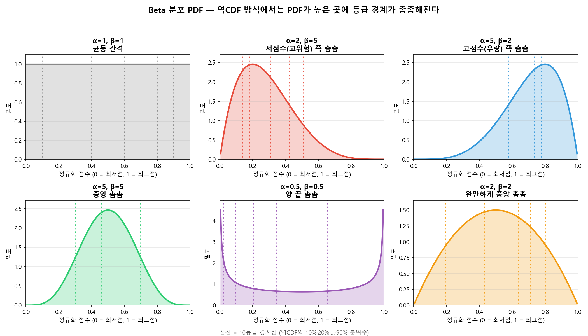
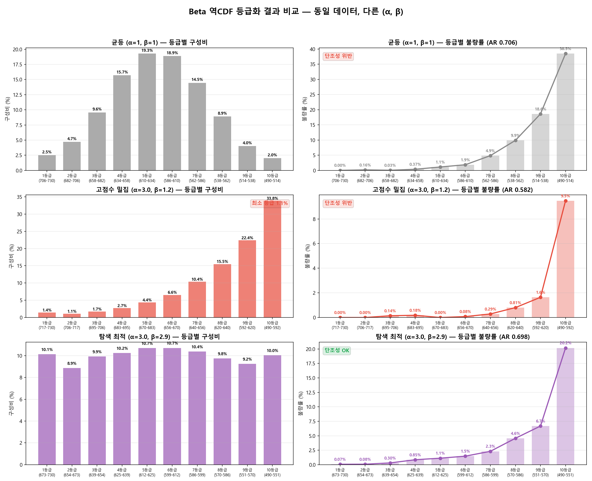

# 스코어카드 변환 & 등급화

## 1.1 스코어카드 변환: Anchor Score & PDO

WoE 로지스틱 회귀에서 최종 신용점수가 변수별 부분점수의 합으로 표현되는 이유는 로짓이 변수들의 **선형 결합**이기 때문이다.

### 왜 Good Odds로 전환하는가?

!!! danger "Odds 방향 전환: Bad Odds → Good Odds"
    Part 1~4는 **Bad Odds** \(p/(1-p)\)(\(p\) = 불량 확률)를 사용했다. 불량 확률이 높으면 Odds도 높아지므로 모형 적합과 이론 설명에 직관적이었다.

    스코어카드 단계에서는 **Good Odds** \((1-p)/p\)로 전환한다. 이유는 다음과 같다.

| 이유 | 설명 |
|------|------|
| **점수 방향의 직관성** | "점수가 높으면 우량" — 심사역·고객·경영진 모두 자연스럽게 이해 |
| **WoE 부호와의 일관성** | WoE 양수 = 우량 구간. Good Odds 기준에서는 WoE가 클수록 점수가 올라가 방향이 일치 |
| **실무 관행** | 국내 CB사(NICE·KCB)와 해외 주요 CB 모두 "높을수록 우량" 체계 |

두 Odds는 역수 관계이므로, 로그를 취하면 **부호만 반전**된다.

$$
\ln\!\left(\frac{1-p}{p}\right) = -\ln\!\left(\frac{p}{1-p}\right) = -\,\text{logit}_{\text{Bad}}
$$

!!! warning "계수는 다시 적합하지 않는다"
    Part 4에서 Bad logit으로 얻은 계수(WoE 변수의 β는 음수)를 **그대로** 쓴다. y=1=Good으로 모형을 다시 적합하는 것이 아니라, 위 식으로 부호만 뒤집는다.

    $$
    \ln(\text{Good Odds}) = -\beta_0 - \sum_{j=1}^{k} \beta_j \cdot \text{WoE}_{j}
    $$

    \(\beta_j < 0\)이고 우량 구간은 \(\text{WoE}_j > 0\)이므로 \(-\beta_j \cdot \text{WoE}_j > 0\) — 우량 구간이 **가점**이 된다.

### 수식의 원리

Good Odds가 높을수록 우량하므로, 점수와 Good Odds의 로그는 **정비례** 관계로 설계한다.

$$
\text{Score} = \text{Offset} + \text{Factor} \times \ln(\text{Good Odds})
$$

두 상수는 다음 두 조건으로 정한다.

!!! info "Anchor Score (기준점수)"
    특정 **기준 Good Odds \(\theta_0\)에 대응하는 목표 점수**로, 점수 체계의 기준점(닻)을 설정한다.

    **예:** "Good Odds 50:1(PD ≈ 1.96%)일 때 600점" → \(\theta_0 = 50\), Anchor = 600

    기준 Odds는 보통 포트폴리오의 평균 수준이나 정책상 의미 있는 수준(예: 승인 경계 근처)으로 잡는다. 기관마다 점수 체계 정책에 따라 다르다.

!!! info "PDO (Points to Double the Odds)"
    Good Odds가 **2배가 될 때** 점수가 몇 점 오르는지를 정하는 스케일 파라미터다.

    **예:** PDO = 20이면 Good Odds가 2배가 될 때마다 +20점. PDO가 클수록 같은 위험 차이가 더 넓은 점수 차이로 표현된다.

    Odds 2배는 불량 확률 절반과 **같지 않다**. Good Odds 1:1(PD 50%) → 2:1이면 PD는 33.3%가 된다. Good Odds 50:1(PD 1.96%) → 100:1이면 PD는 0.99%로, PD가 작을 때만 "Odds 2배 ≈ PD 절반"이 근사적으로 성립한다.

### 스케일링 상수 유도

**① PDO 정의에서 Factor 산출:** Good Odds = \(\theta_0\)일 때 Score = Anchor, \(2\theta_0\)일 때 Anchor + PDO

$$
\big(\text{Offset} + \text{Factor}\ln 2\theta_0\big) - \big(\text{Offset} + \text{Factor}\ln\theta_0\big) = \text{PDO}
\;\;\Rightarrow\;\; \boxed{\text{Factor} = \frac{\text{PDO}}{\ln 2}} \tag{1}
$$

**② Anchor 조건에서 Offset 산출:**

$$
\text{Anchor} = \text{Offset} + \text{Factor}\ln\theta_0 \;\;\Rightarrow\;\; \boxed{\text{Offset} = \text{Anchor} - \text{Factor} \times \ln\theta_0} \tag{2}
$$

**수치 예시** (이 페이지 전체에서 사용): PDO = 20, Anchor = 600, \(\theta_0\) = 50

$$
\text{Factor} = \frac{20}{\ln 2} = 28.854, \qquad \text{Offset} = 600 - 28.854 \times \ln 50 = 600 - 112.877 = 487.123
$$

!!! note "기준 Odds를 1:1로 잡으면"
    \(\theta_0 = 1\)이면 \(\ln 1 = 0\)이라 Offset = Anchor가 되어 계산은 단순해진다. 하지만 이때 Anchor 점수는 "PD 50%인 고객의 점수"라서, 대부분의 실무 포트폴리오에서는 점수 분포의 맨 아래쪽 바깥에 놓인다. 그래서 실무에서는 평균 위험 근처의 Odds(예: 20:1~100:1)를 기준으로 잡는 경우가 많다.

### 스코어카드의 실제 구조 — 고정 부분점수 테이블

스코어카드의 "부분점수"는 고객마다 매번 계산하는 값이 아니다. **각 변수의 구간(Bin)마다 미리 계산된 고정 정수값을 테이블로 만들어 두고, 고객의 구간을 찾아 해당 점수를 합산하는 구조**다.

점수식에 \(\ln(\text{Good Odds}) = -\beta_0 - \sum_j \beta_j \text{WoE}_j\)를 넣고, 절편 항을 \(k\)개 변수에 균등 배분하면 변수 \(j\)의 \(b\)번째 구간 부분점수는

$$
\text{PartScore}_{j,b} = -\,\text{Factor} \times \beta_j \times \text{WoE}_{j,b} \;-\; \frac{\text{Factor} \times \beta_0}{k} \tag{3}
$$

이고, 최종 점수는

$$
\text{Score}_i = \text{Offset} + \sum_{j=1}^{k} \text{PartScore}_{j,\, b(i,j)} \tag{4}
$$

다. \(b(i,j)\)는 고객 \(i\)가 변수 \(j\)에서 속하는 구간이다. \(\beta_j\)와 \(\beta_0\)는 [Part 4 최종 모형](../part4_modeling/multivariate-regression.md)의 Bad logit 계수(음수)다.

!!! example "스코어카드 테이블 예시 — 매출액 변수"
    **모형 설정 (Part 4 최종 5변수 모형, 가상 예시):** \(\beta_0 = -2.75\), \(\beta_{\text{매출액}} = -0.81\), Factor = 28.854, \(k = 5\)

    절편 배분: \(-\text{Factor} \times \beta_0 / k = -28.854 \times (-2.75) / 5 = +15.87\)

    | 매출액 구간 | WoE | \(-\text{Factor} \times \beta \times \text{WoE}\) | 절편 배분 | 부분점수(정수) |
    |------------|-----|---------|----------|---------------|
    | 500억 이상 | +1.20 | −28.854×(−0.81)×1.20 = +28.05 | +15.87 | **+44점** |
    | 100~500억 | +0.45 | −28.854×(−0.81)×0.45 = +10.52 | +15.87 | **+26점** |
    | 30~100억 | −0.10 | −28.854×(−0.81)×(−0.10) = −2.34 | +15.87 | **+14점** |
    | 30억 미만 | −0.95 | −28.854×(−0.81)×(−0.95) = −22.20 | +15.87 | **−6점** |

    WoE가 양수(우량)인 구간일수록 부분점수가 높고, 음수(불량)인 구간일수록 낮다. 매출액이 점수에 줄 수 있는 최대 차이는 44 − (−6) = 50점이다(= Factor × |β| × WoE 범위 = 28.854 × 0.81 × 2.15).

### 변수 합산 — 최종 점수 산출 과정

!!! example "5개 변수 Lookup Table (가상 예시)"

    | 변수 (β) | 구간 1 (우량) | 구간 2 | 구간 3 | 구간 4 (불량) |
    |------|-------|-------|-------|-------|
    | **매출액** (−0.81) | 500억 이상 **+44** | 100~500억 **+26** | 30~100억 **+14** | 30억 미만 **−6** |
    | **부채비율** (−0.70) | 100% 미만 **+33** | 100~150% **+22** | 150~250% **+11** | 250% 이상 **−2** |
    | **영업이익률** (−0.45) | 10% 이상 **+25** | 5~10% **+19** | 0~5% **+13** | 0% 미만 **+5** |
    | **연체건수** (−0.95) | 0건 **+31** | 1건 **−9** | 2건 **−28** | 3건 이상 **−47** |
    | **조회건수** (−0.40) | 0~1건 **+20** | 2~5건 **+16** | 6~9건 **+11** | 10건 이상 **+3** |

    구간별 WoE는 각각 (+1.20, +0.45, −0.10, −0.95), (+0.85, +0.30, −0.25, −0.90), (+0.70, +0.25, −0.20, −0.80), (+0.55, −0.90, −1.60, −2.30), (+0.40, +0.05, −0.45, −1.10)로 가정했다. 모든 변수가 WoE = 0인 고객의 점수는 487.12 + 5 × 15.87 = 566.5점(Good Odds = \(e^{2.75}\) = 15.6:1, PD ≈ 6.0%)이다.

!!! example "기업 A의 점수 산출"

    | 변수 | 기업 A의 값 | 해당 구간 | 부분점수 |
    |------|-----------|----------|---------|
    | 매출액 | 200억 | 100~500억 | **+26** |
    | 부채비율 | 180% | 150~250% | **+11** |
    | 영업이익률 | 6% | 5~10% | **+19** |
    | 연체건수 | 0건 | 0건 | **+31** |
    | 조회건수 | 3건 | 2~5건 | **+16** |
    | | | **Σ 부분점수** | **+103** |

    $$\text{Score}_A = 487.12 + 103 = 590.12 \;\rightarrow\; \textbf{590점}$$

    590점은 아래 Rating Master Table의 **6등급(580~599점)** 이다. 정수화하지 않은 부분점수로 계산하면 590.84점이고, 모형식으로 직접 구한 PD는 2.67%다.

**점수 산출 절차:**

1. 고객의 각 변수 값을 확인
2. 해당 구간을 찾아 부분점수를 조회 (테이블 lookup)
3. 모든 변수의 부분점수를 합산
4. Offset(487.12)을 더하고 반올림하여 최종 점수 산출

이 테이블은 모형 개발 시 **한 번만 계산**하고, 운영 시에는 고객 점수를 **단순 조회 + 합산**으로 처리한다. 로지스틱 회귀나 WoE 계산이 실시간으로 필요하지 않으므로 레거시 전산 시스템에서도 바로 구현할 수 있다는 것이 전통적 스코어카드의 핵심 장점이다.

!!! success "가산성(Additivity)"
    최종 신용점수 = Offset + 각 변수 부분점수의 합. 이 구조 덕분에 심사역이 "왜 이 고객의 점수가 낮은가"를 변수별로 분해해 설명할 수 있다. 기업 A라면 "연체 이력이 없어 +31점, 부채비율이 150~250% 구간이라 +11점"처럼 말할 수 있다.

### 점수의 해석

스코어카드 점수는 **고객 신용도의 순위 척도**이면서, 모형이 캘리브레이션되어 있다면 PD로 바로 환산되는 값이다. 다만 점수의 절대 수준은 Anchor·기준 Odds·PDO 설정에 따라 기관마다 다르므로, 다른 기관의 점수와 직접 비교하지 않는다. 실무에서는 등급별 실제 부도율 대응표(Rating Master Table)를 함께 관리한다.

### Score → Odds → PD 역산

점수 공식을 거꾸로 풀면 다음과 같다.

$$
\ln(\text{Good Odds}) = \frac{\text{Score} - \text{Offset}}{\text{Factor}}, \qquad \text{PD} = \frac{1}{1 + \text{Good Odds}}
$$

**표 A — 점수별 Good Odds·PD** (Offset = 487.12, Factor = 28.854)

| Score | \(\ln(\text{Good Odds})\) | Good Odds | PD |
|-------|--------------------------|-----------|-----------------|
| 700 | +7.378 | 1,600 : 1 | **0.06%** |
| 650 | +5.645 | 283 : 1 | **0.35%** |
| 620 | +4.605 | 100 : 1 | **0.99%** |
| 600 | +3.912 | 50 : 1 | **1.96%** |
| 580 | +3.219 | 25 : 1 | **3.85%** |
| 550 | +2.179 | 8.8 : 1 | **10.2%** |
| 500 | +0.446 | 1.6 : 1 | **39.0%** |

20점마다 Odds가 2배가 되는 것(580 → 600 → 620: 25 → 50 → 100)을 확인할 수 있다.

**표 B — 점수 구간별 PD 범위와 실무 의미** (같은 스케일)

| 점수 구간 | Good Odds | PD 범위 | 실무 의미 (예시) |
|--------------|--------------------|---------|---------|
| 680점 이상 | 800 : 1 이상 | 0.12% 이하 | 우량 거래처, 자동승인 대상 |
| 640~679점 | 200~800 : 1 | 0.12~0.50% | 일반 양호 거래처 |
| 600~639점 | 50~200 : 1 | 0.50~1.96% | 일반 심사 |
| 560~599점 | 12.5~50 : 1 | 1.96~7.41% | 주의, 추가 심사 검토 |
| 560점 미만 | 12.5 : 1 미만 | 7.41% 초과 | 고위험, 거절 또는 엄격한 조건부 승인 |

!!! note "점수 → PD 대응이 성립하는 조건"
    표 A·B는 모형이 **캘리브레이션되어 있을 때**(예측 PD ≈ 실제 부도율) 성립한다. 다운샘플링으로 개발했는데 절편을 보정하지 않았다면 모든 점수의 PD가 체계적으로 틀린다([절편 보정](../part4_modeling/multivariate-regression.md)). 또 개발 기간의 부도율과 장기 평균 부도율이 다를 수 있으므로, 규제·충당금 목적의 PD는 아래 1.2절의 캘리브레이션 절차를 거친 Rating Master Table 값을 쓴다.

!!! note "정수형 보정"
    로지스틱 회귀로 산출한 부분점수는 소수를 포함한다. 시스템 구현 시 반올림해 정수화한다(기업 A: 590.84 → 590). 반올림 오차는 보통 1~2점 이내이며, 필요하면 절편 배분분에 흡수시킨다. 정수 변환 후에도 등급별 Bad Rate 단조성이 유지되는지 재확인한다.

!!! note "하부모형을 결합할 때"
    기업 신용평가처럼 재무·비재무·대표자 하부모형을 따로 만들면, 척도가 다른 점수를 하나로 합쳐야 한다. 순위 기반 정규화 등으로 척도를 맞춘 뒤 가중 결합하는 것이 일반적이다. 다만 같은 정규화 점수가 하부모형마다 같은 부도율을 뜻하지는 않으므로, 변별력 차이는 결합 가중치로 반영한다. 결합할 하부모형은 Bad 정의, 관찰 시점, 성과 기간, 기불량 처리를 같게 맞춘다. 결합 가중치는 몇 가지 후보 조합의 변별력을 비교해 정하고, 정규화 기준 분포는 개발 표본이 아니라 실제로 등급을 매길 대상의 분포로 잡는다. 어떤 하부 점수가 산출되지 않으면 남은 가중치를 다시 맞추거나 중립값을 쓰는 방법 등을 검토하되, 정보가 없다는 사실을 최저 점수로 바꿔 넣지 않는다. 정보 부재 자체가 위험 신호라면 감점을 검토할 수 있지만, 데이터 연결 실패로 빠진 경우는 감점하지 않는다. 어느 방식이든 미산출 집단의 실제 부도율로 확인하고 운영 뒤에도 따로 모니터링한다.

!!! note "100점 배점 방식"
    국내 은행의 기업 하부모형에서는 Odds와 PDO 대신, 항목마다 가장 나쁜 구간을 0점으로 두고 항목별 최고 배점의 합이 100점이 되도록 나누는 배점도 쓴다. 이 경우 하부모형 점수를 정규화해 결합한 뒤 등급을 매긴다. 점수 척도만 다를 뿐, 구간 간 점수 차이가 β × WoE에 비례한다는 원리는 같다.

---

## 1.2 평점 등급화(Rating Grade) & PD 캘리브레이션

스코어카드 변환으로 연속형 점수가 산출되지만, 심사·한도·금리 정책을 적용하려면 **점수를 이산(Discrete) 등급으로 변환**해야 한다. 동시에 각 등급에 실제 부도율(PD)을 대응시키는 캘리브레이션을 수행해야 규제자본·충당금 산출(예: Basel IRB)에 활용할 수 있다.

### 등급 구간 설계 원칙

| 설계 방식 | 내용 | 장단점 |
|-----------|------|--------|
| **동일 인원 구간** (Equal-frequency) | 각 등급에 같은 수의 고객이 배치되도록 점수 경계 설정 | 등급별 표본 균일 / 점수 구간 폭이 등급마다 달라짐 |
| **동일 점수 구간** (Equal-width) | 점수 범위를 균등하게 분할 (예: 20점 간격) | 직관적 / 고객 분포가 몰리면 양 끝 등급 표본 극소 |
| **업무 기준 구간** (Business-driven) | 기존 심사 정책, 금리 단계, 한도 구분과 연계하여 경계 설정 | 현업 적용 용이 / 통계적 최적과 괴리 가능 |
| **PD 기반 구간** (PD-aligned) | 등급별 PD가 목표 범위(예: 등급마다 약 2배)에 들도록 설계 | 등급 간 PD 차별화 명확 / 설계 복잡도 높음 |

!!! note "등급 수"
    등급 수는 통상 10~15개다. Basel II 내부등급법은 기업·국가·은행 익스포저에 대해 **부도 전 차주 등급 최소 7개 + 부도 등급 1개 이상**을 요구한다(BCBS 128 문단 404). 소매 익스포저는 등급 대신 풀(pool) 단위로 관리하지만, 같은 원리로 충분히 세분된 구조가 필요하다. 등급 수가 너무 적으면 PD 차별화가 부족하고, 너무 많으면 등급별 표본이 적어 불안정해진다.

    
출처: <a href="https://www.bis.org/publications/200606-standards-basel-ii-international-convergence-capital-measurement-and-capital-standards-revised-framework.pdf" target="_blank">BCBS, Basel II Comprehensive Version (2006), 문단 404</a>

!!! tip "경계안은 점수 분포로 다시 점검한다"
    분위나 아래의 탐색 방법으로 얻은 경계안도 그대로 확정하지 않는다. 점수를 잘게 나눈 분포표와 구간별 불량률을 보고, 불량률이 거의 같거나 건수가 적은 인접 구간은 합친다. 내부등급법 적용 대상이라면 정리 후 등급 수가 위 최소 기준 이상인지도 확인한다.

### Beta 분포 기반 등급 경계 탐색

위 4가지 설계 방식은 모두 **분석가가 경계점을 직접 정해야** 한다는 한계가 있다. 등급이 10개면 경계점이 9개이고, 조합 공간은 방대하다. Beta 분포를 이용하면 경계점 배치를 **두 개의 파라미터**로 요약해 체계적으로 탐색할 수 있다. 이는 표준 문헌에 정형화된 방법이라기보다 실무에서 쓸 수 있는 탐색 기법의 하나로 소개한다.

#### 핵심 아이디어

정규화한 점수 범위 [0, 1] 위에 Beta 분포를 놓고, 그 **분위수(역누적분포함수, 역CDF)** 를 등급 경계로 쓴다. \(K\)개 등급이면 \(k\)번째 경계점은

$$
\text{Cutoff}_k = S_{\min} + (S_{\max} - S_{\min}) \times F_{\text{Beta}}^{-1}\!\left(\frac{k}{K};\ \alpha,\ \beta\right), \quad k = 1, \ldots, K-1 \tag{5}
$$

여기서 \(F_{\text{Beta}}^{-1}\)은 Beta 분포의 분위수 함수, \(S_{\min}, S_{\max}\)는 경계를 배치할 점수 범위다. 각 등급 구간에는 Beta 분포의 확률질량이 정확히 \(1/K\)씩 들어가므로, **Beta 분포의 밀도(PDF)가 높은 곳일수록 경계가 촘촘해진다.** (여기서 β는 Beta 분포의 모수로, 회귀계수 β와 다른 기호다.)

#### α, β에 따른 경계점 배치

| α, β 조합 | Beta PDF 모양 | 경계점 배치 | 적합한 상황 |
|-----------|-------------|----------------|------------|
| α = 1, β = 1 | 균등 | **균등 간격** — Equal-width와 동일 | 점수 분포가 고른 경우 |
| α > 1, β > 1 | 종형 | **중간 점수대 촘촘**, 양 끝은 넓게 | 고객이 중간 점수대에 몰린 일반적인 경우 |
| α < 1, β < 1 | U자형 | **양 끝 촘촘**, 중간은 넓게 | 최우량·최불량 구간을 정밀하게 나눠야 할 때 |
| α > β | 오른쪽(고점수)에 질량 | **고점수(우량) 쪽 촘촘** | 우량 고객 세분화가 필요할 때 |
| α < β | 왼쪽(저점수)에 질량 | **저점수(고위험) 쪽 촘촘** | 고위험 구간 세분화가 중요할 때 |

!!! tip "직관적 이해"
    "Beta 분포의 질량이 몰린 곳에 경계가 몰린다"만 기억하면 된다. α가 β보다 크면 질량이 1(고점수) 쪽으로, 작으면 0(저점수) 쪽으로 쏠린다. 둘 다 1보다 크면 가운데에, 둘 다 1보다 작으면 양 끝에 몰린다.

#### 탐색 절차

  1
  탐색 그리드 설정

\(\alpha, \beta\) 각각의 탐색 범위를 정한다. 예를 들어 \(\alpha, \beta \in [0.3,\ 5.0]\)을 0.1 간격으로 나누면 48 × 48 = 2,304개 조합이 된다. 등급 수 \(K\)도 함께 탐색할 수 있다.

  2
  각 (α, β) 조합별 등급 구간 생성

식 (5)로 \(K-1\)개의 경계점을 산출하고, 개발 데이터의 각 고객을 등급에 배정한다.

  3
  평가 지표 산출

| 평가 기준 | 지표 | 기준 |
|-----------|------|------|
| **변별력** | 등급 기준 AR (또는 KS) | 높을수록 좋음 — 등급이 Good/Bad를 잘 분리하는가 |
| **안정성** | 등급 구성비 PSI (개발 vs 검증) | 낮을수록 좋음 — 등급 분포가 시점 간 안정적인가 |
| **서열화** | 등급별 Bad Rate 단조성 | **필수** — 등급이 나빠질수록 Bad Rate가 반드시 증가 |
| **집중도** | 등급별 인원 비율 | 극단적 쏠림 없이 적정 분포 (예: 최소 등급 ≥ 2%) |

!!! warning "단조성은 Hard Constraint"
    변별력·안정성·집중도는 최적화 대상(목적함수)이지만, Bad Rate 단조성은 **위반 시 해당 조합을 즉시 제외**하는 필수 제약이다. 단조성이 깨진 등급 체계는 AR이 아무리 높아도 쓸 수 없다.

  4
  최적 (α, β) 선택

제약을 만족하는 조합 중에서 변별력·안정성·집중도를 종합해 \((\alpha^*, \beta^*)\)를 고른다. 가중합으로 단일 평가값을 만들 수 있다.

$$
J(\alpha, \beta) = w_1 \times \text{AR} + w_2 \times (1 - \text{PSI}) + w_3 \times \text{균등도} \tag{6}
$$

균등도는 예를 들어 \(1 - \tfrac{1}{2}\sum_k \lvert s_k - 1/K \rvert\)(\(s_k\) = 등급 \(k\)의 인원 비율, 완전 균등이면 1)로 정의한다. 가중치 \(w_1, w_2, w_3\)는 기관의 정책 우선순위에 따라 정한다.

  5
  검증 및 확정

선정된 등급 구조를 OOT(Out-of-Time) 검증 데이터에 적용하여 같은 지표를 다시 확인한다. 개발-검증 간 괴리가 크면 과적합 가능성을 점검하고 차선 조합을 검토한다.

#### 탐색 결과 예시

가상 데이터(개발 40,000건·불량률 3.7%, 검증 20,000건·불량률 4.7%)에서 점수 범위 490~730점, 10등급으로 탐색했다. 점수는 이 페이지의 스케일(600점 @ 50:1, PDO 20)로 캘리브레이션된 모형을 가정했고, 가중치는 \(w = (0.4, 0.3, 0.3)\), 집중도 제약은 "최소 등급 ≥ 2%"로 두었다. 2,304개 조합 중 단조성·집중도 제약을 통과한 조합은 610개였다.

| 시나리오 | 결과 | 판정 |
|----------|------|------|
| **균등 (α=1, β=1)** | 등급별 인원 2.0%~19.3%로 양 끝 등급이 얇다. 2등급(0.16%) > 3등급(0.03%)으로 **단조성 위반** — 얇은 등급의 불량률이 표본 변동에 흔들린 결과 | **부적합** |
| **고점수 밀집 (α=3.0, β=1.2)** | 우량 쪽을 촘촘히 나눠 1~5등급이 각 1~4%에 불과하고, 10등급에 33.8%가 몰린다. 우량 등급 간 **단조성 위반**, AR 0.582로 하락 | **부적합** — 우량 등급 세분화 과도 |
| **탐색 최적 (α=3.0, β=2.9)** | 등급별 인원 8.9%~10.7%로 고르고, 불량률 0.07% → 20.2%로 단조 증가. AR 0.698, 등급 PSI 0.012 | **적합** |

최적 조합이 α ≈ β > 1(중간 점수대 촘촘)로 나온 것은 고객이 중간 점수대에 몰려 있기 때문이다. 결과적으로 동일 인원 구간과 비슷한 구조가 되었다.

#### 왜 Beta 분포인가?

| 특성 | 설명 |
|------|------|
| **[0, 1] 정의역** | 점수를 [0, 1]로 정규화하면 분위수가 바로 경계점 위치가 됨 |
| **2개 파라미터로 다양한 형태** | 균등·좌편향·우편향·U자·종형 등 다양한 밀도 형태 표현 |
| **연속적 탐색** | α, β를 연속적으로 조절해 경계점을 매끄럽게 이동 |
| **해석 용이** | α, β 값만으로 경계점이 어디에 촘촘한지 바로 알 수 있음 |

!!! note "Equal-frequency와의 관계"
    동일 인원 구간은 **점수의 경험적 분위수**를 경계로 쓰는 방식이다. 식 (5)는 같은 일을 **모수적 분포(Beta)의 분위수**로 한다. 실제 점수 분포를 Beta 분포로 근사하면 동일 인원 구간이 되고, α·β를 조절하면 특정 구간을 일부러 더 촘촘하게(또는 넓게) 만들 수 있다. 동일 인원 구간이 데이터에 완전히 종속되는 반면, 이 방식은 파라미터로 데이터 의존도를 조절한다.

### 등급별 단조성(Monotonicity) 검증

등급이 나빠질수록(점수가 낮을수록) Bad Rate가 반드시 증가해야 한다. 역전 구간이 생기면 모형의 변별력에 문제가 있거나 등급 경계 설계가 잘못된 것이다.

!!! warning "단조성 위반 처리"
    ① 역전 구간의 등급을 인접 등급과 합병 → ② 재분할 후 재확인 → ③ 그래도 해결되지 않으면 Binning 재검토 또는 모형 재개발 검토. 단조성 위반은 내부 검증과 감독 검토에서 주요 지적 사항이다.

### PD 캘리브레이션 절차

  1
  개발 표본 기반 등급별 실측 부도율 산출

등급별 불량자 수 / 해당 등급 전체 대상자 수 = 실측 부도율(Observed Default Rate). 다운샘플링 모형이라면 절편 보정 후 산출한다. 등급 PD의 기준 집단은 성과 기간이 끝난 계량화 대상(실제로 등급을 매길 모집단에 가까운 표본)으로 잡고, 개발 표본의 수치와 구분해 보고한다.

  2
  OOT(Out-of-Time) 표본 검증

개발 기간 밖의 데이터에서 등급별 부도율을 재산출하여 개발 표본과 비교한다. 괴리가 크면 과적합 또는 환경 변화를 의심한다([OOT 검증](oot-validation.md)).

  3
  장기평균 PD 조정

개발 기간의 경기 국면 영향을 줄이고, 경기 순환 전반의 **장기 평균 부도율**에 맞춘다. 장기 평균 구간은 연수만이 아니라 경기 순환을 한 번 이상 담는지도 함께 본다. Basel II는 PD 추정에 쓰는 과거 관측 기간을 기업 익스포저는 적어도 한 원천에서 **최소 5년**, 소매 익스포저도 **최소 5년** 요구한다(BCBS 128 문단 463, 466). 데이터가 짧으면 외부 벤치마크(CB 데이터, 공개 부도율 통계 등)로 보완한다. 아래 예시는 장기평균/개발기간 부도율 비율을 1.10으로 가정했다.

  4
  보수적 가산 (MoC, Margin of Conservatism)

데이터 한계(관측 기간 짧음, 표본 부족, 추정 불확실성 등)를 감안해 PD를 보수적으로 올린다. Basel 기준은 추정 오차의 범위를 반영한 보수적 조정과 그 근거의 문서화를 요구한다. 아래 예시는 장기평균 PD의 15%를 가산한다고 가정했다.

  5
  최종 Rating Master Table 완성

등급, 점수범위, 최종 PD(장기평균 + MoC), 개발 표본 실측 부도율, OOT 실측 부도율, 표본 수, 불량 수를 포함한 종합 테이블을 작성한다.

---

### Rating Master Table 예시

이 페이지의 스케일(600점 @ 50:1, PDO 20)에 맞춰 등급을 20점 간격으로 나눈 예시다. 20점 = PDO이므로 등급이 하나 나빠질 때마다 PD가 약 2배가 된다. 불량 수는 캘리브레이션된 모형을 가정해 계산했다.

| 등급 | 점수 범위 | 표본 수 | 불량 수 | 실측 Bad Rate | 장기평균 PD (×1.10) | MoC (+15%) | 최종 PD |
|------|----------|--------|--------|-------------|--------|---------|---------|
| **1** | 680 이상 | 2,850 | 3 | 0.105% | 0.116% | 0.017% | **0.133%** |
| **2** | 660~679 | 3,120 | 6 | 0.192% | 0.212% | 0.032% | **0.243%** |
| **3** | 640~659 | 4,210 | 15 | 0.356% | 0.392% | 0.059% | **0.451%** |
| **4** | 620~639 | 5,480 | 39 | 0.712% | 0.783% | 0.117% | **0.900%** |
| **5** | 600~619 | 6,320 | 90 | 1.424% | 1.566% | 0.235% | **1.801%** |
| **6** | 580~599 | 5,910 | 166 | 2.809% | 3.090% | 0.463% | **3.553%** |
| **7** | 560~579 | 4,650 | 253 | 5.441% | 5.985% | 0.898% | **6.883%** |
| **8** | 540~559 | 3,280 | 338 | 10.305% | 11.335% | 1.700% | **13.036%** |
| **9** | 520~539 | 2,140 | 399 | 18.645% | 20.509% | 3.076% | **23.586%** |
| **10** | 520 미만 | 1,520 | 476 | 31.316% | 34.447% | 5.167% | **39.614%** |

1등급처럼 불량 수가 한 자릿수인 등급은 실측 부도율이 크게 흔들리므로, 실무에서는 인접 등급을 묶어 추정하거나 모형 PD·외부 벤치마크로 보완한다.

!!! example "실무 참고 — 국내 개인신용평점 체계"
    국내 개인신용평가는 2021년 1월 1일부터 신용등급(1~10등급) 대신 **신용점수(1~1,000점)** 만 산정하는 점수제로 전면 전환되었다. 점수가 높을수록 우량하다. 금융회사는 CB 신용평점을 그대로 쓰거나 자체 등급 체계에 매핑해 쓴다.

    
출처: <a href="https://www.fsc.go.kr/no010101/75101" target="_blank">금융위원회 보도자료 (2020.12.28) — 개인신용평가 점수제 전면 시행</a>

### 등급 상한과 Override — 산출 뒤 조정

모형 산출 뒤의 등급 조정은 실행 주체로 나눈다. 정해진 조건에 걸리면 자동으로 적용하는 **등급 상한**(룰)과 심사역이 판단으로 바꾸는 **Override**(사람)는 따로 기록하고 성과도 따로 추적한다. 등급은 결합 등급, 등급 상한을 적용한 시스템 등급, Override, 최종 등급 순으로 정하고 단계마다 남긴다. 등급 상한은 하부모형 점수가 아니라 결합 뒤 등급에 한 번만 건다. 하부 점수에 걸면 가중치에 희석되고 이중 적용이 된다.

정량 모형 평점이 모든 신용 판단을 반영하지는 못한다. 심사역은 정량 평점을 기준으로 정성적 요소를 반영해 등급을 상하향 조정(Notching)할 수 있다.

| 구분 | 내용 | 관리 원칙 |
|------|------|-----------|
| **Override 상향** | 모형 평점보다 우수하다고 판단하여 등급 상향 | 허용 폭(몇 등급까지)과 승인 권한을 사전에 정하고 사유를 문서화 |
| **Override 하향** | 모형 평점보다 위험하다고 판단하여 등급 하향 | 부정적 정성 정보를 근거로 명기 |
| **등급 상한** (Grade Cap) | 연체 진행 중, 채무불이행 등록, 법적 절차 진행 중처럼 부실 상태나 그 경험에 해당 시 모형 평점과 무관하게 받을 수 있는 최고 등급을 제한 | 항목별로 상한 등급을 정하고, 여러 항목에 걸리면 가장 낮은 상한을 적용. 내부 심사 정책으로 설정 |
| **Override Rate 관리** | 전체 심사 건 중 Override 비율과 Override 건의 사후 성과 추적 | 기관별 허용 수준을 정하고, 지속적으로 높으면 모형 문제 신호로 본다 |

!!! warning "Basel IRB Override 요건"
    Basel II는 전문가 판단으로 모형 결과를 뒤집을 수 있는 상황을 명확히 정하고, **Override를 식별해 그 성과를 별도로 추적**하도록 요구한다(BCBS 128 문단 428). Override 비율이 지속적으로 높거나 Override 건의 성과가 모형보다 나쁘면, 모형 재보정(Recalibration) 또는 재개발 필요성을 검토한다.

    
출처: <a href="https://www.bis.org/publications/200606-standards-basel-ii-international-convergence-capital-measurement-and-capital-standards-revised-framework.pdf" target="_blank">BCBS, Basel II Comprehensive Version (2006), 문단 428</a>

!!! tip "등급 상한 후보와 Override 효과 점검"
    - **등급 상한 후보:** 후보는 두 갈래다. 하나는 Bad 정의 수준이라 표본에서 뺀 정보, 다른 하나는 표본에 남았지만 발생 빈도가 낮아 모형 변수로 뽑히지 않은 고위험 정보다. 둘 다 부실 상태나 그 경험으로 한정하고, 보유 자체가 부실이 아닌 거래 행태나 속성은 근거로 쓰지 않는다. 모형은 자주 나타나는 패턴을, 룰은 드물고 위험한 신호를 맡는 분업이다. 채택할 때는 걸리는 비율, 걸린 차주의 불량률이 전체의 몇 배인지, 걸린 건수와 그중 불량 건수를 함께 보고, 여러 시점에서 위험이 유지되는지 확인한다. Rating Master Table을 확정한 뒤, 걸린 차주의 부도율을 등급별 부도율과 비교해 항목마다 상한 등급을 정하고, 정보 자체가 없는 차주의 부도율도 함께 본다. 일괄 "한 단계 하향"은 상위 등급에 부실 차주가 남을 수 있어 항목별 상한보다 약하다.
    - **모형에 이미 쓴 정보:** 같은 정보가 모형에도 들어가 있으면 상한을 관대하게 두어 바닥 역할만 하게 하고, 결합 등급을 낸 뒤 상위 등급에 부실 차주가 남는지 보고 채택 여부를 정한다([모형과 룰에 같은 신호를 쓸 때](../part1_overview/output-and-usage.md)).
    - **Override 효과:** 비율 하나로 판단하지 않는다. 상향 대상의 부도율이 전체보다 높거나 하향 대상의 부도율이 전체보다 낮으면 조정이 거꾸로 작동하고 있다는 신호다.

### 등급별 여신 정책 연계

Rating Master Table이 완성되면 각 등급에 여신 정책(승인 기준, 한도, 금리 가산)을 연계한다. 아래 PD 범위는 위 예시 테이블의 최종 PD 기준이다.

| 등급 | 최종 PD | 여신 승인 정책 예시 | 금리 가산 예시 |
|------|---------|-------------------|--------------|
| 1~3등급 | 0.5% 미만 | 자동승인 또는 간이심사 | 기준금리 + 0.5~1.0%p |
| 4~6등급 | 0.5~4% | 일반심사, 조건부 승인 검토 | 기준금리 + 1.0~2.5%p |
| 7~8등급 | 4~15% | 심층심사, 담보·보증 요건 강화 | 기준금리 + 2.5~4.0%p |
| 9~10등급 | 15% 이상 | 원칙적 거절, 예외승인 시 위원회 심의 | 적용 불가 또는 별도 협의 |
